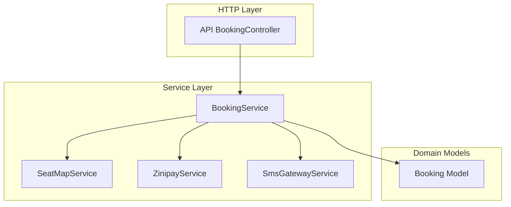
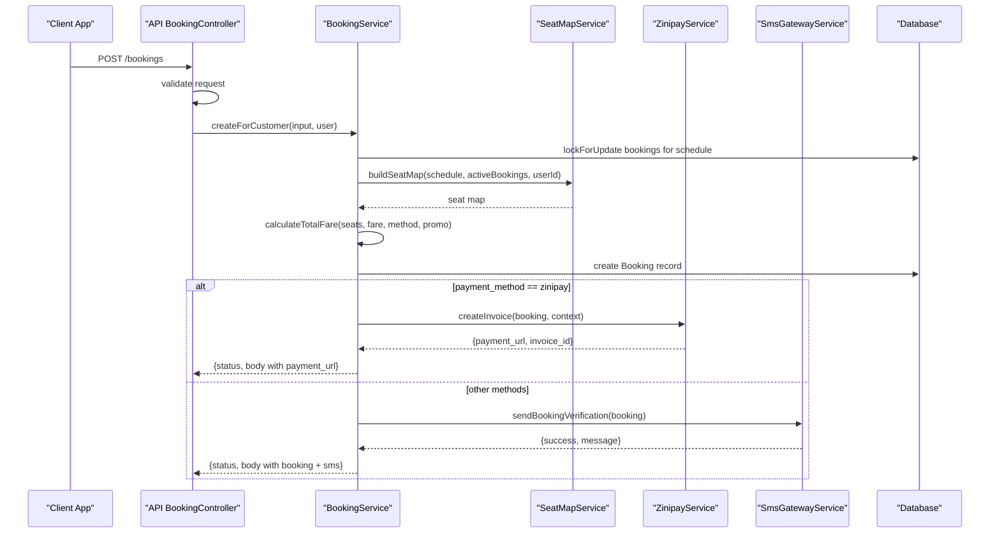
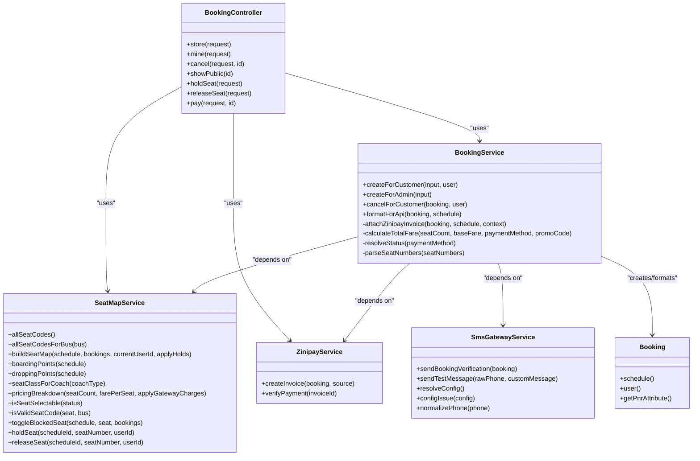

# Service Layer

<cite>
**Referenced Files in This Document**
- [BookingService.php](file://backend/app/Services/BookingService.php)
- [SeatMapService.php](file://backend/app/Services/SeatMapService.php)
- [ZinipayService.php](file://backend/app/Services/ZinipayService.php)
- [SmsGatewayService.php](file://backend/app/Services/SmsGatewayService.php)
- [BookingController.php](file://backend/app/Http/Controllers/API/BookingController.php)
- [Booking.php](file://backend/app/Models/Booking.php)
</cite>

## Table of Contents
1. [Introduction](#introduction)
2. [Project Structure](#project-structure)
3. [Core Components](#core-components)
4. [Architecture Overview](#architecture-overview)
5. [Detailed Component Analysis](#detailed-component-analysis)
6. [Dependency Analysis](#dependency-analysis)
7. [Performance Considerations](#performance-considerations)
8. [Troubleshooting Guide](#troubleshooting-guide)
9. [Conclusion](#conclusion)

## Introduction
This document explains the Laravel service layer architecture for the bus booking application. The service classes encapsulate business logic that is reused by controllers and models, including:

- **BookingService**: reservation lifecycle, seat validation, pricing, payment integration, and SMS notifications.
- **SeatMapService**: seat code generation, seat availability calculation, hold/release behavior, boarding/dropping points, and pricing breakdown.
- **ZinipayService**: external payment invoice creation and verification through ZiniPay.
- **SmsGatewayService**: multi-provider SMS delivery with configuration resolution, phone normalization, message templating, and driver dispatch.

The goal is to keep controllers thin, isolate domain rules in services, and provide clear extension points for custom business logic.

## Project Structure
The relevant backend structure for this documentation is:

**Diagram sources**
- [BookingController.php:10-17](file://backend/app/Http/Controllers/API/BookingController.php#L10-L17)
- [BookingService.php:14-21](file://backend/app/Services/BookingService.php#L14-L21)
- [SeatMapService.php:9-10](file://backend/app/Services/SeatMapService.php#L9-L10)
- [ZinipayService.php:9-18](file://backend/app/Services/ZinipayService.php#L9-L18)
- [SmsGatewayService.php:11-12](file://backend/app/Services/SmsGatewayService.php#L11-L12)
- [Booking.php:8-10](file://backend/app/Models/Booking.php#L8-L10)

**Section sources**
- [BookingController.php:10-17](file://backend/app/Http/Controllers/API/BookingController.php#L10-L17)
- [BookingService.php:14-21](file://backend/app/Services/BookingService.php#L14-L21)

## Core Components
The service layer consists of four primary services:

| Service | Responsibility | Key Integration Points |
|---|---|---|
| `BookingService` | Customer/admin booking creation, cancellation, fare calculation, payment invoice attachment, SMS notification | Uses `SeatMapService`, `ZinipayService`, `SmsGatewayService`, `Booking` model |
| `SeatMapService` | Seat code generation, seat map building, availability checks, holds, boarding/dropping points, pricing breakdown | Reads schedule/bus data, uses cache for temporary holds |
| `ZinipayService` | Creates payment invoices and verifies payment status via HTTP API | Uses Laravel HTTP client and logging |
| `SmsGatewayService` | Resolves active SMS config, validates phone numbers, builds messages, sends via multiple drivers | Uses Laravel HTTP client, logging, and database schema checks |

**Section sources**
- [BookingService.php:14-21](file://backend/app/Services/BookingService.php#L14-L21)
- [SeatMapService.php:9-10](file://backend/app/Services/SeatMapService.php#L9-L10)
- [ZinipayService.php:9-18](file://backend/app/Services/ZinipayService.php#L9-L18)
- [SmsGatewayService.php:11-12](file://backend/app/Services/SmsGatewayService.php#L11-L12)

## Architecture Overview
The booking flow demonstrates how controllers delegate business logic to services, which coordinate models and external integrations.

**Diagram sources**
- [BookingController.php:19-40](file://backend/app/Http/Controllers/API/BookingController.php#L19-L40)
- [BookingService.php:28-130](file://backend/app/Services/BookingService.php#L28-L130)
- [SeatMapService.php:194-244](file://backend/app/Services/SeatMapService.php#L194-L244)
- [ZinipayService.php:27-97](file://backend/app/Services/ZinipayService.php#L27-L97)
- [SmsGatewayService.php:16-48](file://backend/app/Services/SmsGatewayService.php#L16-L48)

## Detailed Component Analysis

### BookingService
`BookingService` centralizes reservation management. It supports customer-facing and admin-facing booking flows, enforces authorization, validates seats, calculates fares, integrates payments, and triggers SMS notifications.

#### Public Methods and Contracts

| Method | Parameters | Return Value | Behavior Summary |
|---|---|---|---|
| `createForCustomer(array $input, User $user)` | `$input`: validated booking payload; `$user`: authenticated user | `array{status: int, body: array}` | Validates payment method, parses and limits seats, locks schedule bookings, builds seat map, validates availability, calculates total fare, creates booking, cleans holds, optionally attaches ZiniPay invoice, sends SMS, returns structured response. |
| `createForAdmin(array $input)` | `$input`: admin booking payload | `array{booking: Booking, payment_url: ?string, sms: array}` | Loads schedule, parses seats, computes pricing, sets status (cash defaults to sold unless explicitly reserved), creates booking, optionally creates ZiniPay invoice, sends SMS only when confirmed. |
| `cancelForCustomer(Booking $booking, User $user)` | `$booking`: target booking; `$user`: requesting user | `array{status: int, body: array}` | Enforces ownership, handles PENDING cancel, already cancelled, or cancel-requested states, updates status accordingly. |
| `formatForApi(Booking $booking, ?Schedule $schedule = null)` | `$booking`; optional `$schedule` | `array` | Eager loads related schedule/bus/route/stations and returns a normalized API representation. |

#### Internal Helpers

| Method | Purpose |
|---|---|
| `attachZinipayInvoice(Booking $booking, Schedule $schedule, string $context)` | Creates payment invoice, stores invoice ID, returns structured result or throws exception on failure. |
| `calculateTotalFare(int $seatCount, float $baseFare, string $paymentMethod, ?string $promoCode)` | Computes seat fare, service/gateway charges/discounts, applies promotion discount if present. |
| `resolveStatus(string $paymentMethod)` | Maps payment method to initial booking status (`PENDING` for ZiniPay, otherwise `SOLD`). |
| `parseSeatNumbers(string $seatNumbers)` | Parses comma-separated seat codes into a trimmed list. |

#### Error Handling Patterns
- Validation failures return HTTP-like status codes inside the response body rather than throwing exceptions.
- Authorization errors return `403`.
- Seat availability errors return `422`.
- Unexpected exceptions are caught and returned as `500` responses.
- External payment invoice creation failure throws an exception after attempting to attach the invoice.

#### Usage Examples

- **Customer booking with ZiniPay**:
  - Call `createForCustomer` with `payment_method` set to `zinipay`.
  - If invoice creation succeeds, response includes `payment_url` and `invoice_id`.
  - If invoice creation fails, an exception is thrown.

- **Customer booking with cash**:
  - Call `createForCustomer` with `payment_method` set to `cash`.
  - Booking is created immediately and SMS is sent if configured.

- **Admin booking**:
  - Call `createForAdmin` with explicit status or rely on default logic.
  - For non-cash payments, a ZiniPay invoice may be created and stored.

**Section sources**
- [BookingService.php:28-130](file://backend/app/Services/BookingService.php#L28-L130)
- [BookingService.php:138-193](file://backend/app/Services/BookingService.php#L138-L193)
- [BookingService.php:200-240](file://backend/app/Services/BookingService.php#L200-L240)
- [BookingService.php:242-281](file://backend/app/Services/BookingService.php#L242-L281)
- [BookingService.php:283-333](file://backend/app/Services/BookingService.php#L283-L333)

### SeatMapService
`SeatMapService` implements the core seat allocation algorithms and provides utilities for seat maps, availability, holds, boarding/dropping points, and pricing.

#### Key Responsibilities
- Generate all valid seat codes based on bus layout or configuration.
- Build a seat map reflecting available, blocked, sold, booked, and held seats.
- Manage temporary seat holds using cache.
- Provide boarding and dropping point formatting.
- Compute pricing breakdowns including service and gateway charges/discounts.
- Validate seat codes and toggle blocked seats.

#### Important Methods

| Method | Parameters | Return Value | Notes |
|---|---|---|---|
| `allSeatCodes()` | none | `list<string>` | Default seat codes from configuration. |
| `allSeatCodesForBus(?Bus $bus)` | optional bus | `list<string>` | Supports custom grid, sleeper layouts, and standard layouts. |
| `buildSeatMap(Schedule $schedule, iterable $bookings, ?int $currentUserId = null, bool $applyHolds = true)` | schedule, bookings, optional user id, holds flag | `array<string, string>` | Maps seat code to status key such as `available`, `blocked`, `sold_M`, `sold_F`, `booked_M`, `booked_F`. |
| `boardingPoints(Schedule $schedule)` | schedule | `array` | Returns formatted boarding points with reporting/departure times. |
| `droppingPoints(Schedule $schedule)` | schedule | `array` | Returns formatted dropping points with arrival time. |
| `seatClassForCoach(?string $coachType)` | coach type | `string` | Derives seat class, defaulting from configuration. |
| `pricingBreakdown(int $seatCount, float $farePerSeat, bool $applyGatewayCharges = true)` | seat count, base fare, gateway flag | `array` | Returns detailed pricing components and total. |
| `isSeatSelectable(string $status)` | status | `bool` | Only `available` is selectable. |
| `isValidSeatCode(string $seat, ?Bus $bus = null)` | seat, optional bus | `bool` | Validates against generated or custom seat codes. |
| `toggleBlockedSeat(Schedule $schedule, string $seat, iterable $bookings)` | schedule, seat, bookings | `array` | Adds/removes blocked seat; throws `InvalidArgumentException` for invalid inputs. |
| `holdSeat(int $scheduleId, string $seatNumber, int $userId)` | schedule id, seat number, user id | `array` | Creates temporary hold with expiration; returns success or error message. |
| `releaseSeat(int $scheduleId, string $seatNumber, int $userId)` | schedule id, seat number, user id | `array` | Releases hold for matching user. |

#### Data Structures and Complexity
- Seat map construction iterates over all seat codes once and then applies blocked seats, holds, and bookings. Time complexity is approximately O(S + B + H), where S is seat count, B is active bookings, and H is cache holds.
- Pricing breakdown is O(1).
- Hold/release operations use cache reads/writes and are O(H) due to filtering expired holds.

#### Error Handling Patterns
- Invalid seat code input throws `InvalidArgumentException`.
- Blocking non-available seats throws `InvalidArgumentException`.
- Seat hold/release returns structured results indicating success or descriptive messages.

#### Usage Examples

- **Building a seat map for display**:
  - Load active bookings for the schedule.
  - Call `buildSeatMap` with current user ID to exclude their own holds.
  - Use `isSeatSelectable` to determine UI interactivity.

- **Reserving a seat temporarily**:
  - Call `holdSeat` before checkout.
  - Use returned `expires_at` to inform the frontend.
  - On cancellation, call `releaseSeat`.

- **Calculating price**:
  - Call `pricingBreakdown` with seat count and base fare.
  - Optionally disable gateway charges for cash-only scenarios.

**Section sources**
- [SeatMapService.php:16-47](file://backend/app/Services/SeatMapService.php#L16-L47)
- [SeatMapService.php:49-189](file://backend/app/Services/SeatMapService.php#L49-L189)
- [SeatMapService.php:194-244](file://backend/app/Services/SeatMapService.php#L194-L244)
- [SeatMapService.php:246-332](file://backend/app/Services/SeatMapService.php#L246-L332)
- [SeatMapService.php:334-365](file://backend/app/Services/SeatMapService.php#L334-L365)
- [SeatMapService.php:367-395](file://backend/app/Services/SeatMapService.php#L367-L395)
- [SeatMapService.php:400-431](file://backend/app/Services/SeatMapService.php#L400-L431)
- [SeatMapService.php:433-500](file://backend/app/Services/SeatMapService.php#L433-L500)
- [SeatMapService.php:502-591](file://backend/app/Services/SeatMapService.php#L502-L591)

### ZinipayService
`ZinipayService` handles integration with the ZiniPay payment provider. It creates invoices and verifies payment status.

#### Public Methods and Contracts

| Method | Parameters | Return Value | Behavior Summary |
|---|---|---|---|
| `createInvoice(Booking $booking, string $source = 'frontend')` | `$booking`, `$source` | `?array` | Builds redirect/cancel/webhook URLs, calls ZiniPay API, logs errors, returns `{payment_url, invoice_id}` or `null`. |
| `verifyPayment(string $invoiceId)` | `$invoiceId` | `?string` | Calls verification endpoint, returns status string or `null` on failure. |

#### Configuration and Environment Handling
- Reads API key and base URL from configuration.
- Rewrites hostnames to `127.0.0.1` in local/testing environments to bypass sandbox domain restrictions.
- Uses Laravel HTTP client with timeouts and JSON headers.

#### Error Handling Patterns
- Missing API key logs an error and returns `null`.
- Non-successful HTTP responses log status and body.
- Exceptions during HTTP calls are logged and converted to `null`.

#### Usage Examples

- **Creating an invoice for a pending booking**:
  - Call `createInvoice` with source `frontend` or `admin`.
  - Store returned `invoice_id` on the booking.
  - Redirect user to `payment_url`.

- **Verifying payment status**:
  - Call `verifyPayment` with the stored invoice ID.
  - Update booking status based on returned status.

**Section sources**
- [ZinipayService.php:14-18](file://backend/app/Services/ZinipayService.php#L14-L18)
- [ZinipayService.php:27-97](file://backend/app/Services/ZinipayService.php#L27-L97)
- [ZinipayService.php:105-139](file://backend/app/Services/ZinipayService.php#L105-L139)

### SmsGatewayService
`SmsGatewayService` abstracts SMS delivery across multiple providers. It resolves configuration, validates phone numbers, builds messages, and dispatches requests.

#### Public Methods and Contracts

| Method | Parameters | Return Value | Behavior Summary |
|---|---|---|---|
| `sendBookingVerification(Booking $booking)` | `$booking` | `array{success: bool, message: string}` | Resolves config, validates phone, builds message, sends SMS, logs outcomes. |
| `sendTestMessage(string $rawPhone, ?string $customMessage = null)` | `$rawPhone`, optional `$customMessage` | `array{success: bool, message: string}` | Sends a test SMS using configured gateway. |
| `resolveConfig()` | none | `?SmsConfig` | Returns latest active SMS config or `null`. |
| `configIssue(SmsConfig $config)` | `$config` | `?string` | Returns missing configuration reason or `null`. |
| `normalizePhone(string $phone)` | `$phone` | `?string` | Normalizes to international format or returns `null`. |

#### Driver Dispatch
Internal driver selection supports:
- `bulksmsbd`
- `smsnetbd`
- `get_query`
- Custom form-based driver

Each driver uses Laravel HTTP client with appropriate form/query parameters and timeouts.

#### Error Handling Patterns
- Missing/inactive config returns failure with descriptive message.
- Invalid phone numbers return failure with validation message.
- Gateway HTTP failures log status and body, returning user-friendly error messages.
- Network exceptions are caught and logged.

#### Usage Examples

- **Sending confirmation SMS**:
  - Call `sendBookingVerification` after booking confirmation.
  - Inspect `success` and `message` to decide next steps.

- **Testing SMS configuration**:
  - Call `sendTestMessage` with a valid Bangladesh mobile number.
  - Use returned message to diagnose configuration issues.

**Section sources**
- [SmsGatewayService.php:16-48](file://backend/app/Services/SmsGatewayService.php#L16-L48)
- [SmsGatewayService.php:53-73](file://backend/app/Services/SmsGatewayService.php#L53-L73)
- [SmsGatewayService.php:75-107](file://backend/app/Services/SmsGatewayService.php#L75-L107)
- [SmsGatewayService.php:109-150](file://backend/app/Services/SmsGatewayService.php#L109-L150)
- [SmsGatewayService.php:156-202](file://backend/app/Services/SmsGatewayService.php#L156-L202)
- [SmsGatewayService.php:204-253](file://backend/app/Services/SmsGatewayService.php#L204-L253)

### Integration with Controllers and Models

#### Controller Integration
`BookingController` delegates business logic to services:

- `store`: validates input, calls `BookingService::createForCustomer`, returns structured JSON.
- `mine`: paginates user bookings and formats them using `BookingService::formatForApi`.
- `cancel`: calls `BookingService::cancelForCustomer`.
- `showPublic`: returns public booking details using `BookingService::formatForApi`.
- `holdSeat`/`releaseSeat`: directly use `SeatMapService` for temporary seat holds.
- `pay`: initiates ZiniPay payment via `ZinipayService` and updates booking invoice ID.

**Section sources**
- [BookingController.php:19-40](file://backend/app/Http/Controllers/API/BookingController.php#L19-L40)
- [BookingController.php:42-60](file://backend/app/Http/Controllers/API/BookingController.php#L42-L60)
- [BookingController.php:62-73](file://backend/app/Http/Controllers/API/BookingController.php#L62-L73)
- [BookingController.php:75-80](file://backend/app/Http/Controllers/API/BookingController.php#L75-L80)
- [BookingController.php:82-116](file://backend/app/Http/Controllers/API/BookingController.php#L82-L116)
- [BookingController.php:118-148](file://backend/app/Http/Controllers/API/BookingController.php#L118-L148)

#### Model Integration
`Booking` model defines fillable attributes, casts, relationships, and a computed PNR attribute used throughout services and APIs.

**Section sources**
- [Booking.php:12-31](file://backend/app/Models/Booking.php#L12-L31)
- [Booking.php:33-47](file://backend/app/Models/Booking.php#L33-L47)

## Dependency Analysis
The service layer exhibits clear separation of concerns:

**Diagram sources**
- [BookingController.php:10-17](file://backend/app/Http/Controllers/API/BookingController.php#L10-L17)
- [BookingService.php:14-21](file://backend/app/Services/BookingService.php#L14-L21)
- [SeatMapService.php:9-10](file://backend/app/Services/SeatMapService.php#L9-L10)
- [ZinipayService.php:9-18](file://backend/app/Services/ZinipayService.php#L9-L18)
- [SmsGatewayService.php:11-12](file://backend/app/Services/SmsGatewayService.php#L11-L12)
- [Booking.php:8-10](file://backend/app/Models/Booking.php#L8-L10)

**Section sources**
- [BookingController.php:10-17](file://backend/app/Http/Controllers/API/BookingController.php#L10-L17)
- [BookingService.php:14-21](file://backend/app/Services/BookingService.php#L14-L21)

## Performance Considerations
- **Database locking**: Customer booking creation uses `lockForUpdate` on active bookings to prevent race conditions during concurrent seat selection.
- **Selective column loading**: Seat map queries select only necessary columns to reduce payload size.
- **Cache-based holds**: Temporary seat holds are stored in cache with expiration, reducing database contention during checkout.
- **Eager loading**: API formatting methods load related entities efficiently to avoid N+1 queries.
- **External API timeouts**: Both ZiniPay and SMS gateways use HTTP timeouts to prevent long-running requests.

[No sources needed since this section provides general guidance]

## Troubleshooting Guide

### Common Issues and Diagnostics

| Symptom | Likely Cause | Diagnostic Steps | Resolution |
|---|---|---|---|
| Booking creation fails with seat unavailable | Seat already booked or held | Check seat map status and cache holds | Ensure seat is selected from available options; release stale holds if needed |
| ZiniPay invoice creation returns null | Missing API key or API error | Review logs for API key configuration and HTTP status/body | Configure `services.zinipay.api_key`; verify network access and sandbox settings |
| SMS not sent | Inactive SMS config or invalid phone | Check `resolveConfig` and `normalizePhone` results | Activate SMS config, ensure required fields are present, validate phone number |
| Admin booking does not trigger SMS | Booking status not confirmed | Verify final booking status before sending SMS | Send SMS only for confirmed statuses (`PAID`, `SOLD`, `BOOKED`) |

**Section sources**
- [BookingService.php:128-130](file://backend/app/Services/BookingService.php#L128-L130)
- [ZinipayService.php:29-32](file://backend/app/Services/ZinipayService.php#L29-L32)
- [ZinipayService.php:81-96](file://backend/app/Services/ZinipayService.php#L81-L96)
- [SmsGatewayService.php:18-48](file://backend/app/Services/SmsGatewayService.php#L18-L48)
- [SmsGatewayService.php:75-107](file://backend/app/Services/SmsGatewayService.php#L75-L107)

## Conclusion
The service layer cleanly separates business logic from HTTP concerns, providing reusable and testable components for booking management, seat allocation, payment processing, and SMS notifications. Controllers remain thin, while services encapsulate complex workflows, error handling, and integration patterns. This design supports extensibility through additional drivers, custom pricing rules, and alternative payment providers without modifying controller code.

[No sources needed since this section summarizes without analyzing specific files]