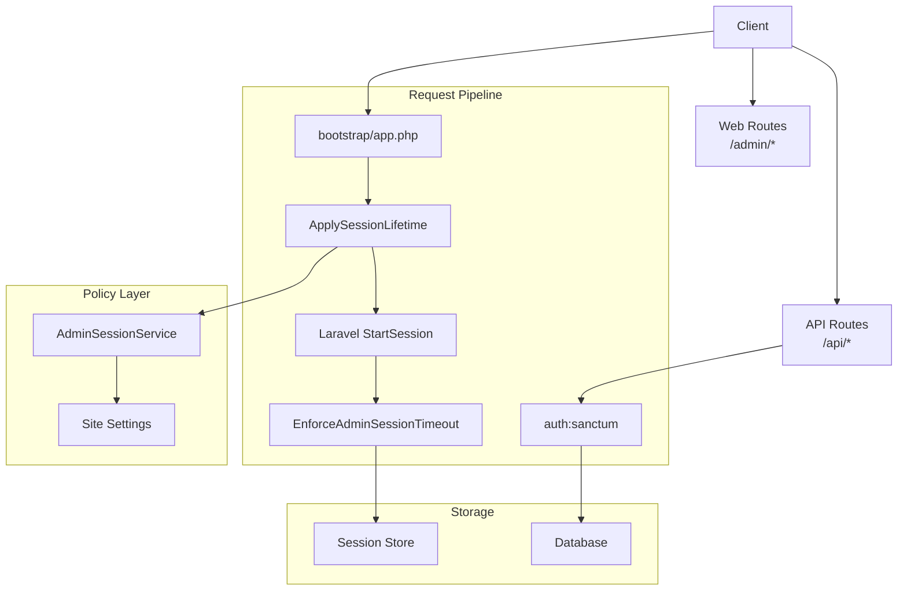
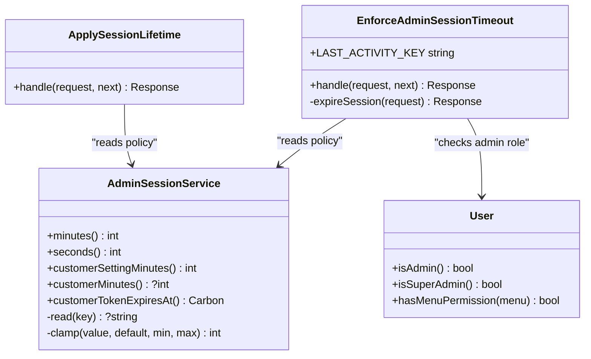
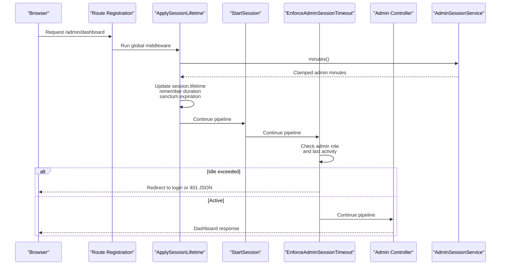
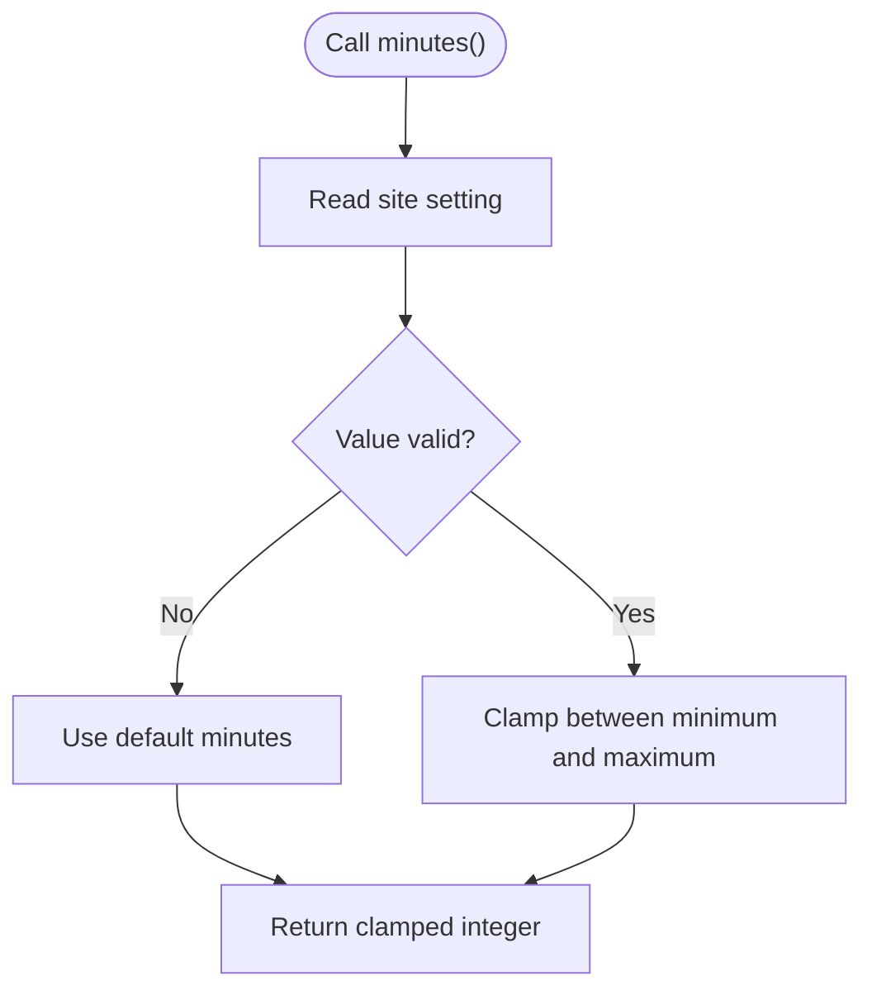
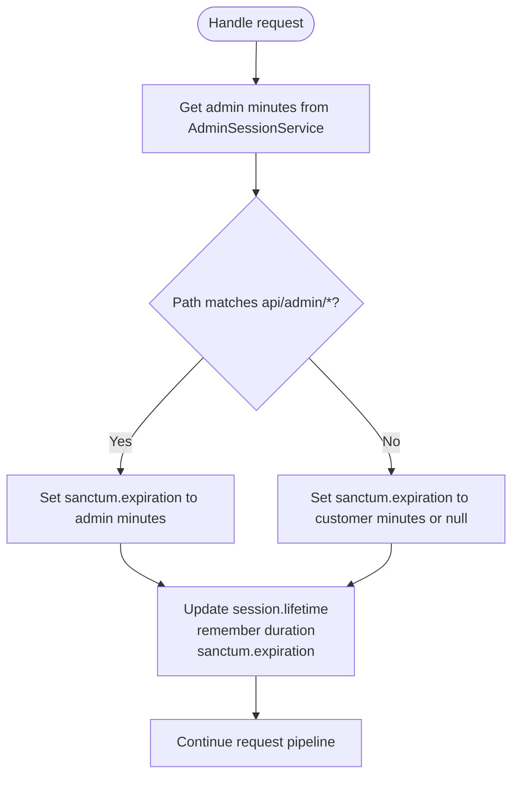
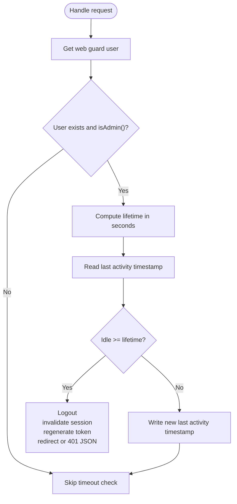
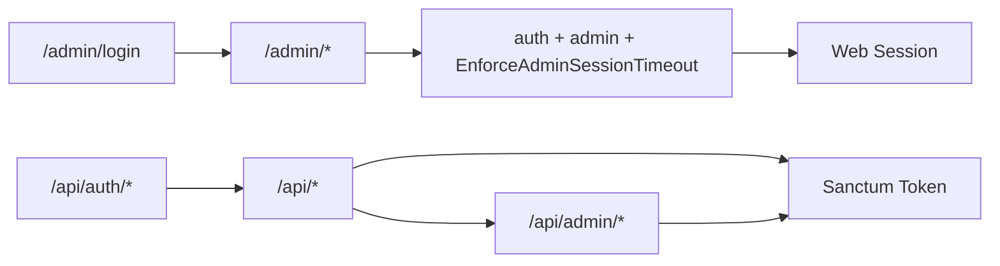
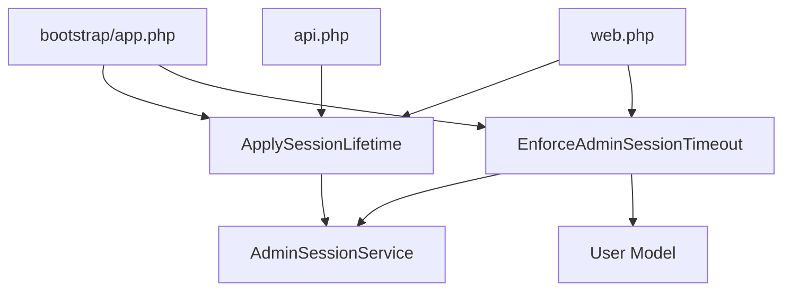

# Session Management

<cite>
**Referenced Files in This Document**   
- [ApplySessionLifetime.php](file://backend/app/Http/Middleware/ApplySessionLifetime.php)
- [EnforceAdminSessionTimeout.php](file://backend/app/Http/Middleware/EnforceAdminSessionTimeout.php)
- [AdminSessionService.php](file://backend/app/Services/AdminSessionService.php)
- [User.php](file://backend/app/Models/User.php)
- [app.php](file://backend/bootstrap/app.php)
- [web.php](file://backend/routes/web.php)
- [api.php](file://backend/routes/api.php)
- [session.php](file://backend/config/session.php)
- [auth.php](file://backend/config/auth.php)
- [sanctum.php](file://backend/config/sanctum.php)
- [AdminSessionTimeoutTest.php](file://backend/tests/Feature/AdminSessionTimeoutTest.php)
</cite>

## Table of Contents
1. [Introduction](#introduction)
2. [Project Structure](#project-structure)
3. [Core Components](#core-components)
4. [Architecture Overview](#architecture-overview)
5. [Detailed Component Analysis](#detailed-component-analysis)
6. [Dependency Analysis](#dependency-analysis)
7. [Performance Considerations](#performance-considerations)
8. [Troubleshooting Guide](#troubleshooting-guide)
9. [Conclusion](#conclusion)

## Introduction
This document explains how session and token lifetimes are managed in the bus application. The system supports two distinct authentication flows:

- **Blade admin panel**: Uses Laravel’s web session guard. Idle sessions are enforced precisely, even on low-traffic installations.
- **API clients**: Use Laravel Sanctum tokens. Customer tokens and admin API tokens can have different lifetimes based on site settings.

The lifetime policy is configurable through the admin panel’s Site Settings → Session Security area. A dedicated service reads and validates those settings, while middleware applies them early in the request lifecycle.

## Project Structure
The session management logic is concentrated in a small set of backend files:

| Area | Responsibility |
|---|---|
| Middleware | Apply configured lifetimes before session or token handling; enforce idle timeout for admins |
| Service | Read, validate, clamp, and convert site settings into minutes or expiration timestamps |
| Models | Identify admin users so only their sessions are subject to idle enforcement |
| Routes | Define where session-based admin routes and Sanctum-protected API routes live |
| Configuration | Provide default session, auth, and Sanctum behavior |
| Tests | Verify that the configured idle timeout is applied consistently |

**Diagram sources**
- [app.php:19-28](file://backend/bootstrap/app.php#L19-L28)
- [ApplySessionLifetime.php:27-46](file://backend/app/Http/Middleware/ApplySessionLifetime.php#L27-L46)
- [EnforceAdminSessionTimeout.php:27-47](file://backend/app/Http/Middleware/EnforceAdminSessionTimeout.php#L27-L47)
- [AdminSessionService.php:41-91](file://backend/app/Services/AdminSessionService.php#L41-L91)

**Section sources**
- [app.php:19-37](file://backend/bootstrap/app.php#L19-L37)
- [web.php:68-306](file://backend/routes/web.php#L68-L306)
- [api.php:39-264](file://backend/routes/api.php#L39-L264)

## Core Components
The session management system has three primary responsibilities:

1. **Resolve lifetime policy from site settings.**  
   `AdminSessionService` reads the configured values, applies defaults, enforces safe ranges, and converts minutes into seconds or expiration timestamps.

2. **Apply policy before authentication.**  
   `ApplySessionLifetime` runs globally and updates framework configuration for session lifetime, remember-me duration, and Sanctum token expiration.

3. **Enforce exact idle timeout for admin sessions.**  
   `EnforceAdminSessionTimeout` tracks the last admin activity timestamp and signs out an admin when the configured idle window has elapsed.

**Diagram sources**
- [AdminSessionService.php:16-120](file://backend/app/Services/AdminSessionService.php#L16-L120)
- [ApplySessionLifetime.php:21-47](file://backend/app/Http/Middleware/ApplySessionLifetime.php#L21-L47)
- [EnforceAdminSessionTimeout.php:18-74](file://backend/app/Http/Middleware/EnforceAdminSessionTimeout.php#L18-L74)
- [User.php:55-85](file://backend/app/Models/User.php#L55-L85)

**Section sources**
- [AdminSessionService.php:16-120](file://backend/app/Services/AdminSessionService.php#L16-L120)
- [ApplySessionLifetime.php:10-47](file://backend/app/Http/Middleware/ApplySessionLifetime.php#L10-L47)
- [EnforceAdminSessionTimeout.php:11-74](file://backend/app/Http/Middleware/EnforceAdminSessionTimeout.php#L11-L74)
- [User.php:55-85](file://backend/app/Models/User.php#L55-L85)

## Architecture Overview
The architecture separates policy resolution from request handling:

- Policy is stored as site settings and resolved by `AdminSessionService`.
- Global middleware updates framework configuration before session or token handling.
- Web requests receive precise idle enforcement through a dedicated middleware.
- API requests use Sanctum tokens whose expiration is also driven by the same policy layer.

**Diagram sources**
- [app.php:23-28](file://backend/bootstrap/app.php#L23-L28)
- [ApplySessionLifetime.php:27-46](file://backend/app/Http/Middleware/ApplySessionLifetime.php#L27-L46)
- [EnforceAdminSessionTimeout.php:27-47](file://backend/app/Http/Middleware/EnforceAdminSessionTimeout.php#L27-L47)
- [AdminSessionService.php:41-57](file://backend/app/Services/AdminSessionService.php#L41-L57)

## Detailed Component Analysis

### AdminSessionService
`AdminSessionService` is the single source of truth for session and token lifetimes. It:

- Reads raw values from site settings.
- Falls back to safe defaults when settings are missing or invalid.
- Clamps values into supported ranges to prevent lockouts or excessively long lifetimes.
- Exposes both minute-based and second-based APIs.
- Converts zero-minute customer token settings into “never expire” semantics.

Key behaviors:

| Method | Purpose | Important Behavior |
|---|---|---|
| `minutes()` | Returns admin panel idle timeout in minutes | Clamped between 1 minute and 7 days |
| `seconds()` | Returns admin idle timeout in seconds | Derived from `minutes()` |
| `customerSettingMinutes()` | Returns raw customer token setting | Allows 0 (never expire) up to 30 days |
| `customerMinutes()` | Returns effective customer token lifetime | Returns null when never expire |
| `customerTokenExpiresAt()` | Computes absolute expiration time | Returns null when never expire |

**Diagram sources**
- [AdminSessionService.php:41-49](file://backend/app/Services/AdminSessionService.php#L41-L49)
- [AdminSessionService.php:97-119](file://backend/app/Services/AdminSessionService.php#L97-L119)

**Section sources**
- [AdminSessionService.php:16-120](file://backend/app/Services/AdminSessionService.php#L16-L120)

### ApplySessionLifetime Middleware
`ApplySessionLifetime` ensures that the configured policy reaches Laravel’s configuration before the session store or Sanctum guard is built. It updates:

- `session.lifetime`: Controls the Blade admin session lifetime.
- `auth.guards.web.remember`: Ensures the remember-me cookie does not outlive the configured idle policy.
- `sanctum.expiration`: Applies the admin idle timeout for `/api/admin/*`, and the customer token lifetime for other API routes.

**Diagram sources**
- [ApplySessionLifetime.php:27-46](file://backend/app/Http/Middleware/ApplySessionLifetime.php#L27-L46)

**Section sources**
- [ApplySessionLifetime.php:10-47](file://backend/app/Http/Middleware/ApplySessionLifetime.php#L10-L47)

### EnforceAdminSessionTimeout Middleware
`EnforceAdminSessionTimeout` provides deterministic idle enforcement for admin sessions. Laravel’s default session expiry only garbage-collects stale storage, which can make timeouts unpredictable under low traffic. This middleware makes the cut-off exact.

Behavior summary:

- Only applies to authenticated admin users.
- Stores the last activity timestamp in the session under a dedicated key.
- Compares current time with the stored timestamp against the configured lifetime.
- Signs out the user, invalidates the session, regenerates the CSRF token, and redirects or returns a JSON 401.

**Diagram sources**
- [EnforceAdminSessionTimeout.php:27-74](file://backend/app/Http/Middleware/EnforceAdminSessionTimeout.php#L27-L74)
- [User.php:55-58](file://backend/app/Models/User.php#L55-L58)

**Section sources**
- [EnforceAdminSessionTimeout.php:11-74](file://backend/app/Http/Middleware/EnforceAdminSessionTimeout.php#L11-L74)
- [User.php:55-58](file://backend/app/Models/User.php#L55-L58)

### Route Integration
Session-related routes are split between web and API groups:

| Route Group | Authentication | Session Behavior |
|---|---|---|
| `/admin/login`, `/admin/logout` | Web session | Triggers admin login/logout flow |
| `/admin/*` dashboard routes | Web session + admin middleware | Subject to idle timeout enforcement |
| `/api/auth/*` | Sanctum guest routes | Customer registration and password recovery |
| `/api/*` authenticated routes | Sanctum token | Customer token lifetime controlled by policy |
| `/api/admin/*` | Sanctum token + admin API middleware | Admin API token lifetime follows admin idle policy |

**Diagram sources**
- [web.php:68-80](file://backend/routes/web.php#L68-L80)
- [api.php:54-88](file://backend/routes/api.php#L54-L88)
- [api.php:99-264](file://backend/routes/api.php#L99-L264)

**Section sources**
- [web.php:68-306](file://backend/routes/web.php#L68-L306)
- [api.php:39-264](file://backend/routes/api.php#L39-L264)

### Configuration Defaults
The configuration files provide baseline behavior:

| File | Relevant Setting | Meaning |
|---|---|---|
| `config/session.php` | `driver`, `lifetime`, `cookie`, `secure`, `same_site` | Defines session storage, default lifetime, and cookie security |
| `config/auth.php` | `guards.web.driver = session` | Admin panel uses session-based authentication |
| `config/sanctum.php` | `expiration = null` | Default Sanctum expiration is overridden at runtime by `ApplySessionLifetime` |

Important notes:

- The default session lifetime is 120 minutes unless overridden by the middleware.
- Sanctum’s default expiration is null, but the middleware sets it per request based on route type and site settings.
- Remember-me cookies are explicitly aligned with the admin idle policy to avoid silent re-authentication after idle timeout.

**Section sources**
- [session.php:21-40](file://backend/config/session.php#L21-L40)
- [auth.php:40-45](file://backend/config/auth.php#L40-L45)
- [sanctum.php:47-53](file://backend/config/sanctum.php#L47-L53)

## Dependency Analysis
The components have clear directional dependencies:

- `ApplySessionLifetime` depends on `AdminSessionService`.
- `EnforceAdminSessionTimeout` depends on `AdminSessionService` and the web guard’s `User` model.
- Both middleware are registered centrally in `bootstrap/app.php`.
- Routes define where each authentication mechanism applies.

**Diagram sources**
- [app.php:23-28](file://backend/bootstrap/app.php#L23-L28)
- [ApplySessionLifetime.php:23-29](file://backend/app/Http/Middleware/ApplySessionLifetime.php#L23-L29)
- [EnforceAdminSessionTimeout.php:23-35](file://backend/app/Http/Middleware/EnforceAdminSessionTimeout.php#L23-L35)
- [web.php:68-80](file://backend/routes/web.php#L68-L80)
- [api.php:99-104](file://backend/routes/api.php#L99-L104)

**Section sources**
- [app.php:19-37](file://backend/bootstrap/app.php#L19-L37)
- [ApplySessionLifetime.php:23-46](file://backend/app/Http/Middleware/ApplySessionLifetime.php#L23-L46)
- [EnforceAdminSessionTimeout.php:23-47](file://backend/app/Http/Middleware/EnforceAdminSessionTimeout.php#L23-L47)

## Performance Considerations
- **Minimal overhead:** The policy service reads site settings once per request and caches results implicitly through normal Laravel configuration resolution.
- **Exact timeout without heavy polling:** Idle enforcement happens per request rather than through background jobs or timers.
- **Safe defaults protect availability:** Clamping prevents extremely short or extremely long lifetimes that could cause lockouts or security concerns.
- **Session driver choice matters:** The default session driver is database-backed; high-traffic deployments may benefit from cache-backed drivers such as Redis.

[No sources needed since this section provides general guidance]

## Troubleshooting Guide

### Admin Panel Logs Out Too Quickly
Check the following:

1. Confirm the configured admin session lifetime in Site Settings.
2. Verify that `AdminSessionService::DEFAULT_MINUTES` is being used when the setting is missing.
3. Ensure `ApplySessionLifetime` is running before `StartSession`.
4. Confirm that the remember-me cookie duration is not longer than the configured idle timeout.

**Section sources**
- [AdminSessionService.php:24-32](file://backend/app/Services/AdminSessionService.php#L24-L32)
- [ApplySessionLifetime.php:35-44](file://backend/app/Http/Middleware/ApplySessionLifetime.php#L35-L44)
- [app.php:23-28](file://backend/bootstrap/app.php#L23-L28)

### Admin Session Does Not Expire After Idle Time
Check the following:

1. Confirm the user is recognized as an admin via `User::isAdmin()`.
2. Verify that `EnforceAdminSessionTimeout` is attached to the web middleware group.
3. Check that the session contains the last activity timestamp.
4. Confirm the configured lifetime is not set to an unusually large value.

**Section sources**
- [EnforceAdminSessionTimeout.php:32-47](file://backend/app/Http/Middleware/EnforceAdminSessionTimeout.php#L32-L47)
- [User.php:55-58](file://backend/app/Models/User.php#L55-L58)
- [app.php:27-28](file://backend/bootstrap/app.php#L27-L28)

### Customer API Tokens Expire Unexpectedly
Check the following:

1. Confirm whether the route is under `/api/admin/*`; admin API tokens follow the admin idle timeout.
2. For customer tokens, verify the configured customer session lifetime.
3. Remember that a value of zero means tokens never expire.
4. Inspect `sanctum.expiration` during the request because it is set dynamically.

**Section sources**
- [ApplySessionLifetime.php:31-44](file://backend/app/Http/Middleware/ApplySessionLifetime.php#L31-L44)
- [AdminSessionService.php:62-91](file://backend/app/Services/AdminSessionService.php#L62-L91)
- [api.php:99-104](file://backend/routes/api.php#L99-L104)

### Tests Can Help Validate Behavior
The feature test covers:

- Persistence and validation of the session lifetime setting.
- Propagation to session lifetime and remember-me duration.
- Exact idle logout for admin sessions.
- Separation of customer API token scope.

**Section sources**
- [AdminSessionTimeoutTest.php:13-21](file://backend/tests/Feature/AdminSessionTimeoutTest.php#L13-L21)

## Conclusion
The session management implementation cleanly separates policy, application, and enforcement:

- `AdminSessionService` centralizes lifetime policy and protects against unsafe values.
- `ApplySessionLifetime` applies policy early, ensuring consistent behavior across session and token authentication.
- `EnforceAdminSessionTimeout` guarantees deterministic idle logout for admin sessions.
- Routes clearly separate web session usage from Sanctum token usage.
- Configuration defaults provide safe baselines while allowing runtime customization.

This design makes session behavior predictable, configurable, and auditable, while keeping performance overhead minimal and security boundaries explicit.