# Supporting Services

<cite>
**Referenced Files in This Document**   
- [GatewaySettingsService.php](file://backend/app/Services/GatewaySettingsService.php)
- [LicenseService.php](file://backend/app/Services/LicenseService.php)
- [SiteSettingsService.php](file://backend/app/Services/SiteSettingsService.php)
- [EnvFileWriter.php](file://backend/app/Services/EnvFileWriter.php)
- [ExcelExportService.php](file://backend/app/Services/ExcelExportService.php)
- [ReportDataService.php](file://backend/app/Services/ReportDataService.php)
- [ReportFilterService.php](file://backend/app/Services/ReportFilterService.php)
- [RouteService.php](file://backend/app/Services/RouteService.php)
- [CoachServicesService.php](file://backend/app/Services/CoachServicesService.php)
</cite>

## Table of Contents
1. [Introduction](#introduction)
2. [Project Structure](#project-structure)
3. [Core Components](#core-components)
4. [Architecture Overview](#architecture-overview)
5. [Detailed Component Analysis](#detailed-component-analysis)
6. [Dependency Analysis](#dependency-analysis)
7. [Performance Considerations](#performance-considerations)
8. [Troubleshooting Guide](#troubleshooting-guide)
9. [Conclusion](#conclusion)

## Introduction
This document explains the supporting service classes that power configuration, licensing, runtime site settings, environment file management, reporting, route operations, and bus fleet search in the application. Each service is designed to encapsulate a focused domain:

- **GatewaySettingsService**: Manages SMS, email, and payment gateway configuration.
- **LicenseService**: Verifies Envato purchase codes, enforces domain limits, and persists license state.
- **SiteSettingsService**: Reads and updates public-facing site configuration such as branding, SEO, and maintenance mode.
- **EnvFileWriter**: Safely writes key-value pairs into the `.env` file.
- **ExcelExportService**: Exports tabular data to an Excel-compatible spreadsheet via streamed XML.
- **ReportDataService**: Builds query builders, row formatters, headers, summaries, and aggregations for multiple reports.
- **ReportFilterService**: Validates report filters and resolves date ranges and labels.
- **RouteService**: Validates and checks routes for boarding/dropping points and duplicate detection.
- **CoachServicesService**: Searches schedules, formats seat maps, and manages blocked seats for bus fleet operations.

These services are typically called from controllers, API endpoints, admin panels, or background jobs. They interact with models, configuration, cache, HTTP clients, mail, and external gateways.

## Project Structure
The services live under `backend/app/Services`. They follow a clear separation of concerns:

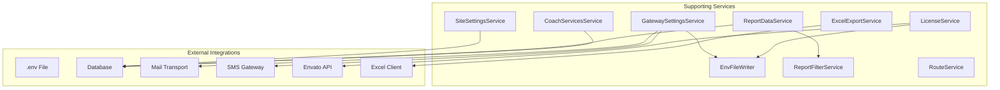

**Diagram sources**
- [GatewaySettingsService.php:18-22](file://backend/app/Services/GatewaySettingsService.php#L18-L22)
- [LicenseService.php:42-42](file://backend/app/Services/LicenseService.php#L42-L42)
- [ReportDataService.php:13-15](file://backend/app/Services/ReportDataService.php#L13-L15)
- [CoachServicesService.php:12-14](file://backend/app/Services/CoachServicesService.php#L12-L14)

**Section sources**
- [GatewaySettingsService.php:1-155](file://backend/app/Services/GatewaySettingsService.php#L1-L155)
- [LicenseService.php:1-408](file://backend/app/Services/LicenseService.php#L1-L408)
- [SiteSettingsService.php:1-182](file://backend/app/Services/SiteSettingsService.php#L1-L182)
- [EnvFileWriter.php:1-55](file://backend/app/Services/EnvFileWriter.php#L1-L55)
- [ExcelExportService.php:1-67](file://backend/app/Services/ExcelExportService.php#L1-L67)
- [ReportDataService.php:1-774](file://backend/app/Services/ReportDataService.php#L1-L774)
- [ReportFilterService.php:1-85](file://backend/app/Services/ReportFilterService.php#L1-L85)
- [RouteService.php:1-102](file://backend/app/Services/RouteService.php#L1-L102)
- [CoachServicesService.php:1-190](file://backend/app/Services/CoachServicesService.php#L1-L190)

## Core Components
This section summarizes each service’s purpose, main methods, configuration inputs, and integration points.

### GatewaySettingsService
- Purpose: Update SMS, mail, and Zinipay payment gateway settings; send test messages.
- Key behaviors:
  - Updates SMS configuration in database and `.env`.
  - Updates mail configuration in site settings and `.env`.
  - Updates Zinipay payment gateway keys and base URL.
  - Sends test SMS through SMS gateway service.
  - Sends test email using system mail transport.
- Configuration options:
  - SMS: gateway name, driver, API URL, API key, sender ID, message template, active flag.
  - Mail: mailer, host, port, username, password, encryption, from address/name.
  - Zinipay: API key and base URL.
- Integration points:
  - Uses `EnvFileWriter` to persist environment variables.
  - Uses `SmsGatewayService` for SMS delivery.
  - Uses Laravel Mail facade for email testing.
  - Persists mail and payment settings through site settings model.

**Section sources**
- [GatewaySettingsService.php:24-57](file://backend/app/Services/GatewaySettingsService.php#L24-L57)
- [GatewaySettingsService.php:59-95](file://backend/app/Services/GatewaySettingsService.php#L59-L95)
- [GatewaySettingsService.php:97-113](file://backend/app/Services/GatewaySettingsService.php#L97-L113)
- [GatewaySettingsService.php:115-148](file://backend/app/Services/GatewaySettingsService.php#L115-L148)

### LicenseService
- Purpose: Verify Envato purchase codes, enforce domain activation limits, and manage license state.
- Key behaviors:
  - Validates UUID format.
  - Supports local bypass when configured.
  - Supports seller bypass code without calling Envato API.
  - Calls Envato API with fallback endpoint on authentication errors.
  - Enforces product ownership by item ID.
  - Limits unique domains per purchase code (maximum five).
  - Persists verified license and sets `.env` license flag.
  - Caches activation status.
- Configuration options:
  - Envato personal token and item ID.
  - Local bypass flag for development.
  - Seller bypass code constant.
- Integration points:
  - Uses `EnvFileWriter` to write `APP_LICENSED`.
  - Uses HTTP client to call Envato APIs.
  - Uses cache and license model for activation state.

**Section sources**
- [LicenseService.php:56-158](file://backend/app/Services/LicenseService.php#L56-L158)
- [LicenseService.php:164-226](file://backend/app/Services/LicenseService.php#L164-L226)
- [LicenseService.php:237-361](file://backend/app/Services/LicenseService.php#L237-L361)
- [LicenseService.php:363-406](file://backend/app/Services/LicenseService.php#L363-L406)

### SiteSettingsService
- Purpose: Manage public site configuration including branding, footer links, maintenance mode, and SEO metadata.
- Key behaviors:
  - Converts stored settings into a public API array.
  - Validates and updates site settings from requests.
  - Uploads favicon and logo files safely with MIME-based extension mapping.
  - Deletes existing logo files when clearing logo setting.
- Configuration options:
  - Site title, logo text, company name, copyright.
  - Footer links JSON.
  - Maintenance mode and message.
  - SEO meta description, keywords, Open Graph fields, analytics ID.
- Integration points:
  - Uses site settings model for persistence and caching.
  - Writes uploaded assets to public uploads directory.

**Section sources**
- [SiteSettingsService.php:14-49](file://backend/app/Services/SiteSettingsService.php#L14-L49)
- [SiteSettingsService.php:51-84](file://backend/app/Services/SiteSettingsService.php#L51-L84)
- [SiteSettingsService.php:86-139](file://backend/app/Services/SiteSettingsService.php#L86-L139)
- [SiteSettingsService.php:149-180](file://backend/app/Services/SiteSettingsService.php#L149-L180)

### EnvFileWriter
- Purpose: Securely update key/value pairs in the `.env` file.
- Key behaviors:
  - Prevents path traversal by validating real paths.
  - Only accepts valid environment variable names.
  - Formats values safely, quoting strings with spaces or braces.
  - Creates or replaces existing keys.
- Security considerations:
  - Path validation ensures `.env` remains within the application base path.
  - Regex validation prevents injection of invalid keys.

**Section sources**
- [EnvFileWriter.php:10-44](file://backend/app/Services/EnvFileWriter.php#L10-L44)
- [EnvFileWriter.php:46-53](file://backend/app/Services/EnvFileWriter.php#L46-L53)

### ExcelExportService
- Purpose: Export tabular data to an Excel-compatible `.xls` file using streamed XML.
- Key behaviors:
  - Builds workbook XML with worksheet and table structure.
  - Escapes cell content for XML safety.
  - Detects numeric values to set appropriate data types.
  - Streams response to avoid loading entire file into memory.
- Usage pattern:
  - Provide headers, rows, filename, and optional title.
  - Returns a streamed download response.

**Section sources**
- [ExcelExportService.php:9-18](file://backend/app/Services/ExcelExportService.php#L9-L18)
- [ExcelExportService.php:20-49](file://backend/app/Services/ExcelExportService.php#L20-L49)
- [ExcelExportService.php:51-65](file://backend/app/Services/ExcelExportService.php#L51-L65)

### ReportDataService
- Purpose: Build queries, format rows, define headers, compute summaries, and aggregate results for multiple reports.
- Supported reports:
  - Selling, cancellation, booking, revenue, passenger, seat occupancy, refund, payment, route sales, agent sales.
- Key behaviors:
  - Resolves date range using `ReportFilterService`.
  - Applies common filters such as coach type, payment method, route, and operator.
  - Formats raw model records into report-ready arrays.
  - Computes summary metrics like totals, AC/non-AC breakdowns, and payment method distributions.
  - Aggregates route-wise and agent-wise sales.
- Integration points:
  - Depends on `ReportFilterService` for filter validation and date resolution.
  - Queries booking, schedule, bus, route, and station models.

**Section sources**
- [ReportDataService.php:17-67](file://backend/app/Services/ReportDataService.php#L17-L67)
- [ReportDataService.php:69-121](file://backend/app/Services/ReportDataService.php#L69-L121)
- [ReportDataService.php:123-163](file://backend/app/Services/ReportDataService.php#L123-L163)
- [ReportDataService.php:207-263](file://backend/app/Services/ReportDataService.php#L207-L263)
- [ReportDataService.php:269-338](file://backend/app/Services/ReportDataService.php#L269-L338)
- [ReportDataService.php:344-395](file://backend/app/Services/ReportDataService.php#L344-L395)
- [ReportDataService.php:401-479](file://backend/app/Services/ReportDataService.php#L401-L479)
- [ReportDataService.php:486-571](file://backend/app/Services/ReportDataService.php#L486-L571)
- [ReportDataService.php:577-642](file://backend/app/Services/ReportDataService.php#L577-L642)
- [ReportDataService.php:648-706](file://backend/app/Services/ReportDataService.php#L648-L706)
- [ReportDataService.php:712-772](file://backend/app/Services/ReportDataService.php#L712-L772)

### ReportFilterService
- Purpose: Validate report filters and resolve date ranges and labels.
- Key behaviors:
  - Validates group-by fields, period, dates, coach type, payment method, route ID, and operator.
  - Resolves weekly, monthly, quarterly, yearly, or custom date ranges.
  - Produces human-readable period labels and filter summaries.
- Usage pattern:
  - Use `validateFilters` before processing report requests.
  - Use `resolveDateRange` to obtain start/end timestamps.
  - Use `periodLabel` and `filterSummary` for UI display.

**Section sources**
- [ReportFilterService.php:10-22](file://backend/app/Services/ReportFilterService.php#L10-L22)
- [ReportFilterService.php:24-46](file://backend/app/Services/ReportFilterService.php#L24-L46)
- [ReportFilterService.php:48-83](file://backend/app/Services/ReportFilterService.php#L48-L83)

### RouteService
- Purpose: Validate route creation/update and detect duplicates.
- Key behaviors:
  - Validates departure and arrival stations, distance, duration, and point JSON payloads.
  - Requires at least one boarding and dropping point with names.
  - Parses and cleans JSON point arrays.
  - Checks for duplicate routes between two stations.
- Integration points:
  - Uses route model for duplicate existence checks.
  - Throws validation exceptions for missing or invalid point data.

**Section sources**
- [RouteService.php:14-64](file://backend/app/Services/RouteService.php#L14-L64)
- [RouteService.php:66-76](file://backend/app/Services/RouteService.php#L66-L76)
- [RouteService.php:78-100](file://backend/app/Services/RouteService.php#L78-L100)

### CoachServicesService
- Purpose: Search bus schedules, format seat map payloads, and toggle blocked seats.
- Key behaviors:
  - Filters schedules by origin/destination, date, and coach type.
  - Loads paid bookings scoped for seat map availability.
  - Falls back to latest schedules if no future schedules exist.
  - Formats schedule payload including bus details, route info, seat map, pricing, and available seat count.
  - Toggles blocked seats and returns updated seat map state.
- Integration points:
  - Uses `SeatMapService` for seat formatting and blocking logic.
  - Queries schedule, bus, route, and booking models.

**Section sources**
- [CoachServicesService.php:19-124](file://backend/app/Services/CoachServicesService.php#L19-L124)
- [CoachServicesService.php:129-174](file://backend/app/Services/CoachServicesService.php#L129-L174)
- [CoachServicesService.php:176-188](file://backend/app/Services/CoachServicesService.php#L176-L188)

## Architecture Overview
The supporting services form a layered architecture where controllers and API endpoints delegate business logic to these services. External integrations such as Envato, SMS providers, mail transports, and Excel clients are isolated behind service boundaries.

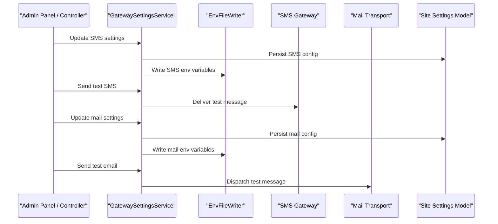

**Diagram sources**
- [GatewaySettingsService.php:24-57](file://backend/app/Services/GatewaySettingsService.php#L24-L57)
- [GatewaySettingsService.php:59-95](file://backend/app/Services/GatewaySettingsService.php#L59-L95)
- [GatewaySettingsService.php:115-148](file://backend/app/Services/GatewaySettingsService.php#L115-L148)

## Detailed Component Analysis

### GatewaySettingsService
Usage patterns:
- Call `updateSms` to configure SMS provider credentials and active state.
- Call `updateMail` to configure SMTP or log mailer settings.
- Call `updateZinipay` to configure payment gateway API key and base URL.
- Call `sendTestSms` and `sendTestEmail` to validate connectivity.

Configuration options:
- SMS: gateway name, driver, API URL, API key, sender ID, message template, active flag.
- Mail: mailer type, host, port, username, password, encryption, from address/name.
- Zinipay: API key and base URL.

Integration points:
- Persists SMS configuration to database and `.env`.
- Persists mail and Zinipay settings to site settings and `.env`.
- Delegates SMS sending to `SmsGatewayService`.
- Uses Laravel Mail facade for email testing.

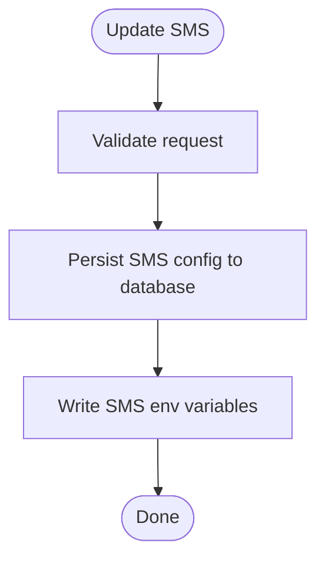

**Diagram sources**
- [GatewaySettingsService.php:24-57](file://backend/app/Services/GatewaySettingsService.php#L24-L57)

**Section sources**
- [GatewaySettingsService.php:24-57](file://backend/app/Services/GatewaySettingsService.php#L24-L57)
- [GatewaySettingsService.php:59-95](file://backend/app/Services/GatewaySettingsService.php#L59-L95)
- [GatewaySettingsService.php:97-113](file://backend/app/Services/GatewaySettingsService.php#L97-L113)
- [GatewaySettingsService.php:115-148](file://backend/app/Services/GatewaySettingsService.php#L115-L148)

### LicenseService
Usage patterns:
- Call `verify` with purchase code, persistence flag, and current domain.
- Call `persistVerifiedLicense` after migrations have run.
- Call `isActivated` to check license activation status.
- Call `deactivate` to remove license and reset environment flag.
- Call `info` to retrieve masked license details and domain slots.

Configuration options:
- Envato personal token and item ID.
- Local bypass flag for development environments.
- Seller bypass code constant.

Integration points:
- Uses `EnvFileWriter` to set `APP_LICENSED`.
- Calls Envato API with retry and fallback behavior.
- Uses cache to store activation status.
- Persists license record and registers domain.

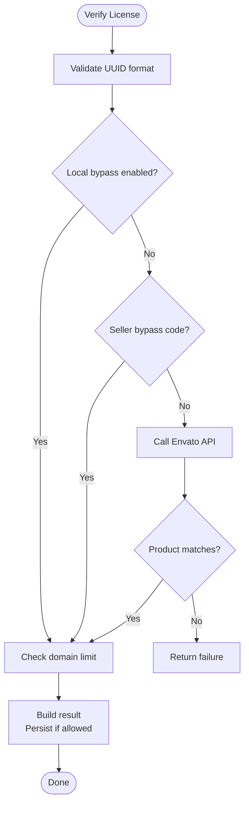

**Diagram sources**
- [LicenseService.php:56-158](file://backend/app/Services/LicenseService.php#L56-L158)
- [LicenseService.php:237-361](file://backend/app/Services/LicenseService.php#L237-L361)

**Section sources**
- [LicenseService.php:56-158](file://backend/app/Services/LicenseService.php#L56-L158)
- [LicenseService.php:164-226](file://backend/app/Services/LicenseService.php#L164-L226)
- [LicenseService.php:237-361](file://backend/app/Services/LicenseService.php#L237-L361)
- [LicenseService.php:363-406](file://backend/app/Services/LicenseService.php#L363-L406)

### SiteSettingsService
Usage patterns:
- Call `toPublicApiArray` to expose site settings to frontend/API consumers.
- Call `updateFromRequest` to save site-wide configuration.
- Call `uploadFavicon` and `uploadLogo` to upload brand assets.
- Call `deleteLogo` to remove existing logo file and reset setting.

Configuration options:
- Branding: site title, logo URL/text, favicon URL.
- Footer: company name, copyright, links JSON.
- Maintenance: enabled flag and message.
- SEO: meta description, keywords, Open Graph fields, analytics ID.

Integration points:
- Uses site settings model for persistence and cache clearing.
- Writes files to public uploads directory with safe extension mapping.

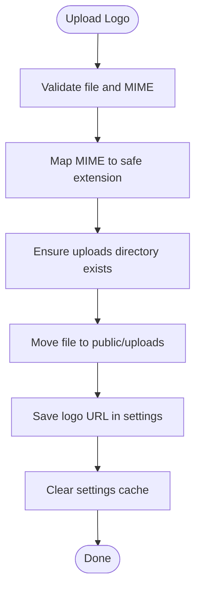

**Diagram sources**
- [SiteSettingsService.php:108-126](file://backend/app/Services/SiteSettingsService.php#L108-L126)
- [SiteSettingsService.php:149-180](file://backend/app/Services/SiteSettingsService.php#L149-L180)

**Section sources**
- [SiteSettingsService.php:14-49](file://backend/app/Services/SiteSettingsService.php#L14-L49)
- [SiteSettingsService.php:51-84](file://backend/app/Services/SiteSettingsService.php#L51-L84)
- [SiteSettingsService.php:86-139](file://backend/app/Services/SiteSettingsService.php#L86-L139)
- [SiteSettingsService.php:149-180](file://backend/app/Services/SiteSettingsService.php#L149-L180)

### EnvFileWriter
Usage patterns:
- Call `set` with an associative array of environment variables.
- The writer validates paths and keys, formats values, and writes to `.env`.

Security considerations:
- Path traversal protection.
- Strict environment variable name validation.
- Safe value quoting for complex strings.

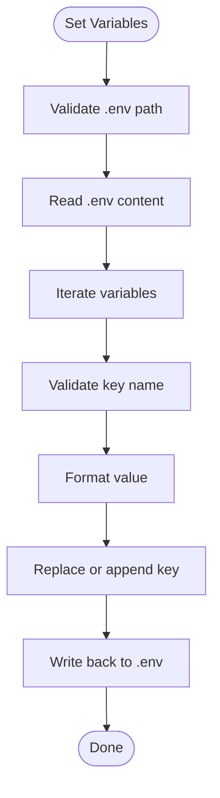

**Diagram sources**
- [EnvFileWriter.php:10-44](file://backend/app/Services/EnvFileWriter.php#L10-L44)
- [EnvFileWriter.php:46-53](file://backend/app/Services/EnvFileWriter.php#L46-L53)

**Section sources**
- [EnvFileWriter.php:10-44](file://backend/app/Services/EnvFileWriter.php#L10-L44)
- [EnvFileWriter.php:46-53](file://backend/app/Services/EnvFileWriter.php#L46-L53)

### ExcelExportService
Usage patterns:
- Call `download` with headers, rows, filename, and optional title.
- The service builds XML and streams it as an Excel-compatible response.

Data handling:
- Numeric detection for proper Excel typing.
- XML escaping to prevent malformed spreadsheets.

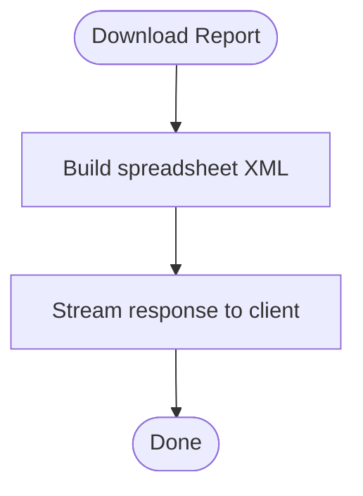

**Diagram sources**
- [ExcelExportService.php:9-18](file://backend/app/Services/ExcelExportService.php#L9-L18)
- [ExcelExportService.php:20-49](file://backend/app/Services/ExcelExportService.php#L20-L49)

**Section sources**
- [ExcelExportService.php:9-18](file://backend/app/Services/ExcelExportService.php#L9-L18)
- [ExcelExportService.php:20-49](file://backend/app/Services/ExcelExportService.php#L20-L49)
- [ExcelExportService.php:51-65](file://backend/app/Services/ExcelExportService.php#L51-L65)

### ReportDataService
Usage patterns:
- For each report, call the corresponding query builder method with a request containing filters.
- Use formatter methods to convert model records into report rows.
- Use header methods to define column order.
- Use summary/aggregation methods to compute totals and breakdowns.

Supported reports:
- Selling, cancellation, booking, revenue, passenger, seat occupancy, refund, payment, route sales, agent sales.

Common filters:
- Date range resolved by `ReportFilterService`.
- Coach type, payment method, route ID, operator.

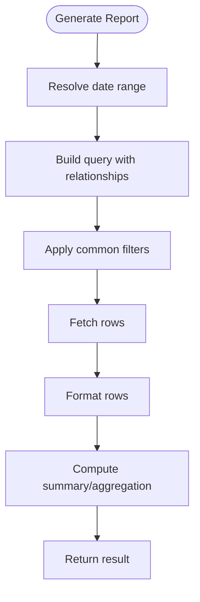

**Diagram sources**
- [ReportDataService.php:17-67](file://backend/app/Services/ReportDataService.php#L17-L67)
- [ReportDataService.php:123-163](file://backend/app/Services/ReportDataService.php#L123-L163)
- [ReportDataService.php:269-338](file://backend/app/Services/ReportDataService.php#L269-L338)
- [ReportDataService.php:401-479](file://backend/app/Services/ReportDataService.php#L401-L479)
- [ReportDataService.php:648-706](file://backend/app/Services/ReportDataService.php#L648-L706)
- [ReportDataService.php:712-772](file://backend/app/Services/ReportDataService.php#L712-L772)

**Section sources**
- [ReportDataService.php:17-67](file://backend/app/Services/ReportDataService.php#L17-L67)
- [ReportDataService.php:69-121](file://backend/app/Services/ReportDataService.php#L69-L121)
- [ReportDataService.php:123-163](file://backend/app/Services/ReportDataService.php#L123-L163)
- [ReportDataService.php:207-263](file://backend/app/Services/ReportDataService.php#L207-L263)
- [ReportDataService.php:269-338](file://backend/app/Services/ReportDataService.php#L269-L338)
- [ReportDataService.php:344-395](file://backend/app/Services/ReportDataService.php#L344-L395)
- [ReportDataService.php:401-479](file://backend/app/Services/ReportDataService.php#L401-L479)
- [ReportDataService.php:486-571](file://backend/app/Services/ReportDataService.php#L486-L571)
- [ReportDataService.php:577-642](file://backend/app/Services/ReportDataService.php#L577-L642)
- [ReportDataService.php:648-706](file://backend/app/Services/ReportDataService.php#L648-L706)
- [ReportDataService.php:712-772](file://backend/app/Services/ReportDataService.php#L712-L772)

### ReportFilterService
Usage patterns:
- Validate incoming request filters before processing.
- Resolve date ranges based on period or custom dates.
- Generate readable period labels and filter summaries for UI.

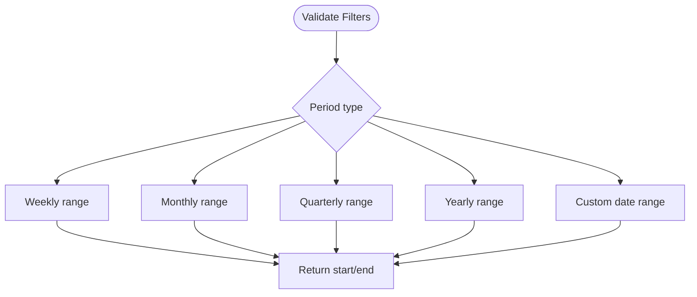

**Diagram sources**
- [ReportFilterService.php:24-46](file://backend/app/Services/ReportFilterService.php#L24-L46)

**Section sources**
- [ReportFilterService.php:10-22](file://backend/app/Services/ReportFilterService.php#L10-L22)
- [ReportFilterService.php:24-46](file://backend/app/Services/ReportFilterService.php#L24-L46)
- [ReportFilterService.php:48-83](file://backend/app/Services/ReportFilterService.php#L48-L83)

### RouteService
Usage patterns:
- Call `validateFromRequest` to parse and validate route data including boarding/dropping points.
- Call `duplicateExists` to check for existing routes between two stations.

Validation rules:
- Departure and arrival stations must exist and differ.
- At least one boarding and dropping point required.
- Point names must be present and trimmed.

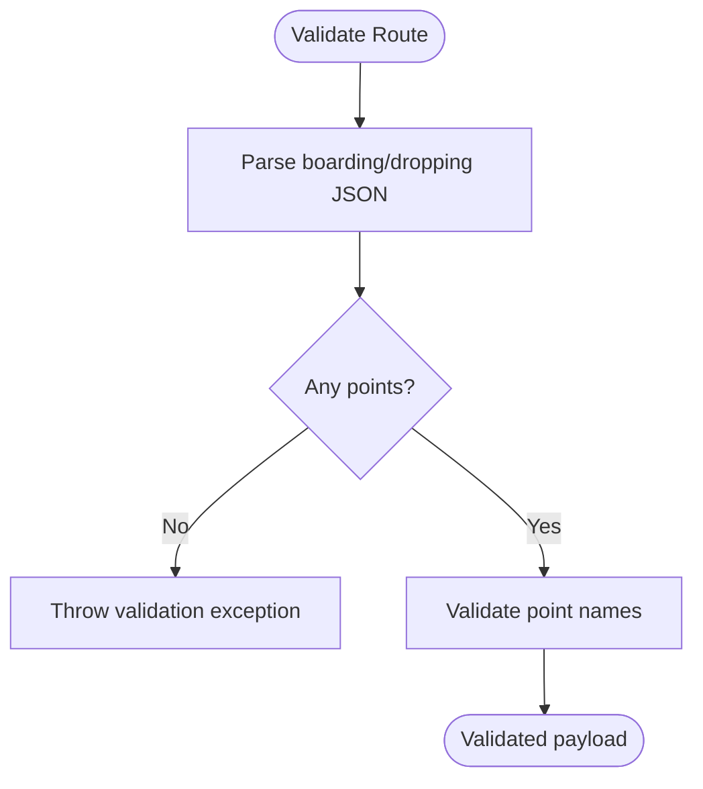

**Diagram sources**
- [RouteService.php:14-64](file://backend/app/Services/RouteService.php#L14-L64)
- [RouteService.php:78-100](file://backend/app/Services/RouteService.php#L78-L100)

**Section sources**
- [RouteService.php:14-64](file://backend/app/Services/RouteService.php#L14-L64)
- [RouteService.php:66-76](file://backend/app/Services/RouteService.php#L66-L76)
- [RouteService.php:78-100](file://backend/app/Services/RouteService.php#L78-L100)

### CoachServicesService
Usage patterns:
- Call `search` to find schedules by origin/destination, date, and coach type.
- Call `toggleBlockedSeat` to block/unblock a seat for a schedule.

Search behavior:
- Loads related bus, route, and paid bookings for seat map.
- Falls back to latest schedules if none found for future dates.
- Formats seat map payload including pricing and available seat count.

Blocked seat behavior:
- Validates schedule existence.
- Delegates blocking logic to `SeatMapService`.
- Returns updated seat map and booked seats.

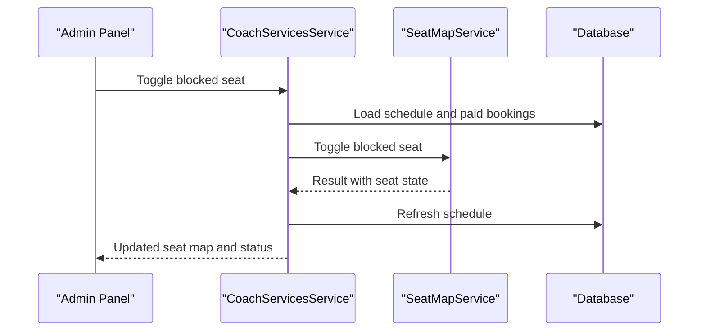

**Diagram sources**
- [CoachServicesService.php:129-174](file://backend/app/Services/CoachServicesService.php#L129-L174)
- [CoachServicesService.php:176-188](file://backend/app/Services/CoachServicesService.php#L176-L188)

**Section sources**
- [CoachServicesService.php:19-124](file://backend/app/Services/CoachServicesService.php#L19-L124)
- [CoachServicesService.php:129-174](file://backend/app/Services/CoachServicesService.php#L129-L174)
- [CoachServicesService.php:176-188](file://backend/app/Services/CoachServicesService.php#L176-L188)

## Dependency Analysis
The services exhibit clear dependency relationships:

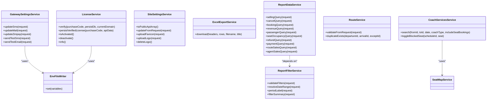

**Diagram sources**
- [GatewaySettingsService.php:18-22](file://backend/app/Services/GatewaySettingsService.php#L18-L22)
- [LicenseService.php:42-42](file://backend/app/Services/LicenseService.php#L42-L42)
- [ReportDataService.php:13-15](file://backend/app/Services/ReportDataService.php#L13-L15)
- [CoachServicesService.php:12-14](file://backend/app/Services/CoachServicesService.php#L12-L14)

**Section sources**
- [GatewaySettingsService.php:18-22](file://backend/app/Services/GatewaySettingsService.php#L18-L22)
- [LicenseService.php:42-42](file://backend/app/Services/LicenseService.php#L42-L42)
- [ReportDataService.php:13-15](file://backend/app/Services/ReportDataService.php#L13-L15)
- [CoachServicesService.php:12-14](file://backend/app/Services/CoachServicesService.php#L12-L14)

## Performance Considerations
- **ReportDataService**:
  - Uses eager loading of relationships to reduce N+1 queries.
  - Performs aggregation in-memory on collections; consider database-level aggregation for very large datasets.
  - Seat occupancy calculation loads all bookings per schedule; optimize with grouped counts if needed.
- **LicenseService**:
  - Uses HTTP retries and timeouts for Envato API calls.
  - Caches activation status to avoid repeated DB checks.
- **SiteSettingsService**:
  - Clears settings cache after file uploads to ensure consistency.
- **ExcelExportService**:
  - Streams responses to minimize memory usage during large exports.
- **EnvFileWriter**:
  - Reads and writes the entire `.env` file; batch variable updates to reduce I/O.

[No sources needed since this section provides general guidance]

## Troubleshooting Guide
Common issues and resolutions:

- **SMS/email tests fail**:
  - Verify gateway credentials and mailer configuration.
  - Check network connectivity to SMS provider and SMTP server.
  - Review error messages returned by `sendTestSms` and `sendTestEmail`.

- **License verification fails**:
  - Ensure Envato personal token and item ID are configured.
  - Confirm purchase code format and product match.
  - Check domain activation limit; remove unused domains or use a new purchase code.
  - For local development, enable local bypass appropriately.

- **Environment file writes fail**:
  - Ensure `.env` path is valid and writable.
  - Verify environment variable names conform to allowed patterns.
  - Check for path traversal protections triggering exceptions.

- **Report data incomplete**:
  - Validate date range and filter parameters.
  - Ensure relationships are loaded correctly.
  - Inspect summary calculations for expected aggregations.

- **Route validation errors**:
  - Ensure departure and arrival stations exist and differ.
  - Provide at least one boarding and dropping point with names.
  - Validate JSON structure for points.

- **Seat blocking issues**:
  - Confirm schedule exists.
  - Check seat identifier format and validity.
  - Review seat map payload for accurate availability.

**Section sources**
- [GatewaySettingsService.php:115-148](file://backend/app/Services/GatewaySettingsService.php#L115-L148)
- [LicenseService.php:56-158](file://backend/app/Services/LicenseService.php#L56-L158)
- [EnvFileWriter.php:10-44](file://backend/app/Services/EnvFileWriter.php#L10-L44)
- [RouteService.php:14-64](file://backend/app/Services/RouteService.php#L14-L64)
- [CoachServicesService.php:129-174](file://backend/app/Services/CoachServicesService.php#L129-L174)

## Conclusion
The supporting services provide robust, modular functionality across configuration, licensing, site settings, environment management, reporting, route operations, and bus fleet management. By isolating responsibilities and integrating carefully with external systems, they enable scalable administration and reliable user experiences. When extending or maintaining these services, prioritize input validation, secure file and environment handling, efficient data access patterns, and clear error reporting.

[No sources needed since this section summarizes without analyzing specific files]