# Backend Architecture

<cite>
**Referenced Files in This Document**
- [ARCHITECTURE.md](file://backend/ARCHITECTURE.md)
- [BACKEND_CODING_GUIDE.md](file://backend/BACKEND_CODING_GUIDE.md)
- [web.php](file://backend/routes/web.php)
- [api.php](file://backend/routes/api.php)
- [AppServiceProvider.php](file://backend/app/Providers/AppServiceProvider.php)
- [EnsureUserIsAdmin.php](file://backend/app/Http/Middleware/EnsureUserIsAdmin.php)
- [EnsureUserHasMenuPermission.php](file://backend/app/Http/Middleware/EnsureUserHasMenuPermission.php)
- [EnsureUserIsSuperAdmin.php](file://backend/app/Http/Middleware/EnsureUserIsSuperAdmin.php)
- [CheckMaintenanceMode.php](file://backend/app/Http/Middleware/CheckMaintenanceMode.php)
- [auth.php](file://backend/config/auth.php)
- [queue.php](file://backend/config/queue.php)
- [database.php](file://backend/config/database.php)
- [User.php](file://backend/app/Models/User.php)
- [Controller.php](file://backend/app/Http/Controllers/Controller.php)
- [BaseController.php](file://backend/app/Http/Controllers/API/BaseController.php)
</cite>

## Table of Contents
1. Introduction
2. Project Structure
3. Core Components
4. Architecture Overview
5. Detailed Component Analysis
6. Dependency Analysis
7. Performance Considerations
8. Troubleshooting Guide
9. Conclusion

## Introduction
This document explains the Laravel 12 backend architecture for a bus booking application. It covers the MVC pattern, service layer design, controller organization, routing strategy separating API and web routes, middleware pipeline, provider system and service container configuration, directory conventions, database abstraction with Eloquent, queue integration, and event-related background processing patterns. The goal is to make the system understandable for both new contributors and experienced developers.

## Project Structure
The backend follows standard Laravel conventions with clear separation between:
- Web routes for the admin dashboard (Blade views, session-based authentication).
- API routes for the React frontend (JSON endpoints, Sanctum token authentication).
- Services for business logic.
- Models for data access via Eloquent.
- Middleware for security, authorization, and maintenance mode.
- Providers for bootstrapping dynamic configuration and view composers.

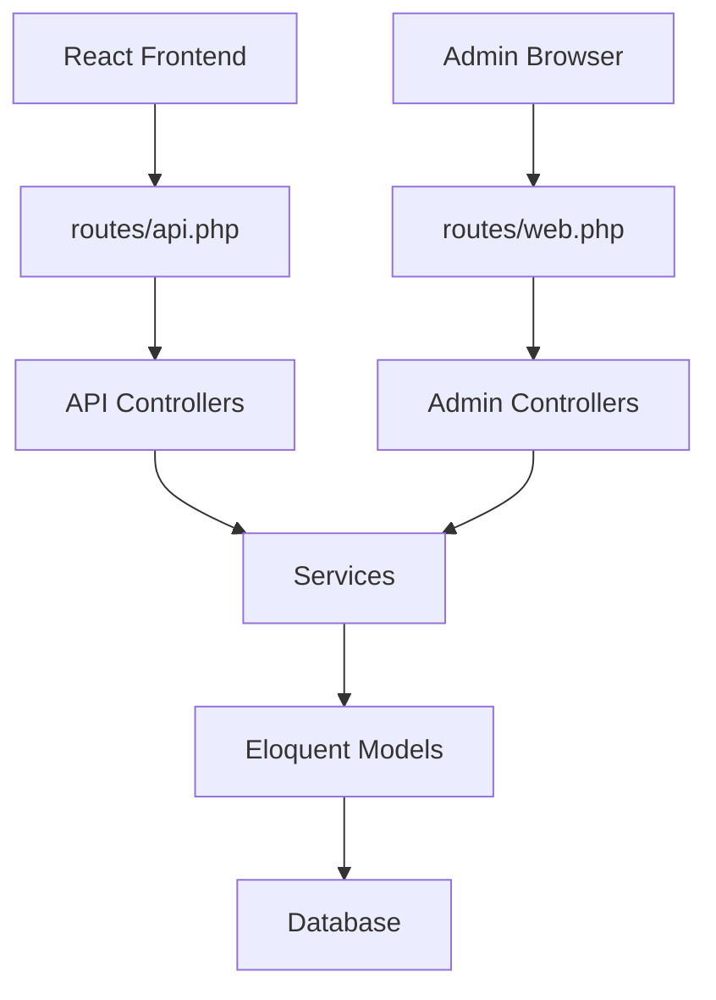

**Diagram sources**
- [web.php:1-293](file://backend/routes/web.php#L1-L293)
- [api.php:1-77](file://backend/routes/api.php#L1-L77)
- [ARCHITECTURE.md:15-35](file://backend/ARCHITECTURE.md#L15-L35)

**Section sources**
- [ARCHITECTURE.md:1-35](file://backend/ARCHITECTURE.md#L1-L35)
- [BACKEND_CODING_GUIDE.md:16-27](file://backend/BACKEND_CODING_GUIDE.md#L16-L27)

## Core Components
- Controllers: Thin request handlers that validate input and delegate to services.
- Services: Reusable business logic such as seat map generation, pricing, SMS notifications, payment gateway operations, and reporting.
- Models: Eloquent entities representing domain concepts like Booking, Schedule, Route, Bus, Station, User, SiteSetting.
- Middleware: Authentication, authorization, menu permissions, super-admin checks, and maintenance mode.
- Provider: AppServiceProvider dynamically overrides mail and payment service configurations from site settings and shares settings with Blade views.

Key responsibilities:
- Routing separates customer-facing APIs from admin web routes.
- Service layer centralizes complex rules (seat availability, pricing, promotions, reports).
- Middleware enforces role-based access and maintenance behavior.
- Provider ensures runtime configuration updates without code changes.

**Section sources**
- [BACKEND_CODING_GUIDE.md:123-232](file://backend/BACKEND_CODING_GUIDE.md#L123-L232)
- [ARCHITECTURE.md:39-53](file://backend/ARCHITECTURE.md#L39-L53)

## Architecture Overview
The system uses two entry points:
- Customer API under /api consumed by the React frontend using Sanctum tokens.
- Admin web routes under /admin using session-based authentication.

Request flow examples:
- Customer booking: React → POST /api/bookings → API\BookingController → BookingService → JSON ticket or payment URL.
- Admin booking: Blade form → POST /admin/bookings → Admin\BookingController → BookingService → redirect or JSON.
- Admin AJAX: Blade JS → GET /admin/api/* → Admin controllers → Services → JSON.

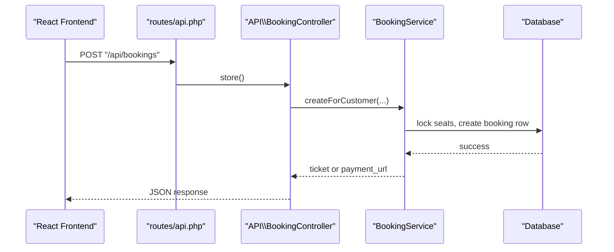

**Diagram sources**
- [api.php:63-75](file://backend/routes/api.php#L63-L75)
- [ARCHITECTURE.md:54-72](file://backend/ARCHITECTURE.md#L54-L72)

**Section sources**
- [ARCHITECTURE.md:5-13](file://backend/ARCHITECTURE.md#L5-L13)
- [ARCHITECTURE.md:54-81](file://backend/ARCHITECTURE.md#L54-L81)

## Detailed Component Analysis

### MVC Pattern Implementation
- Controllers:
  - Base classes provide common structure; API controllers extend BaseController.
  - Admin controllers handle Blade forms and session-based AJAX.
- Views:
  - Blade templates render admin dashboards and reports.
- Models:
  - Eloquent models encapsulate relationships and casts.
- Services:
  - Business logic resides in dedicated services for reuse across controllers.

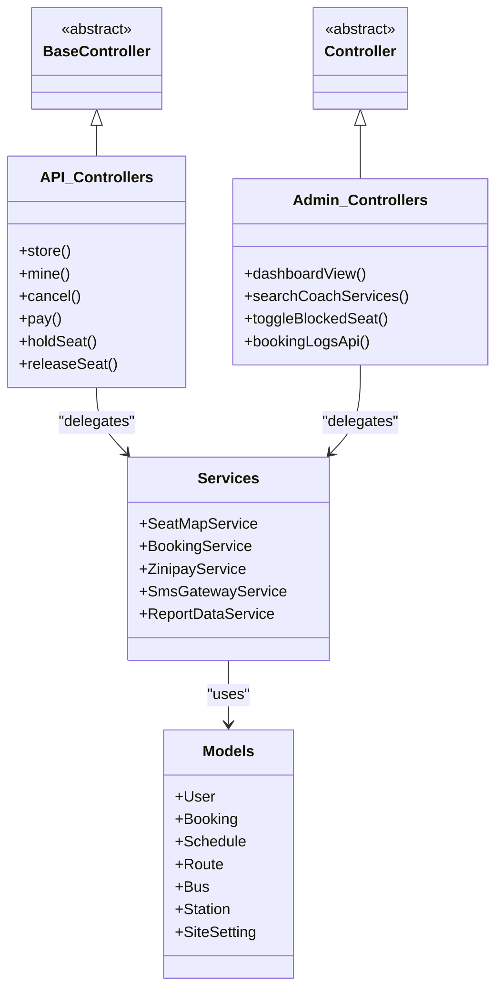

**Diagram sources**
- [Controller.php:1-8](file://backend/app/Http/Controllers/Controller.php#L1-L8)
- [BaseController.php:1-8](file://backend/app/Http/Controllers/API/BaseController.php#L1-L8)
- [BACKEND_CODING_GUIDE.md:123-232](file://backend/BACKEND_CODING_GUIDE.md#L123-L232)

**Section sources**
- [BACKEND_CODING_GUIDE.md:123-232](file://backend/BACKEND_CODING_GUIDE.md#L123-L232)
- [ARCHITECTURE.md:15-35](file://backend/ARCHITECTURE.md#L15-L35)

### Service Layer Design
- SeatMapService: Generates seat codes, builds status maps, handles boarding/dropping points, pricing breakdowns, and seat blocking toggles.
- BookingService: Shared booking creation/cancellation logic used by both API and admin flows.
- ZinipayService: Payment invoice creation and verification.
- SmsGatewayService: Sends confirmation messages after successful payments or admin-paid bookings.
- ReportDataService and ReportFilterService: Provide data for admin reports.

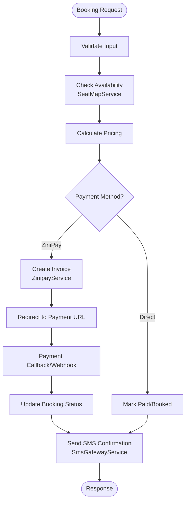

**Diagram sources**
- [BACKEND_CODING_GUIDE.md:212-232](file://backend/BACKEND_CODING_GUIDE.md#L212-L232)
- [BACKEND_CODING_GUIDE.md:272-289](file://backend/BACKEND_CODING_GUIDE.md#L272-L289)

**Section sources**
- [BACKEND_CODING_GUIDE.md:212-232](file://backend/BACKEND_CODING_GUIDE.md#L212-L232)
- [BACKEND_CODING_GUIDE.md:272-289](file://backend/BACKEND_CODING_GUIDE.md#L272-L289)

### Controller Organization
- API Controllers:
  - Handle public and authenticated customer endpoints.
  - Use Sanctum for authentication on protected routes.
- Admin Controllers:
  - Manage CRUD for stations, buses, routes, schedules, promotions, users.
  - Provide AJAX endpoints under /admin/api for dashboard interactions.
- Shared Concerns:
  - Redirect helpers preserve active tabs after form submissions.

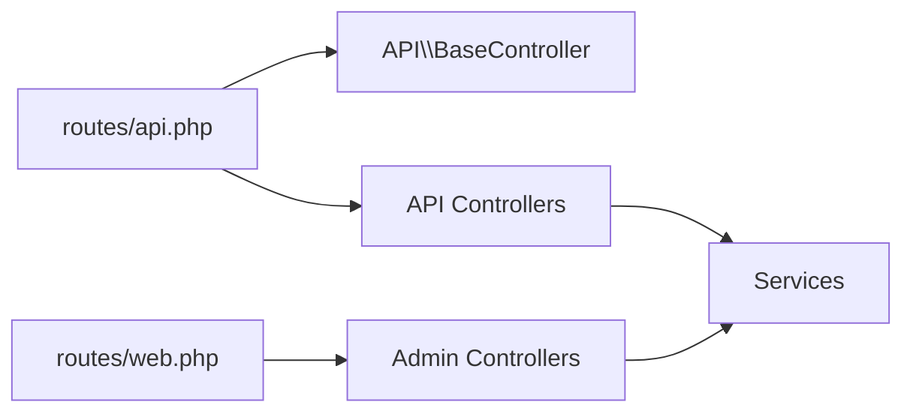

**Diagram sources**
- [api.php:1-77](file://backend/routes/api.php#L1-L77)
- [web.php:1-293](file://backend/routes/web.php#L1-L293)

**Section sources**
- [BACKEND_CODING_GUIDE.md:182-209](file://backend/BACKEND_CODING_GUIDE.md#L182-L209)
- [BACKEND_CODING_GUIDE.md:255-269](file://backend/BACKEND_CODING_GUIDE.md#L255-L269)

### Routing Strategy
- Web routes:
  - Installation wizard, public admin login/logout.
  - Session-authenticated admin dashboard and CRUD actions.
  - AJAX endpoints under /admin/api.
  - Super admin-only routes for license and site settings.
  - Payment callback and cancel endpoints.
- API routes:
  - Public site settings and search endpoints.
  - Authenticated customer routes guarded with Sanctum.
  - Public webhooks and external callbacks.

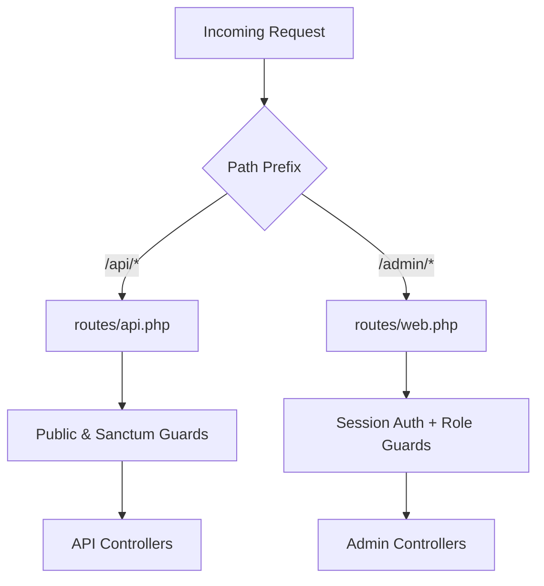

**Diagram sources**
- [web.php:1-293](file://backend/routes/web.php#L1-L293)
- [api.php:1-77](file://backend/routes/api.php#L1-L77)

**Section sources**
- [web.php:1-293](file://backend/routes/web.php#L1-L293)
- [api.php:1-77](file://backend/routes/api.php#L1-L77)

### Middleware Pipeline
- EnsureUserIsAdmin:
  - Validates authentication and admin role.
  - Returns JSON errors for API/admin API requests; redirects for web.
- EnsureUserHasMenuPermission:
  - Checks per-menu permissions stored in user model.
  - Supports granular access control for admin sections.
- EnsureUserIsSuperAdmin:
  - Restricts sensitive operations to super admins.
- CheckMaintenanceMode:
  - Blocks API routes during maintenance except site-settings.
  - Reads maintenance flags/messages from SiteSetting.

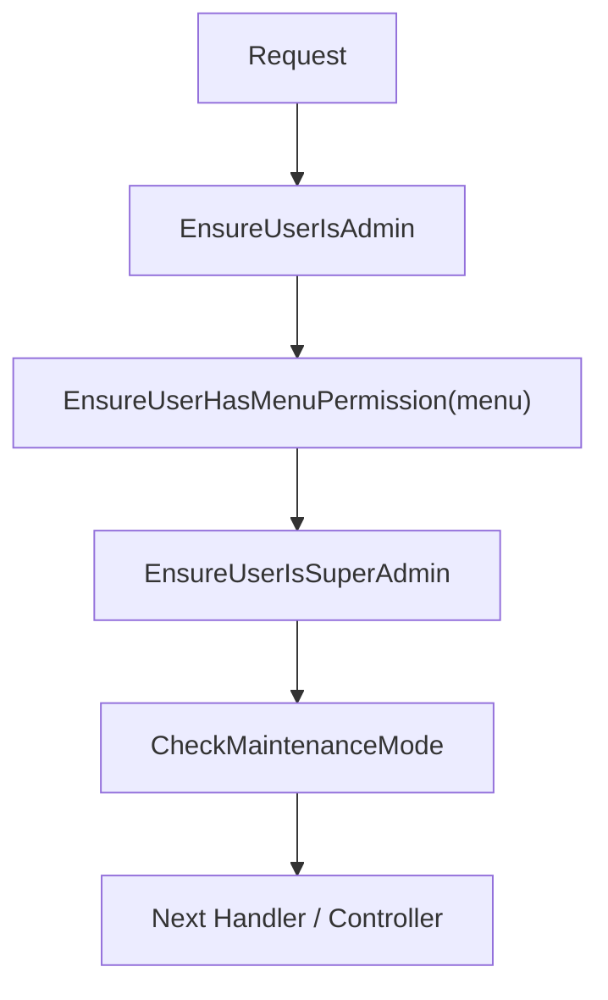

**Diagram sources**
- [EnsureUserIsAdmin.php:1-41](file://backend/app/Http/Middleware/EnsureUserIsAdmin.php#L1-L41)
- [EnsureUserHasMenuPermission.php:1-41](file://backend/app/Http/Middleware/EnsureUserHasMenuPermission.php#L1-L41)
- [EnsureUserIsSuperAdmin.php:1-38](file://backend/app/Http/Middleware/EnsureUserIsSuperAdmin.php#L1-L38)
- [CheckMaintenanceMode.php:1-49](file://backend/app/Http/Middleware/CheckMaintenanceMode.php#L1-L49)

**Section sources**
- [BACKEND_CODING_GUIDE.md:235-252](file://backend/BACKEND_CODING_GUIDE.md#L235-L252)
- [ARCHITECTURE.md:91-96](file://backend/ARCHITECTURE.md#L91-L96)

### Provider System and Service Container Configuration
- AppServiceProvider:
  - Skips DB-dependent logic during installation.
  - Overrides mail and ZiniPay configurations from SiteSetting at runtime.
  - Shares siteSettings and smsConfig with admin layout via View::composer.

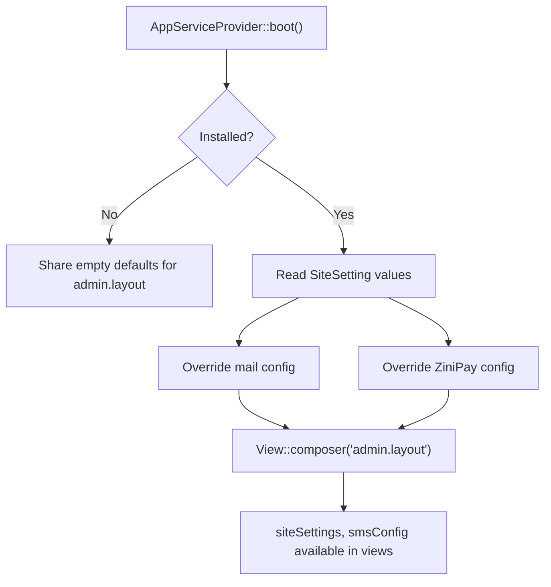

**Diagram sources**
- [AppServiceProvider.php:20-103](file://backend/app/Providers/AppServiceProvider.php#L20-L103)

**Section sources**
- [AppServiceProvider.php:20-103](file://backend/app/Providers/AppServiceProvider.php#L20-L103)

### Database Abstraction and Data Access Strategies
- Eloquent ORM:
  - Models define relationships and casts (e.g., arrays for JSON fields).
  - Relationships include hasMany/belongsTo across Stations, Buses, Routes, Schedules, Bookings, Users.
- Repository Patterns:
  - Not explicitly implemented; business logic is centralized in services which interact directly with Eloquent models.
- Data Access:
  - Controllers call services; services use Eloquent queries and relationships.
  - SiteSetting provides cached key/value configuration.

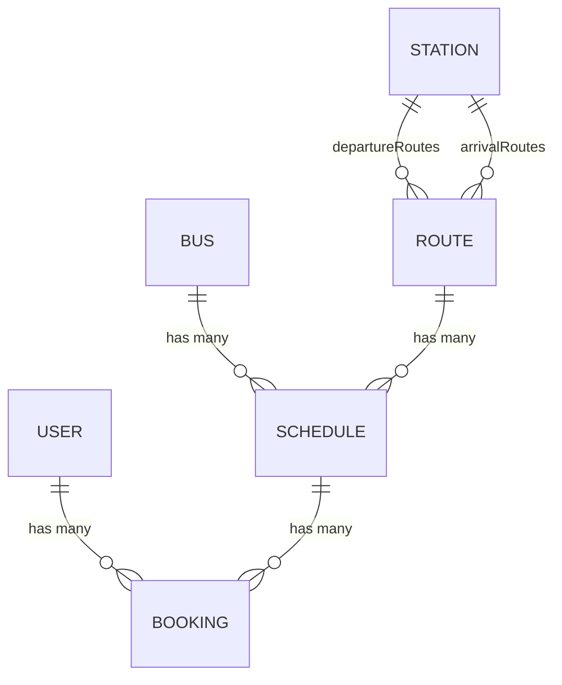

**Diagram sources**
- [BACKEND_CODING_GUIDE.md:30-95](file://backend/BACKEND_CODING_GUIDE.md#L30-L95)

**Section sources**
- [BACKEND_CODING_GUIDE.md:30-95](file://backend/BACKEND_CODING_GUIDE.md#L30-L95)
- [User.php:39-74](file://backend/app/Models/User.php#L39-L74)

### Queue System Integration and Background Jobs
- Queue Configuration:
  - Default connection is database; supports sync, beanstalkd, sqs, redis, deferred, background, failover.
  - Failed jobs stored via database-uuids.
- Jobs:
  - Example job exists for sending booking SMS notifications.
- Event Handling:
  - While not shown here, queues are typically used to dispatch events asynchronously for tasks like SMS, emails, and analytics.

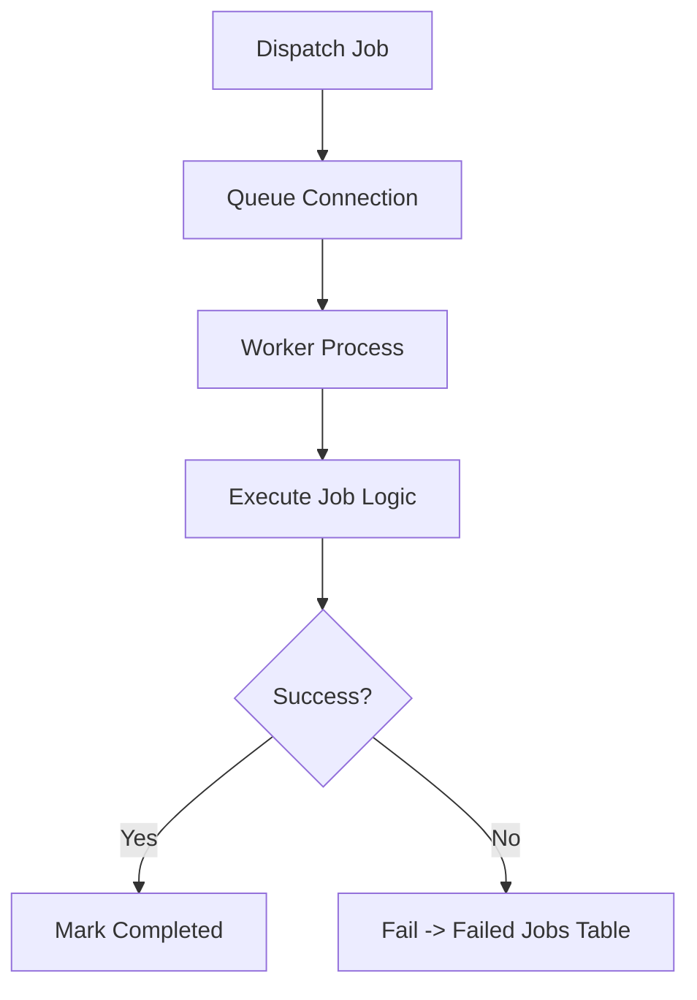

**Diagram sources**
- [queue.php:1-130](file://backend/config/queue.php#L1-L130)

**Section sources**
- [queue.php:1-130](file://backend/config/queue.php#L1-L130)

## Dependency Analysis
- Controllers depend on Services for business logic.
- Services depend on Models for data access.
- Middleware depends on User model methods for roles and permissions.
- Provider depends on SiteSetting for dynamic configuration.

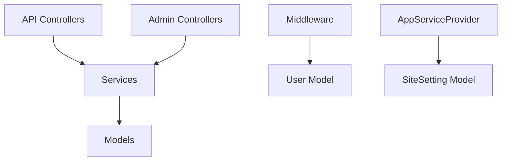

**Diagram sources**
- [web.php:1-293](file://backend/routes/web.php#L1-L293)
- [api.php:1-77](file://backend/routes/api.php#L1-L77)
- [AppServiceProvider.php:20-103](file://backend/app/Providers/AppServiceProvider.php#L20-L103)
- [User.php:39-74](file://backend/app/Models/User.php#L39-L74)

**Section sources**
- [BACKEND_CODING_GUIDE.md:123-232](file://backend/BACKEND_CODING_GUIDE.md#L123-L232)
- [AppServiceProvider.php:20-103](file://backend/app/Providers/AppServiceProvider.php#L20-L103)

## Performance Considerations
- Eager Loading:
  - Use eager loading for nested relationships (e.g., schedule.bus, schedule.route.departureStation) to reduce N+1 queries.
- Caching:
  - SiteSetting uses caching for read performance; ensure cache drivers are configured appropriately.
- Queues:
  - Offload heavy tasks (SMS, emails, report generation) to queues to keep request latency low.
- Database Indexes:
  - Add indexes on frequently queried columns (e.g., schedule departure_time, route station IDs).
- Maintenance Mode:
  - Avoid unnecessary DB calls when maintenance is enabled; short-circuit responses early.

[No sources needed since this section provides general guidance]

## Troubleshooting Guide
- Unauthenticated Requests:
  - EnsureUserIsAdmin returns JSON 401 for API/admin API requests; verify Sanctum tokens or session cookies.
- Authorization Errors:
  - EnsureUserHasMenuPermission denies access if menu_permissions do not include the requested menu; check user role and permissions.
- Super Admin Restrictions:
  - EnsureUserIsSuperAdmin blocks non-super-admin users from sensitive routes; confirm role.
- Maintenance Mode:
  - CheckMaintenanceMode returns 503 with maintenance message unless route is excluded; verify SiteSetting values.
- Dynamic Config Issues:
  - AppServiceProvider may override mail/ZiniPay configs; ensure SiteSetting values are correct and cache is refreshed.

**Section sources**
- [EnsureUserIsAdmin.php:1-41](file://backend/app/Http/Middleware/EnsureUserIsAdmin.php#L1-L41)
- [EnsureUserHasMenuPermission.php:1-41](file://backend/app/Http/Middleware/EnsureUserHasMenuPermission.php#L1-L41)
- [EnsureUserIsSuperAdmin.php:1-38](file://backend/app/Http/Middleware/EnsureUserIsSuperAdmin.php#L1-L38)
- [CheckMaintenanceMode.php:1-49](file://backend/app/Http/Middleware/CheckMaintenanceMode.php#L1-L49)
- [AppServiceProvider.php:20-103](file://backend/app/Providers/AppServiceProvider.php#L20-L103)

## Conclusion
The backend implements a clean MVC architecture with a strong service layer, clear controller responsibilities, and robust middleware for security and authorization. Routing cleanly separates customer APIs from admin web routes. Eloquent models provide flexible data access, while queues enable asynchronous processing. The provider system allows dynamic configuration through site settings, improving operational flexibility. Following these patterns ensures maintainability, scalability, and clarity for future enhancements.

[No sources needed since this section summarizes without analyzing specific files]