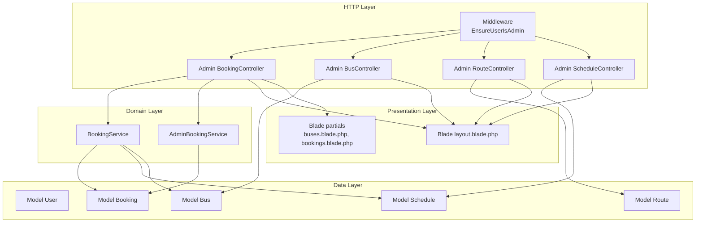
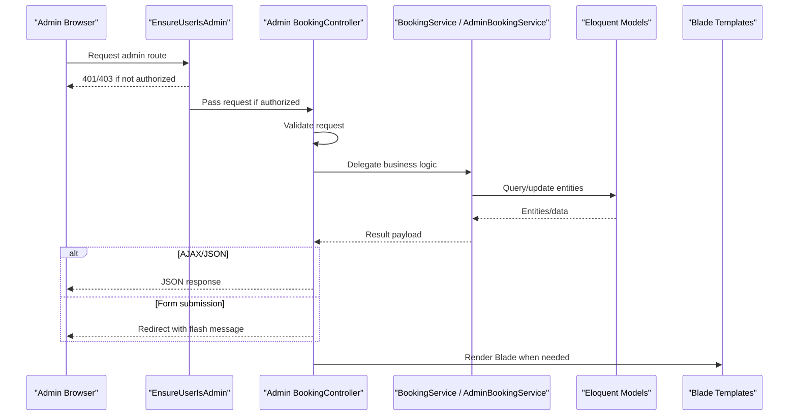
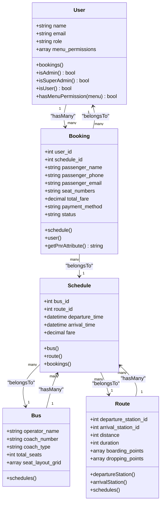
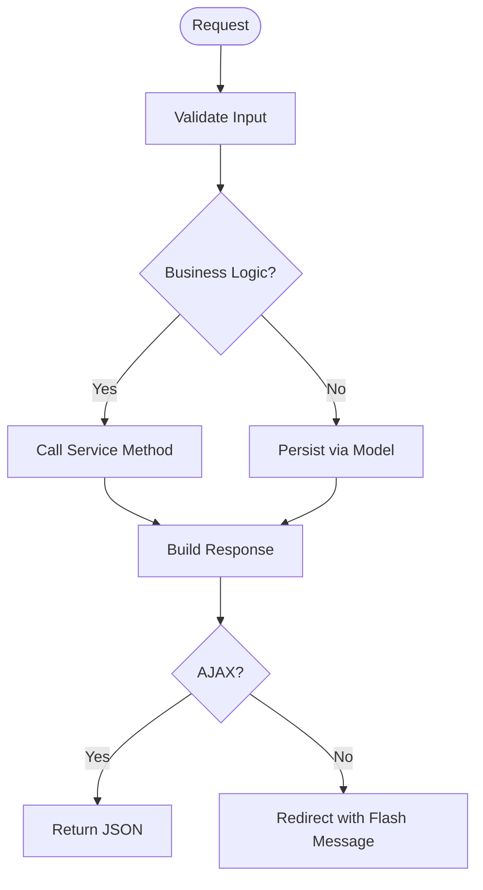
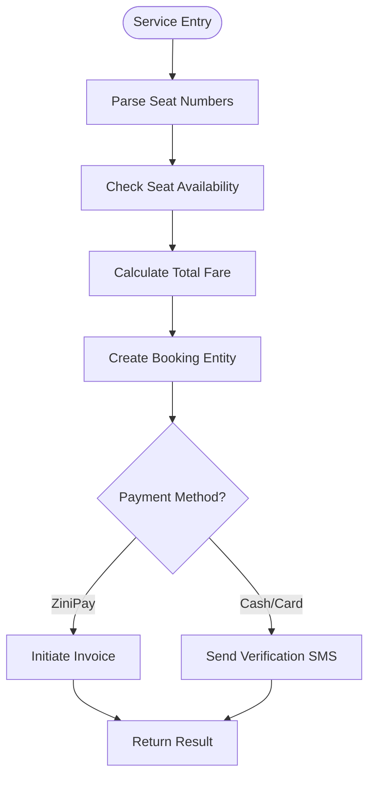
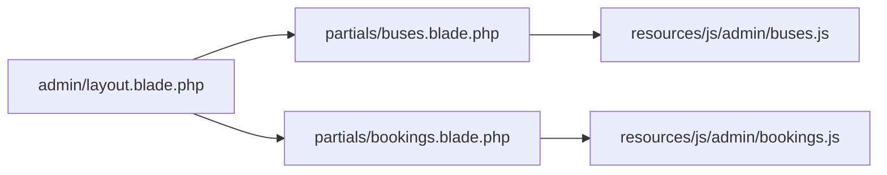
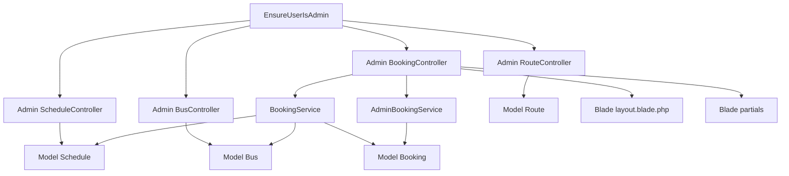

# MVC Pattern Implementation

<cite>
**Referenced Files in This Document**
- [User.php](file://backend/app/Models/User.php)
- [Booking.php](file://backend/app/Models/Booking.php)
- [Bus.php](file://backend/app/Models/Bus.php)
- [Route.php](file://backend/app/Models/Route.php)
- [Schedule.php](file://backend/app/Models/Schedule.php)
- [BaseAdminController.php](file://backend/app/Http/Controllers/Admin/BaseAdminController.php)
- [BookingController.php](file://backend/app/Http/Controllers/Admin/BookingController.php)
- [BusController.php](file://backend/app/Http/Controllers/Admin/BusController.php)
- [RouteController.php](file://backend/app/Http/Controllers/Admin/RouteController.php)
- [ScheduleController.php](file://backend/app/Http/Controllers/Admin/ScheduleController.php)
- [BookingService.php](file://backend/app/Services/BookingService.php)
- [AdminBookingService.php](file://backend/app/Services/AdminBookingService.php)
- [EnsureUserIsAdmin.php](file://backend/app/Http/Middleware/EnsureUserIsAdmin.php)
- [layout.blade.php](file://backend/resources/views/admin/layout.blade.php)
- [buses.blade.php](file://backend/resources/views/admin/partials/buses.blade.php)
- [bookings.blade.php](file://backend/resources/views/admin/partials/bookings.blade.php)
</cite>

## Table of Contents
1. [Introduction](#introduction)
2. [Project Structure](#project-structure)
3. [Core Components](#core-components)
4. [Architecture Overview](#architecture-overview)
5. [Detailed Component Analysis](#detailed-component-analysis)
6. [Dependency Analysis](#dependency-analysis)
7. [Performance Considerations](#performance-considerations)
8. [Troubleshooting Guide](#troubleshooting-guide)
9. [Conclusion](#conclusion)

## Introduction
This document explains how the Laravel backend implements the Model-View-Controller pattern for the admin interface and booking domain. It focuses on:
- Models as Eloquent entities with relationships and casts
- Controllers handling HTTP requests, validating input, delegating business logic to services, and rendering Blade views
- Views organizing Blade templates for the admin dashboard
- Data flow from controllers to models and services
- Best practices for clean MVC architecture and common anti-patterns to avoid

## Project Structure
The relevant MVC layers are organized under `app`, `resources/views`, and routes. The admin panel uses a shared layout and partials for consistent UI. Services encapsulate complex business logic such as seat locking, pricing, SMS notifications, and payment integration.

**Diagram sources**
- [EnsureUserIsAdmin.php:10-41](file://backend/app/Http/Middleware/EnsureUserIsAdmin.php#L10-L41)
- [BookingController.php:11-137](file://backend/app/Http/Controllers/Admin/BookingController.php#L11-L137)
- [BusController.php:8-97](file://backend/app/Http/Controllers/Admin/BusController.php#L8-L97)
- [RouteController.php:9-53](file://backend/app/Http/Controllers/Admin/RouteController.php#L9-L53)
- [ScheduleController.php:8-49](file://backend/app/Http/Controllers/Admin/ScheduleController.php#L8-L49)
- [BookingService.php:14-335](file://backend/app/Services/BookingService.php#L14-L335)
- [AdminBookingService.php:9-254](file://backend/app/Services/AdminBookingService.php#L9-L254)
- [layout.blade.php:1-800](file://backend/resources/views/admin/layout.blade.php#L1-L800)
- [buses.blade.php:1-437](file://backend/resources/views/admin/partials/buses.blade.php#L1-L437)
- [bookings.blade.php:1-161](file://backend/resources/views/admin/partials/bookings.blade.php#L1-L161)

**Section sources**
- [layout.blade.php:1-800](file://backend/resources/views/admin/layout.blade.php#L1-L800)
- [buses.blade.php:1-437](file://backend/resources/views/admin/partials/buses.blade.php#L1-L437)
- [bookings.blade.php:1-161](file://backend/resources/views/admin/partials/bookings.blade.php#L1-L161)

## Core Components
- Models represent database entities using Eloquent ORM. They define fillable fields, attribute casts, and relationships to other models. Examples include users, bookings, buses, routes, and schedules.
- Controllers handle HTTP requests, validate inputs, delegate business logic to services, and return JSON or redirect responses. Admin controllers extend a base controller that provides tab-aware redirects.
- Services encapsulate domain logic such as seat availability checks, pricing calculations, SMS notifications, and payment invoice creation.
- Views render Blade templates for the admin interface, including a shared layout and feature-specific partials.

Key responsibilities:
- Models: data mapping, relationships, attribute casting, computed attributes
- Controllers: request validation, orchestration, response formatting
- Services: business rules, transactions, external integrations
- Views: presentation, templating, reusable partials

**Section sources**
- [User.php:12-75](file://backend/app/Models/User.php#L12-L75)
- [Booking.php:8-48](file://backend/app/Models/Booking.php#L8-L48)
- [Bus.php:8-22](file://backend/app/Models/Bus.php#L8-L22)
- [Route.php:8-40](file://backend/app/Models/Route.php#L8-L40)
- [Schedule.php:8-34](file://backend/app/Models/Schedule.php#L8-L34)
- [BaseAdminController.php:8-14](file://backend/app/Http/Controllers/Admin/BaseAdminController.php#L8-L14)
- [BookingController.php:11-137](file://backend/app/Http/Controllers/Admin/BookingController.php#L11-L137)
- [BusController.php:8-97](file://backend/app/Http/Controllers/Admin/BusController.php#L8-L97)
- [RouteController.php:9-53](file://backend/app/Http/Controllers/Admin/RouteController.php#L9-L53)
- [ScheduleController.php:8-49](file://backend/app/Http/Controllers/Admin/ScheduleController.php#L8-L49)
- [BookingService.php:14-335](file://backend/app/Services/BookingService.php#L14-L335)
- [AdminBookingService.php:9-254](file://backend/app/Services/AdminBookingService.php#L9-L254)
- [layout.blade.php:1-800](file://backend/resources/views/admin/layout.blade.php#L1-L800)
- [buses.blade.php:1-437](file://backend/resources/views/admin/partials/buses.blade.php#L1-L437)
- [bookings.blade.php:1-161](file://backend/resources/views/admin/partials/bookings.blade.php#L1-L161)

## Architecture Overview
The admin MVC flow follows these steps:
1. Middleware ensures only authenticated admins can access admin routes.
2. Controllers validate incoming requests and delegate business operations to services.
3. Services perform domain logic, interact with models, and coordinate external systems (SMS, payments).
4. Controllers respond with JSON for AJAX or redirect with flash messages for form submissions.
5. Views render Blade templates using shared layouts and partials.

**Diagram sources**
- [EnsureUserIsAdmin.php:10-41](file://backend/app/Http/Middleware/EnsureUserIsAdmin.php#L10-L41)
- [BookingController.php:20-52](file://backend/app/Http/Controllers/Admin/BookingController.php#L20-L52)
- [BookingService.php:28-131](file://backend/app/Services/BookingService.php#L28-L131)
- [AdminBookingService.php:58-80](file://backend/app/Services/AdminBookingService.php#L58-L80)
- [Booking.php:8-48](file://backend/app/Models/Booking.php#L8-L48)
- [layout.blade.php:1-800](file://backend/resources/views/admin/layout.blade.php#L1-L800)

## Detailed Component Analysis

### Models and Eloquent Relationships
Models define entity structure, casts, and relationships:
- User: roles, menu permissions, relationship to bookings
- Booking: passenger details, schedule/user relationships, computed PNR
- Bus: coach metadata, relationship to schedules
- Route: departure/arrival stations, relationship to schedules
- Schedule: bus/route relationships, relationship to bookings

**Diagram sources**
- [User.php:12-75](file://backend/app/Models/User.php#L12-L75)
- [Booking.php:8-48](file://backend/app/Models/Booking.php#L8-L48)
- [Bus.php:8-22](file://backend/app/Models/Bus.php#L8-L22)
- [Route.php:8-40](file://backend/app/Models/Route.php#L8-L40)
- [Schedule.php:8-34](file://backend/app/Models/Schedule.php#L8-L34)

**Section sources**
- [User.php:12-75](file://backend/app/Models/User.php#L12-L75)
- [Booking.php:8-48](file://backend/app/Models/Booking.php#L8-L48)
- [Bus.php:8-22](file://backend/app/Models/Bus.php#L8-L22)
- [Route.php:8-40](file://backend/app/Models/Route.php#L8-L40)
- [Schedule.php:8-34](file://backend/app/Models/Schedule.php#L8-L34)

### Controllers: Request Handling and Delegation
Admin controllers follow a consistent pattern:
- Extend BaseAdminController for shared behavior like tab-aware redirects
- Validate input using Laravel’s validator
- Delegate business logic to services where applicable
- Return JSON for AJAX or redirect with success/error messages for form submissions

Examples:
- BookingController: validates booking data, delegates creation to BookingService, handles cancellation and payment flows
- BusController: validates and persists bus fleet data, handles logo upload conversion
- RouteController: delegates validation and duplicate checks to RouteService
- ScheduleController: validates and persists schedule runs

**Diagram sources**
- [BookingController.php:20-52](file://backend/app/Http/Controllers/Admin/BookingController.php#L20-L52)
- [BusController.php:27-53](file://backend/app/Http/Controllers/Admin/BusController.php#L27-L53)
- [RouteController.php:15-28](file://backend/app/Http/Controllers/Admin/RouteController.php#L15-L28)
- [ScheduleController.php:10-23](file://backend/app/Http/Controllers/Admin/ScheduleController.php#L10-L23)

**Section sources**
- [BaseAdminController.php:8-14](file://backend/app/Http/Controllers/Admin/BaseAdminController.php#L8-L14)
- [BookingController.php:11-137](file://backend/app/Http/Controllers/Admin/BookingController.php#L11-L137)
- [BusController.php:8-97](file://backend/app/Http/Controllers/Admin/BusController.php#L8-L97)
- [RouteController.php:9-53](file://backend/app/Http/Controllers/Admin/RouteController.php#L9-L53)
- [ScheduleController.php:8-49](file://backend/app/Http/Controllers/Admin/ScheduleController.php#L8-L49)

### Services: Business Logic Encapsulation
Services centralize complex domain logic:
- BookingService: customer and admin booking creation, seat selection, pricing, SMS, payment integration
- AdminBookingService: admin-specific queries, cancel request workflows, log formatting

**Diagram sources**
- [BookingService.php:28-131](file://backend/app/Services/BookingService.php#L28-L131)
- [BookingService.php:138-193](file://backend/app/Services/BookingService.php#L138-L193)
- [AdminBookingService.php:58-80](file://backend/app/Services/AdminBookingService.php#L58-L80)

**Section sources**
- [BookingService.php:14-335](file://backend/app/Services/BookingService.php#L14-L335)
- [AdminBookingService.php:9-254](file://backend/app/Services/AdminBookingService.php#L9-L254)

### Views: Blade Template Organization
Views provide the admin interface:
- Shared layout defines header, sidebar, content area, theme variables, and responsive styles
- Partials implement specific features like fleet management and booking logs
- Forms submit to controller routes and use CSRF protection
- Pagination and dynamic UI elements are included

**Diagram sources**
- [layout.blade.php:1-800](file://backend/resources/views/admin/layout.blade.php#L1-L800)
- [buses.blade.php:1-437](file://backend/resources/views/admin/partials/buses.blade.php#L1-L437)
- [bookings.blade.php:1-161](file://backend/resources/views/admin/partials/bookings.blade.php#L1-L161)

**Section sources**
- [layout.blade.php:1-800](file://backend/resources/views/admin/layout.blade.php#L1-L800)
- [buses.blade.php:1-437](file://backend/resources/views/admin/partials/buses.blade.php#L1-L437)
- [bookings.blade.php:1-161](file://backend/resources/views/admin/partials/bookings.blade.php#L1-L161)

## Dependency Analysis
The following diagram shows dependencies between controllers, services, models, middleware, and views:

**Diagram sources**
- [EnsureUserIsAdmin.php:10-41](file://backend/app/Http/Middleware/EnsureUserIsAdmin.php#L10-L41)
- [BookingController.php:11-137](file://backend/app/Http/Controllers/Admin/BookingController.php#L11-L137)
- [BusController.php:8-97](file://backend/app/Http/Controllers/Admin/BusController.php#L8-L97)
- [RouteController.php:9-53](file://backend/app/Http/Controllers/Admin/RouteController.php#L9-L53)
- [ScheduleController.php:8-49](file://backend/app/Http/Controllers/Admin/ScheduleController.php#L8-L49)
- [BookingService.php:14-335](file://backend/app/Services/BookingService.php#L14-L335)
- [AdminBookingService.php:9-254](file://backend/app/Services/AdminBookingService.php#L9-L254)
- [layout.blade.php:1-800](file://backend/resources/views/admin/layout.blade.php#L1-L800)

**Section sources**
- [EnsureUserIsAdmin.php:10-41](file://backend/app/Http/Middleware/EnsureUserIsAdmin.php#L10-L41)
- [BookingController.php:11-137](file://backend/app/Http/Controllers/Admin/BookingController.php#L11-L137)
- [BusController.php:8-97](file://backend/app/Http/Controllers/Admin/BusController.php#L8-L97)
- [RouteController.php:9-53](file://backend/app/Http/Controllers/Admin/RouteController.php#L9-L53)
- [ScheduleController.php:8-49](file://backend/app/Http/Controllers/Admin/ScheduleController.php#L8-L49)
- [BookingService.php:14-335](file://backend/app/Services/BookingService.php#L14-L335)
- [AdminBookingService.php:9-254](file://backend/app/Services/AdminBookingService.php#L9-L254)
- [layout.blade.php:1-800](file://backend/resources/views/admin/layout.blade.php#L1-L800)

## Performance Considerations
- Use eager loading for related entities to reduce N+1 queries (e.g., loading schedule.bus and route.departureStation/arrivalStation)
- Apply pagination for large datasets in admin lists
- Keep view logic minimal; move computations into services
- Avoid heavy processing in controllers; delegate to services
- Cache frequently accessed configuration or reference data where appropriate

[No sources needed since this section provides general guidance]

## Troubleshooting Guide
Common issues and resolutions:
- Unauthorized access: Ensure middleware is applied to admin routes and users have correct roles
- Validation errors: Verify request validation rules match model requirements
- Payment flow failures: Check service responses and invoice creation outcomes
- Missing relationships: Ensure eager loading is used when rendering schedule/bus/route data in views

**Section sources**
- [EnsureUserIsAdmin.php:10-41](file://backend/app/Http/Middleware/EnsureUserIsAdmin.php#L10-L41)
- [BookingController.php:20-52](file://backend/app/Http/Controllers/Admin/BookingController.php#L20-L52)
- [BookingService.php:28-131](file://backend/app/Services/BookingService.php#L28-L131)

## Conclusion
The Laravel backend cleanly separates concerns across Models, Controllers, Services, and Views. Models encapsulate data and relationships, Controllers handle HTTP concerns and delegate to Services, Services implement domain logic, and Views render Blade templates. Following these patterns helps maintain scalability, readability, and testability while avoiding common anti-patterns such as placing business logic in controllers or views.

[No sources needed since this section summarizes without analyzing specific files]