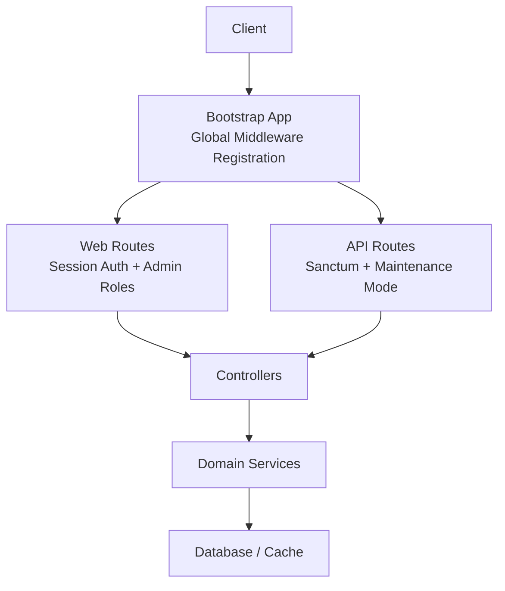
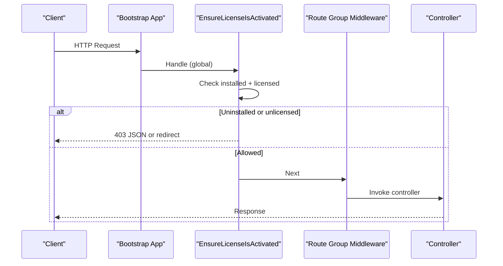
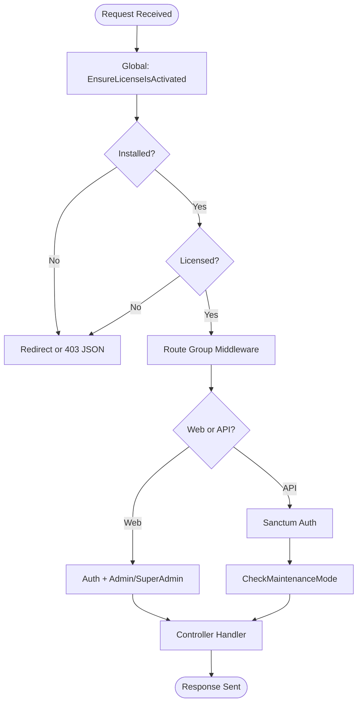
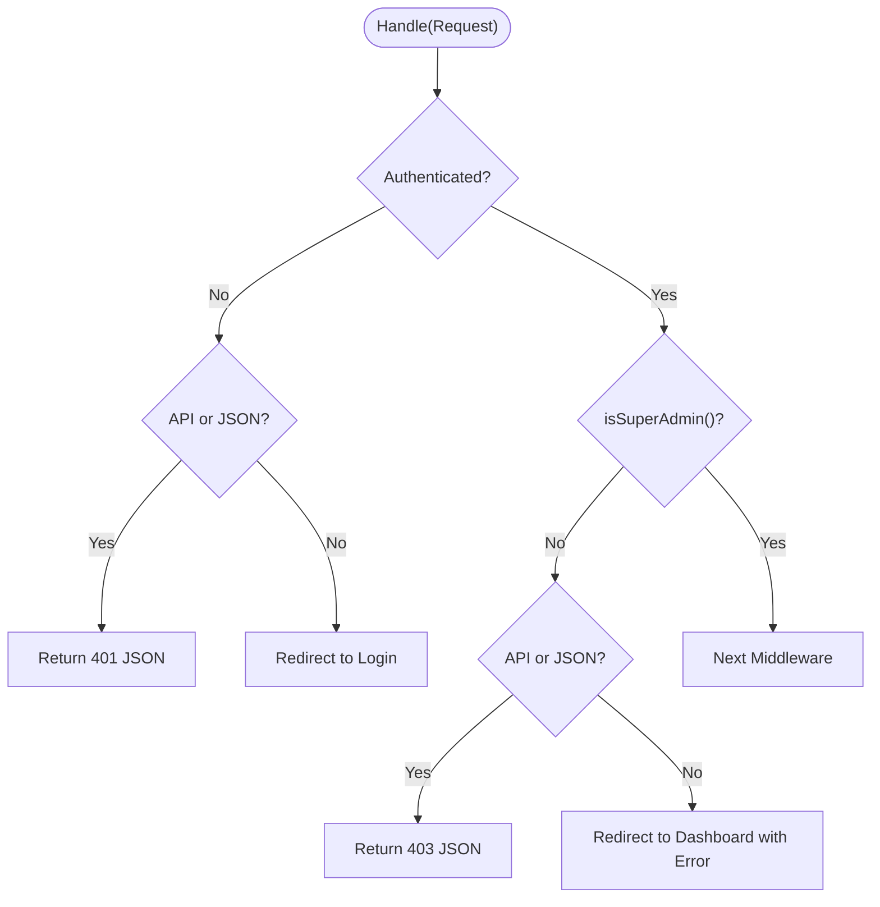
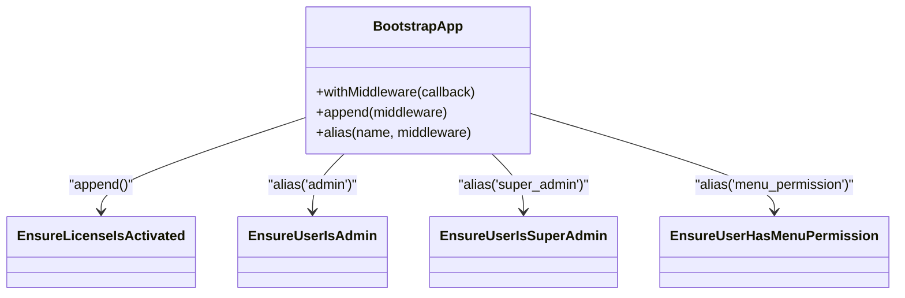
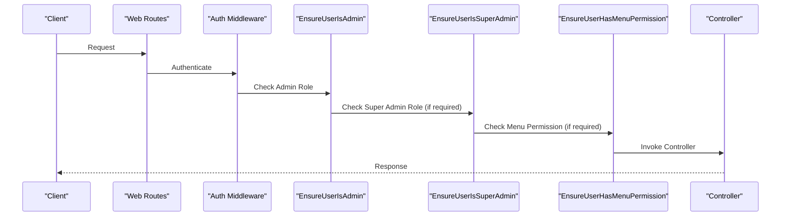
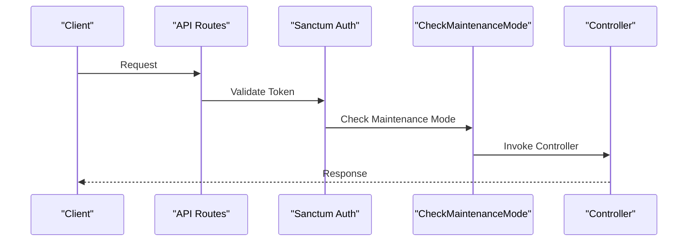
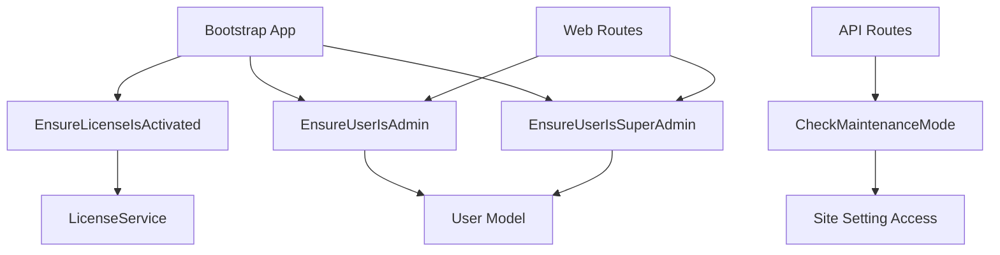

# Middleware Pipeline

<cite>
**Referenced Files in This Document**
- [bootstrap/app.php](file://backend/bootstrap/app.php)
- [routes/web.php](file://backend/routes/web.php)
- [routes/api.php](file://backend/routes/api.php)
- [app/Http/Middleware/CheckMaintenanceMode.php](file://backend/app/Http/Middleware/CheckMaintenanceMode.php)
- [app/Http/Middleware/EnsureLicenseIsActivated.php](file://backend/app/Http/Middleware/EnsureLicenseIsActivated.php)
- [app/Http/Middleware/EnsureUserIsAdmin.php](file://backend/app/Http/Middleware/EnsureUserIsAdmin.php)
- [app/Http/Middleware/EnsureUserIsSuperAdmin.php](file://backend/app/Http/Middleware/EnsureUserIsSuperAdmin.php)
- [app/Models/User.php](file://backend/app/Models/User.php)
- [app/Services/LicenseService.php](file://backend/app/Services/LicenseService.php)
</cite>

## Table of Contents
1. [Introduction](#introduction)
2. [Project Structure](#project-structure)
3. [Core Components](#core-components)
4. [Architecture Overview](#architecture-overview)
5. [Detailed Component Analysis](#detailed-component-analysis)
6. [Dependency Analysis](#dependency-analysis)
7. [Performance Considerations](#performance-considerations)
8. [Troubleshooting Guide](#troubleshooting-guide)
9. [Conclusion](#conclusion)

## Introduction
This document explains the middleware pipeline architecture used by the application to enforce cross-cutting concerns such as installation gating, license verification, maintenance mode, authentication, authorization, and role-based access control. It focuses on:

- How requests flow through the global and route-level middleware stack.
- The behavior of custom middleware implementations.
- Middleware registration, execution order, and aliasing.
- Examples of chaining, response modification, and early termination.
- Security implications and performance considerations.

The implementation is Laravel-based, with a bootstrap configuration that registers global middleware and aliases, route groups that apply additional middleware, and domain-specific logic inside each middleware class.

## Project Structure
The middleware-related code lives primarily under `backend/app/Http/Middleware`, with routing and registration spread across `backend/bootstrap/app.php`, `backend/routes/web.php`, and `backend/routes/api.php`.

**Diagram sources**
- [bootstrap/app.php:7-28](file://backend/bootstrap/app.php#L7-L28)
- [routes/web.php:68-292](file://backend/routes/web.php#L68-L292)
- [routes/api.php:18-75](file://backend/routes/api.php#L18-L75)

**Section sources**
- [bootstrap/app.php:7-28](file://backend/bootstrap/app.php#L7-L28)
- [routes/web.php:68-292](file://backend/routes/web.php#L68-L292)
- [routes/api.php:18-75](file://backend/routes/api.php#L18-L75)

## Core Components
The middleware pipeline consists of four primary custom middleware classes plus supporting models and services:

| Component | Responsibility | Key Behavior |
|---|---|---|
| `EnsureLicenseIsActivated` | Installation and license gating | Blocks uninstalled or unlicensed routes; allows install, health, payment, and public API reads. |
| `CheckMaintenanceMode` | Maintenance mode enforcement | Returns 503 JSON when maintenance is enabled, with configurable message; excludes site settings. |
| `EnsureUserIsAdmin` | Admin authorization | Requires authenticated admin user; returns 401/403 for API, redirects for web. |
| `EnsureUserIsSuperAdmin` | Super-admin authorization | Requires super-admin role; returns 401/403 for API, redirects for web. |
| `User` model | Role checks | Provides `isAdmin()` and `isSuperAdmin()` helpers. |
| `LicenseService` | License verification | Validates purchase codes, enforces domain limits, caches activation state. |

**Section sources**
- [app/Http/Middleware/EnsureLicenseIsActivated.php:10-167](file://backend/app/Http/Middleware/EnsureLicenseIsActivated.php#L10-L167)
- [app/Http/Middleware/CheckMaintenanceMode.php:10-47](file://backend/app/Http/Middleware/CheckMaintenanceMode.php#L10-L47)
- [app/Http/Middleware/EnsureUserIsAdmin.php:10-39](file://backend/app/Http/Middleware/EnsureUserIsAdmin.php#L10-L39)
- [app/Http/Middleware/EnsureUserIsSuperAdmin.php:10-36](file://backend/app/Http/Middleware/EnsureUserIsSuperAdmin.php#L10-L36)
- [app/Models/User.php:44-52](file://backend/app/Models/User.php#L44-L52)
- [app/Services/LicenseService.php:175-194](file://backend/app/Services/LicenseService.php#L175-L194)

## Architecture Overview
The request lifecycle uses two layers of middleware:

1. Global middleware registered in the bootstrap configuration.
2. Route-level middleware applied via route groups.

**Diagram sources**
- [bootstrap/app.php:19-27](file://backend/bootstrap/app.php#L19-L27)
- [app/Http/Middleware/EnsureLicenseIsActivated.php:86-167](file://backend/app/Http/Middleware/EnsureLicenseIsActivated.php#L86-L167)
- [routes/web.php:80-292](file://backend/routes/web.php#L80-L292)
- [routes/api.php:26-75](file://backend/routes/api.php#L26-L75)

### Execution Order Summary
- Global middleware runs first: `EnsureLicenseIsActivated`.
- Route group middleware runs next:
  - Web routes: `auth`, then `admin` or `super_admin`.
  - API routes: `auth:sanctum`, then `CheckMaintenanceMode`.

**Diagram sources**
- [bootstrap/app.php:19-27](file://backend/bootstrap/app.php#L19-L27)
- [routes/web.php:80-292](file://backend/routes/web.php#L80-L292)
- [routes/api.php:26-75](file://backend/routes/api.php#L26-L75)

**Section sources**
- [bootstrap/app.php:19-27](file://backend/bootstrap/app.php#L19-L27)
- [routes/web.php:80-292](file://backend/routes/web.php#L80-L292)
- [routes/api.php:26-75](file://backend/routes/api.php#L26-L75)

## Detailed Component Analysis

### EnsureLicenseIsActivated
This middleware implements a two-stage gate:

- Stage 1: Installation lock. If the application is not installed, only install-related and system routes are allowed. Other routes receive a redirect or 403 JSON.
- Stage 2: License gate. After installation, public customer API reads are permitted without a license. Admin and write routes require an activated license.

Key behaviors:
- Always allowed paths include health, payment callbacks, and install routes.
- Public API prefixes like `api/auth/` and `api/bookings/public/` bypass license checks.
- All other API GET/HEAD/OPTIONS calls are treated as public reads.
- Non-public API endpoints require `LicenseService::isActivated()`.

**Diagram sources**
- [app/Http/Middleware/EnsureLicenseIsActivated.php:30-167](file://backend/app/Http/Middleware/EnsureLicenseIsActivated.php#L30-L167)

**Section sources**
- [app/Http/Middleware/EnsureLicenseIsActivated.php:10-167](file://backend/app/Http/Middleware/EnsureLicenseIsActivated.php#L10-L167)
- [app/Services/LicenseService.php:175-194](file://backend/app/Services/LicenseService.php#L175-L194)

### CheckMaintenanceMode
This middleware enforces maintenance mode using database-backed site settings:

- Excludes specific API patterns so the frontend can still fetch maintenance status.
- Reads `maintenance_mode` and `maintenance_message` from site settings.
- Returns a 503 JSON response when maintenance is active.

**Diagram sources**
- [app/Http/Middleware/CheckMaintenanceMode.php:17-47](file://backend/app/Http/Middleware/CheckMaintenanceMode.php#L17-L47)

**Section sources**
- [app/Http/Middleware/CheckMaintenanceMode.php:10-47](file://backend/app/Http/Middleware/CheckMaintenanceMode.php#L10-L47)

### EnsureUserIsAdmin
This middleware ensures the current user is authenticated and has admin privileges:

- For API requests or JSON-prefixed admin API routes, it returns 401 if unauthenticated or 403 if not admin.
- For web requests, it redirects to login and clears session on denial.

**Diagram sources**
- [app/Http/Middleware/EnsureUserIsAdmin.php:12-39](file://backend/app/Http/Middleware/EnsureUserIsAdmin.php#L12-L39)
- [app/Models/User.php:44-47](file://backend/app/Models/User.php#L44-L47)

**Section sources**
- [app/Http/Middleware/EnsureUserIsAdmin.php:10-39](file://backend/app/Http/Middleware/EnsureUserIsAdmin.php#L10-L39)
- [app/Models/User.php:44-47](file://backend/app/Models/User.php#L44-L47)

### EnsureUserIsSuperAdmin
This middleware ensures the current user is authenticated and has super-admin privileges:

- For API requests or JSON-prefixed admin API routes, it returns 401 if unauthenticated or 403 if not super-admin.
- For web requests, it redirects to the admin dashboard with an error message.

**Diagram sources**
- [app/Http/Middleware/EnsureUserIsSuperAdmin.php:12-36](file://backend/app/Http/Middleware/EnsureUserIsSuperAdmin.php#L12-L36)
- [app/Models/User.php:49-52](file://backend/app/Models/User.php#L49-L52)

**Section sources**
- [app/Http/Middleware/EnsureUserIsSuperAdmin.php:10-36](file://backend/app/Http/Middleware/EnsureUserIsSuperAdmin.php#L10-L36)
- [app/Models/User.php:49-52](file://backend/app/Models/User.php#L49-L52)

### Middleware Registration and Aliasing
Registration occurs in the bootstrap configuration:

- Global middleware: `EnsureLicenseIsActivated` is appended to run on every request.
- Aliases:
  - `admin` maps to `EnsureUserIsAdmin`.
  - `super_admin` maps to `EnsureUserIsSuperAdmin`.
  - `menu_permission` maps to `EnsureUserHasMenuPermission`.

**Diagram sources**
- [bootstrap/app.php:19-27](file://backend/bootstrap/app.php#L19-L27)

**Section sources**
- [bootstrap/app.php:19-27](file://backend/bootstrap/app.php#L19-L27)

### Middleware Chaining Examples

#### Web Admin Routes
Web routes use chained middleware:

- `auth`: Ensures session-based authentication.
- `admin`: Ensures admin role.
- `super_admin`: Ensures super-admin role for sensitive routes.
- `menu_permission`: Enforces per-menu permissions.

**Diagram sources**
- [routes/web.php:80-292](file://backend/routes/web.php#L80-L292)

#### API Customer Routes
API routes chain Sanctum authentication and maintenance mode:

- `auth:sanctum`: Ensures API token authentication.
- `CheckMaintenanceMode`: Enforces maintenance mode.

**Diagram sources**
- [routes/api.php:63-75](file://backend/routes/api.php#L63-L75)

**Section sources**
- [routes/web.php:80-292](file://backend/routes/web.php#L80-L292)
- [routes/api.php:63-75](file://backend/routes/api.php#L63-L75)

## Dependency Analysis
The middleware components depend on models, services, and routing configuration:

**Diagram sources**
- [app/Http/Middleware/EnsureLicenseIsActivated.php:5-24](file://backend/app/Http/Middleware/EnsureLicenseIsActivated.php#L5-L24)
- [app/Http/Middleware/EnsureUserIsAdmin.php:5-8](file://backend/app/Http/Middleware/EnsureUserIsAdmin.php#L5-L8)
- [app/Http/Middleware/EnsureUserIsSuperAdmin.php:5-8](file://backend/app/Http/Middleware/EnsureUserIsSuperAdmin.php#L5-L8)
- [app/Http/Middleware/CheckMaintenanceMode.php:5-8](file://backend/app/Http/Middleware/CheckMaintenanceMode.php#L5-L8)
- [bootstrap/app.php:19-27](file://backend/bootstrap/app.php#L19-L27)
- [routes/web.php:80-292](file://backend/routes/web.php#L80-L292)
- [routes/api.php:26-75](file://backend/routes/api.php#L26-L75)

**Section sources**
- [app/Http/Middleware/EnsureLicenseIsActivated.php:5-24](file://backend/app/Http/Middleware/EnsureLicenseIsActivated.php#L5-L24)
- [app/Http/Middleware/EnsureUserIsAdmin.php:5-8](file://backend/app/Http/Middleware/EnsureUserIsAdmin.php#L5-L8)
- [app/Http/Middleware/EnsureUserIsSuperAdmin.php:5-8](file://backend/app/Http/Middleware/EnsureUserIsSuperAdmin.php#L5-L8)
- [app/Http/Middleware/CheckMaintenanceMode.php:5-8](file://backend/app/Http/Middleware/CheckMaintenanceMode.php#L5-L8)
- [bootstrap/app.php:19-27](file://backend/bootstrap/app.php#L19-L27)
- [routes/web.php:80-292](file://backend/routes/web.php#L80-L292)
- [routes/api.php:26-75](file://backend/routes/api.php#L26-L75)

## Performance Considerations
- Global middleware adds overhead to every request. `EnsureLicenseIsActivated` performs path matching and may call `LicenseService::isActivated()`, which uses cache and database checks.
- Maintenance mode checks read from site settings on every request within the affected route groups.
- Authentication middleware (`auth`, `auth:sanctum`) incurs session or token validation costs.
- To optimize:
  - Keep middleware logic lightweight and avoid unnecessary I/O.
  - Use caching where appropriate (e.g., license activation state).
  - Exclude non-critical routes from expensive middleware.
  - Monitor request latency and adjust middleware order to fail fast on denied requests.

[No sources needed since this section provides general guidance]

## Troubleshooting Guide
Common issues and resolutions:

- **Uninstalled Application**: Requests are redirected to `/install` or return 403 JSON. Verify installation completion and ensure install routes are accessible.
- **Unlicensed Application**: Non-public API endpoints return 403 JSON or redirect to `/install`. Confirm license activation via `LicenseService::isActivated()`.
- **Maintenance Mode Active**: API responses return 503 JSON with a maintenance message. Update site settings to disable maintenance mode.
- **Unauthorized Admin Access**: Admin-only routes return 401/403 for API or redirect for web. Ensure the user has the correct role.
- **Super-Admin Access Denied**: Sensitive routes require super-admin role. Verify user role and permissions.

**Section sources**
- [app/Http/Middleware/EnsureLicenseIsActivated.php:98-167](file://backend/app/Http/Middleware/EnsureLicenseIsActivated.php#L98-L167)
- [app/Http/Middleware/CheckMaintenanceMode.php:32-47](file://backend/app/Http/Middleware/CheckMaintenanceMode.php#L32-L47)
- [app/Http/Middleware/EnsureUserIsAdmin.php:14-39](file://backend/app/Http/Middleware/EnsureUserIsAdmin.php#L14-L39)
- [app/Http/Middleware/EnsureUserIsSuperAdmin.php:14-36](file://backend/app/Http/Middleware/EnsureUserIsSuperAdmin.php#L14-L36)

## Conclusion
The middleware pipeline provides a robust foundation for enforcing security, licensing, and operational constraints. By combining global and route-level middleware, the application ensures consistent behavior across web and API endpoints. Custom middleware implementations handle authentication, authorization, maintenance mode, and license verification, while route groups enable fine-grained control over middleware chains. Proper registration, execution order, and thoughtful design of middleware logic contribute to both security and performance.

[No sources needed since this section summarizes without analyzing specific files]