# Middleware Pipeline

<cite>
**Referenced Files in This Document**
- [bootstrap/app.php](file://backend/bootstrap/app.php)
- [routes/web.php](file://backend/routes/web.php)
- [routes/api.php](file://backend/routes/api.php)
- [app/Http/Middleware/CheckMaintenanceMode.php](file://backend/app/Http/Middleware/CheckMaintenanceMode.php)
- [app/Http/Middleware/EnsureLicenseIsActivated.php](file://backend/app/Http/Middleware/EnsureLicenseIsActivated.php)
- [app/Http/Middleware/EnsureUserIsAdmin.php](file://backend/app/Http/Middleware/EnsureUserIsAdmin.php)
- [app/Http/Middleware/EnsureUserIsSuperAdmin.php](file://backend/app/Http/Middleware/EnsureUserIsSuperAdmin.php)
- [app/Http/Middleware/ApplySessionLifetime.php](file://backend/app/Http/Middleware/ApplySessionLifetime.php)
- [app/Http/Middleware/EnforceAdminSessionTimeout.php](file://backend/app/Http/Middleware/EnforceAdminSessionTimeout.php)
- [app/Http/Middleware/EnsureApiUserIsAdmin.php](file://backend/app/Http/Middleware/EnsureApiUserIsAdmin.php)
- [app/Http/Middleware/EnsureApiUserHasMenuPermission.php](file://backend/app/Http/Middleware/EnsureApiUserHasMenuPermission.php)
- [app/Http/Middleware/EnsureUserHasMenuPermission.php](file://backend/app/Http/Middleware/EnsureUserHasMenuPermission.php)
- [app/Services/AdminSessionService.php](file://backend/app/Services/AdminSessionService.php)
- [app/Models/User.php](file://backend/app/Models/User.php)
- [app/Services/LicenseService.php](file://backend/app/Services/LicenseService.php)
</cite>

## Update Summary
**Changes Made**
- Added documentation for two new API-specific authorization middleware: `EnsureApiUserIsAdmin` and `EnsureApiUserHasMenuPermission`
- Enhanced `ApplySessionLifetime` middleware to support both admin panel and customer API token lifetimes
- Updated core components table to include the new API middleware classes
- Expanded architecture overview with API-specific authorization flow
- Added detailed analysis of API token-based authorization mechanisms
- Updated middleware registration section to reflect new API aliases
- Enhanced performance considerations to cover API middleware overhead

## Table of Contents
1. [Introduction](#introduction)
2. [Project Structure](#project-structure)
3. [Core Components](#core-components)
4. [Architecture Overview](#architecture-overview)
5. [Detailed Component Analysis](#detailed-component-analysis)
6. [Dependency Analysis](#dependency-analysis)
7. [Performance Considerations](#performance-considerations)
8. [Troubleshooting Guide](#troubleshooting-guide)
9. [Conclusion](#conclusion)

## Introduction
This document explains the middleware pipeline architecture used by the application to enforce cross-cutting concerns such as installation gating, license verification, maintenance mode, authentication, authorization, role-based access control, and admin session security. It focuses on:

- How requests flow through the global and route-level middleware stack.
- The behavior of custom middleware implementations including new API-specific authorization features.
- Middleware registration, execution order, and aliasing.
- Examples of chaining, response modification, and early termination.
- Security implications and performance considerations.

The implementation is Laravel-based, with a bootstrap configuration that registers global middleware and aliases, route groups that apply additional middleware, and domain-specific logic inside each middleware class.

## Project Structure
The middleware-related code lives primarily under `backend/app/Http/Middleware`, with routing and registration spread across `backend/bootstrap/app.php`, `backend/routes/web.php`, and `backend/routes/api.php`.

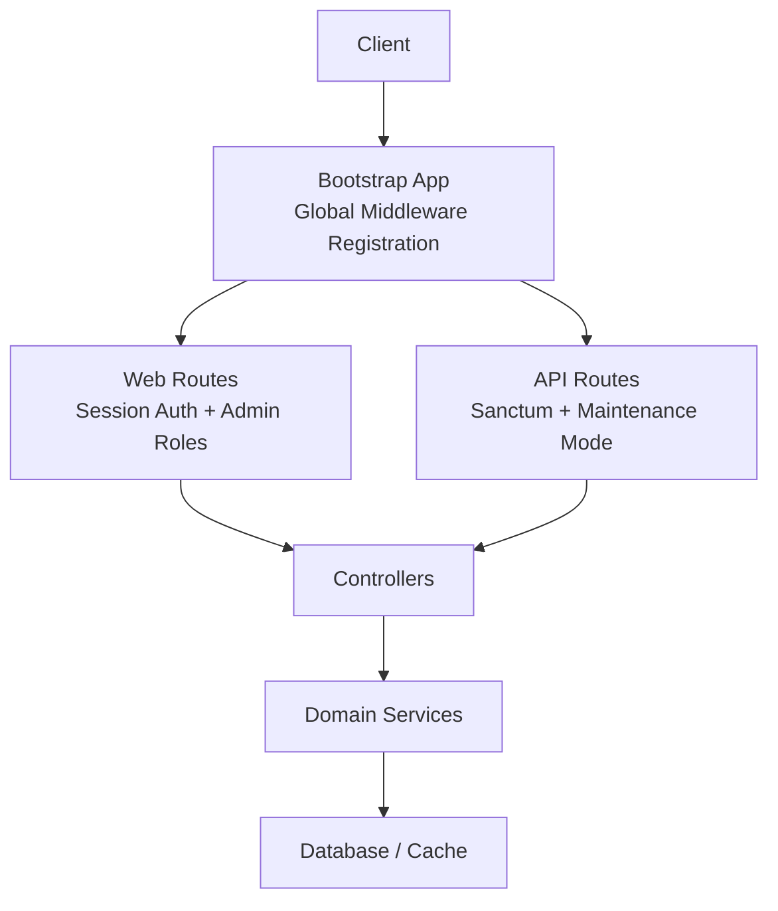

**Diagram sources**
- [bootstrap/app.php:7-28](file://backend/bootstrap/app.php#L7-L28)
- [routes/web.php:68-292](file://backend/routes/web.php#L68-L292)
- [routes/api.php:18-75](file://backend/routes/api.php#L18-L75)

**Section sources**
- [bootstrap/app.php:7-28](file://backend/bootstrap/app.php#L7-L28)
- [routes/web.php:68-292](file://backend/routes/web.php#L68-L292)
- [routes/api.php:18-75](file://backend/routes/api.php#L18-L75)

## Core Components
The middleware pipeline consists of eight primary custom middleware classes plus supporting models and services:

| Component | Responsibility | Key Behavior |
|---|---|---|
| `EnsureLicenseIsActivated` | Installation and license gating | Blocks uninstalled or unlicensed routes; allows install, health, payment, and public API reads. |
| `CheckMaintenanceMode` | Maintenance mode enforcement | Returns 503 JSON when maintenance is enabled, with configurable message; excludes site settings. |
| `EnsureUserIsAdmin` | Admin authorization (web) | Requires authenticated admin user; returns 401/403 for API, redirects for web. |
| `EnsureUserIsSuperAdmin` | Super-admin authorization (web) | Requires super-admin role; returns 401/403 for API, redirects for web. |
| `EnsureApiUserIsAdmin` | Admin authorization (API) | Token-based admin check for Sanctum-authenticated API requests. |
| `EnsureApiUserHasMenuPermission` | Menu permission (API) | Token-based menu permission check for Sanctum-authenticated API requests. |
| `ApplySessionLifetime` | Session lifetime configuration | Configures session and token lifetimes from admin settings before session store initialization. |
| `EnforceAdminSessionTimeout` | Exact idle timeout enforcement | Signs out admins after configured idle period with automatic sign-out functionality. |
| `User` model | Role checks | Provides `isAdmin()`, `isSuperAdmin()`, and `hasMenuPermission()` helpers. |
| `LicenseService` | License verification | Validates purchase codes, enforces domain limits, caches activation state. |
| `AdminSessionService` | Session policy management | Resolves admin and customer session lifetimes from site settings with validation and defaults. |

**Updated** Added two new API-specific middleware classes and enhanced session lifetime support.

**Section sources**
- [app/Http/Middleware/EnsureLicenseIsActivated.php:10-167](file://backend/app/Http/Middleware/EnsureLicenseIsActivated.php#L10-L167)
- [app/Http/Middleware/CheckMaintenanceMode.php:10-47](file://backend/app/Http/Middleware/CheckMaintenanceMode.php#L10-L47)
- [app/Http/Middleware/EnsureUserIsAdmin.php:10-39](file://backend/app/Http/Middleware/EnsureUserIsAdmin.php#L10-L39)
- [app/Http/Middleware/EnsureUserIsSuperAdmin.php:10-36](file://backend/app/Http/Middleware/EnsureUserIsSuperAdmin.php#L10-L36)
- [app/Http/Middleware/EnsureApiUserIsAdmin.php:16-37](file://backend/app/Http/Middleware/EnsureApiUserIsAdmin.php#L16-L37)
- [app/Http/Middleware/EnsureApiUserHasMenuPermission.php:14-35](file://backend/app/Http/Middleware/EnsureApiUserHasMenuPermission.php#L14-L35)
- [app/Http/Middleware/ApplySessionLifetime.php:10-49](file://backend/app/Http/Middleware/ApplySessionLifetime.php#L10-L49)
- [app/Http/Middleware/EnforceAdminSessionTimeout.php:11-76](file://backend/app/Http/Middleware/EnforceAdminSessionTimeout.php#L11-L76)
- [app/Services/AdminSessionService.php:8-121](file://backend/app/Services/AdminSessionService.php#L8-L121)
- [app/Models/User.php:44-85](file://backend/app/Models/User.php#L44-L85)
- [app/Services/LicenseService.php:175-194](file://backend/app/Services/LicenseService.php#L175-L194)

## Architecture Overview
The request lifecycle uses two layers of middleware:

1. Global middleware registered in the bootstrap configuration.
2. Route-level middleware applied via route groups.

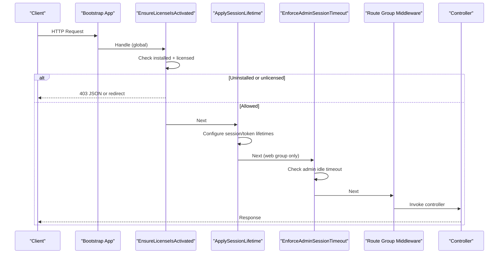

**Diagram sources**
- [bootstrap/app.php:19-28](file://backend/bootstrap/app.php#L19-L28)
- [app/Http/Middleware/EnsureLicenseIsActivated.php:86-167](file://backend/app/Http/Middleware/EnsureLicenseIsActivated.php#L86-L167)
- [app/Http/Middleware/ApplySessionLifetime.php:27-47](file://backend/app/Http/Middleware/ApplySessionLifetime.php#L27-L47)
- [app/Http/Middleware/EnforceAdminSessionTimeout.php:27-48](file://backend/app/Http/Middleware/EnforceAdminSessionTimeout.php#L27-L48)
- [routes/web.php:80-292](file://backend/routes/web.php#L80-L292)
- [routes/api.php:26-75](file://backend/routes/api.php#L26-L75)

### Execution Order Summary
- Global middleware runs first: `EnsureLicenseIsActivated`, then `ApplySessionLifetime`.
- Web group middleware runs next: `EnforceAdminSessionTimeout` (exact idle timeout).
- Route group middleware runs last:
  - Web routes: `auth`, then `admin` or `super_admin`.
  - API routes: `auth:sanctum`, then `api_admin` or `api_menu`, then `CheckMaintenanceMode`.

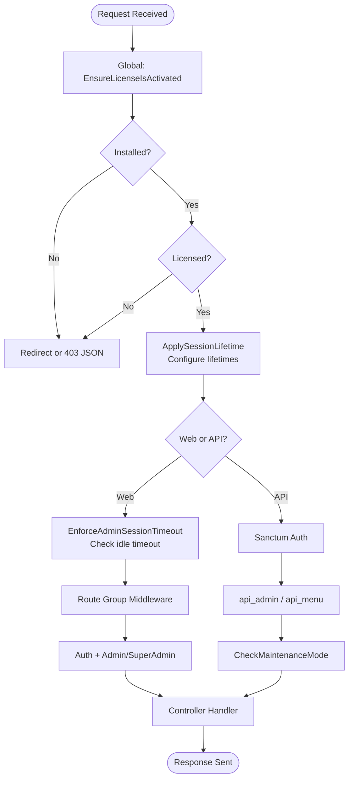

**Diagram sources**
- [bootstrap/app.php:19-28](file://backend/bootstrap/app.php#L19-L28)
- [routes/web.php:80-292](file://backend/routes/web.php#L80-L292)
- [routes/api.php:26-75](file://backend/routes/api.php#L26-L75)

**Section sources**
- [bootstrap/app.php:19-28](file://backend/bootstrap/app.php#L19-L28)
- [routes/web.php:80-292](file://backend/routes/web.php#L80-L292)
- [routes/api.php:26-75](file://backend/routes/api.php#L26-L75)

## Detailed Component Analysis

### EnsureLicenseIsActivated
This middleware implements a two-stage gate:

- Stage 1: Installation lock. If the application is not installed, only install-related and system routes are allowed. Other routes receive a redirect or 403 JSON.
- Stage 2: License gate. After installation, public customer API reads are permitted without a license. Admin and write routes require an activated license.

Key behaviors:
- Always allowed paths include health, payment callbacks, and install routes.
- Public API prefixes like `api/auth/` and `api/bookings/public/` bypass license checks.
- All other API GET/HEAD/OPTIONS calls are treated as public reads.
- Non-public API endpoints require `LicenseService::isActivated()`.

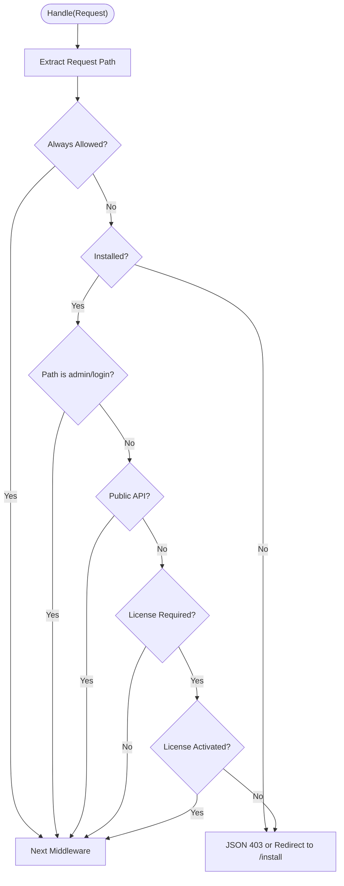

**Diagram sources**
- [app/Http/Middleware/EnsureLicenseIsActivated.php:30-167](file://backend/app/Http/Middleware/EnsureLicenseIsActivated.php#L30-L167)

**Section sources**
- [app/Http/Middleware/EnsureLicenseIsActivated.php:10-167](file://backend/app/Http/Middleware/EnsureLicenseIsActivated.php#L10-L167)
- [app/Services/LicenseService.php:175-194](file://backend/app/Services/LicenseService.php#L175-L194)

### ApplySessionLifetime
This middleware configures session and token lifetimes based on admin settings before the session store initializes:

- Reads admin session lifetime from `AdminSessionService`.
- Detects admin API requests (`api/admin/*`) vs customer API requests.
- Updates framework configuration for session lifetime, remember cookie duration, and Sanctum token expiration.
- Runs globally before session store initialization to ensure proper timing.

Key behaviors:
- Sets `session.lifetime` and `auth.guards.web.remember` to admin session minutes.
- For admin API routes, sets `sanctum.expiration` to admin session minutes.
- For customer API routes, sets `sanctum.expiration` to customer session minutes (or null for never-expiring tokens).
- Prevents "remember me" cookies from outliving the configured policy.

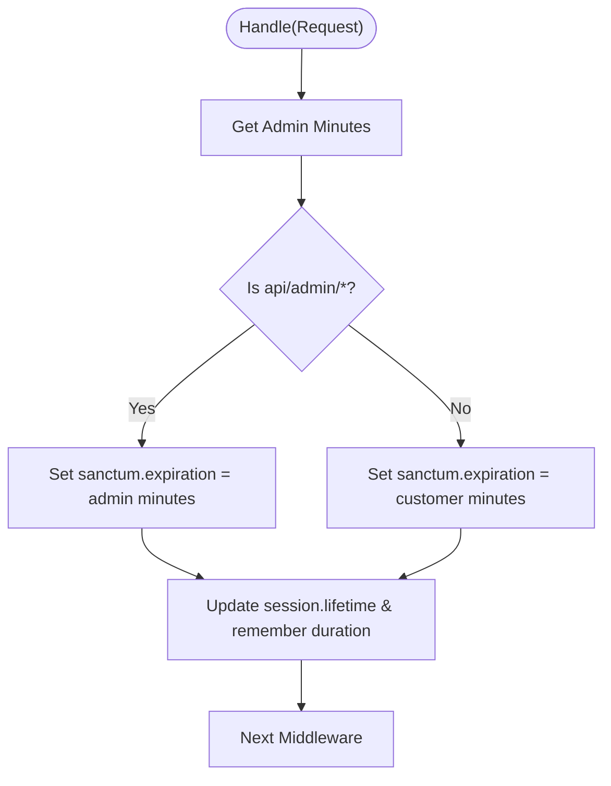

**Diagram sources**
- [app/Http/Middleware/ApplySessionLifetime.php:27-47](file://backend/app/Http/Middleware/ApplySessionLifetime.php#L27-L47)

**Section sources**
- [app/Http/Middleware/ApplySessionLifetime.php:10-49](file://backend/app/Http/Middleware/ApplySessionLifetime.php#L10-L49)
- [app/Services/AdminSessionService.php:41-81](file://backend/app/Services/AdminSessionService.php#L41-L81)

### EnforceAdminSessionTimeout
This middleware enforces exact idle timeout for admin sessions with automatic sign-out functionality:

- Only applies to authenticated admin users (not customers or guests).
- Tracks last activity timestamp in session using `admin_last_activity` key.
- Compares current time against configured idle timeout.
- Automatically signs out expired sessions and redirects to login.

Key behaviors:
- Uses `AdminSessionService` to get configured timeout in minutes.
- Stores last activity timestamp on each successful request.
- On timeout: logs out user, invalidates session, regenerates CSRF token.
- Returns appropriate responses for both web and API requests.
- Provides clear "session expired" messaging to users.

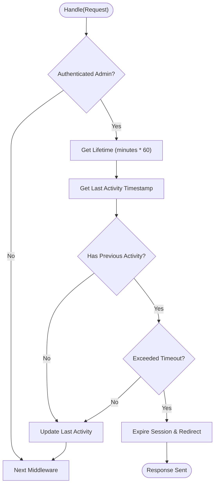

**Diagram sources**
- [app/Http/Middleware/EnforceAdminSessionTimeout.php:27-76](file://backend/app/Http/Middleware/EnforceAdminSessionTimeout.php#L27-L76)

**Section sources**
- [app/Http/Middleware/EnforceAdminSessionTimeout.php:11-76](file://backend/app/Http/Middleware/EnforceAdminSessionTimeout.php#L11-L76)
- [app/Services/AdminSessionService.php:41-57](file://backend/app/Services/AdminSessionService.php#L41-L57)

### EnsureApiUserIsAdmin
This middleware provides token-based admin authorization for API requests, serving as the counterpart to `EnsureUserIsAdmin`:

- Works with Sanctum bearer tokens instead of session cookies.
- Extracts the authenticated user from `$request->user()`.
- Returns 401 JSON if no user is authenticated.
- Returns 403 JSON if the user is not an admin.
- Allows the request to proceed if the user has admin privileges.

Key behaviors:
- Designed specifically for API routes using Sanctum authentication.
- Uses the same `isAdmin()` method from the User model as the web middleware.
- Provides consistent error responses for API clients.
- Enables fine-grained API endpoint protection.

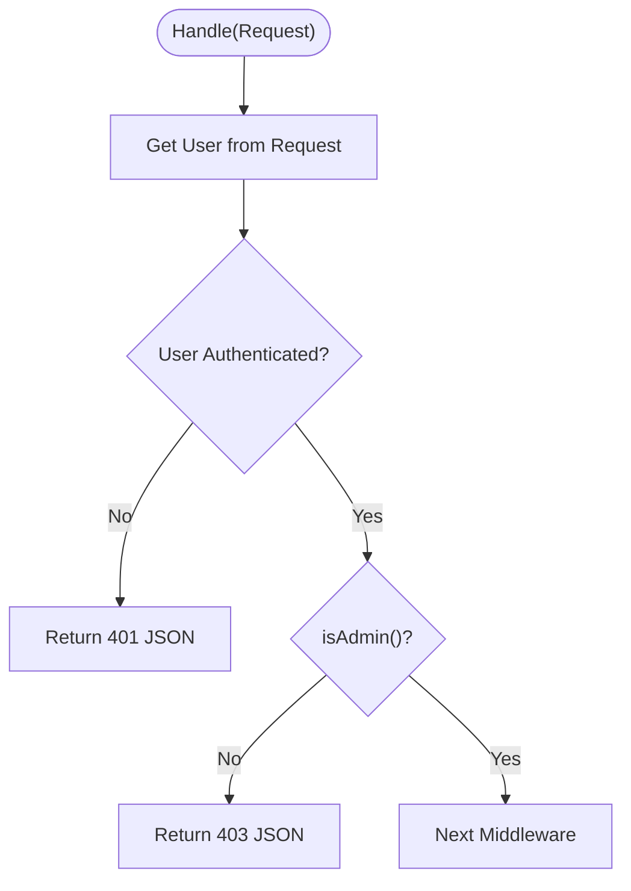

**Diagram sources**
- [app/Http/Middleware/EnsureApiUserIsAdmin.php:18-37](file://backend/app/Http/Middleware/EnsureApiUserIsAdmin.php#L18-L37)
- [app/Models/User.php:55-58](file://backend/app/Models/User.php#L55-L58)

**Section sources**
- [app/Http/Middleware/EnsureApiUserIsAdmin.php:16-37](file://backend/app/Http/Middleware/EnsureApiUserIsAdmin.php#L16-L37)
- [app/Models/User.php:55-58](file://backend/app/Models/User.php#L55-L58)

### EnsureApiUserHasMenuPermission
This middleware provides token-based menu permission checking for API requests, serving as the counterpart to `EnsureUserHasMenuPermission`:

- Works with Sanctum bearer tokens instead of session cookies.
- Accepts a menu parameter to specify which menu permission to check.
- Returns 401 JSON if no user is authenticated.
- Returns 403 JSON if the user lacks the required menu permission.
- Allows the request to proceed if the user has the specified menu permission.

Key behaviors:
- Designed specifically for API routes using Sanctum authentication.
- Uses the same `hasMenuPermission()` method from the User model as the web middleware.
- Supports granular API endpoint permissions (bookings, stations, buses, etc.).
- Provides consistent error responses for API clients.

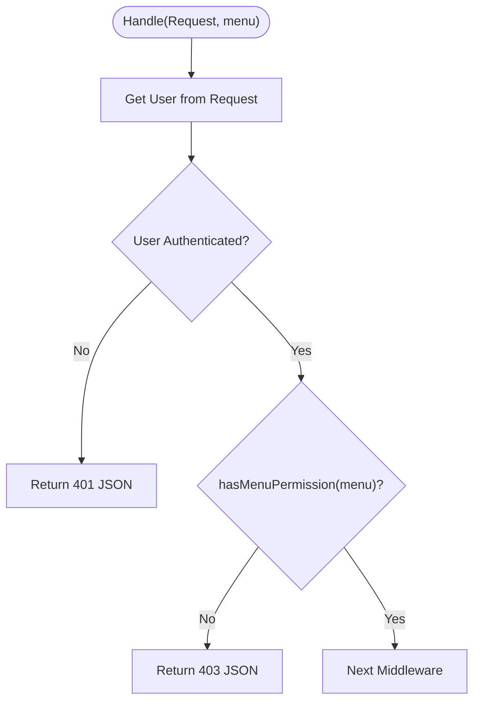

**Diagram sources**
- [app/Http/Middleware/EnsureApiUserHasMenuPermission.php:16-35](file://backend/app/Http/Middleware/EnsureApiUserHasMenuPermission.php#L16-L35)
- [app/Models/User.php:70-85](file://backend/app/Models/User.php#L70-L85)

**Section sources**
- [app/Http/Middleware/EnsureApiUserHasMenuPermission.php:14-35](file://backend/app/Http/Middleware/EnsureApiUserHasMenuPermission.php#L14-L35)
- [app/Models/User.php:70-85](file://backend/app/Models/User.php#L70-L85)

### CheckMaintenanceMode
This middleware enforces maintenance mode using database-backed site settings:

- Excludes specific API patterns so the frontend can still fetch maintenance status.
- Reads `maintenance_mode` and `maintenance_message` from site settings.
- Returns a 503 JSON response when maintenance is active.

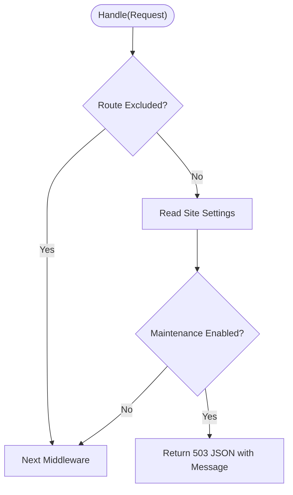

**Diagram sources**
- [app/Http/Middleware/CheckMaintenanceMode.php:17-47](file://backend/app/Http/Middleware/CheckMaintenanceMode.php#L17-L47)

**Section sources**
- [app/Http/Middleware/CheckMaintenanceMode.php:10-47](file://backend/app/Http/Middleware/CheckMaintenanceMode.php#L10-L47)

### EnsureUserIsAdmin
This middleware ensures the current user is authenticated and has admin privileges:

- For API requests or JSON-prefixed admin API routes, it returns 401 if unauthenticated or 403 if not admin.
- For web requests, it redirects to login and clears session on denial.

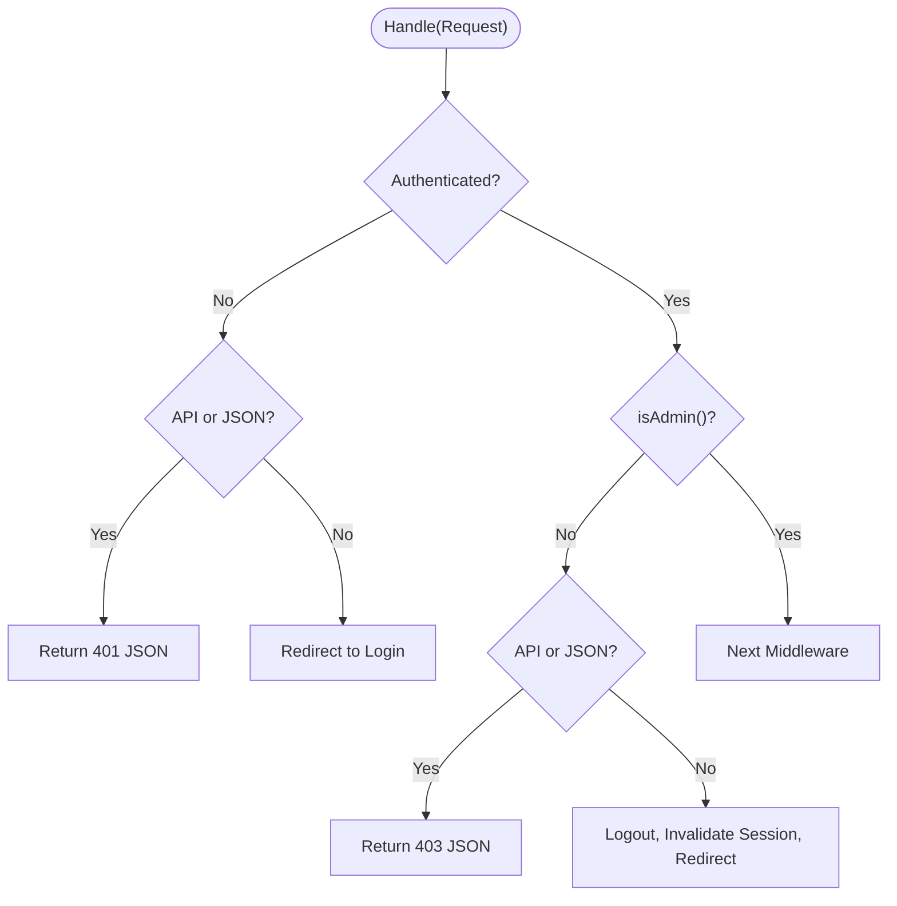

**Diagram sources**
- [app/Http/Middleware/EnsureUserIsAdmin.php:12-39](file://backend/app/Http/Middleware/EnsureUserIsAdmin.php#L12-L39)
- [app/Models/User.php:44-47](file://backend/app/Models/User.php#L44-L47)

**Section sources**
- [app/Http/Middleware/EnsureUserIsAdmin.php:10-39](file://backend/app/Http/Middleware/EnsureUserIsAdmin.php#L10-L39)
- [app/Models/User.php:44-47](file://backend/app/Models/User.php#L44-L47)

### EnsureUserIsSuperAdmin
This middleware ensures the current user is authenticated and has super-admin privileges:

- For API requests or JSON-prefixed admin API routes, it returns 401 if unauthenticated or 403 if not super-admin.
- For web requests, it redirects to the admin dashboard with an error message.

**Diagram sources**
- [app/Http/Middleware/EnsureUserIsSuperAdmin.php:12-36](file://backend/app/Http/Middleware/EnsureUserIsSuperAdmin.php#L12-L36)
- [app/Models/User.php:49-52](file://backend/app/Models/User.php#L49-L52)

**Section sources**
- [app/Http/Middleware/EnsureUserIsSuperAdmin.php:10-36](file://backend/app/Http/Middleware/EnsureUserIsSuperAdmin.php#L10-L36)
- [app/Models/User.php:49-52](file://backend/app/Models/User.php#L49-L52)

### Middleware Registration and Aliasing
Registration occurs in the bootstrap configuration:

- Global middleware: `EnsureLicenseIsActivated` and `ApplySessionLifetime` are appended to run on every request.
- Web group middleware: `EnforceAdminSessionTimeout` is added to the 'web' group for exact idle timeout enforcement.
- Aliases:
  - `admin` maps to `EnsureUserIsAdmin`.
  - `super_admin` maps to `EnsureUserIsSuperAdmin`.
  - `menu_permission` maps to `EnsureUserHasMenuPermission`.
  - `api_admin` maps to `EnsureApiUserIsAdmin`.
  - `api_menu` maps to `EnsureApiUserHasMenuPermission`.

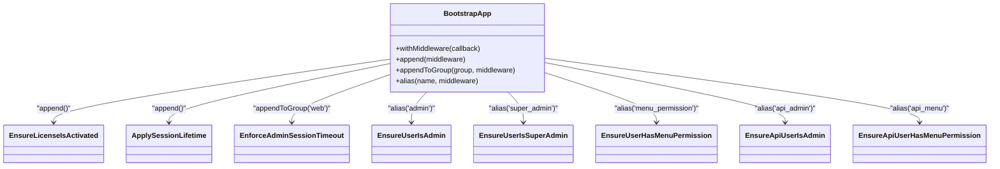

**Diagram sources**
- [bootstrap/app.php:19-37](file://backend/bootstrap/app.php#L19-L37)

**Section sources**
- [bootstrap/app.php:19-37](file://backend/bootstrap/app.php#L19-L37)

### Middleware Chaining Examples

#### Web Admin Routes
Web routes use chained middleware:

- `auth`: Ensures session-based authentication.
- `admin`: Ensures admin role.
- `super_admin`: Ensures super-admin role for sensitive routes.
- `menu_permission`: Enforces per-menu permissions.

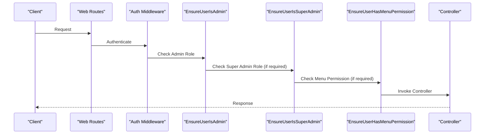

**Diagram sources**
- [routes/web.php:80-292](file://backend/routes/web.php#L80-L292)

#### API Admin Routes
API routes chain Sanctum authentication with API-specific authorization:

- `auth:sanctum`: Ensures API token authentication.
- `api_admin`: Ensures admin role for API requests.
- `api_menu`: Ensures menu permissions for API requests.

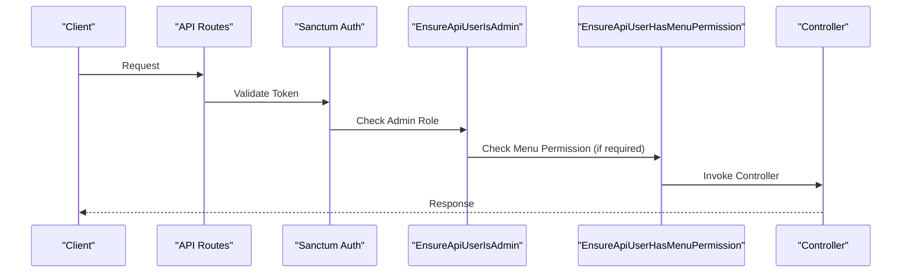

**Diagram sources**
- [routes/api.php:104-264](file://backend/routes/api.php#L104-L264)

#### API Customer Routes
API routes chain Sanctum authentication and maintenance mode:

- `auth:sanctum`: Ensures API token authentication.
- `CheckMaintenanceMode`: Enforces maintenance mode.

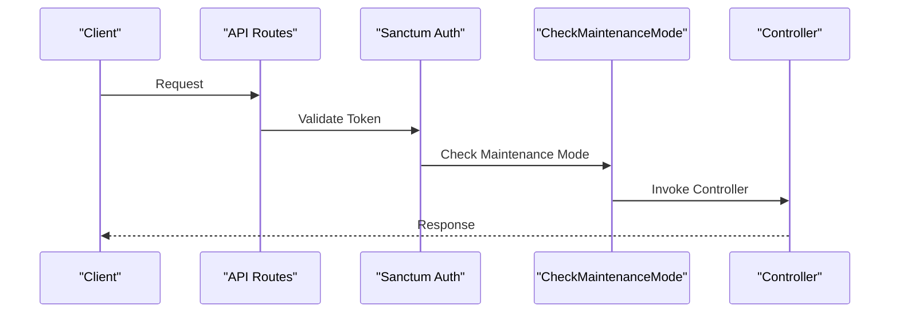

**Diagram sources**
- [routes/api.php:76-88](file://backend/routes/api.php#L76-L88)

**Section sources**
- [routes/web.php:80-292](file://backend/routes/web.php#L80-L292)
- [routes/api.php:104-264](file://backend/routes/api.php#L104-L264)
- [routes/api.php:76-88](file://backend/routes/api.php#L76-L88)

## Dependency Analysis
The middleware components depend on models, services, and routing configuration:

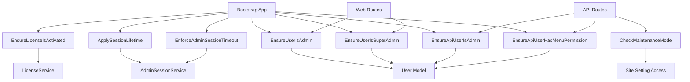

**Diagram sources**
- [app/Http/Middleware/EnsureLicenseIsActivated.php:5-24](file://backend/app/Http/Middleware/EnsureLicenseIsActivated.php#L5-L24)
- [app/Http/Middleware/EnsureUserIsAdmin.php:5-8](file://backend/app/Http/Middleware/EnsureUserIsAdmin.php#L5-L8)
- [app/Http/Middleware/EnsureUserIsSuperAdmin.php:5-8](file://backend/app/Http/Middleware/EnsureUserIsSuperAdmin.php#L5-L8)
- [app/Http/Middleware/EnsureApiUserIsAdmin.php:5-8](file://backend/app/Http/Middleware/EnsureApiUserIsAdmin.php#L5-L8)
- [app/Http/Middleware/EnsureApiUserHasMenuPermission.php:5-8](file://backend/app/Http/Middleware/EnsureApiUserHasMenuPermission.php#L5-L8)
- [app/Http/Middleware/CheckMaintenanceMode.php:5-8](file://backend/app/Http/Middleware/CheckMaintenanceMode.php#L5-L8)
- [app/Http/Middleware/ApplySessionLifetime.php:5-25](file://backend/app/Http/Middleware/ApplySessionLifetime.php#L5-L25)
- [app/Http/Middleware/EnforceAdminSessionTimeout.php:5-25](file://backend/app/Http/Middleware/EnforceAdminSessionTimeout.php#L5-L25)
- [bootstrap/app.php:19-37](file://backend/bootstrap/app.php#L19-L37)
- [routes/web.php:80-292](file://backend/routes/web.php#L80-L292)
- [routes/api.php:26-75](file://backend/routes/api.php#L26-L75)

**Section sources**
- [app/Http/Middleware/EnsureLicenseIsActivated.php:5-24](file://backend/app/Http/Middleware/EnsureLicenseIsActivated.php#L5-L24)
- [app/Http/Middleware/EnsureUserIsAdmin.php:5-8](file://backend/app/Http/Middleware/EnsureUserIsAdmin.php#L5-L8)
- [app/Http/Middleware/EnsureUserIsSuperAdmin.php:5-8](file://backend/app/Http/Middleware/EnsureUserIsSuperAdmin.php#L5-L8)
- [app/Http/Middleware/EnsureApiUserIsAdmin.php:5-8](file://backend/app/Http/Middleware/EnsureApiUserIsAdmin.php#L5-L8)
- [app/Http/Middleware/EnsureApiUserHasMenuPermission.php:5-8](file://backend/app/Http/Middleware/EnsureApiUserHasMenuPermission.php#L5-L8)
- [app/Http/Middleware/CheckMaintenanceMode.php:5-8](file://backend/app/Http/Middleware/CheckMaintenanceMode.php#L5-L8)
- [app/Http/Middleware/ApplySessionLifetime.php:5-25](file://backend/app/Http/Middleware/ApplySessionLifetime.php#L5-L25)
- [app/Http/Middleware/EnforceAdminSessionTimeout.php:5-25](file://backend/app/Http/Middleware/EnforceAdminSessionTimeout.php#L5-L25)
- [bootstrap/app.php:19-37](file://backend/bootstrap/app.php#L19-L37)
- [routes/web.php:80-292](file://backend/routes/web.php#L80-L292)
- [routes/api.php:26-75](file://backend/routes/api.php#L26-L75)

## Performance Considerations
- Global middleware adds overhead to every request. `EnsureLicenseIsActivated` performs path matching and may call `LicenseService::isActivated()`, which uses cache and database checks.
- `ApplySessionLifetime` runs on every request to configure session and token lifetimes, but this is lightweight configuration-only logic.
- `EnforceAdminSessionTimeout` runs on every web request for admin sessions, performing session read/write operations to track activity timestamps.
- Maintenance mode checks read from site settings on every request within the affected route groups.
- Authentication middleware (`auth`, `auth:sanctum`) incurs session or token validation costs.
- New API middleware (`EnsureApiUserIsAdmin`, `EnsureApiUserHasMenuPermission`) add minimal overhead for token-based authorization checks.
- To optimize:
  - Keep middleware logic lightweight and avoid unnecessary I/O.
  - Use caching where appropriate (e.g., license activation state).
  - Exclude non-critical routes from expensive middleware.
  - Monitor request latency and adjust middleware order to fail fast on denied requests.
  - The new session middleware are designed to be efficient, with `ApplySessionLifetime` doing only configuration updates and `EnforceAdminSessionTimeout` performing minimal session operations.
  - API middleware leverage existing Sanctum authentication rather than duplicating auth logic.

**Updated** Added performance considerations for the new API middleware and enhanced session management.

## Troubleshooting Guide
Common issues and resolutions:

- **Uninstalled Application**: Requests are redirected to `/install` or return 403 JSON. Verify installation completion and ensure install routes are accessible.
- **Unlicensed Application**: Non-public API endpoints return 403 JSON or redirect to `/install`. Confirm license activation via `LicenseService::isActivated()`.
- **Maintenance Mode Active**: API responses return 503 JSON with a maintenance message. Update site settings to disable maintenance mode.
- **Unauthorized Admin Access**: Admin-only routes return 401/403 for API or redirect for web. Ensure the user has the correct role.
- **Super-Admin Access Denied**: Sensitive routes require super-admin role. Verify user role and permissions.
- **API Admin Authorization Failed**: API requests return 401/403 JSON. Ensure the Sanctum token is valid and the user has admin privileges.
- **API Menu Permission Denied**: API requests return 403 JSON with menu-specific messages. Verify the user has the required menu permissions in their profile.
- **Admin Session Expires Unexpectedly**: Check admin session lifetime settings in Site Settings → Session Security. Verify the configured timeout value is within acceptable ranges (1 minute to 7 days).
- **Customer API Tokens Expire**: Review customer session lifetime settings. A value of 0 means tokens never expire, while values above 0 set expiration in minutes (max 30 days).
- **Session Configuration Not Applied**: Ensure `ApplySessionLifetime` middleware runs before session store initialization. Check that admin session settings are properly saved in the database.
- **Token-Based Authorization Issues**: Verify that API routes use the correct middleware aliases (`api_admin`, `api_menu`) and that Sanctum is properly configured.

**Updated** Added troubleshooting guidance for the new API middleware and enhanced session security features.

**Section sources**
- [app/Http/Middleware/EnsureLicenseIsActivated.php:98-167](file://backend/app/Http/Middleware/EnsureLicenseIsActivated.php#L98-L167)
- [app/Http/Middleware/CheckMaintenanceMode.php:32-47](file://backend/app/Http/Middleware/CheckMaintenanceMode.php#L32-L47)
- [app/Http/Middleware/EnsureUserIsAdmin.php:14-39](file://backend/app/Http/Middleware/EnsureUserIsAdmin.php#L14-L39)
- [app/Http/Middleware/EnsureUserIsSuperAdmin.php:14-36](file://backend/app/Http/Middleware/EnsureUserIsSuperAdmin.php#L14-L36)
- [app/Http/Middleware/EnsureApiUserIsAdmin.php:18-37](file://backend/app/Http/Middleware/EnsureApiUserIsAdmin.php#L18-L37)
- [app/Http/Middleware/EnsureApiUserHasMenuPermission.php:16-35](file://backend/app/Http/Middleware/EnsureApiUserHasMenuPermission.php#L16-L35)
- [app/Http/Middleware/ApplySessionLifetime.php:27-47](file://backend/app/Http/Middleware/ApplySessionLifetime.php#L27-L47)
- [app/Http/Middleware/EnforceAdminSessionTimeout.php:27-76](file://backend/app/Http/Middleware/EnforceAdminSessionTimeout.php#L27-L76)
- [app/Services/AdminSessionService.php:30-36](file://backend/app/Services/AdminSessionService.php#L30-L36)

## Conclusion
The middleware pipeline provides a robust foundation for enforcing security, licensing, operational constraints, and comprehensive session management. By combining global and route-level middleware, the application ensures consistent behavior across web and API endpoints. Custom middleware implementations handle authentication, authorization, maintenance mode, license verification, and precise session security policies. The addition of API-specific middleware (`EnsureApiUserIsAdmin` and `EnsureApiUserHasMenuPermission`) provides token-based authorization for Sanctum-authenticated API requests, while the enhanced `ApplySessionLifetime` middleware supports both admin panel and customer API token lifetimes. Proper registration, execution order, and thoughtful design of middleware logic contribute to both security and performance across all request types.

**Updated** Enhanced conclusion to reflect the new API middleware capabilities and enhanced session management features.