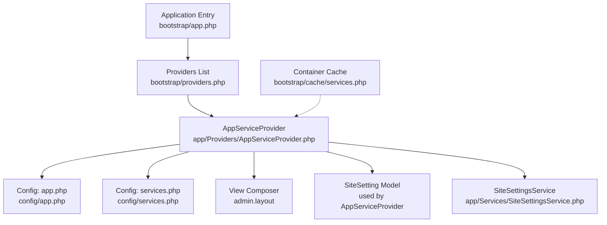
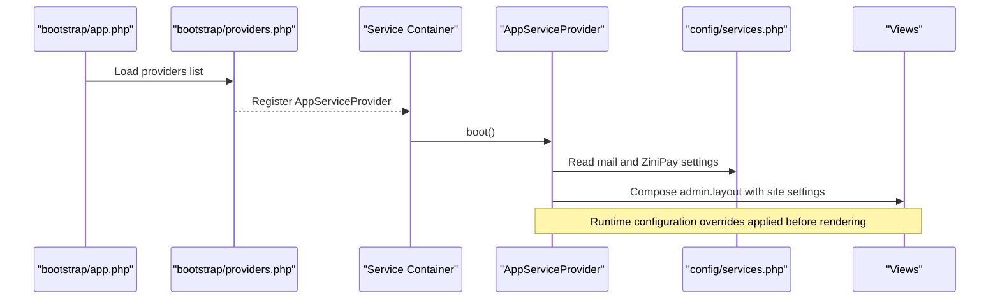
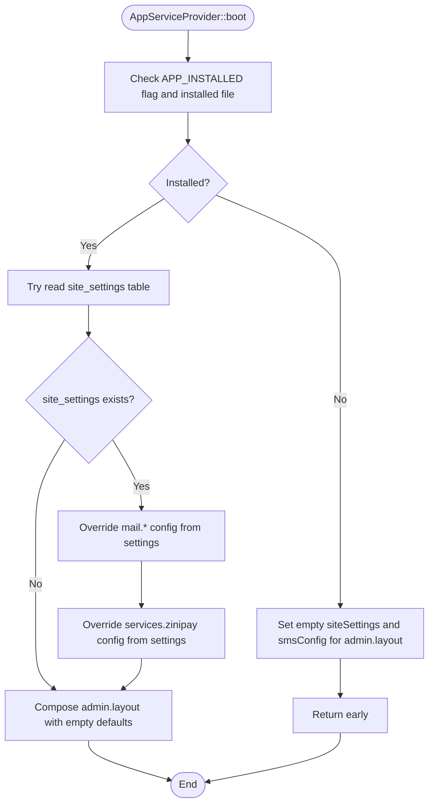
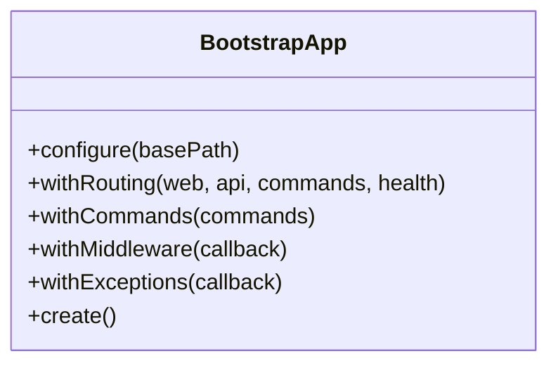
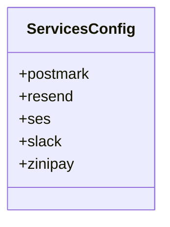
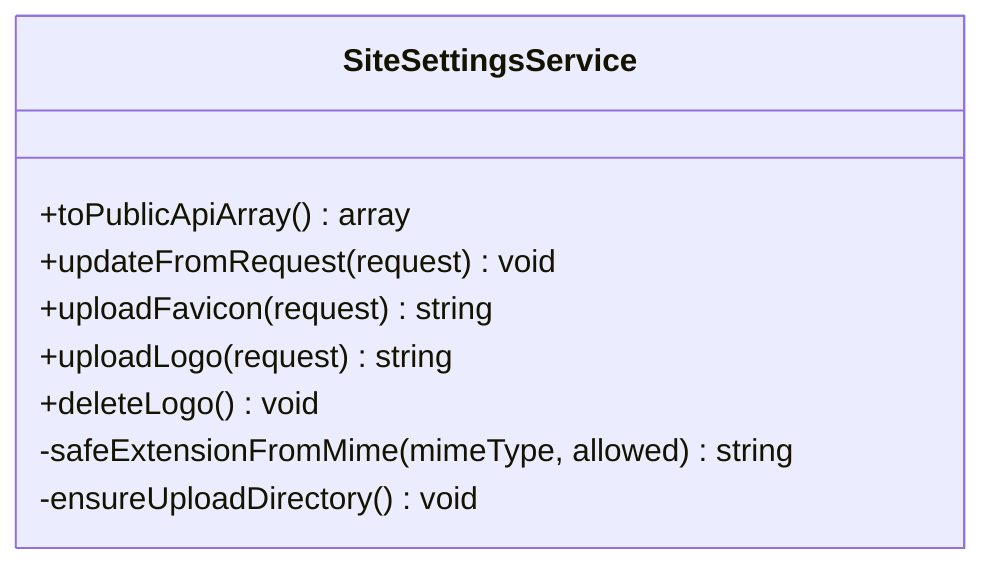
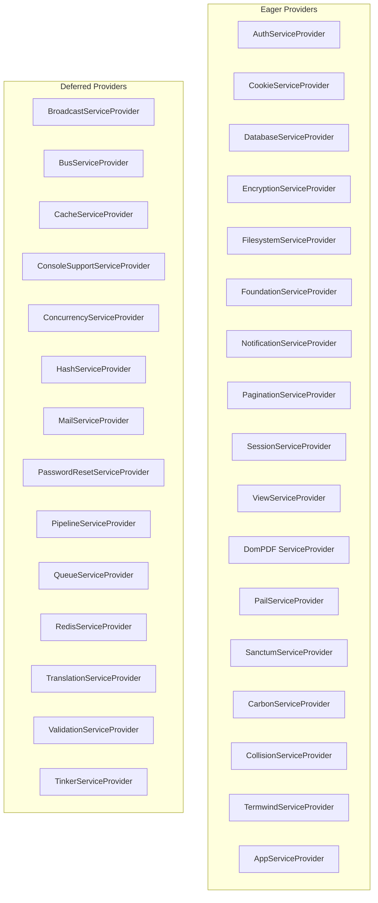

# Provider System

<cite>
**Referenced Files in This Document**
- [AppServiceProvider.php](file://backend/app/Providers/AppServiceProvider.php)
- [app.php](file://backend/bootstrap/app.php)
- [providers.php](file://backend/bootstrap/providers.php)
- [services.php](file://backend/config/services.php)
- [app.php](file://backend/config/app.php)
- [SiteSettingsService.php](file://backend/app/Services/SiteSettingsService.php)
- [services.php](file://backend/bootstrap/cache/services.php)
</cite>

## Table of Contents
1. [Introduction](#introduction)
2. [Project Structure](#project-structure)
3. [Core Components](#core-components)
4. [Architecture Overview](#architecture-overview)
5. [Detailed Component Analysis](#detailed-component-analysis)
6. [Dependency Analysis](#dependency-analysis)
7. [Performance Considerations](#performance-considerations)
8. [Troubleshooting Guide](#troubleshooting-guide)
9. [Conclusion](#conclusion)

## Introduction
This document explains the Laravel provider system and service container configuration for this application. It focuses on how `AppServiceProvider` initializes runtime behavior, how third-party services are configured, and how the bootstrap process loads providers and registers application functionality. It also covers dependency injection patterns, singleton usage, runtime configuration overrides, and performance optimization techniques for provider initialization.

## Project Structure
The provider-related code is concentrated in a small set of files:
- Application provider definition and boot logic live under `app/Providers`.
- Bootstrap configuration wires routing, middleware, commands, and exceptions.
- Providers list defines which service providers are loaded at startup.
- Third-party credentials and package configuration live under `config/services.php`.
- Core application settings live under `config/app.php`.
- Cached service container metadata lives under `bootstrap/cache/services.php`.

**Diagram sources**
- [app.php:7-31](file://backend/bootstrap/app.php#L7-L31)
- [providers.php:1-7](file://backend/bootstrap/providers.php#L1-L7)
- [AppServiceProvider.php:10-103](file://backend/app/Providers/AppServiceProvider.php#L10-L103)
- [app.php:16-62](file://backend/config/app.php#L16-L62)
- [services.php:38-41](file://backend/config/services.php#L38-L41)
- [SiteSettingsService.php:11-49](file://backend/app/Services/SiteSettingsService.php#L11-L49)
- [services.php:30-35](file://backend/bootstrap/cache/services.php#L30-L35)

**Section sources**
- [app.php:7-31](file://backend/bootstrap/app.php#L7-L31)
- [providers.php:1-7](file://backend/bootstrap/providers.php#L1-L7)
- [AppServiceProvider.php:10-103](file://backend/app/Providers/AppServiceProvider.php#L10-L103)
- [services.php:38-41](file://backend/config/services.php#L38-L41)
- [app.php:16-62](file://backend/config/app.php#L16-L62)
- [SiteSettingsService.php:11-49](file://backend/app/Services/SiteSettingsService.php#L11-L49)
- [services.php:30-35](file://backend/bootstrap/cache/services.php#L30-L35)

## Core Components
- **AppServiceProvider**: The main application provider. It currently does not register bindings in `register()`, but performs important boot-time tasks such as view composition and dynamic configuration overrides based on stored site settings.
- **Bootstrap Configuration (`bootstrap/app.php`)**: Wires routes, console commands, middleware, and exception handling. It does not directly register service container bindings here; that is delegated to providers.
- **Providers List (`bootstrap/providers.php`)**: Declares the application’s service providers. Currently only `AppServiceProvider` is registered.
- **Third-Party Services (`config/services.php`)**: Centralizes credentials for external packages like ZiniPay, Postmark, Resend, SES, and Slack.
- **Application Configuration (`config/app.php`)**: Defines core application settings including environment flags used by the provider to gate database-dependent logic.
- **Cached Service Container (`bootstrap/cache/services.php`)**: Contains eager, deferred, and when-bindings for all registered providers and framework services.

Key responsibilities:
- Bootstrapping view composers for admin layout.
- Overriding mail and payment gateway configurations from the database at runtime.
- Sharing site-wide settings with views during request lifecycle.

**Section sources**
- [AppServiceProvider.php:10-103](file://backend/app/Providers/AppServiceProvider.php#L10-L103)
- [app.php:7-31](file://backend/bootstrap/app.php#L7-L31)
- [providers.php:1-7](file://backend/bootstrap/providers.php#L1-L7)
- [services.php:38-41](file://backend/config/services.php#L38-L41)
- [app.php:16-62](file://backend/config/app.php#L16-L62)
- [services.php:30-35](file://backend/bootstrap/cache/services.php#L30-L35)

## Architecture Overview
The provider system integrates with Laravel’s service container through the following flow:
1. The application entry point configures routing, commands, middleware, and exceptions.
2. The providers list declares `AppServiceProvider`.
3. During bootstrap, Laravel loads the service container cache, marking providers as eager or deferred.
4. `AppServiceProvider::boot()` runs after core services are available, enabling it to safely access the database and configuration.
5. At runtime, the provider composes views and dynamically updates configuration values (mail, ZiniPay) from stored site settings.

**Diagram sources**
- [app.php:7-31](file://backend/bootstrap/app.php#L7-L31)
- [providers.php:1-7](file://backend/bootstrap/providers.php#L1-L7)
- [AppServiceProvider.php:20-103](file://backend/app/Providers/AppServiceProvider.php#L20-L103)
- [services.php:38-41](file://backend/config/services.php#L38-L41)

## Detailed Component Analysis

### AppServiceProvider
Responsibilities:
- Skip database-dependent logic during installation to prevent errors when tables do not exist.
- Share default empty data with the admin layout during installation.
- Override mailer and ZiniPay configuration values from the database if present.
- Compose the admin layout with cached site settings and latest SMS configuration.

Boot-time behavior:
- Installation check uses an environment flag and a storage file to determine whether the application is installed.
- If not installed, it sets safe defaults for view variables and returns early.
- If installed, it attempts to read site settings and update configuration keys for mail and ZiniPay.
- Finally, it attaches a view composer to inject site settings and SMS configuration into the admin layout.

Error handling:
- Database access is wrapped in try/catch blocks to tolerate missing tables or connection issues during migrations or seeding.

**Diagram sources**
- [AppServiceProvider.php:20-103](file://backend/app/Providers/AppServiceProvider.php#L20-L103)

**Section sources**
- [AppServiceProvider.php:10-103](file://backend/app/Providers/AppServiceProvider.php#L10-L103)

### Bootstrap Configuration
Responsibilities:
- Configure web, API, and console routes.
- Register custom Artisan commands for installation and demo seeding.
- Append license guard middleware globally except install routes.
- Define middleware aliases for admin and permission checks.
- Provide an exception handler hook.

**Diagram sources**
- [app.php:7-31](file://backend/bootstrap/app.php#L7-L31)

**Section sources**
- [app.php:7-31](file://backend/bootstrap/app.php#L7-L31)

### Providers List
Responsibilities:
- Declare application service providers.
- Currently includes only `AppServiceProvider`.

**Diagram sources**
- [providers.php:1-7](file://backend/bootstrap/providers.php#L1-L7)

**Section sources**
- [providers.php:1-7](file://backend/bootstrap/providers.php#L1-L7)

### Third-Party Services Configuration
Responsibilities:
- Store credentials for external services such as Postmark, Resend, SES, Slack, and ZiniPay.
- Allow runtime override via environment variables and database-driven configuration.

**Diagram sources**
- [services.php:17-41](file://backend/config/services.php#L17-L41)

**Section sources**
- [services.php:17-41](file://backend/config/services.php#L17-L41)

### Site Settings Service
Responsibilities:
- Provide a public API array representation of site settings.
- Validate and persist site settings from requests.
- Manage uploaded favicon and logo assets securely.
- Clear settings cache after updates.

**Diagram sources**
- [SiteSettingsService.php:11-181](file://backend/app/Services/SiteSettingsService.php#L11-L181)

**Section sources**
- [SiteSettingsService.php:11-181](file://backend/app/Services/SiteSettingsService.php#L11-L181)

## Dependency Analysis
The application relies on Laravel’s service container and provider loading mechanism:
- Eager providers include foundational services like Auth, Cookie, Database, Encryption, Filesystem, Foundation, Notifications, Pagination, Session, and View.
- Deferred providers include broadcasting, bus, cache, queue, redis, translation, validation, and tinker.
- `AppServiceProvider` is marked as eager, ensuring its `boot()` method runs early in the request lifecycle.

**Diagram sources**
- [services.php:36-55](file://backend/bootstrap/cache/services.php#L36-L55)
- [services.php:56-213](file://backend/bootstrap/cache/services.php#L56-L213)

**Section sources**
- [services.php:36-55](file://backend/bootstrap/cache/services.php#L36-L55)
- [services.php:56-213](file://backend/bootstrap/cache/services.php#L56-L213)

## Performance Considerations
- Keep `AppServiceProvider::register()` minimal. Avoid heavy computations or I/O operations there since it runs during container construction.
- Use `boot()` for logic that requires other services to be available, such as database access and configuration overrides.
- Prefer caching expensive lookups. The provider already reads cached site settings via `SiteSetting::getAllCached()`.
- Gate database-dependent logic using installation checks to avoid unnecessary queries during install or maintenance.
- Avoid registering heavy services as singletons unless they are truly global and stateless. If you must use singletons, ensure they do not hold per-request mutable state.
- Leverage Laravel’s deferred providers for optional features to reduce initial load time.
- When overriding configuration at runtime, limit changes to necessary keys to minimize side effects across the request.

[No sources needed since this section provides general guidance]

## Troubleshooting Guide
Common issues and resolutions:
- **Installation mode crashes**: Ensure `APP_INSTALLED` is correctly set and the installed marker file exists. The provider guards against DB-dependent logic when not installed.
- **Missing tables during migration/seeding**: The provider wraps database calls in try/catch to tolerate missing tables. Verify migrations run successfully before enabling full functionality.
- **Mail configuration not applied**: Confirm that site settings contain valid mailer values and that the provider has executed. Check `config('mail.*')` at runtime.
- **ZiniPay configuration not applied**: Ensure `services.zinipay.api_key` and `base_url` are updated from site settings. Verify environment variables and database values align.
- **Admin layout missing settings**: The view composer injects `siteSettings` and `smsConfig`. If these are null or empty, verify table existence and query success.

**Section sources**
- [AppServiceProvider.php:20-103](file://backend/app/Providers/AppServiceProvider.php#L20-L103)

## Conclusion
The provider system in this application centers around `AppServiceProvider`, which handles view composition and runtime configuration overrides while respecting installation state. Bootstrap configuration wires routing, middleware, and commands, and the providers list declares the application’s service providers. Third-party services are configured centrally, and the service container cache reflects eager and deferred provider loading. For performance, keep provider registration lightweight, defer heavy work, and rely on caching and guarded database access. Extending functionality typically involves adding new providers or extending existing ones, binding interfaces to implementations in `register()`, and performing boot-time setup in `boot()`.

[No sources needed since this section summarizes without analyzing specific files]