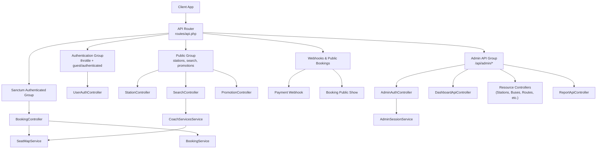
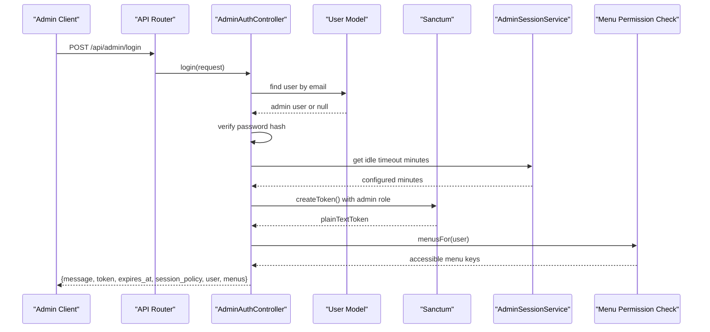

```mermaid
classDiagram
class UserController {
+register(request)
+login(request)
+logout(request)
+me(request)
+updatePassword(request)
+forgotPassword(request)
+resetPassword(request)
-formatUser(user)
}
class AdminUserController {
+login(request)
+me(request)
+logout(request)
+updatePassword(request)
-sessionPolicy()
-menusFor(user)
}
class BookingController {
+store(request)
+mine(request)
+cancel(request, id)
+showPublic(id)
+holdSeat(request)
+releaseSeat(request)
+pay(request, id)
}
class AdminBookingController {
+index(request)
+store(request)
+show(id)
+update(request, id)
+destroy(id)
+cancel(id)
+requestCancel(id)
+pay(id)
-validateFilters(request)
}
class SearchController {
+search(request)
}
class StationController {
+index()
}
class AdminStationController {
+index(request)
+show(id)
+store(request)
+update(request, id)
+destroy(id)
}
class PromotionController {
+check(request)
+index()
}
class AdminReportController {
+index()
+filters()
+show(type, request)
-preview(type, request)
}
class BookingService {
+createForCustomer(input, user)
+cancelForCustomer(booking, user)
+formatForApi(booking, schedule)
+createForAdmin(input)
}
class SeatMapService {
+buildSeatMap(schedule, bookings, userId, applyHolds)
+holdSeat(scheduleId, seatNumber, userId)
+releaseSeat(scheduleId, seatNumber, userId)
+pricingBreakdown(seatCount, farePerSeat, applyGatewayCharges)
}
class CoachServicesService {
+search(fromId, toId, date, coachType, includeSeatBookings)
}
class BaseAdminApiController {
+perPage(request, default)
+likeTerm(term)
+serviceResponse(result)
+itemResponse(data, message, status, extra)
}
class User {
+bookings()
+isAdmin()
+isSuperAdmin()
+isUser()
+hasMenuPermission(menu)
}
class EnsureApiUserIsAdmin {
+handle(request, next)
}
class EnsureApiUserHasMenuPermission {
+handle(request, next, menu)
}
UserController --> User : "uses"
AdminUserController --> User : "uses"
BookingController --> BookingService : "delegates"
BookingController --> SeatMapService : "delegates"
AdminBookingController --> BookingService : "delegates"
AdminReportController --> ReportDataService : "delegates"
AdminReportController --> ReportFilterService : "delegates"
SearchController --> CoachServicesService : "delegates"
CoachServicesService --> SeatMapService : "uses"
BaseAdminApiController --> BaseController : "extends"
EnsureApiUserIsAdmin --> User : "checks role"
EnsureApiUserHasMenuPermission --> User : "checks permissions"
```

# API Routes

<cite>
**Referenced Files in This Document**
- [api.php](file://backend/routes/api.php)
- [BaseController.php](file://backend/app/Http/Controllers/API/BaseController.php)
- [UserAuthController.php](file://backend/app/Http/Controllers/API/UserAuthController.php)
- [BookingController.php](file://backend/app/Http/Controllers/API/BookingController.php)
- [SearchController.php](file://backend/app/Http/Controllers/API/SearchController.php)
- [StationController.php](file://backend/app/Http/Controllers/API/StationController.php)
- [PromotionController.php](file://backend/app/Http/Controllers/API/PromotionController.php)
- [AdminAuthController.php](file://backend/app/Http/Controllers/API/Admin/AdminAuthController.php)
- [BaseAdminApiController.php](file://backend/app/Http/Controllers/API/Admin/BaseAdminApiController.php)
- [DashboardApiController.php](file://backend/app/Http/Controllers/API/Admin/DashboardApiController.php)
- [StationApiController.php](file://backend/app/Http/Controllers/API/Admin/StationApiController.php)
- [BusApiController.php](file://backend/app/Http/Controllers/API/Admin/BusApiController.php)
- [BookingApiController.php](file://backend/app/Http/Controllers/API/Admin/BookingApiController.php)
- [ReportApiController.php](file://backend/app/Http/Controllers/API/Admin/ReportApiController.php)
- [EnsureApiUserIsAdmin.php](file://backend/app/Http/Middleware/EnsureApiUserIsAdmin.php)
- [EnsureApiUserHasMenuPermission.php](file://backend/app/Http/Middleware/EnsureApiUserHasMenuPermission.php)
- [ApplySessionLifetime.php](file://backend/app/Http/Middleware/ApplySessionLifetime.php)
- [EnforceAdminSessionTimeout.php](file://backend/app/Http/Middleware/EnforceAdminSessionTimeout.php)
- [BookingService.php](file://backend/app/Services/BookingService.php)
- [SeatMapService.php](file://backend/app/Services/SeatMapService.php)
- [CoachServicesService.php](file://backend/app/Services/CoachServicesService.php)
- [sanctum.php](file://backend/config/sanctum.php)
- [cors.php](file://backend/config/cors.php)
- [User.php](file://backend/app/Models/User.php)
</cite>

## Update Summary
**Changes Made**
- Added comprehensive Admin API section covering `/api/admin/*` endpoints with over 190 lines of routing definitions
- Documented new admin authentication flow with token-based authentication and session policies
- Added detailed endpoint coverage for all admin resources (stations, buses, routes, schedules, bookings, users, reports, etc.)
- Updated architecture diagrams to include admin API components and middleware
- Enhanced security considerations for admin API access control with role-based permissions
- Documented menu-based permission system and API-specific middleware

## Table of Contents
1. [Introduction](#introduction)
2. [Project Structure](#project-structure)
3. [Core Components](#core-components)
4. [Architecture Overview](#architecture-overview)
5. [Detailed Component Analysis](#detailed-component-analysis)
6. [Dependency Analysis](#dependency-analysis)
7. [Performance Considerations](#performance-considerations)
8. [Troubleshooting Guide](#troubleshooting-guide)
9. [Conclusion](#conclusion)
10. [Appendices](#appendices)

## Introduction
This document describes the RESTful API routing strategy implemented in the backend routes file and how it maps to controllers, services, and models. It covers all public and authenticated endpoints grouped by domain: authentication, booking management, search, stations, promotions, seat management, and the comprehensive Admin API. For each endpoint group, this document explains HTTP methods, URL patterns, request parameters, response schemas, authentication requirements, error handling, rate limiting, and versioning considerations.

The API is a Laravel application exposing JSON endpoints under the `/api` prefix for both the React frontend and administrative interfaces. Authentication uses Laravel Sanctum bearer tokens. Public endpoints are protected by maintenance mode checks, while sensitive endpoints require appropriate authentication levels.

**Updated** Added extensive Admin API support with comprehensive endpoint coverage for administrative operations, including over 190 lines of routing definitions organized by functional area with proper middleware protection using `auth:sanctum` and custom `api_admin` middleware.

## Project Structure
The API routes are defined in a single routes file and grouped by feature and access level. Controllers delegate business logic to service classes. Models represent database entities such as users, bookings, schedules, stations, and promotions. Configuration files define Sanctum behavior and CORS policy. The Admin API provides a complete mirror of the Blade dashboard functionality through RESTful endpoints with role-based access control.

**Diagram sources**
- [api.php:26-267](file://backend/routes/api.php#L26-L267)
- [UserAuthController.php:15-218](file://backend/app/Http/Controllers/API/UserAuthController.php#L15-L218)
- [AdminAuthController.php:20-149](file://backend/app/Http/Controllers/API/Admin/AdminAuthController.php#L20-L149)
- [DashboardApiController.php:18-86](file://backend/app/Http/Controllers/API/Admin/DashboardApiController.php#L18-L86)
- [ReportApiController.php:15-200](file://backend/app/Http/Controllers/API/Admin/ReportApiController.php#L15-L200)

**Section sources**
- [api.php:1-267](file://backend/routes/api.php#L1-L267)

## Core Components
- API router groups endpoints by middleware: maintenance check, throttle, Sanctum authentication, and admin-specific guards.
- Controllers validate input and delegate to services for complex operations.
- Services encapsulate business logic: booking creation, cancellation, pricing, seat availability, search queries, payment integration, and administrative operations.
- Models provide data structures and relationships; the User model includes role helpers and Sanctum token support.
- Admin API controllers extend BaseAdminApiController for consistent pagination, formatting, and response handling.
- Custom middleware provides role-based access control for admin endpoints.

Key responsibilities:
- Authentication controller handles registration, login, logout, profile retrieval, password update, and password reset flows for customers.
- Admin authentication controller provides token-based authentication for administrative operations with session timeout policies and menu-based permissions.
- Booking controller manages booking creation, listing, cancellation, payment initiation, and seat hold/release for customers.
- Admin booking controller provides comprehensive booking management capabilities for administrators.
- Search controller validates query parameters and returns schedule results with seat map and pricing.
- Station controller returns a sorted list of stations for customers.
- Admin station controller provides full CRUD operations for station management.
- Promotion controller lists promotions and validates promo codes for customers.
- Admin promotion controller manages promotional campaigns.
- Report controller provides comprehensive reporting and analytics for administrative operations.
- Services implement transactional booking workflows, seat locking, pricing calculations, search aggregation, and administrative analytics.

**Section sources**
- [api.php:26-267](file://backend/routes/api.php#L26-L267)
- [UserAuthController.php:15-218](file://backend/app/Http/Controllers/API/UserAuthController.php#L15-L218)
- [AdminAuthController.php:20-149](file://backend/app/Http/Controllers/API/Admin/AdminAuthController.php#L20-L149)
- [BaseAdminApiController.php:15-73](file://backend/app/Http/Controllers/API/Admin/BaseAdminApiController.php#L15-L73)
- [ReportApiController.php:15-200](file://backend/app/Http/Controllers/API/Admin/ReportApiController.php#L15-L200)

## Architecture Overview
The API follows a layered architecture with distinct separation between customer-facing and administrative interfaces:
- Routing layer defines endpoints and applies middleware including admin-specific guards.
- Controller layer validates requests and orchestrates calls to services.
- Service layer implements domain logic, transactions, and integrations.
- Model layer represents persistent data and relationships.
- Admin API mirrors the Blade dashboard functionality with consistent business rules and permissions.
- Menu-based permission system controls access to specific administrative functions.

**Diagram sources**
- [api.php:99-102](file://backend/routes/api.php#L99-L102)
- [AdminAuthController.php:28-68](file://backend/app/Http/Controllers/API/Admin/AdminAuthController.php#L28-L68)
- [User.php:12-15](file://backend/app/Models/User.php#L12-L15)
- [sanctum.php:39-53](file://backend/config/sanctum.php#L39-L53)

## Detailed Component Analysis

### Authentication Endpoints

#### Customer Authentication
URL pattern: `/api/auth/*`

Endpoints:
- `POST /api/auth/register`
  - Authentication: None (guest)
  - Rate limit: 10 attempts per minute per IP
  - Request body fields:
    - name: string, required, max 100
    - email: string, required, valid email, unique
    - password: string, required, min 6, confirmed
  - Response:
    - message: string
    - token: string (bearer token)
    - user: object with id, name, email, role
  - Status codes:
    - 201 on success
    - 422 on validation errors
    - 403 if admin account tries to register via customer API

- `POST /api/auth/login`
  - Authentication: None (guest)
  - Rate limit: 10 attempts per minute per IP
  - Request body fields:
    - email: string, required, valid email
    - password: string, required
  - Response:
    - message: string
    - token: string (bearer token)
    - user: object with id, name, email, role
  - Status codes:
    - 200 on success
    - 422 on invalid credentials
    - 403 if admin account

- `POST /api/auth/forgot-password`
  - Authentication: None (guest)
  - Rate limit: 10 attempts per minute per IP
  - Request body fields:
    - email: string, required, valid email, max 100
  - Response:
    - message: string
    - code: string (only in local/testing environments)
  - Status codes:
    - 200 on success
    - 422 if email not registered as customer or mail sending fails

- `POST /api/auth/reset-password`
  - Authentication: None (guest)
  - Rate limit: 10 attempts per minute per IP
  - Request body fields:
    - email: string, required, valid email, max 100
    - code: string, required
    - password: string, required, min 6, confirmed
  - Response:
    - message: string
  - Status codes:
    - 200 on success
    - 422 if invalid or expired code

- `POST /api/auth/logout`
  - Authentication: Required (Sanctum bearer token)
  - Response:
    - message: string
  - Status codes:
    - 200 on success

- `GET /api/auth/me`
  - Authentication: Required (Sanctum bearer token)
  - Response:
    - user: object with id, name, email, role
  - Status codes:
    - 200 on success

- `POST /api/auth/password`
  - Authentication: Required (Sanctum bearer token)
  - Request body fields:
    - current_password: string, required
    - password: string, required, min 6, confirmed
  - Response:
    - message: string
    - user: updated user object
  - Status codes:
    - 200 on success
    - 422 if current password incorrect

#### Admin Authentication
URL pattern: `/api/admin/*`

Endpoints:
- `POST /api/admin/login`
  - Authentication: None (guest)
  - Rate limit: 10 attempts per minute per IP
  - Request body fields:
    - email: string, required, valid email
    - password: string, required
    - device_name: string, optional, max 60
  - Response:
    - message: string
    - token: string (bearer token with admin role)
    - expires_at: ISO 8601 timestamp
    - expires_in: integer seconds
    - session: object with admin_idle_timeout_minutes and customer_token_lifetime_minutes
    - user: formatted admin user object
    - menus: array of menu keys the user can access
  - Status codes:
    - 200 on success
    - 422 on invalid credentials
    - 403 if non-admin account attempts login

- `GET /api/admin/me`
  - Authentication: Required (Sanctum bearer token with admin role)
  - Response:
    - user: formatted admin user object
    - menus: array of menu keys
    - session: session policy configuration
    - token: object with name and expires_at
  - Status codes:
    - 200 on success

- `POST /api/admin/logout`
  - Authentication: Required (Sanctum bearer token with admin role)
  - Response:
    - message: string
  - Status codes:
    - 200 on success

- `POST /api/admin/password`
  - Authentication: Required (Sanctum bearer token with admin role)
  - Request body fields:
    - current_password: string, required
    - password: string, required, min 8, confirmed
  - Response:
    - message: string
    - user: updated admin user object
  - Status codes:
    - 200 on success
    - 422 if current password incorrect

Route parameter binding:
- No route parameters in authentication endpoints.

Query parameter handling:
- Not used in authentication endpoints.

Response formatting standards:
- Success responses include a message field and relevant payload.
- Validation errors return 422 with field-specific messages.
- User objects are formatted consistently with id, name, email, role.
- Admin responses include additional metadata like menus and session policies.

Common API call examples:
- Customer Register: POST /api/auth/register with name, email, password, password_confirmation
- Customer Login: POST /api/auth/login with email, password
- Admin Login: POST /api/admin/login with email, password, device_name
- Get Profile: GET /api/auth/me with Authorization: Bearer <token>
- Admin Profile: GET /api/admin/me with Authorization: Bearer <token>
- Logout: POST /api/auth/logout with Authorization: Bearer <token>

Error responses:
- 422 ValidationException with field messages
- 403 Forbidden for unauthorized access attempts
- 500 Internal server errors when unexpected exceptions occur

Rate limiting:
- Throttle middleware limits authentication endpoints to 10 requests per minute per IP.

Authentication requirements:
- Guest endpoints: register, login, forgot-password, reset-password (customer); login (admin)
- Authenticated endpoints: logout, me, password (customer); me, logout, password (admin)

Backward compatibility:
- Existing token-based authentication remains supported through Sanctum.
- User format remains stable with id, name, email, role.
- Admin API provides consistent interface mirroring the Blade dashboard.

**Section sources**
- [api.php:41-46](file://backend/routes/api.php#L41-L46)
- [api.php:54-59](file://backend/routes/api.php#L54-L59)
- [api.php:99-114](file://backend/routes/api.php#L99-L114)
- [UserAuthController.php:17-218](file://backend/app/Http/Controllers/API/UserAuthController.php#L17-L218)
- [AdminAuthController.php:28-149](file://backend/app/Http/Controllers/API/Admin/AdminAuthController.php#L28-L149)
- [User.php:12-75](file://backend/app/Models/User.php#L12-L75)
- [sanctum.php:39-53](file://backend/config/sanctum.php#L39-L53)

### Booking Management Endpoints

#### Customer Booking Endpoints
URL pattern: `/api/bookings/*`

Endpoints:
- `POST /api/bookings`
  - Authentication: Required (Sanctum bearer token)
  - Request body fields:
    - schedule_id: integer, required, exists in schedules
    - passenger_name: string, required, max 100
    - passenger_phone: string, required, max 20
    - passenger_email: string, required, valid email, max 100
    - seat_numbers: string, required, comma-separated, max 255
    - payment_method: string, required, max 50
    - total_fare: number, optional, non-negative
    - passenger_gender: string, optional, M or F
    - boarding_point: string, optional, max 150
    - dropping_point: string, optional, max 150
    - promo_code: string, optional
    - status: enum, optional, PENDING/PAID/SOLD/BOOKED/CANCEL_REQUESTED/CANCELLED
  - Response:
    - message: string
    - booking: object with id, pnr, passenger details, seat_numbers, total_fare, payment_method, payment_invoice_id, status, created_at, schedule
    - sms: object indicating SMS result
  - Status codes:
    - 201 on successful booking creation
    - 422 on validation or seat availability issues
    - 403 if non-admin attempts cash/manual booking
    - 500 on internal errors

- `GET /api/bookings/mine`
  - Authentication: Required (Sanctum bearer token)
  - Query parameters:
    - page: integer, optional, min 1
    - per_page: integer, optional, min 1, max 50
  - Response: Paginated list of bookings with schedule details
  - Status codes:
    - 200 on success

- `POST /api/bookings/{id}/cancel`
  - Authentication: Required (Sanctum bearer token)
  - Route parameter:
    - id: integer, booking identifier
  - Response:
    - message: string
    - booking_id: integer
    - status: string
  - Status codes:
    - 200 on success
    - 400 if already cancelled or cancellation requested
    - 403 if unauthorized
    - 404 if booking not found

- `POST /api/bookings/{id}/pay`
  - Authentication: Required (Sanctum bearer token)
  - Route parameter:
    - id: integer, booking identifier
  - Response:
    - message: string
    - payment_url: string
    - invoice_id: string
    - booking: object
  - Status codes:
    - 200 on payment initiation
    - 403 if unauthorized
    - 422 if invalid booking status or payment method
    - 404 if booking not found
    - 500 if payment gateway fails

- `GET /api/bookings/public/{id}`
  - Authentication: None (public)
  - Route parameter:
    - id: integer, booking identifier
  - Response:
    - booking: object with schedule details
  - Status codes:
    - 200 on success
    - 404 if booking not found

#### Admin Booking Endpoints
URL pattern: `/api/admin/bookings/*`

Endpoints:
- `GET /api/admin/bookings`
  - Authentication: Required (Sanctum bearer token with admin role)
  - Query parameters:
    - search: string, optional, max 100
    - status: enum, optional, PENDING/PAID/SOLD/BOOKED/CANCEL_REQUESTED/CANCELLED
    - period: enum, optional, all/today/yesterday/this_week/this_year/custom
    - from_date: date, optional, Y-m-d format
    - to_date: date, optional, Y-m-d format, after_or_equal to from_date
    - per_page: integer, optional, min 1, max 100
  - Response: Paginated list of bookings with full details
  - Status codes:
    - 200 on success

- `POST /api/admin/bookings`
  - Authentication: Required (Sanctum bearer token with admin role)
  - Request body fields:
    - schedule_id: integer, required, exists in schedules
    - passenger_name: string, required, max 100
    - passenger_phone: string, required, max 20
    - passenger_email: string, required, valid email, max 100
    - seat_numbers: string, required, max 255
    - payment_method: string, required, max 50
    - total_fare: number, optional, numeric, min 0
    - passenger_gender: string, optional, M or F
    - boarding_point: string, optional, max 150
    - dropping_point: string, optional, max 150
    - status: enum, optional, PENDING/PAID/SOLD/BOOKED/CANCEL_REQUESTED/CANCELLED
  - Response:
    - message: string
    - data: booking object
    - payment_url: string (if applicable)
    - sms: object indicating SMS result
  - Status codes:
    - 201 on successful booking creation
    - 422 on validation errors

- `GET /api/admin/bookings/{id}`
  - Authentication: Required (Sanctum bearer token with admin role)
  - Route parameter:
    - id: integer, booking identifier
  - Response: Single booking object with full details
  - Status codes:
    - 200 on success
    - 404 if booking not found

- `PUT/PATCH /api/admin/bookings/{id}`
  - Authentication: Required (Sanctum bearer token with admin role)
  - Route parameter:
    - id: integer, booking identifier
  - Request body fields:
    - passenger_name: string, required, max 100
    - passenger_phone: string, required, max 20
    - passenger_email: string, required, valid email, max 100
    - seat_numbers: string, required, max 255
    - total_fare: number, required, numeric, min 0
    - payment_method: string, required, max 50
    - status: enum, required, PENDING/PAID/SOLD/BOOKED/CANCEL_REQUESTED/CANCELLED
  - Response: Updated booking object
  - Status codes:
    - 200 on success
    - 422 on validation errors
    - 404 if booking not found

- `DELETE /api/admin/bookings/{id}`
  - Authentication: Required (Sanctum bearer token with admin role)
  - Route parameter:
    - id: integer, booking identifier
  - Response:
    - message: string
  - Status codes:
    - 200 on success
    - 404 if booking not found

- `POST /api/admin/bookings/{id}/cancel`
  - Authentication: Required (Sanctum bearer token with admin role)
  - Route parameter:
    - id: integer, booking identifier
  - Response:
    - message: string
    - status: string
  - Status codes:
    - 200 on success
    - 422 if invalid booking state

- `POST /api/admin/bookings/{id}/request-cancel`
  - Authentication: Required (Sanctum bearer token with admin role)
  - Route parameter:
    - id: integer, booking identifier
  - Response:
    - message: string
    - status: string
  - Status codes:
    - 200 on success
    - 422 if invalid booking state

- `POST /api/admin/bookings/{id}/pay`
  - Authentication: Required (Sanctum bearer token with admin role)
  - Route parameter:
    - id: integer, booking identifier
  - Response:
    - message: string
    - payment_url: string
    - invoice_id: string
  - Status codes:
    - 200 on payment initiation
    - 422 if invalid booking status or payment method
    - 502 if payment gateway fails

Route parameter binding:
- `{id}` binds to the booking identifier across all booking endpoints.

Query parameter handling:
- Customer mine endpoint supports pagination via page and per_page.
- Admin endpoints support comprehensive filtering including search, status, date ranges, and pagination.

Response formatting standards:
- Booking objects include schedule nested with bus and route information.
- Dates are ISO 8601 strings.
- Numeric values are floats where applicable.
- Admin responses include additional metadata and extended booking information.

Common API call examples:
- Customer Create booking: POST /api/bookings with schedule_id, passenger details, seat_numbers, payment_method
- Customer List my bookings: GET /api/bookings/mine?page=1&per_page=10
- Admin List bookings: GET /api/admin/bookings?search=john&status=PENDING&per_page=20
- Admin Create booking: POST /api/admin/bookings with full booking details
- Cancel booking: POST /api/bookings/{id}/cancel (customer) or POST /api/admin/bookings/{id}/cancel (admin)
- Pay booking: POST /api/bookings/{id}/pay (customer) or POST /api/admin/bookings/{id}/pay (admin)

Error responses:
- 422 for validation failures or unavailable seats
- 403 for authorization failures
- 404 for missing resources
- 500 for internal errors
- 502 for payment gateway failures

Rate limiting:
- No explicit throttle on booking endpoints; rely on Sanctum authentication and application-level safeguards.

Authentication requirements:
- All customer booking endpoints except public show require Sanctum bearer token.
- All admin booking endpoints require Sanctum bearer token with admin role.

Business rules:
- Maximum 4 seats per customer booking.
- Cash/manual booking restricted to admins.
- ZiniPay flow sets booking status to PENDING and creates invoice.
- Cancellation transitions depend on current status.
- Admin endpoints provide override capabilities for customer booking restrictions.

**Section sources**
- [api.php:68-71](file://backend/routes/api.php#L68-L71)
- [api.php:81-84](file://backend/routes/api.php#L81-L84)
- [api.php:195-204](file://backend/routes/api.php#L195-L204)
- [BookingController.php:19-148](file://backend/app/Http/Controllers/API/BookingController.php#L19-L148)
- [BookingApiController.php:27-163](file://backend/app/Http/Controllers/API/Admin/BookingApiController.php#L27-L163)
- [BookingService.php:28-333](file://backend/app/Services/BookingService.php#L28-L333)
- [SeatMapService.php:499-593](file://backend/app/Services/SeatMapService.php#L499-L593)

### Search Functionality Endpoint
URL pattern: `/api/search`

Endpoint:
- `GET /api/search`
  - Authentication: None (public)
  - Query parameters:
    - from: integer, required, station id
    - to: integer, required, station id
    - date: string, required, Y-m-d format
    - coach_type: string, optional
  - Response: Collection of schedule objects including bus, route, seat_map, booked_seats, boarding_points, dropping_points, seat_class, pricing, available_seats_count
  - Status codes:
    - 200 on success

Route parameter binding:
- No route parameters.

Query parameter handling:
- Validates station ids exist in stations table.
- Filters schedules by route and departure time window.
- Optional coach type filter applied client-side after query.

Response formatting standards:
- Schedule payloads include comprehensive seat map and pricing breakdown.
- Dates are ISO 8601 strings.
- Bus and route objects contain identifiers and descriptive fields.

Common API call examples:
- Search schedules: GET /api/search?from=1&to=2&date=2026-01-01&coach_type=AC

Error responses:
- 422 for invalid or missing parameters

Authentication requirements:
- Public endpoint; no token required.

**Section sources**
- [api.php:26-32](file://backend/routes/api.php#L26-L32)
- [SearchController.php:14-31](file://backend/app/Http/Controllers/API/SearchController.php#L14-L31)
- [CoachServicesService.php:19-124](file://backend/app/Services/CoachServicesService.php#L19-L124)
- [SeatMapService.php:367-382](file://backend/app/Services/SeatMapService.php#L367-L382)

### Station Operations Endpoints

#### Customer Station Endpoint
URL pattern: `/api/stations`

Endpoint:
- `GET /api/stations`
  - Authentication: None (public)
  - Response: Array of station objects sorted by name ascending
  - Status codes:
    - 200 on success

Route parameter binding:
- No route parameters.

Query parameter handling:
- No query parameters.

Response formatting standards:
- Station objects include standard attributes exposed by the model.

Common API call examples:
- Fetch stations: GET /api/stations

Authentication requirements:
- Public endpoint; no token required.

#### Admin Station Endpoints
URL pattern: `/api/admin/stations/*`

Endpoints:
- `GET /api/admin/stations`
  - Authentication: Required (Sanctum bearer token with admin role)
  - Query parameters:
    - search: string, optional, max 100
    - per_page: integer, optional, min 1, max 100
  - Response: Paginated list of station objects
  - Status codes:
    - 200 on success

- `POST /api/admin/stations`
  - Authentication: Required (Sanctum bearer token with admin role)
  - Request body fields:
    - name: string, required, max 100, unique
  - Response: Created station object
  - Status codes:
    - 201 on success
    - 422 on validation errors

- `GET /api/admin/stations/{id}`
  - Authentication: Required (Sanctum bearer token with admin role)
  - Route parameter:
    - id: integer, station identifier
  - Response: Single station object
  - Status codes:
    - 200 on success
    - 404 if station not found

- `PUT/PATCH /api/admin/stations/{id}`
  - Authentication: Required (Sanctum bearer token with admin role)
  - Route parameter:
    - id: integer, station identifier
  - Request body fields:
    - name: string, required, max 100, unique (excluding current)
  - Response: Updated station object
  - Status codes:
    - 200 on success
    - 422 on validation errors
    - 404 if station not found

- `DELETE /api/admin/stations/{id}`
  - Authentication: Required (Sanctum bearer token with admin role)
  - Route parameter:
    - id: integer, station identifier
  - Response:
    - message: string
  - Status codes:
    - 200 on success
    - 404 if station not found
    - 409 if station has associated routes

Route parameter binding:
- `{id}` binds to the station identifier in show, update, and delete endpoints.

Query parameter handling:
- Index endpoint supports search and pagination.

Response formatting standards:
- Station objects include standard attributes with consistent formatting.

Common API call examples:
- List stations: GET /api/admin/stations?search=dhaka&per_page=10
- Create station: POST /api/admin/stations with name
- Update station: PUT /api/admin/stations/{id} with name
- Delete station: DELETE /api/admin/stations/{id}

Error responses:
- 422 for validation failures
- 404 for missing resources
- 409 for constraint violations

Authentication requirements:
- All admin station endpoints require Sanctum bearer token with admin role.

Business rules:
- Station names must be unique.
- Stations cannot be deleted if they have associated routes.
- Names are automatically converted to uppercase.

**Section sources**
- [api.php:26-32](file://backend/routes/api.php#L26-L32)
- [api.php:130-136](file://backend/routes/api.php#L130-L136)
- [StationController.php:10-14](file://backend/app/Http/Controllers/API/StationController.php#L10-L14)
- [StationApiController.php:17-86](file://backend/app/Http/Controllers/API/Admin/StationApiController.php#L17-L86)

### Promotion Handling Endpoints

#### Customer Promotion Endpoints
URL pattern: `/api/promotions*`

Endpoints:
- `GET /api/promotions`
  - Authentication: None (public)
  - Response: Array of promotion objects
  - Status codes:
    - 200 on success

- `GET /api/promotions/check`
  - Authentication: None (public)
  - Query parameters:
    - code: string, required
  - Response:
    - code: string
    - discount_amount: float
    - description: string
  - Status codes:
    - 200 on success
    - 404 if promo code not found

Route parameter binding:
- No route parameters.

Query parameter handling:
- Check endpoint normalizes code to uppercase before lookup.

Response formatting standards:
- Promotion objects include code, discount amount, and description.

Common API call examples:
- List promotions: GET /api/promotions
- Validate promo code: GET /api/promotions/check?code=SAVE10

Authentication requirements:
- Public endpoints; no token required.

#### Admin Promotion Endpoints
URL pattern: `/api/admin/promotions/*`

Endpoints:
- `GET /api/admin/promotions`
  - Authentication: Required (Sanctum bearer token with admin role)
  - Response: Paginated list of promotion objects
  - Status codes:
    - 200 on success

- `POST /api/admin/promotions`
  - Authentication: Required (Sanctum bearer token with admin role)
  - Request body fields:
    - code: string, required, unique
    - discount_amount: number, required, positive
    - description: string, optional
    - start_date: date, optional
    - end_date: date, optional
  - Response: Created promotion object
  - Status codes:
    - 201 on success
    - 422 on validation errors

- `GET /api/admin/promotions/{id}`
  - Authentication: Required (Sanctum bearer token with admin role)
  - Route parameter:
    - id: integer, promotion identifier
  - Response: Single promotion object
  - Status codes:
    - 200 on success
    - 404 if promotion not found

- `PUT/PATCH /api/admin/promotions/{id}`
  - Authentication: Required (Sanctum bearer token with admin role)
  - Route parameter:
    - id: integer, promotion identifier
  - Request body fields:
    - code: string, optional, unique (excluding current)
    - discount_amount: number, optional, positive
    - description: string, optional
    - start_date: date, optional
    - end_date: date, optional
  - Response: Updated promotion object
  - Status codes:
    - 200 on success
    - 422 on validation errors
    - 404 if promotion not found

- `DELETE /api/admin/promotions/{id}`
  - Authentication: Required (Sanctum bearer token with admin role)
  - Route parameter:
    - id: integer, promotion identifier
  - Response:
    - message: string
  - Status codes:
    - 200 on success
    - 404 if promotion not found

Route parameter binding:
- `{id}` binds to the promotion identifier in show, update, and delete endpoints.

Query parameter handling:
- Index endpoint supports pagination.

Response formatting standards:
- Promotion objects include code, discount amount, description, and validity dates.

Common API call examples:
- List promotions: GET /api/admin/promotions?per_page=20
- Create promotion: POST /api/admin/promotions with code, discount_amount, description
- Update promotion: PUT /api/admin/promotions/{id} with updated fields
- Delete promotion: DELETE /api/admin/promotions/{id}

Error responses:
- 422 for validation failures
- 404 for missing resources

Authentication requirements:
- All admin promotion endpoints require Sanctum bearer token with admin role.

Business rules:
- Promotion codes must be unique.
- Discount amounts must be positive numbers.
- Date validation ensures proper date ranges.

**Section sources**
- [api.php:30-31](file://backend/routes/api.php#L30-L31)
- [api.php:182-188](file://backend/routes/api.php#L182-L188)
- [PromotionController.php:10-37](file://backend/app/Http/Controllers/API/PromotionController.php#L10-L37)

### Seat Management Endpoints

#### Customer Seat Endpoints
URL pattern: `/api/seats/*`

Endpoints:
- `POST /api/seats/hold`
  - Authentication: Required (Sanctum bearer token)
  - Request body fields:
    - schedule_id: integer, required, exists in schedules
    - seat_number: string, required
  - Response:
    - success: boolean
    - expires_at: ISO 8601 timestamp (on success)
    - message: string (on failure)
  - Status codes:
    - 200 on success
    - 422 on validation or seat not available

- `POST /api/seats/release`
  - Authentication: Required (Sanctum bearer token)
  - Request body fields:
    - schedule_id: integer, required, exists in schedules
    - seat_number: string, required
  - Response:
    - success: boolean
  - Status codes:
    - 200 on success

Route parameter binding:
- No route parameters.

Query parameter handling:
- Not used in seat endpoints.

Response formatting standards:
- Hold/release responses use a consistent structure with success flag and message.

Common API call examples:
- Hold seat: POST /api/seats/hold with schedule_id and seat_number
- Release seat: POST /api/seats/release with schedule_id and seat_number

Authentication requirements:
- Both endpoints require Sanctum bearer token.

Business rules:
- Holds are stored in cache with expiration.
- Only available seats can be held.
- Releases remove holds for the authenticated user.

#### Admin Seat Endpoints
URL pattern: `/api/admin/seats/*`

Endpoints:
- `POST /api/admin/coach-services/schedules/{id}/seats/toggle-block`
  - Authentication: Required (Sanctum bearer token with admin role)
  - Route parameter:
    - id: integer, schedule identifier
  - Request body fields:
    - seat_number: string, required
    - blocked: boolean, required
  - Response:
    - success: boolean
    - seat_number: string
    - blocked: boolean
  - Status codes:
    - 200 on success
    - 422 on validation errors

- `POST /api/admin/seats/hold`
  - Authentication: Required (Sanctum bearer token with admin role)
  - Request body fields:
    - schedule_id: integer, required, exists in schedules
    - seat_number: string, required
  - Response:
    - success: boolean
    - expires_at: ISO 8601 timestamp (on success)
    - message: string (on failure)
  - Status codes:
    - 200 on success
    - 422 on validation or seat not available

- `POST /api/admin/seats/release`
  - Authentication: Required (Sanctum bearer token with admin role)
  - Request body fields:
    - schedule_id: integer, required, exists in schedules
    - seat_number: string, required
  - Response:
    - success: boolean
  - Status codes:
    - 200 on success

Route parameter binding:
- `{id}` binds to the schedule identifier in toggle-block endpoint.

Query parameter handling:
- Not used in seat endpoints.

Response formatting standards:
- Hold/release responses use a consistent structure with success flag and message.
- Toggle-block responses include seat state information.

Common API call examples:
- Block seat: POST /api/admin/coach-services/schedules/{id}/seats/toggle-block with seat_number and blocked=true
- Hold seat: POST /api/admin/seats/hold with schedule_id and seat_number
- Release seat: POST /api/admin/seats/release with schedule_id and seat_number

Authentication requirements:
- All admin seat endpoints require Sanctum bearer token with admin role.

Business rules:
- Admins can block/unblock seats for maintenance or operational reasons.
- Holds are stored in cache with expiration.
- Only available seats can be held.
- Releases remove holds for the authenticated user.

**Section sources**
- [api.php:73-74](file://backend/routes/api.php#L73-L74)
- [api.php:221-226](file://backend/routes/api.php#L221-L226)
- [BookingController.php:82-116](file://backend/app/Http/Controllers/API/BookingController.php#L82-L116)
- [SeatMapService.php:502-582](file://backend/app/Services/SeatMapService.php#L502-L582)

### Additional Admin Resources

#### Dashboard Endpoints
URL pattern: `/api/admin/dashboard*`

Endpoints:
- `GET /api/admin/dashboard`
  - Authentication: Required (Sanctum bearer token with admin role)
  - Query parameters:
    - buses_search: string, optional, max 100
    - schedules_search: string, optional, max 100
  - Response:
    - metrics: object with KPI data
    - analytics: object with chart data
    - session: object with timeout policies
    - lists: object with paginated data for stations, buses, routes, schedules, promotions, users
  - Status codes:
    - 200 on success

- `GET /api/admin/dashboard/analytics`
  - Authentication: Required (Sanctum bearer token with admin role)
  - Query parameters:
    - period: enum, optional, today/last_7_days/this_month/this_year
  - Response: Analytics data for specified period
  - Status codes:
    - 200 on success

Route parameter binding:
- No route parameters.

Query parameter handling:
- Dashboard index supports search terms for specific tabs.
- Analytics endpoint supports time period filtering.

Response formatting standards:
- Dashboard responses include comprehensive metrics and paginated list data.
- Analytics responses include time-series data for charts.

Common API call examples:
- Get dashboard: GET /api/admin/dashboard?buses_search=ac&per_page=10
- Get analytics: GET /api/admin/dashboard/analytics?period=this_month

Authentication requirements:
- All dashboard endpoints require Sanctum bearer token with admin role.

**Section sources**
- [api.php:121-123](file://backend/routes/api.php#L121-L123)
- [DashboardApiController.php:29-86](file://backend/app/Http/Controllers/API/Admin/DashboardApiController.php#L29-L86)

#### Other Admin Resources
The Admin API also provides comprehensive CRUD operations for:
- **Buses**: Full fleet management with seat layout configuration
- **Routes**: Route planning and management
- **Schedules**: Schedule creation and management
- **Users**: User account management with role-based permissions
- **Cancel Requests**: Cancellation request approval workflow
- **Site Settings**: System configuration management
- **Reports**: Report generation and filtering with multiple report types

Each resource follows consistent RESTful patterns with proper authentication, validation, and error handling.

**Section sources**
- [api.php:143-149](file://backend/routes/api.php#L143-L149)
- [api.php:156-162](file://backend/routes/api.php#L156-L162)
- [api.php:169-175](file://backend/routes/api.php#L169-L175)
- [api.php:233-239](file://backend/routes/api.php#L233-L239)
- [api.php:211-214](file://backend/routes/api.php#L211-L214)
- [api.php:246-252](file://backend/routes/api.php#L246-L252)
- [api.php:259-263](file://backend/routes/api.php#L259-L263)

## Dependency Analysis
The API exhibits clear separation of concerns with enhanced admin API support:
- Controllers depend on services for business logic.
- Services depend on models and external gateways (SMS, payment).
- Sanctum provides token-based authentication for protected routes.
- CORS configuration allows cross-origin requests from the frontend.
- Admin API uses specialized middleware for role-based access control.
- BaseAdminApiController provides shared functionality for all admin endpoints.
- Menu-based permission system controls access to specific administrative functions.

**Diagram sources**
- [UserAuthController.php:15-218](file://backend/app/Http/Controllers/API/UserAuthController.php#L15-L218)
- [AdminAuthController.php:20-149](file://backend/app/Http/Controllers/API/Admin/AdminAuthController.php#L20-L149)
- [BookingController.php:10-148](file://backend/app/Http/Controllers/API/BookingController.php#L10-L148)
- [BookingApiController.php:18-163](file://backend/app/Http/Controllers/API/Admin/BookingApiController.php#L18-L163)
- [SearchController.php:8-31](file://backend/app/Http/Controllers/API/SearchController.php#L8-L31)
- [StationController.php:8-15](file://backend/app/Http/Controllers/API/StationController.php#L8-L15)
- [StationApiController.php:13-86](file://backend/app/Http/Controllers/API/Admin/StationApiController.php#L13-L86)
- [PromotionController.php:8-37](file://backend/app/Http/Controllers/API/PromotionController.php#L8-L37)
- [ReportApiController.php:15-200](file://backend/app/Http/Controllers/API/Admin/ReportApiController.php#L15-L200)
- [BookingService.php:14-333](file://backend/app/Services/BookingService.php#L14-L333)
- [SeatMapService.php:9-593](file://backend/app/Services/SeatMapService.php#L9-L593)
- [CoachServicesService.php:10-190](file://backend/app/Services/CoachServicesService.php#L10-L190)
- [BaseAdminApiController.php:15-73](file://backend/app/Http/Controllers/API/Admin/BaseAdminApiController.php#L15-L73)
- [User.php:12-75](file://backend/app/Models/User.php#L12-L75)
- [EnsureApiUserIsAdmin.php:16-36](file://backend/app/Http/Middleware/EnsureApiUserIsAdmin.php#L16-L36)
- [EnsureApiUserHasMenuPermission.php:14-34](file://backend/app/Http/Middleware/EnsureApiUserHasMenuPermission.php#L14-L34)

**Section sources**
- [api.php:26-267](file://backend/routes/api.php#L26-L267)
- [cors.php:18-32](file://backend/config/cors.php#L18-L32)
- [sanctum.php:21-53](file://backend/config/sanctum.php#L21-L53)

## Performance Considerations
- Database queries in search and booking flows use eager loading to reduce N+1 problems.
- Seat availability checks use lock-for-update within transactions to prevent race conditions.
- Cache is used for temporary seat holds to avoid database contention during high-concurrency scenarios.
- Pagination is supported for listing user bookings to limit payload size.
- Pricing calculations are centralized in services to ensure consistency and avoid redundant computations.
- Admin API endpoints use efficient querying with proper indexing for large datasets.
- Dashboard endpoints aggregate data efficiently using optimized service methods.
- Report endpoints use row limits to prevent excessive data transfer.

Recommendations:
- Monitor query performance using Laravel debug toolbar or profiling tools.
- Consider indexing frequently queried columns such as schedule_id, user_id, and status.
- Use background jobs for non-critical tasks like SMS notifications to improve response times.
- Implement caching strategies for frequently accessed admin data.
- Use database query optimization for admin reporting endpoints.

[No sources needed since this section provides general guidance]

## Troubleshooting Guide
Common issues and resolutions:
- Authentication failures:
  - Ensure bearer token is included in Authorization header.
  - Verify Sanctum stateful domains include the frontend origin if using cookies.
  - Check CORS settings allow the frontend domain.
  - For admin API, verify user has admin role and token hasn't expired.

- Validation errors:
  - Review request payload against documented fields and constraints.
  - Inspect 422 responses for field-specific messages.
  - Check admin-specific validation rules for additional constraints.

- Seat availability conflicts:
  - Use seat hold/release endpoints to manage concurrency.
  - Check cache for active holds if seats appear blocked unexpectedly.
  - Verify admin seat blocking isn't interfering with customer operations.

- Payment initiation failures:
  - Confirm booking status is PENDING and payment method is ZiniPay.
  - Verify payment gateway configuration and network connectivity.
  - Check admin payment initiation has proper permissions.

- Maintenance mode:
  - Public endpoints are blocked during maintenance; disable maintenance mode to restore access.
  - Admin endpoints may still be accessible depending on configuration.

- Admin API specific issues:
  - Verify admin user has proper role permissions.
  - Check token expiration based on configured idle timeout.
  - Ensure menu permissions align with user roles.
  - Verify session timeout policies are correctly configured.
  - Check api_menu middleware permissions for specific endpoints.

**Section sources**
- [sanctum.php:21-53](file://backend/config/sanctum.php#L21-L53)
- [cors.php:18-32](file://backend/config/cors.php#L18-L32)
- [UserAuthController.php:41-69](file://backend/app/Http/Controllers/API/UserAuthController.php#L41-L69)
- [AdminAuthController.php:28-68](file://backend/app/Http/Controllers/API/Admin/AdminAuthController.php#L28-L68)
- [BookingController.php:118-148](file://backend/app/Http/Controllers/API/BookingController.php#L118-L148)
- [SeatMapService.php:502-582](file://backend/app/Services/SeatMapService.php#L502-L582)
- [EnsureApiUserIsAdmin.php:16-36](file://backend/app/Http/Middleware/EnsureApiUserIsAdmin.php#L16-L36)
- [EnsureApiUserHasMenuPermission.php:14-34](file://backend/app/Http/Middleware/EnsureApiUserHasMenuPermission.php#L14-L34)

## Conclusion
The API provides a well-structured set of endpoints for authentication, booking management, search, stations, promotions, seat management, and comprehensive administrative operations. It leverages Laravel Sanctum for secure token-based authentication, enforces rate limiting on sensitive endpoints, and centralizes business logic in service classes. The addition of the Admin API extends the system's capabilities with a complete mirror of the Blade dashboard functionality, providing robust administrative controls while maintaining security and performance standards.

The dual-interface design separates customer-facing operations from administrative tasks, ensuring appropriate access controls and specialized functionality for each user type. The consistent API patterns across both interfaces promote maintainability, scalability, and clarity for both developers and clients. The comprehensive admin API with over 190 lines of routing definitions provides full administrative control through RESTful endpoints with role-based permissions and menu-based access control.

[No sources needed since this section summarizes without analyzing specific files]

## Appendices

### API Versioning Strategy and Backward Compatibility
- Current implementation does not include explicit API versioning in URLs or headers.
- To introduce versioning, consider prefixing routes with `/api/v1`, `/api/v2`, etc., and maintaining separate controllers or route groups for each version.
- Maintain backward compatibility by deprecating endpoints gradually and providing migration guides.
- Keep response schemas stable; add new fields without removing existing ones to avoid breaking clients.
- Admin API should follow the same versioning strategy as customer API for consistency.

### Security Considerations
- Admin API endpoints require both Sanctum authentication and admin role verification.
- Token expiration is controlled by configured idle timeout policies.
- Menu-based permission system restricts access to specific administrative functions.
- Rate limiting protects against brute-force attacks on authentication endpoints.
- Input validation prevents injection attacks and ensures data integrity.
- Custom middleware (`api_admin` and `api_menu`) provides additional security layers for admin endpoints.

### Admin API Best Practices
- Always include proper authentication headers for admin endpoints.
- Handle token expiration gracefully in client applications.
- Respect rate limiting and implement retry logic with exponential backoff.
- Use appropriate HTTP status codes and handle error responses consistently.
- Follow the established request/response patterns for consistency across all admin endpoints.
- Check menu permissions before attempting to access specific admin resources.
- Monitor session timeouts and implement automatic re-authentication flows.

### Admin API Middleware Architecture
The admin API uses a layered middleware approach:
- `auth:sanctum`: Validates bearer tokens for all admin endpoints
- `api_admin`: Ensures user has admin role
- `api_menu:{menu_key}`: Grants access to specific administrative functions based on user permissions
- Session lifetime middleware applies configured timeout policies

**Section sources**
- [api.php:99-104](file://backend/routes/api.php#L99-L104)
- [EnsureApiUserIsAdmin.php:16-36](file://backend/app/Http/Middleware/EnsureApiUserIsAdmin.php#L16-L36)
- [EnsureApiUserHasMenuPermission.php:14-34](file://backend/app/Http/Middleware/EnsureApiUserHasMenuPermission.php#L14-L34)
- [ApplySessionLifetime.php:21-33](file://backend/app/Http/Middleware/ApplySessionLifetime.php#L21-L33)