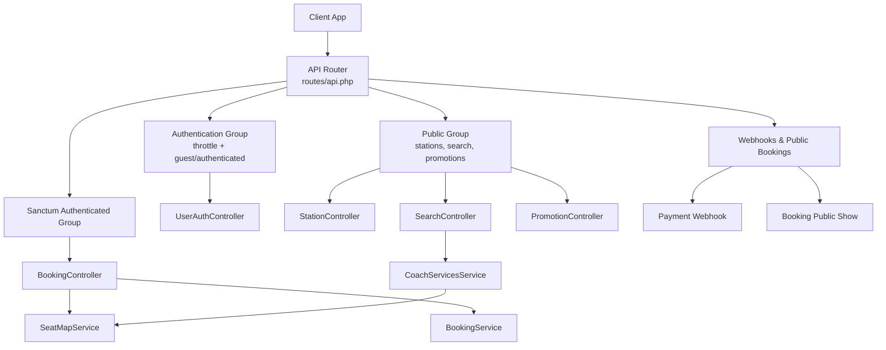
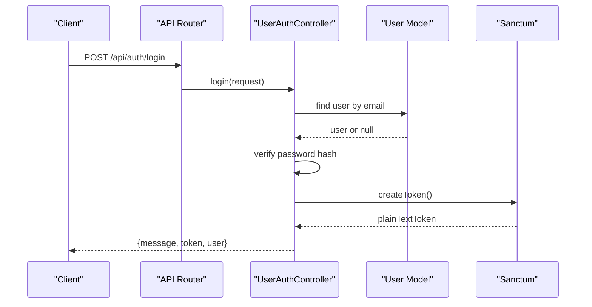
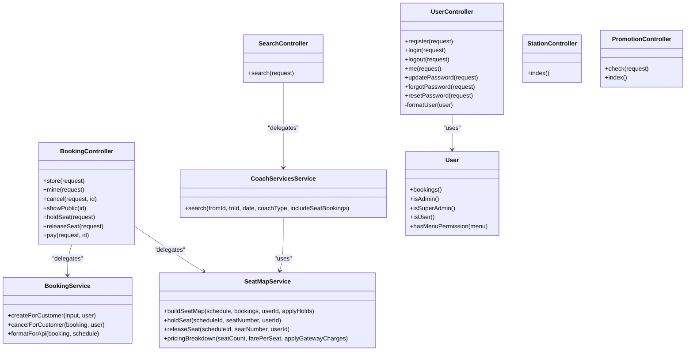

# API Routes

<cite>
**Referenced Files in This Document**
- [api.php](file://backend/routes/api.php)
- [BaseController.php](file://backend/app/Http/Controllers/API/BaseController.php)
- [UserAuthController.php](file://backend/app/Http/Controllers/API/UserAuthController.php)
- [BookingController.php](file://backend/app/Http/Controllers/API/BookingController.php)
- [SearchController.php](file://backend/app/Http/Controllers/API/SearchController.php)
- [StationController.php](file://backend/app/Http/Controllers/API/StationController.php)
- [PromotionController.php](file://backend/app/Http/Controllers/API/PromotionController.php)
- [BookingService.php](file://backend/app/Services/BookingService.php)
- [SeatMapService.php](file://backend/app/Services/SeatMapService.php)
- [CoachServicesService.php](file://backend/app/Services/CoachServicesService.php)
- [sanctum.php](file://backend/config/sanctum.php)
- [cors.php](file://backend/config/cors.php)
- [User.php](file://backend/app/Models/User.php)
</cite>

## Table of Contents
1. [Introduction](#introduction)
2. [Project Structure](#project-structure)
3. [Core Components](#core-components)
4. [Architecture Overview](#architecture-overview)
5. [Detailed Component Analysis](#detailed-component-analysis)
6. [Dependency Analysis](#dependency-analysis)
7. [Performance Considerations](#performance-considerations)
8. [Troubleshooting Guide](#troubleshooting-guide)
9. [Conclusion](#conclusion)
10. [Appendices](#appendices)

## Introduction
This document describes the RESTful API routing strategy implemented in the backend routes file and how it maps to controllers, services, and models. It covers all public and authenticated endpoints grouped by domain: authentication, booking management, search, stations, promotions, and seat management. For each endpoint group, this document explains HTTP methods, URL patterns, request parameters, response schemas, authentication requirements, error handling, rate limiting, and versioning considerations.

The API is a Laravel application exposing JSON endpoints under the `/api` prefix for the React frontend. Authentication uses Laravel Sanctum bearer tokens. Public endpoints are protected by maintenance mode checks, while sensitive endpoints require an authenticated user.

## Project Structure
The API routes are defined in a single routes file and grouped by feature and access level. Controllers delegate business logic to service classes. Models represent database entities such as users, bookings, schedules, stations, and promotions. Configuration files define Sanctum behavior and CORS policy.

**Diagram sources**
- [api.php:26-75](file://backend/routes/api.php#L26-L75)
- [UserAuthController.php:15-218](file://backend/app/Http/Controllers/API/UserAuthController.php#L15-L218)
- [StationController.php:8-15](file://backend/app/Http/Controllers/API/StationController.php#L8-L15)
- [SearchController.php:8-31](file://backend/app/Http/Controllers/API/SearchController.php#L8-L31)
- [PromotionController.php:8-37](file://backend/app/Http/Controllers/API/PromotionController.php#L8-L37)
- [BookingController.php:10-148](file://backend/app/Http/Controllers/API/BookingController.php#L10-L148)
- [BookingService.php:14-333](file://backend/app/Services/BookingService.php#L14-L333)
- [SeatMapService.php:9-593](file://backend/app/Services/SeatMapService.php#L9-L593)
- [CoachServicesService.php:10-190](file://backend/app/Services/CoachServicesService.php#L10-L190)

**Section sources**
- [api.php:1-77](file://backend/routes/api.php#L1-L77)

## Core Components
- API router groups endpoints by middleware: maintenance check, throttle, Sanctum authentication.
- Controllers validate input and delegate to services for complex operations.
- Services encapsulate business logic: booking creation, cancellation, pricing, seat availability, search queries, and payment integration.
- Models provide data structures and relationships; the User model includes role helpers and Sanctum token support.

Key responsibilities:
- Authentication controller handles registration, login, logout, profile retrieval, password update, and password reset flows.
- Booking controller manages booking creation, listing, cancellation, payment initiation, and seat hold/release.
- Search controller validates query parameters and returns schedule results with seat map and pricing.
- Station controller returns a sorted list of stations.
- Promotion controller lists promotions and validates promo codes.
- Services implement transactional booking workflows, seat locking, pricing calculations, and search aggregation.

**Section sources**
- [api.php:26-75](file://backend/routes/api.php#L26-L75)
- [UserAuthController.php:15-218](file://backend/app/Http/Controllers/API/UserAuthController.php#L15-L218)
- [BookingController.php:10-148](file://backend/app/Http/Controllers/API/BookingController.php#L10-L148)
- [SearchController.php:8-31](file://backend/app/Http/Controllers/API/SearchController.php#L8-L31)
- [StationController.php:8-15](file://backend/app/Http/Controllers/API/StationController.php#L8-L15)
- [PromotionController.php:8-37](file://backend/app/Http/Controllers/API/PromotionController.php#L8-L37)
- [BookingService.php:14-333](file://backend/app/Services/BookingService.php#L14-L333)
- [SeatMapService.php:9-593](file://backend/app/Services/SeatMapService.php#L9-L593)
- [CoachServicesService.php:10-190](file://backend/app/Services/CoachServicesService.php#L10-L190)
- [User.php:12-75](file://backend/app/Models/User.php#L12-L75)

## Architecture Overview
The API follows a layered architecture:
- Routing layer defines endpoints and applies middleware.
- Controller layer validates requests and orchestrates calls to services.
- Service layer implements domain logic, transactions, and integrations.
- Model layer represents persistent data and relationships.

**Diagram sources**
- [api.php:41-46](file://backend/routes/api.php#L41-L46)
- [UserAuthController.php:41-69](file://backend/app/Http/Controllers/API/UserAuthController.php#L41-L69)
- [User.php:12-15](file://backend/app/Models/User.php#L12-L15)
- [sanctum.php:39-53](file://backend/config/sanctum.php#L39-L53)

## Detailed Component Analysis

### Authentication Endpoints
URL pattern: `/api/auth/*`

Endpoints:
- `POST /api/auth/register`
  - Authentication: None (guest)
  - Rate limit: 10 attempts per minute per IP
  - Request body fields:
    - name: string, required, max 100
    - email: string, required, valid email, unique
    - password: string, required, min 6, confirmed
  - Response:
    - message: string
    - token: string (bearer token)
    - user: object with id, name, email, role
  - Status codes:
    - 201 on success
    - 422 on validation errors
    - 403 if admin account tries to register via customer API

- `POST /api/auth/login`
  - Authentication: None (guest)
  - Rate limit: 10 attempts per minute per IP
  - Request body fields:
    - email: string, required, valid email
    - password: string, required
  - Response:
    - message: string
    - token: string (bearer token)
    - user: object with id, name, email, role
  - Status codes:
    - 200 on success
    - 422 on invalid credentials
    - 403 if admin account

- `POST /api/auth/forgot-password`
  - Authentication: None (guest)
  - Rate limit: 10 attempts per minute per IP
  - Request body fields:
    - email: string, required, valid email, max 100
  - Response:
    - message: string
    - code: string (only in local/testing environments)
  - Status codes:
    - 200 on success
    - 422 if email not registered as customer or mail sending fails

- `POST /api/auth/reset-password`
  - Authentication: None (guest)
  - Rate limit: 10 attempts per minute per IP
  - Request body fields:
    - email: string, required, valid email, max 100
    - code: string, required
    - password: string, required, min 6, confirmed
  - Response:
    - message: string
  - Status codes:
    - 200 on success
    - 422 if invalid or expired code

- `POST /api/auth/logout`
  - Authentication: Required (Sanctum bearer token)
  - Response:
    - message: string
  - Status codes:
    - 200 on success

- `GET /api/auth/me`
  - Authentication: Required (Sanctum bearer token)
  - Response:
    - user: object with id, name, email, role
  - Status codes:
    - 200 on success

- `POST /api/auth/password`
  - Authentication: Required (Sanctum bearer token)
  - Request body fields:
    - current_password: string, required
    - password: string, required, min 6, confirmed
  - Response:
    - message: string
    - user: updated user object
  - Status codes:
    - 200 on success
    - 422 if current password incorrect

Route parameter binding:
- No route parameters in authentication endpoints.

Query parameter handling:
- Not used in authentication endpoints.

Response formatting standards:
- Success responses include a message field and relevant payload.
- Validation errors return 422 with field-specific messages.
- User objects are formatted consistently with id, name, email, role.

Common API call examples:
- Register: POST /api/auth/register with name, email, password, password_confirmation
- Login: POST /api/auth/login with email, password
- Get profile: GET /api/auth/me with Authorization: Bearer <token>
- Logout: POST /api/auth/logout with Authorization: Bearer <token>

Error responses:
- 422 ValidationException with field messages
- 403 Forbidden for admin accounts attempting customer flows
- 500 Internal server errors when unexpected exceptions occur

Rate limiting:
- Throttle middleware limits authentication endpoints to 10 requests per minute per IP.

Authentication requirements:
- Guest endpoints: register, login, forgot-password, reset-password
- Authenticated endpoints: logout, me, password

Backward compatibility:
- Existing token-based authentication remains supported through Sanctum.
- User format remains stable with id, name, email, role.

**Section sources**
- [api.php:41-46](file://backend/routes/api.php#L41-L46)
- [api.php:63-66](file://backend/routes/api.php#L63-L66)
- [UserAuthController.php:17-218](file://backend/app/Http/Controllers/API/UserAuthController.php#L17-L218)
- [User.php:12-75](file://backend/app/Models/User.php#L12-L75)
- [sanctum.php:39-53](file://backend/config/sanctum.php#L39-L53)

### Booking Management Endpoints
URL pattern: `/api/bookings/*`

Endpoints:
- `POST /api/bookings`
  - Authentication: Required (Sanctum bearer token)
  - Request body fields:
    - schedule_id: integer, required, exists in schedules
    - passenger_name: string, required, max 100
    - passenger_phone: string, required, max 20
    - passenger_email: string, required, valid email, max 100
    - seat_numbers: string, required, comma-separated, max 255
    - payment_method: string, required, max 50
    - total_fare: number, optional, non-negative
    - passenger_gender: string, optional, M or F
    - boarding_point: string, optional, max 150
    - dropping_point: string, optional, max 150
    - promo_code: string, optional
    - status: enum, optional, PENDING/PAID/SOLD/BOOKED/CANCEL_REQUESTED/CANCELLED
  - Response:
    - message: string
    - booking: object with id, pnr, passenger details, seat_numbers, total_fare, payment_method, payment_invoice_id, status, created_at, schedule
    - sms: object indicating SMS result
  - Status codes:
    - 201 on successful booking creation
    - 422 on validation or seat availability issues
    - 403 if non-admin attempts cash/manual booking
    - 500 on internal errors

- `GET /api/bookings/mine`
  - Authentication: Required (Sanctum bearer token)
  - Query parameters:
    - page: integer, optional, min 1
    - per_page: integer, optional, min 1, max 50
  - Response: Paginated list of bookings with schedule details
  - Status codes:
    - 200 on success

- `POST /api/bookings/{id}/cancel`
  - Authentication: Required (Sanctum bearer token)
  - Route parameter:
    - id: integer, booking identifier
  - Response:
    - message: string
    - booking_id: integer
    - status: string
  - Status codes:
    - 200 on success
    - 400 if already cancelled or cancellation requested
    - 403 if unauthorized
    - 404 if booking not found

- `POST /api/bookings/{id}/pay`
  - Authentication: Required (Sanctum bearer token)
  - Route parameter:
    - id: integer, booking identifier
  - Response:
    - message: string
    - payment_url: string
    - invoice_id: string
    - booking: object
  - Status codes:
    - 200 on payment initiation
    - 403 if unauthorized
    - 422 if invalid booking status or payment method
    - 404 if booking not found
    - 500 if payment gateway fails

- `GET /api/bookings/public/{id}`
  - Authentication: None (public)
  - Route parameter:
    - id: integer, booking identifier
  - Response:
    - booking: object with schedule details
  - Status codes:
    - 200 on success
    - 404 if booking not found

Route parameter binding:
- `{id}` binds to the booking identifier in cancel and pay endpoints.

Query parameter handling:
- mine endpoint supports pagination via page and per_page.

Response formatting standards:
- Booking objects include schedule nested with bus and route information.
- Dates are ISO 8601 strings.
- Numeric values are floats where applicable.

Common API call examples:
- Create booking: POST /api/bookings with schedule_id, passenger details, seat_numbers, payment_method
- List my bookings: GET /api/bookings/mine?page=1&per_page=10
- Cancel booking: POST /api/bookings/{id}/cancel
- Pay booking: POST /api/bookings/{id}/pay

Error responses:
- 422 for validation failures or unavailable seats
- 403 for authorization failures
- 404 for missing resources
- 500 for internal errors

Rate limiting:
- No explicit throttle on booking endpoints; rely on Sanctum authentication and application-level safeguards.

Authentication requirements:
- All booking endpoints except public show require Sanctum bearer token.

Business rules:
- Maximum 4 seats per booking.
- Cash/manual booking restricted to admins.
- ZiniPay flow sets booking status to PENDING and creates invoice.
- Cancellation transitions depend on current status.

**Section sources**
- [api.php:68-71](file://backend/routes/api.php#L68-L71)
- [api.php:54-55](file://backend/routes/api.php#L54-L55)
- [BookingController.php:19-148](file://backend/app/Http/Controllers/API/BookingController.php#L19-L148)
- [BookingService.php:28-333](file://backend/app/Services/BookingService.php#L28-L333)
- [SeatMapService.php:499-593](file://backend/app/Services/SeatMapService.php#L499-L593)

### Search Functionality Endpoint
URL pattern: `/api/search`

Endpoint:
- `GET /api/search`
  - Authentication: None (public)
  - Query parameters:
    - from: integer, required, station id
    - to: integer, required, station id
    - date: string, required, Y-m-d format
    - coach_type: string, optional
  - Response: Collection of schedule objects including bus, route, seat_map, booked_seats, boarding_points, dropping_points, seat_class, pricing, available_seats_count
  - Status codes:
    - 200 on success

Route parameter binding:
- No route parameters.

Query parameter handling:
- Validates station ids exist in stations table.
- Filters schedules by route and departure time window.
- Optional coach type filter applied client-side after query.

Response formatting standards:
- Schedule payloads include comprehensive seat map and pricing breakdown.
- Dates are ISO 8601 strings.
- Bus and route objects contain identifiers and descriptive fields.

Common API call examples:
- Search schedules: GET /api/search?from=1&to=2&date=2026-01-01&coach_type=AC

Error responses:
- 422 for invalid or missing parameters

Authentication requirements:
- Public endpoint; no token required.

**Section sources**
- [api.php:26-32](file://backend/routes/api.php#L26-L32)
- [SearchController.php:14-31](file://backend/app/Http/Controllers/API/SearchController.php#L14-L31)
- [CoachServicesService.php:19-124](file://backend/app/Services/CoachServicesService.php#L19-L124)
- [SeatMapService.php:367-382](file://backend/app/Services/SeatMapService.php#L367-L382)

### Station Operations Endpoint
URL pattern: `/api/stations`

Endpoint:
- `GET /api/stations`
  - Authentication: None (public)
  - Response: Array of station objects sorted by name ascending
  - Status codes:
    - 200 on success

Route parameter binding:
- No route parameters.

Query parameter handling:
- No query parameters.

Response formatting standards:
- Station objects include standard attributes exposed by the model.

Common API call examples:
- Fetch stations: GET /api/stations

Authentication requirements:
- Public endpoint; no token required.

**Section sources**
- [api.php:26-32](file://backend/routes/api.php#L26-L32)
- [StationController.php:10-14](file://backend/app/Http/Controllers/API/StationController.php#L10-L14)

### Promotion Handling Endpoints
URL pattern: `/api/promotions*`

Endpoints:
- `GET /api/promotions`
  - Authentication: None (public)
  - Response: Array of promotion objects
  - Status codes:
    - 200 on success

- `GET /api/promotions/check`
  - Authentication: None (public)
  - Query parameters:
    - code: string, required
  - Response:
    - code: string
    - discount_amount: float
    - description: string
  - Status codes:
    - 200 on success
    - 404 if promo code not found

Route parameter binding:
- No route parameters.

Query parameter handling:
- Check endpoint normalizes code to uppercase before lookup.

Response formatting standards:
- Promotion objects include code, discount amount, and description.

Common API call examples:
- List promotions: GET /api/promotions
- Validate promo code: GET /api/promotions/check?code=SAVE10

Authentication requirements:
- Public endpoints; no token required.

**Section sources**
- [api.php:30-31](file://backend/routes/api.php#L30-L31)
- [PromotionController.php:10-37](file://backend/app/Http/Controllers/API/PromotionController.php#L10-L37)

### Seat Management Endpoints
URL pattern: `/api/seats/*`

Endpoints:
- `POST /api/seats/hold`
  - Authentication: Required (Sanctum bearer token)
  - Request body fields:
    - schedule_id: integer, required, exists in schedules
    - seat_number: string, required
  - Response:
    - success: boolean
    - expires_at: ISO 8601 timestamp (on success)
    - message: string (on failure)
  - Status codes:
    - 200 on success
    - 422 on validation or seat not available

- `POST /api/seats/release`
  - Authentication: Required (Sanctum bearer token)
  - Request body fields:
    - schedule_id: integer, required, exists in schedules
    - seat_number: string, required
  - Response:
    - success: boolean
  - Status codes:
    - 200 on success

Route parameter binding:
- No route parameters.

Query parameter handling:
- Not used in seat endpoints.

Response formatting standards:
- Hold/release responses use a consistent structure with success flag and message.

Common API call examples:
- Hold seat: POST /api/seats/hold with schedule_id and seat_number
- Release seat: POST /api/seats/release with schedule_id and seat_number

Authentication requirements:
- Both endpoints require Sanctum bearer token.

Business rules:
- Holds are stored in cache with expiration.
- Only available seats can be held.
- Releases remove holds for the authenticated user.

**Section sources**
- [api.php:73-74](file://backend/routes/api.php#L73-L74)
- [BookingController.php:82-116](file://backend/app/Http/Controllers/API/BookingController.php#L82-L116)
- [SeatMapService.php:502-582](file://backend/app/Services/SeatMapService.php#L502-L582)

## Dependency Analysis
The API exhibits clear separation of concerns:
- Controllers depend on services for business logic.
- Services depend on models and external gateways (SMS, payment).
- Sanctum provides token-based authentication for protected routes.
- CORS configuration allows cross-origin requests from the frontend.

**Diagram sources**
- [UserAuthController.php:15-218](file://backend/app/Http/Controllers/API/UserAuthController.php#L15-L218)
- [BookingController.php:10-148](file://backend/app/Http/Controllers/API/BookingController.php#L10-L148)
- [SearchController.php:8-31](file://backend/app/Http/Controllers/API/SearchController.php#L8-L31)
- [StationController.php:8-15](file://backend/app/Http/Controllers/API/StationController.php#L8-L15)
- [PromotionController.php:8-37](file://backend/app/Http/Controllers/API/PromotionController.php#L8-L37)
- [BookingService.php:14-333](file://backend/app/Services/BookingService.php#L14-L333)
- [SeatMapService.php:9-593](file://backend/app/Services/SeatMapService.php#L9-L593)
- [CoachServicesService.php:10-190](file://backend/app/Services/CoachServicesService.php#L10-L190)
- [User.php:12-75](file://backend/app/Models/User.php#L12-L75)

**Section sources**
- [api.php:26-75](file://backend/routes/api.php#L26-L75)
- [cors.php:18-32](file://backend/config/cors.php#L18-L32)
- [sanctum.php:21-53](file://backend/config/sanctum.php#L21-L53)

## Performance Considerations
- Database queries in search and booking flows use eager loading to reduce N+1 problems.
- Seat availability checks use lock-for-update within transactions to prevent race conditions.
- Cache is used for temporary seat holds to avoid database contention during high-concurrency scenarios.
- Pagination is supported for listing user bookings to limit payload size.
- Pricing calculations are centralized in services to ensure consistency and avoid redundant computations.

Recommendations:
- Monitor query performance using Laravel debug toolbar or profiling tools.
- Consider indexing frequently queried columns such as schedule_id, user_id, and status.
- Use background jobs for non-critical tasks like SMS notifications to improve response times.

[No sources needed since this section provides general guidance]

## Troubleshooting Guide
Common issues and resolutions:
- Authentication failures:
  - Ensure bearer token is included in Authorization header.
  - Verify Sanctum stateful domains include the frontend origin if using cookies.
  - Check CORS settings allow the frontend domain.

- Validation errors:
  - Review request payload against documented fields and constraints.
  - Inspect 422 responses for field-specific messages.

- Seat availability conflicts:
  - Use seat hold/release endpoints to manage concurrency.
  - Check cache for active holds if seats appear blocked unexpectedly.

- Payment initiation failures:
  - Confirm booking status is PENDING and payment method is ZiniPay.
  - Verify payment gateway configuration and network connectivity.

- Maintenance mode:
  - Public endpoints are blocked during maintenance; disable maintenance mode to restore access.

**Section sources**
- [sanctum.php:21-53](file://backend/config/sanctum.php#L21-L53)
- [cors.php:18-32](file://backend/config/cors.php#L18-L32)
- [UserAuthController.php:41-69](file://backend/app/Http/Controllers/API/UserAuthController.php#L41-L69)
- [BookingController.php:118-148](file://backend/app/Http/Controllers/API/BookingController.php#L118-L148)
- [SeatMapService.php:502-582](file://backend/app/Services/SeatMapService.php#L502-L582)

## Conclusion
The API provides a well-structured set of endpoints for authentication, booking management, search, stations, promotions, and seat management. It leverages Laravel Sanctum for secure token-based authentication, enforces rate limiting on sensitive endpoints, and centralizes business logic in service classes. The design promotes maintainability, scalability, and clarity for both developers and clients.

[No sources needed since this section summarizes without analyzing specific files]

## Appendices

### API Versioning Strategy and Backward Compatibility
- Current implementation does not include explicit API versioning in URLs or headers.
- To introduce versioning, consider prefixing routes with `/api/v1`, `/api/v2`, etc., and maintaining separate controllers or route groups for each version.
- Maintain backward compatibility by deprecating endpoints gradually and providing migration guides.
- Keep response schemas stable; add new fields without removing existing ones to avoid breaking clients.

[No sources needed since this section provides general guidance]