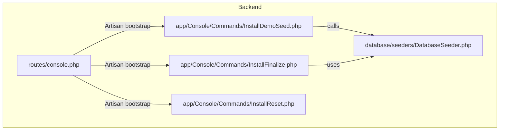
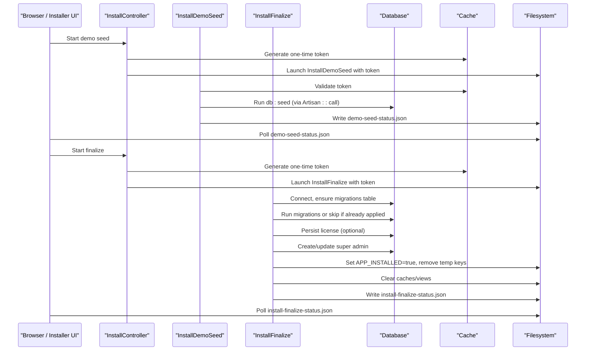
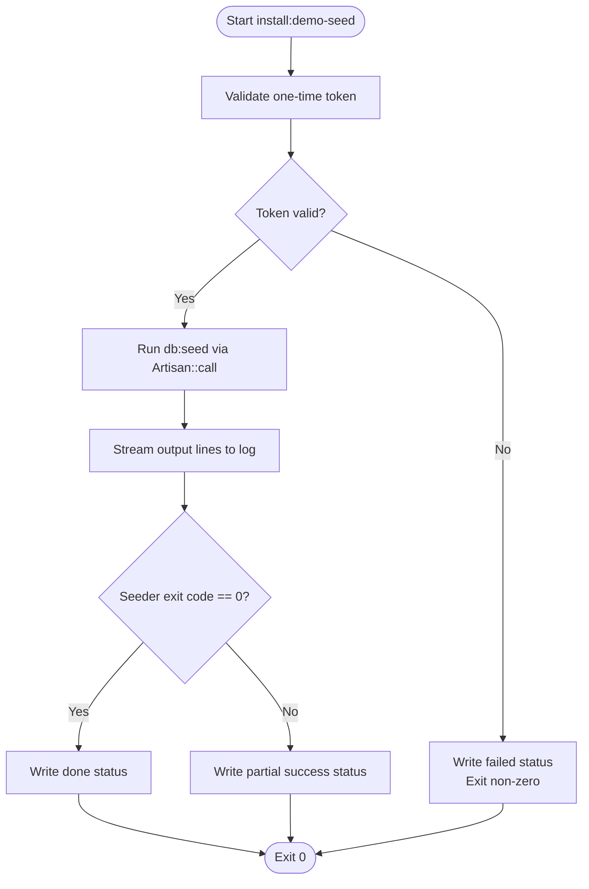
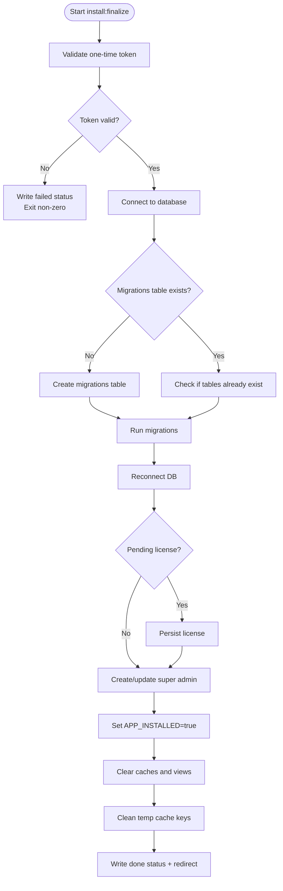
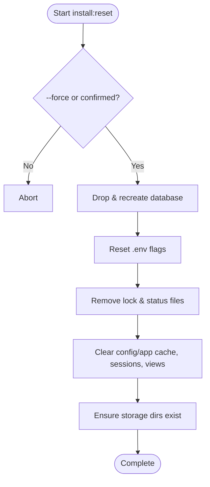
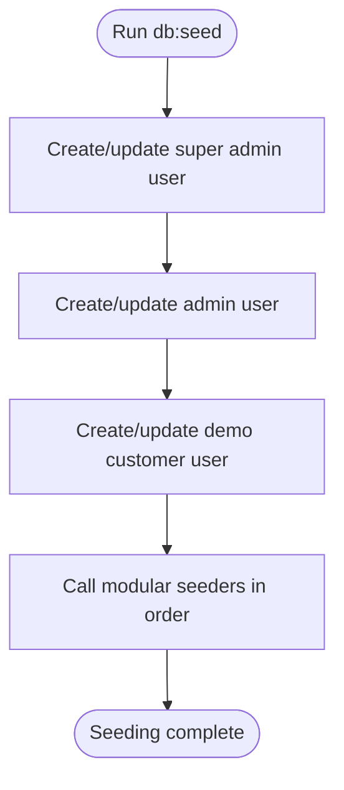
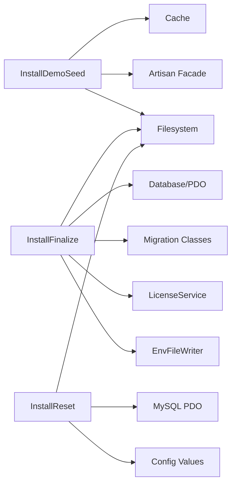

# Console Routes

<cite>
**Referenced Files in This Document**
- [console.php](file://backend/routes/console.php)
- [InstallDemoSeed.php](file://backend/app/Console/Commands/InstallDemoSeed.php)
- [InstallFinalize.php](file://backend/app/Console/Commands/InstallFinalize.php)
- [InstallReset.php](file://backend/app/Console/Commands/InstallReset.php)
- [DatabaseSeeder.php](file://backend/database/seeders/DatabaseSeeder.php)
</cite>

## Table of Contents
1. [Introduction](#introduction)
2. [Project Structure](#project-structure)
3. [Core Components](#core-components)
4. [Architecture Overview](#architecture-overview)
5. [Detailed Component Analysis](#detailed-component-analysis)
6. [Dependency Analysis](#dependency-analysis)
7. [Performance Considerations](#performance-considerations)
8. [Troubleshooting Guide](#troubleshooting-guide)
9. [Conclusion](#conclusion)

## Introduction
This document explains the Artisan console commands and related installation/maintenance workflows used by the application. It focuses on:
- Installation commands: `install:demo-seed`, `install:finalize`, `install:reset`
- Database seeding operations
- System initialization tasks
- Maintenance and reset behavior
- Command structure, input/output handling, progress reporting
- Manual execution examples and cron scheduling guidance
- Command dependencies, error handling, and logging strategies for background tasks

The commands are implemented as Laravel console commands under `app/Console/Commands`. The default console routes file is present but does not register these custom commands; they are auto-discovered by Laravel when registered via their class definitions.

## Project Structure
The relevant files for this documentation are:
- Backend console route registration (default example only)
- Custom installation commands
- Database seeder orchestration

**Diagram sources**
- [console.php:1-9](file://backend/routes/console.php#L1-L9)
- [InstallDemoSeed.php:1-102](file://backend/app/Console/Commands/InstallDemoSeed.php#L1-L102)
- [InstallFinalize.php:1-268](file://backend/app/Console/Commands/InstallFinalize.php#L1-L268)
- [InstallReset.php:1-139](file://backend/app/Console/Commands/InstallReset.php#L1-L139)
- [DatabaseSeeder.php:1-56](file://backend/database/seeders/DatabaseSeeder.php#L1-L56)

**Section sources**
- [console.php:1-9](file://backend/routes/console.php#L1-L9)

## Core Components
- InstallDemoSeed: Runs demo seeders in a background process during installation and reports progress to a status file.
- InstallFinalize: Performs finalization steps such as migrations, license persistence, super admin creation, installer lock, cache clearing, and completion redirect.
- InstallReset: Resets the application to a fresh uninstalled state by dropping/recreating the database, resetting .env flags, removing lock/status files, clearing caches, and ensuring storage directories exist.
- DatabaseSeeder: Orchestrates seeding of users and modular entities (stations, buses, routes, schedules, bookings, promotions, SMS config).

Key responsibilities:
- Input validation via command options
- Progress reporting via JSON status files
- Safe background execution without blocking the web server
- Idempotent and safe migration handling
- Secure environment flag management

**Section sources**
- [InstallDemoSeed.php:1-102](file://backend/app/Console/Commands/InstallDemoSeed.php#L1-L102)
- [InstallFinalize.php:1-268](file://backend/app/Console/Commands/InstallFinalize.php#L1-L268)
- [InstallReset.php:1-139](file://backend/app/Console/Commands/InstallReset.php#L1-L139)
- [DatabaseSeeder.php:1-56](file://backend/database/seeders/DatabaseSeeder.php#L1-L56)

## Architecture Overview
The installation workflow uses two long-running background commands that write progress to files so the browser can poll them.

**Diagram sources**
- [InstallDemoSeed.php:21-100](file://backend/app/Console/Commands/InstallDemoSeed.php#L21-L100)
- [InstallFinalize.php:28-265](file://backend/app/Console/Commands/InstallFinalize.php#L28-L265)

## Detailed Component Analysis

### Command: install:demo-seed
Purpose:
- Execute demo data seeding in a detached background process.
- Report progress and errors to a JSON status file for polling.

Signature and options:
- Command name: `install:demo-seed`
- Option: `--token` (required one-time security token)

Behavior highlights:
- Extends time limit and memory limit for long-running seeding.
- Validates a one-time token from cache before proceeding.
- Calls `db:seed` with force flag and streams output lines into the status log.
- Writes status transitions: running → done or failed.

Progress reporting:
- Status file path: `storage/framework/demo-seed-status.json`
- Contains fields: status, log, optional error.

Error handling:
- Invalid or missing token returns an error and non-zero exit code.
- Exceptions during seeding are captured and written to the status file.

Manual usage:
- Typically invoked internally by the installer wizard. If run manually:
  - php artisan install:demo-seed --token=<one-time-token>

Scheduling:
- Not intended for cron; it is designed to be launched once per installation flow.

**Diagram sources**
- [InstallDemoSeed.php:21-100](file://backend/app/Console/Commands/InstallDemoSeed.php#L21-L100)

**Section sources**
- [InstallDemoSeed.php:1-102](file://backend/app/Console/Commands/InstallDemoSeed.php#L1-L102)

### Command: install:finalize
Purpose:
- Perform all installation finalization steps in a background process:
  - Ensure database connection and migrations table
  - Run migrations or skip if already applied
  - Persist license record (if pending)
  - Create or update super admin user
  - Lock installer by setting APP_INSTALLED
  - Clear caches and compiled views
  - Clean temporary cache keys

Signature and options:
- Command name: `install:finalize`
- Option: `--token` (required one-time security token)

Behavior highlights:
- Extends time limit and memory limit.
- Validates one-time token from cache.
- Checks and creates migrations table if missing.
- Iterates migration files and executes them directly, recording results.
- Reconnects database after migrations.
- Persists license using service layer if pending.
- Creates or updates super admin account.
- Sets APP_INSTALLED=true and writes timestamp to installed marker.
- Clears file-based cache and compiled views.
- Removes temporary cache keys used during installation.

Progress reporting:
- Status file path: `storage/framework/install-finalize-status.json`
- Contains fields: status, log, optional error, redirect URL upon completion.

Error handling:
- Invalid token returns error and non-zero exit code.
- Database connection failures throw runtime exceptions.
- Migration errors are logged; “already exists” and duplicate errors are handled gracefully.
- License persistence failures are logged and skipped.
- Admin creation failures throw runtime exceptions.

Manual usage:
- Typically invoked internally by the installer wizard. If run manually:
  - php artisan install:finalize --token=<one-time-token>

Scheduling:
- Not intended for cron; it is designed to be launched once per installation flow.

**Diagram sources**
- [InstallFinalize.php:28-265](file://backend/app/Console/Commands/InstallFinalize.php#L28-L265)

**Section sources**
- [InstallFinalize.php:1-268](file://backend/app/Console/Commands/InstallFinalize.php#L1-L268)

### Command: install:reset
Purpose:
- Reset the application to a fresh uninstalled state:
  - Drop and recreate the database
  - Reset .env flags (APP_INSTALLED=false, APP_LICENSED=false)
  - Remove install lock and status files
  - Clear configuration, app cache, sessions, and compiled views
  - Ensure required storage directories exist

Signature and options:
- Command name: `install:reset`
- Option: `--force` (skip confirmation prompt)

Behavior highlights:
- Prompts for confirmation unless `--force` is provided.
- Drops and recreates the MySQL database using configured credentials.
- Rewrites .env flags for installation and licensing states.
- Deletes framework lock and status JSON files.
- Manually clears bootstrap/cache, storage/framework cache/data, sessions, and views.
- Ensures storage directories exist.

Progress reporting:
- Uses task-based output with success/failure indicators.

Error handling:
- Each step is wrapped in a task helper that reports errors inline and rethrows exceptions.

Manual usage:
- php artisan install:reset
- php artisan install:reset --force

Scheduling:
- Not intended for cron; typically run manually during development or troubleshooting.

**Diagram sources**
- [InstallReset.php:17-122](file://backend/app/Console/Commands/InstallReset.php#L17-L122)

**Section sources**
- [InstallReset.php:1-139](file://backend/app/Console/Commands/InstallReset.php#L1-L139)

### Database Seeding Operations
Orchestration:
- The main seeder creates three default users (super admin, admin, demo customer) and then calls modular seeders in order: stations, buses, routes, route points, schedules, bookings, promotions, SMS config.

Usage:
- Invoked by `install:demo-seed` via `php artisan db:seed --force`.

Idempotency:
- Users are created or updated using upsert logic to avoid duplicates.

**Diagram sources**
- [DatabaseSeeder.php:13-54](file://backend/database/seeders/DatabaseSeeder.php#L13-L54)

**Section sources**
- [DatabaseSeeder.php:1-56](file://backend/database/seeders/DatabaseSeeder.php#L1-L56)

## Dependency Analysis
Command relationships and external dependencies:

- InstallDemoSeed depends on:
  - Cache store for one-time token validation
  - Artisan facade to call `db:seed`
  - Filesystem for writing progress status JSON

- InstallFinalize depends on:
  - Database connection and PDO for connectivity checks and direct SQL
  - Migration classes (loaded dynamically)
  - Service layer for license persistence
  - Environment file writer for setting APP_INSTALLED
  - Filesystem for clearing caches and views

- InstallReset depends on:
  - MySQL PDO for dropping/recreating the database
  - Filesystem for manipulating .env and framework files
  - Configuration values for database credentials

**Diagram sources**
- [InstallDemoSeed.php:21-100](file://backend/app/Console/Commands/InstallDemoSeed.php#L21-L100)
- [InstallFinalize.php:28-265](file://backend/app/Console/Commands/InstallFinalize.php#L28-L265)
- [InstallReset.php:17-122](file://backend/app/Console/Commands/InstallReset.php#L17-L122)

**Section sources**
- [InstallDemoSeed.php:1-102](file://backend/app/Console/Commands/InstallDemoSeed.php#L1-L102)
- [InstallFinalize.php:1-268](file://backend/app/Console/Commands/InstallFinalize.php#L1-L268)
- [InstallReset.php:1-139](file://backend/app/Console/Commands/InstallReset.php#L1-L139)

## Performance Considerations
- Background processes: Both `install:demo-seed` and `install:finalize` extend PHP time limits and memory limits to accommodate long-running tasks.
- Direct migration execution: `install:finalize` iterates migration files and executes them directly to avoid overhead and provide fine-grained control over migration outcomes.
- Minimal I/O: Progress is written incrementally to JSON files to keep polling lightweight.
- Cache and view cleanup: Commands clear cached configurations and compiled views to ensure consistent state post-installation.

[No sources needed since this section provides general guidance]

## Troubleshooting Guide
Common issues and resolutions:

- Invalid or missing token:
  - Cause: One-time token mismatch or expired.
  - Resolution: Regenerate the token via the installer controller and retry the command.

- Database connection failure:
  - Cause: Incorrect database credentials or unreachable host.
  - Resolution: Verify `.env` database settings and network connectivity.

- Migration conflicts:
  - Cause: Tables already exist or schema changes conflict.
  - Resolution: Use `install:reset` to rebuild the database, or inspect migration logs for specific errors.

- Seeder failures:
  - Cause: Data constraints or missing dependencies.
  - Resolution: Review `demo-seed-status.json` for detailed logs and fix underlying data issues.

- Stale caches:
  - Cause: Cached configuration or views causing unexpected behavior.
  - Resolution: Run `install:reset` or manually clear `bootstrap/cache` and `storage/framework` directories.

Logging strategy:
- Background commands write structured logs to JSON status files for polling.
- Errors are captured and included in the status payload for visibility.
- For persistent logs, consider integrating with Laravel’s logging stack and capturing command outputs to log files.

**Section sources**
- [InstallDemoSeed.php:55-99](file://backend/app/Console/Commands/InstallDemoSeed.php#L55-L99)
- [InstallFinalize.php:56-265](file://backend/app/Console/Commands/InstallFinalize.php#L56-L265)
- [InstallReset.php:20-122](file://backend/app/Console/Commands/InstallReset.php#L20-L122)

## Conclusion
The installation and maintenance commands provide a robust, background-friendly workflow for setting up the application, seeding demo data, finalizing installations, and resetting environments. They emphasize safety through token validation, idempotent operations, and comprehensive progress reporting. For production automation, prefer orchestrating these commands via deployment scripts rather than cron, given their one-shot nature and dependency on installer state.

[No sources needed since this section summarizes without analyzing specific files]