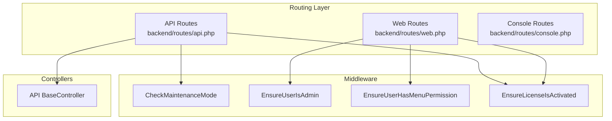
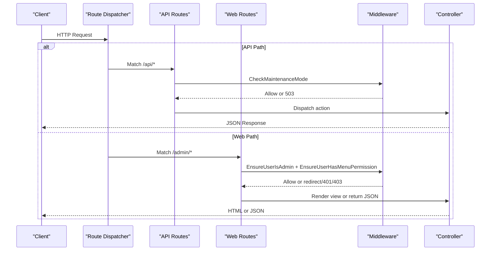
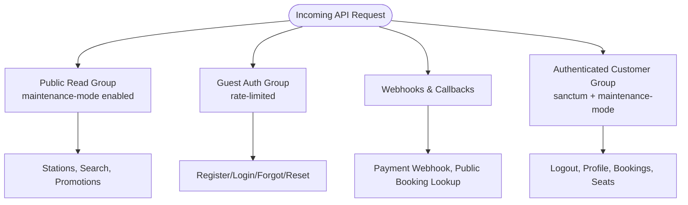
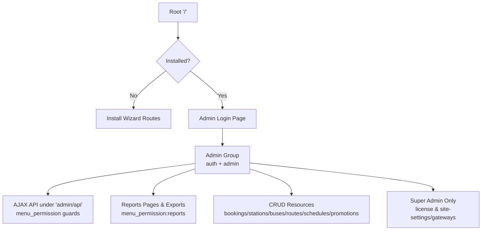
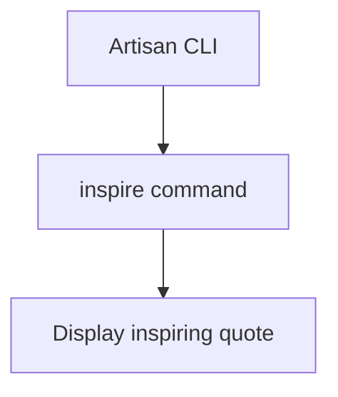
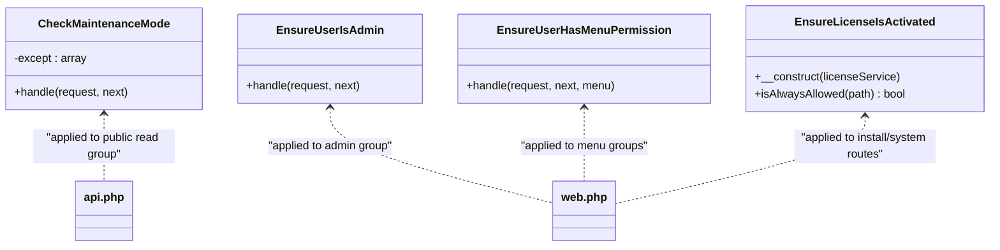
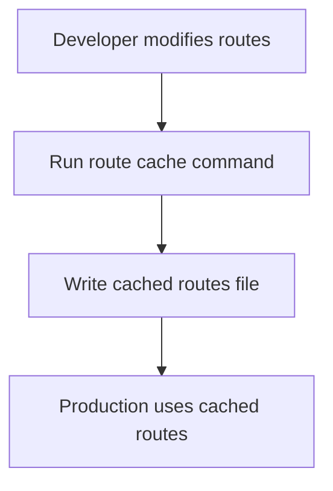
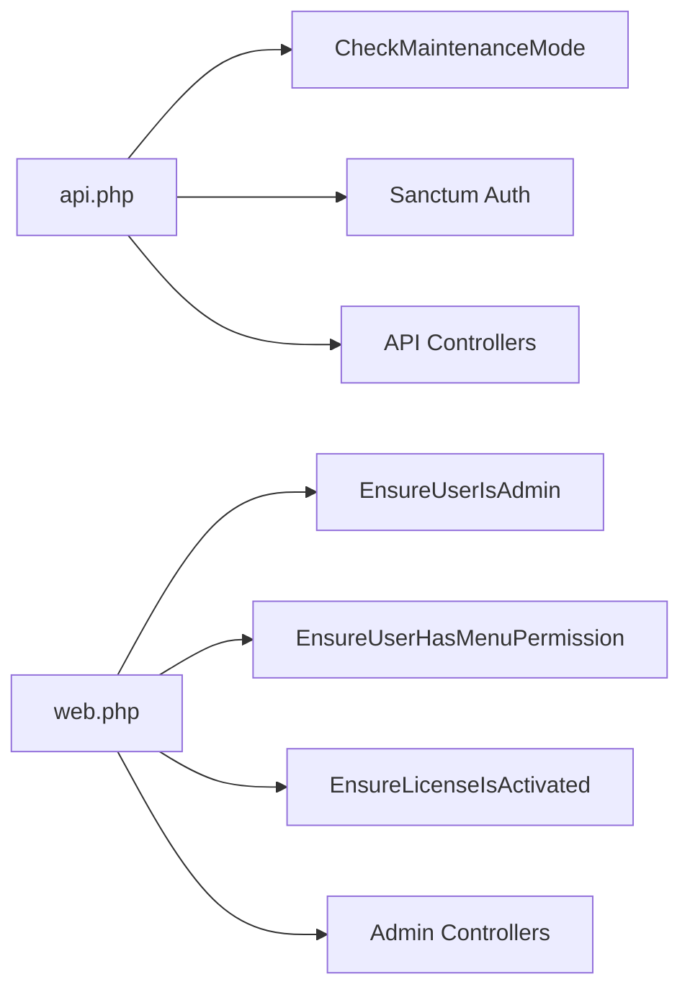

# Routing Strategy

<cite>
**Referenced Files in This Document**
- [api.php](file://backend/routes/api.php)
- [web.php](file://backend/routes/web.php)
- [console.php](file://backend/routes/console.php)
- [CheckMaintenanceMode.php](file://backend/app/Http/Middleware/CheckMaintenanceMode.php)
- [EnsureUserIsAdmin.php](file://backend/app/Http/Middleware/EnsureUserIsAdmin.php)
- [EnsureUserHasMenuPermission.php](file://backend/app/Http/Middleware/EnsureUserHasMenuPermission.php)
- [EnsureLicenseIsActivated.php](file://backend/app/Http/Middleware/EnsureLicenseIsActivated.php)
- [BaseController.php](file://backend/app/Http/Controllers/API/BaseController.php)
- [routes-v7.php](file://backend/bootstrap/cache/routes-v7.php)
</cite>

## Table of Contents
1. [Introduction](#introduction)
2. [Project Structure](#project-structure)
3. [Core Components](#core-components)
4. [Architecture Overview](#architecture-overview)
5. [Detailed Component Analysis](#detailed-component-analysis)
6. [Dependency Analysis](#dependency-analysis)
7. [Performance Considerations](#performance-considerations)
8. [Troubleshooting Guide](#troubleshooting-guide)
9. [Conclusion](#conclusion)
10. [Appendices](#appendices)

## Introduction
This document explains the routing strategy that separates API endpoints from web routes, focusing on:
- RESTful API design patterns used in the API route definitions
- Web routes for the admin panel, middleware groups, and route protection mechanisms
- Console routes for Artisan commands and scheduled tasks
- Route parameter binding examples
- Route caching strategies
- Versioning approaches for API evolution and backward compatibility considerations

The backend is a Laravel application where:
- API routes are defined under `backend/routes/api.php`
- Web routes (admin dashboard, session-based authentication, AJAX APIs) are defined under `backend/routes/web.php`
- Console routes are defined under `backend/routes/console.php`
- Middleware enforces maintenance mode, admin access, menu permissions, and license activation

## Project Structure
The routing layer is organized by purpose:
- API routes: stateless JSON endpoints for the React frontend and external integrations
- Web routes: Blade-driven admin dashboard with session-based auth and AJAX helpers
- Console routes: Artisan commands and scheduling hooks

**Diagram sources**
- [api.php:1-77](file://backend/routes/api.php#L1-L77)
- [web.php:1-293](file://backend/routes/web.php#L1-L293)
- [console.php:1-9](file://backend/routes/console.php#L1-L9)
- [CheckMaintenanceMode.php:1-49](file://backend/app/Http/Middleware/CheckMaintenanceMode.php#L1-L49)
- [EnsureUserIsAdmin.php:1-41](file://backend/app/Http/Middleware/EnsureUserIsAdmin.php#L1-L41)
- [EnsureUserHasMenuPermission.php:1-41](file://backend/app/Http/Middleware/EnsureUserHasMenuPermission.php#L1-L41)
- [EnsureLicenseIsActivated.php:1-46](file://backend/app/Http/Middleware/EnsureLicenseIsActivated.php#L1-L46)
- [BaseController.php:1-8](file://backend/app/Http/Controllers/API/BaseController.php#L1-L8)

**Section sources**
- [api.php:1-77](file://backend/routes/api.php#L1-L77)
- [web.php:1-293](file://backend/routes/web.php#L1-L293)
- [console.php:1-9](file://backend/routes/console.php#L1-L9)

## Core Components
- API routes provide public read endpoints, guest authentication endpoints, authenticated customer endpoints, and public webhooks/callbacks.
- Web routes provide the admin dashboard, CRUD operations, report pages, AJAX helpers, and super-admin configuration endpoints.
- Middleware enforces:
  - Maintenance mode gating for API routes
  - Admin role checks for web routes
  - Menu-level permission checks for specific admin sections
  - License activation gating for install and system routes
- Controllers:
  - API controllers implement RESTful actions for stations, search, promotions, bookings, and user auth
  - A shared abstract base controller exists for API controllers

Key responsibilities:
- Separation of concerns between API and web layers
- Consistent use of middleware to protect sensitive routes
- Clear naming and grouping of routes for maintainability

**Section sources**
- [api.php:1-77](file://backend/routes/api.php#L1-L77)
- [web.php:1-293](file://backend/routes/web.php#L1-L293)
- [CheckMaintenanceMode.php:1-49](file://backend/app/Http/Middleware/CheckMaintenanceMode.php#L1-L49)
- [EnsureUserIsAdmin.php:1-41](file://backend/app/Http/Middleware/EnsureUserIsAdmin.php#L1-L41)
- [EnsureUserHasMenuPermission.php:1-41](file://backend/app/Http/Middleware/EnsureUserHasMenuPermission.php#L1-L41)
- [EnsureLicenseIsActivated.php:1-46](file://backend/app/Http/Middleware/EnsureLicenseIsActivated.php#L1-L46)
- [BaseController.php:1-8](file://backend/app/Http/Controllers/API/BaseController.php#L1-L8)

## Architecture Overview
The request lifecycle across routing layers:

**Diagram sources**
- [api.php:1-77](file://backend/routes/api.php#L1-L77)
- [web.php:1-293](file://backend/routes/web.php#L1-L293)
- [CheckMaintenanceMode.php:1-49](file://backend/app/Http/Middleware/CheckMaintenanceMode.php#L1-L49)
- [EnsureUserIsAdmin.php:1-41](file://backend/app/Http/Middleware/EnsureUserIsAdmin.php#L1-L41)
- [EnsureUserHasMenuPermission.php:1-41](file://backend/app/Http/Middleware/EnsureUserHasMenuPermission.php#L1-L41)

## Detailed Component Analysis

### API Routing Strategy
The API layer uses clear groupings and middleware:
- Public site settings endpoint always accessible
- Public read endpoints wrapped in maintenance-mode middleware
- Guest authentication endpoints rate-limited
- Authenticated customer endpoints protected by Sanctum and maintenance-mode middleware
- Public webhooks and callbacks exposed without auth

RESTful patterns observed:
- Resource-oriented paths such as `/stations`, `/promotions`, `/bookings`
- Action-specific routes for complex flows like seat hold/release and booking payment/cancel
- Parameter binding via route parameters (for example, booking ID in cancel/pay routes)
- Stateless JSON responses expected by the React frontend

Example route categories:
- Public reads: stations, search, promotions
- Guest auth: register, login, forgot-password, reset-password
- Authenticated customer: logout, profile, password update, bookings CRUD-like actions, seat management
- Webhooks/callbacks: payment webhook, public booking lookup

**Diagram sources**
- [api.php:1-77](file://backend/routes/api.php#L1-L77)
- [CheckMaintenanceMode.php:1-49](file://backend/app/Http/Middleware/CheckMaintenanceMode.php#L1-L49)

**Section sources**
- [api.php:1-77](file://backend/routes/api.php#L1-L77)

### Web Routing Strategy
The web layer provides the admin dashboard and internal AJAX APIs:
- Installation wizard routes bypass normal license gating
- Public web routes include root redirect to install or login, and payment callback/cancel
- Admin authentication routes are session-based and rate-limited
- Admin console routes are grouped under `auth` and `admin` middleware
- AJAX helper routes under `admin/api` are protected by menu permissions
- Report pages and exports are grouped under reports menu permission
- CRUD routes for bookings, stations, buses, routes, schedules, promotions follow REST conventions
- Super-admin-only routes for license and site settings/gateway configurations

Protection mechanisms:
- Role check via `EnsureUserIsAdmin`
- Menu-level permission check via `EnsureUserHasMenuPermission`
- Super-admin gate for sensitive configuration updates

**Diagram sources**
- [web.php:1-293](file://backend/routes/web.php#L1-L293)
- [EnsureUserIsAdmin.php:1-41](file://backend/app/Http/Middleware/EnsureUserIsAdmin.php#L1-L41)
- [EnsureUserHasMenuPermission.php:1-41](file://backend/app/Http/Middleware/EnsureUserHasMenuPermission.php#L1-L41)

**Section sources**
- [web.php:1-293](file://backend/routes/web.php#L1-L293)

### Console Routing Strategy
Console routes define Artisan commands and can be extended for scheduled tasks:
- Default inspire command is present
- Additional commands exist in the codebase for installation and seeding workflows

Scheduled tasks:
- The repository does not show explicit scheduler entries in console routes; scheduled jobs are typically registered in the application’s scheduler configuration outside this file

**Diagram sources**
- [console.php:1-9](file://backend/routes/console.php#L1-L9)

**Section sources**
- [console.php:1-9](file://backend/routes/console.php#L1-L9)

### Middleware Groups and Route Protection
- Maintenance mode:
  - Blocks most API routes during maintenance except explicitly allowed endpoints
  - Returns a structured JSON response with status 503 when maintenance is active
- Admin role:
  - Ensures only admin users can access admin routes
  - Returns appropriate JSON or redirects based on request type
- Menu permissions:
  - Enforces fine-grained access control per admin menu section
  - Supports both JSON and HTML responses depending on context
- License activation:
  - Two-stage gating: install lock and license verification
  - Allows critical system and payment routes to bypass restrictions

**Diagram sources**
- [CheckMaintenanceMode.php:1-49](file://backend/app/Http/Middleware/CheckMaintenanceMode.php#L1-L49)
- [EnsureUserIsAdmin.php:1-41](file://backend/app/Http/Middleware/EnsureUserIsAdmin.php#L1-L41)
- [EnsureUserHasMenuPermission.php:1-41](file://backend/app/Http/Middleware/EnsureUserHasMenuPermission.php#L1-L41)
- [EnsureLicenseIsActivated.php:1-46](file://backend/app/Http/Middleware/EnsureLicenseIsActivated.php#L1-L46)
- [api.php:1-77](file://backend/routes/api.php#L1-L77)
- [web.php:1-293](file://backend/routes/web.php#L1-L293)

**Section sources**
- [CheckMaintenanceMode.php:1-49](file://backend/app/Http/Middleware/CheckMaintenanceMode.php#L1-L49)
- [EnsureUserIsAdmin.php:1-41](file://backend/app/Http/Middleware/EnsureUserIsAdmin.php#L1-L41)
- [EnsureUserHasMenuPermission.php:1-41](file://backend/app/Http/Middleware/EnsureUserHasMenuPermission.php#L1-L41)
- [EnsureLicenseIsActivated.php:1-46](file://backend/app/Http/Middleware/EnsureLicenseIsActivated.php#L1-L46)

### RESTful API Design Patterns
- Resource routing:
  - Nouns represent resources: stations, promotions, bookings
  - Actions map to HTTP methods: GET for reads, POST for creation/actions, PUT/PATCH for updates, DELETE for removals
- Route parameters:
  - IDs bound into route segments for targeted operations (for example, cancel/pay for a specific booking)
- Request/response formats:
  - JSON payloads for all API interactions
  - Structured error responses for validation and authorization failures
  - Maintenance mode returns a consistent JSON structure with a 503 status

Examples of patterns:
- Resource collection endpoints: GET /api/stations, GET /api/promotions
- Action endpoints: POST /api/bookings/{id}/cancel, POST /api/bookings/{id}/pay
- State transitions: POST /api/seats/hold, POST /api/seats/release

**Section sources**
- [api.php:1-77](file://backend/routes/api.php#L1-L77)

### Route Parameter Binding Examples
- Booking ID binding:
  - Used in cancel and pay actions to target a specific booking resource
- Station and promotion lookups:
  - Collection endpoints do not require IDs; individual item endpoints would bind IDs similarly if added

Binding behavior:
- Laravel automatically binds route parameters to controller method arguments
- Validation and existence checks should be handled within controllers/services

**Section sources**
- [api.php:1-77](file://backend/routes/api.php#L1-L77)

### Route Caching Strategies
- Cached route files:
  - The presence of `bootstrap/cache/routes-v7.php` indicates route caching is supported and likely used in production
- Benefits:
  - Faster route resolution by avoiding runtime parsing
- Operational guidance:
  - Regenerate cache after modifying route definitions
  - Monitor cache invalidation during deployments

**Diagram sources**
- [routes-v7.php](file://backend/bootstrap/cache/routes-v7.php)

**Section sources**
- [routes-v7.php](file://backend/bootstrap/cache/routes-v7.php)

### API Versioning Approaches and Backward Compatibility
Current implementation:
- No explicit version prefix (for example, `/v1`) is present in the API routes
- All endpoints live under `/api` without version segments

Recommended approach for future evolution:
- Introduce a version prefix (for example, `/api/v1`) to isolate breaking changes
- Maintain backward compatibility by:
  - Deprecating old fields gradually
  - Supporting multiple versions concurrently during transition periods
  - Using feature flags or versioned controllers for major changes
- Communicate deprecation timelines and migration guides to API consumers

[No sources needed since this section provides general guidance]

## Dependency Analysis
Relationships among routing components:
- API routes depend on maintenance-mode middleware and Sanctum authentication
- Web routes depend on admin role and menu-permission middleware
- License activation middleware gates install and system routes
- Controllers implement business logic invoked by matched routes

**Diagram sources**
- [api.php:1-77](file://backend/routes/api.php#L1-L77)
- [web.php:1-293](file://backend/routes/web.php#L1-L293)
- [CheckMaintenanceMode.php:1-49](file://backend/app/Http/Middleware/CheckMaintenanceMode.php#L1-L49)
- [EnsureUserIsAdmin.php:1-41](file://backend/app/Http/Middleware/EnsureUserIsAdmin.php#L1-L41)
- [EnsureUserHasMenuPermission.php:1-41](file://backend/app/Http/Middleware/EnsureUserHasMenuPermission.php#L1-L41)
- [EnsureLicenseIsActivated.php:1-46](file://backend/app/Http/Middleware/EnsureLicenseIsActivated.php#L1-L46)

**Section sources**
- [api.php:1-77](file://backend/routes/api.php#L1-L77)
- [web.php:1-293](file://backend/routes/web.php#L1-L293)

## Performance Considerations
- Route caching reduces route resolution overhead in production
- Middleware should remain lightweight; expensive operations belong in services
- Rate limiting protects authentication endpoints from brute-force attempts
- Avoid unnecessary database queries in middleware; prefer cached settings where appropriate

[No sources needed since this section provides general guidance]

## Troubleshooting Guide
Common issues and resolutions:
- Maintenance mode blocking API calls:
  - Verify maintenance mode setting and ensure excluded endpoints are correctly configured
  - Confirm that site-settings endpoints remain accessible during maintenance
- Unauthorized or forbidden responses:
  - Ensure admin role and menu permissions are correctly assigned
  - Validate Sanctum token usage for authenticated customer endpoints
- License activation errors:
  - Confirm install completion and license verification steps
  - Check that critical system and payment routes are allowed through the license gate

**Section sources**
- [CheckMaintenanceMode.php:1-49](file://backend/app/Http/Middleware/CheckMaintenanceMode.php#L1-L49)
- [EnsureUserIsAdmin.php:1-41](file://backend/app/Http/Middleware/EnsureUserIsAdmin.php#L1-L41)
- [EnsureUserHasMenuPermission.php:1-41](file://backend/app/Http/Middleware/EnsureUserHasMenuPermission.php#L1-L41)
- [EnsureLicenseIsActivated.php:1-46](file://backend/app/Http/Middleware/EnsureLicenseIsActivated.php#L1-L46)

## Conclusion
The routing strategy cleanly separates API and web concerns:
- API endpoints expose a RESTful interface for the frontend and external systems
- Web routes provide a secure, permission-gated admin dashboard
- Middleware enforces maintenance mode, admin roles, menu permissions, and license activation
- Route caching improves performance in production
- Future API versioning should introduce explicit version prefixes to support backward compatibility

[No sources needed since this section summarizes without analyzing specific files]

## Appendices

### API Endpoint Summary
- Public reads: stations, search, promotions
- Guest auth: register, login, forgot-password, reset-password
- Authenticated customer: logout, profile, password update, bookings actions, seat hold/release
- Webhooks/callbacks: payment webhook, public booking lookup

**Section sources**
- [api.php:1-77](file://backend/routes/api.php#L1-L77)

### Admin Panel Endpoint Summary
- Dashboard and analytics
- AJAX helpers for coach services, bookings, cancel requests
- Reports pages and exports
- CRUD for bookings, stations, buses, routes, schedules, promotions
- Super-admin configuration for license and site settings/gateways

**Section sources**
- [web.php:1-293](file://backend/routes/web.php#L1-L293)