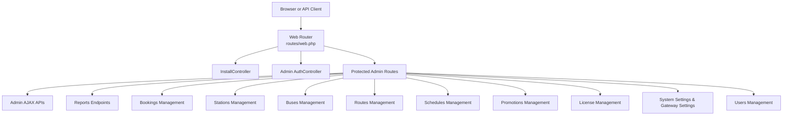
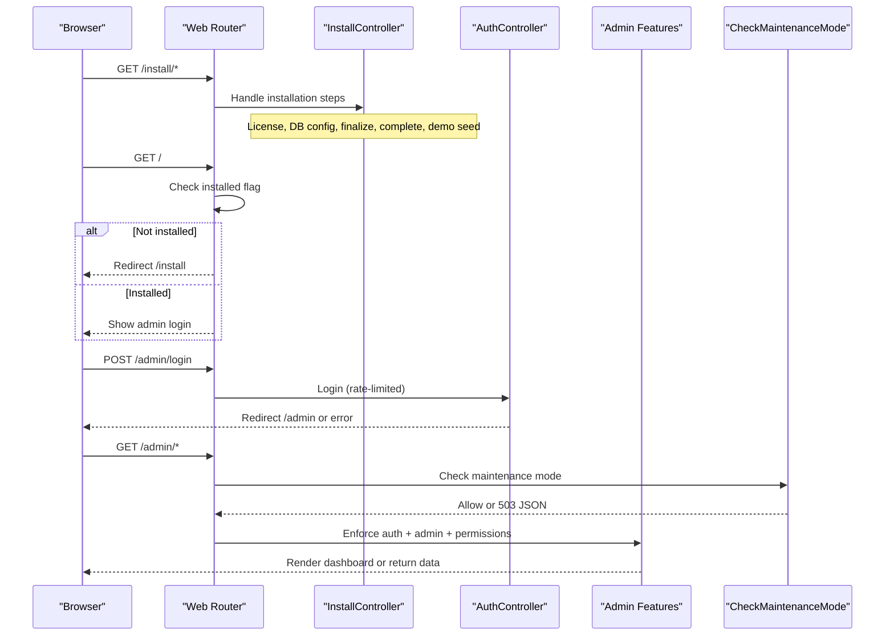
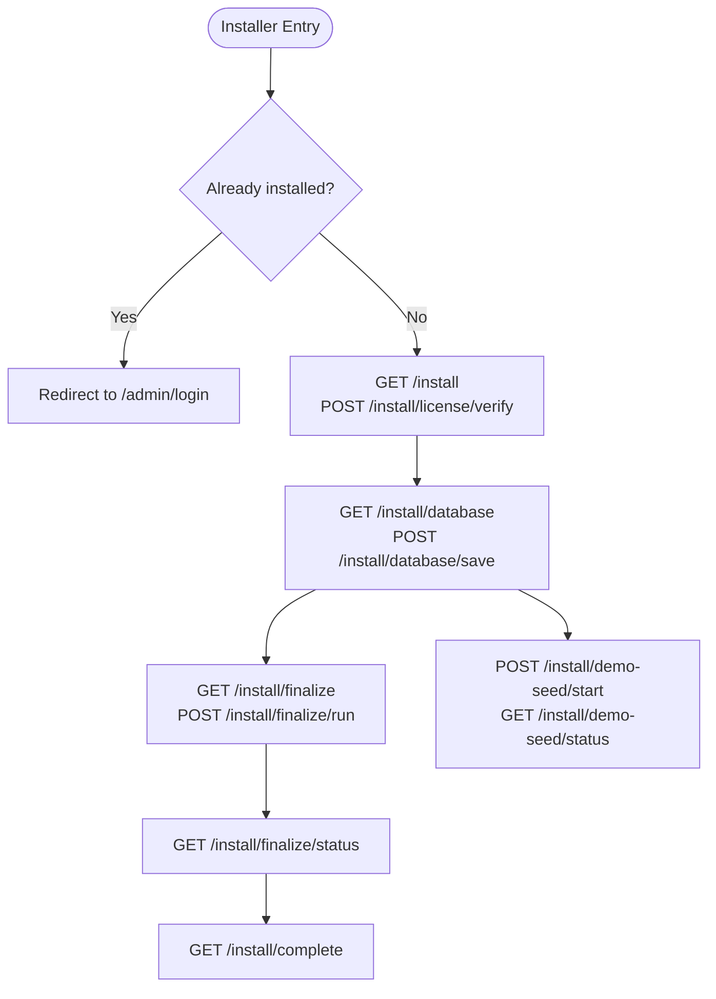
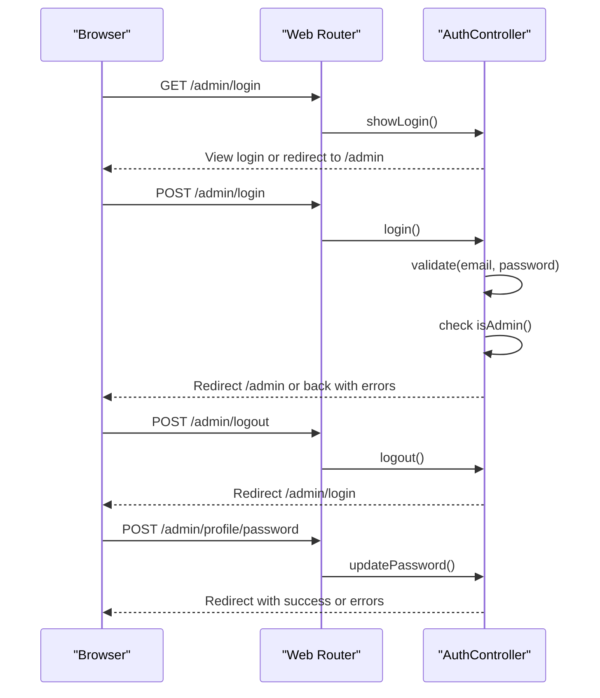
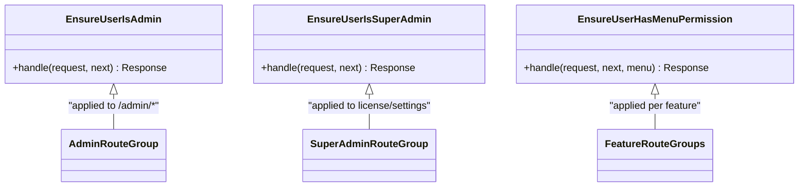
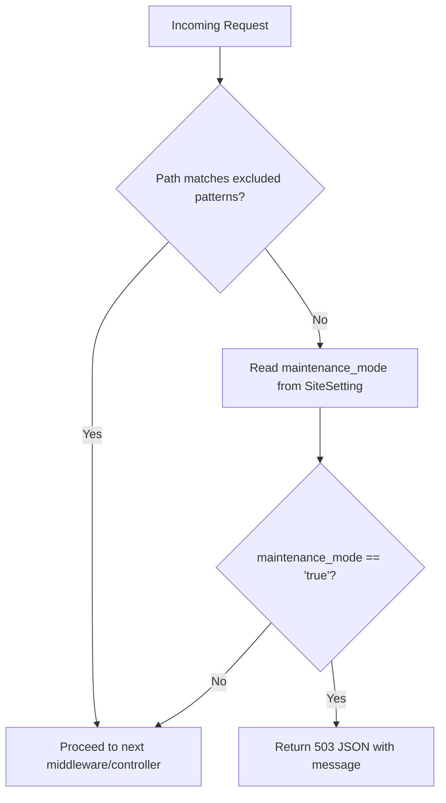
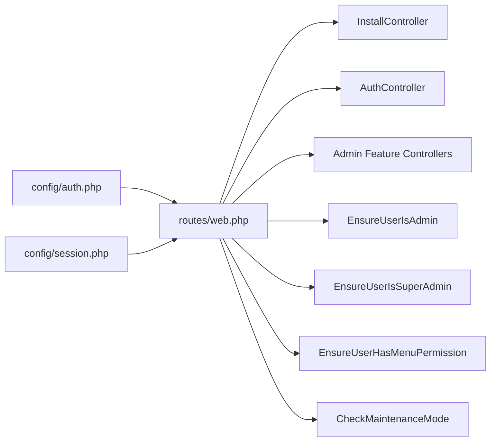

# Web Routes

<cite>
**Referenced Files in This Document**   
- [web.php](file://backend/routes/web.php)
- [InstallController.php](file://backend/app/Http/Controllers/Install/InstallController.php)
- [AuthController.php](file://backend/app/Http/Controllers/Admin/AuthController.php)
- [EnsureUserIsAdmin.php](file://backend/app/Http/Middleware/EnsureUserIsAdmin.php)
- [EnsureUserIsSuperAdmin.php](file://backend/app/Http/Middleware/EnsureUserIsSuperAdmin.php)
- [EnsureUserHasMenuPermission.php](file://backend/app/Http/Middleware/EnsureUserHasMenuPermission.php)
- [CheckMaintenanceMode.php](file://backend/app/Http/Middleware/CheckMaintenanceMode.php)
- [session.php](file://backend/config/session.php)
- [auth.php](file://backend/config/auth.php)
</cite>

## Table of Contents
1. [Introduction](#introduction)
2. [Project Structure](#project-structure)
3. [Core Components](#core-components)
4. [Architecture Overview](#architecture-overview)
5. [Detailed Component Analysis](#detailed-component-analysis)
6. [Dependency Analysis](#dependency-analysis)
7. [Performance Considerations](#performance-considerations)
8. [Troubleshooting Guide](#troubleshooting-guide)
9. [Conclusion](#conclusion)

## Introduction
This document explains the web routes that serve the admin panel and installation process. It covers:
- Protected admin routes requiring authentication and role-based access control
- Middleware groups for admin, super-admin, and menu permissions
- Route protection mechanisms including CSRF, session management, and security middleware
- Installation wizard endpoints, maintenance mode handling, and guest-accessible endpoints
- Route parameters, form submissions, file uploads, and example endpoints for admin-only operations, user profile management, and system configuration

## Project Structure
The web routing layer is defined in a single route file. Controllers are organized by feature area:
- Installation controller under `App\Http\Controllers\Install`
- Admin controllers under `App\Http\Controllers\Admin`
- Security and authorization logic implemented as HTTP middleware
- Session and authentication configuration under `config/`

**Diagram sources**
- [web.php:27-42](file://backend/routes/web.php#L27-L42)
- [web.php:68-70](file://backend/routes/web.php#L68-L70)
- [web.php:80-291](file://backend/routes/web.php#L80-L291)

**Section sources**
- [web.php:1-293](file://backend/routes/web.php#L1-L293)

## Core Components
- Installation wizard routes handle license verification, database configuration, finalization, completion, and optional demo seeding.
- Public entry point redirects to install if not installed; otherwise it shows the admin login page.
- Admin authentication uses session guard with rate limiting on login attempts.
- All admin console routes are protected by `auth` and `admin` middleware.
- Fine-grained access control is enforced via `menu_permission:<feature>` middleware.
- Super-admin-only routes protect license management, site settings, and gateway integrations.
- Maintenance mode middleware returns 503 JSON responses except for explicitly excluded API paths.

Key responsibilities:
- Route definitions and grouping
- Controller actions for installation and admin features
- Middleware enforcing authentication, roles, and permissions
- Configuration for sessions and authentication guards

**Section sources**
- [web.php:21-42](file://backend/routes/web.php#L21-L42)
- [web.php:44-70](file://backend/routes/web.php#L44-L70)
- [web.php:80-291](file://backend/routes/web.php#L80-L291)
- [EnsureUserIsAdmin.php:10-40](file://backend/app/Http/Middleware/EnsureUserIsAdmin.php#L10-L40)
- [EnsureUserIsSuperAdmin.php:10-37](file://backend/app/Http/Middleware/EnsureUserIsSuperAdmin.php#L10-L37)
- [EnsureUserHasMenuPermission.php:10-40](file://backend/app/Http/Middleware/EnsureUserHasMenuPermission.php#L10-L40)
- [CheckMaintenanceMode.php:10-48](file://backend/app/Http/Middleware/CheckMaintenanceMode.php#L10-L48)

## Architecture Overview
The request flow for web routes follows this pattern:
1. Request enters the router.
2. Installation routes bypass license checks during setup.
3. Public root redirects to install if not installed; otherwise shows admin login.
4. Admin login is rate-limited and validates credentials.
5. Protected admin routes require authenticated admin users.
6. Feature-specific routes enforce menu permissions.
7. Super-admin routes restrict sensitive configuration changes.
8. Maintenance mode middleware intercepts requests and returns 503 when enabled.

**Diagram sources**
- [web.php:27-42](file://backend/routes/web.php#L27-L42)
- [web.php:50-56](file://backend/routes/web.php#L50-L56)
- [web.php:68-70](file://backend/routes/web.php#L68-L70)
- [web.php:80-291](file://backend/routes/web.php#L80-L291)
- [CheckMaintenanceMode.php:22-47](file://backend/app/Http/Middleware/CheckMaintenanceMode.php#L22-L47)

## Detailed Component Analysis

### Installation Wizard Routes
Guest-accessible endpoints guide through installation:
- License verification: GET `/install`, POST `/install/license/verify`
- Database configuration: GET `/install/database`, POST `/install/database/save`
- Finalization: GET `/install/finalize`, POST `/install/finalize/run`, GET `/install/finalize/status`
- Completion: GET `/install/complete`
- Demo seeding: POST `/install/demo-seed/start`, GET `/install/demo-seed/status`

Behavior highlights:
- If already installed, installer routes redirect to admin login.
- License verification stores pending license data in session.
- Database save validates connection via PDO and writes credentials to `.env`.
- Optional SQL file upload triggers import before finalization.
- Finalization launches a background command and exposes status polling.

**Diagram sources**
- [web.php:27-42](file://backend/routes/web.php#L27-L42)
- [InstallController.php:46-79](file://backend/app/Http/Controllers/Install/InstallController.php#L46-L79)
- [InstallController.php:90-144](file://backend/app/Http/Controllers/Install/InstallController.php#L90-L144)
- [InstallController.php:166-222](file://backend/app/Http/Controllers/Install/InstallController.php#L166-L222)
- [InstallController.php:231-262](file://backend/app/Http/Controllers/Install/InstallController.php#L231-L262)

**Section sources**
- [web.php:27-42](file://backend/routes/web.php#L27-L42)
- [InstallController.php:20-42](file://backend/app/Http/Controllers/Install/InstallController.php#L20-L42)
- [InstallController.php:46-79](file://backend/app/Http/Controllers/Install/InstallController.php#L46-L79)
- [InstallController.php:90-144](file://backend/app/Http/Controllers/Install/InstallController.php#L90-L144)
- [InstallController.php:166-222](file://backend/app/Http/Controllers/Install/InstallController.php#L166-L222)
- [InstallController.php:231-262](file://backend/app/Http/Controllers/Install/InstallController.php#L231-L262)

### Admin Authentication and Profile Management
Admin authentication routes:
- GET `/admin/login`: Shows login view; redirects authenticated admins to dashboard.
- POST `/admin/login`: Rate-limited login attempt; validates email/password; enforces admin role; regenerates session.
- POST `/admin/logout`: Logs out, invalidates session, regenerates token, redirects to login.
- POST `/admin/profile/password`: Updates password after verifying current password.

Security notes:
- Non-admin users attempting admin login are logged out and redirected back with an error.
- Successful login regenerates session ID to prevent fixation.
- Logout invalidates session and regenerates CSRF token.

**Diagram sources**
- [web.php:68-70](file://backend/routes/web.php#L68-L70)
- [web.php:86-88](file://backend/routes/web.php#L86-L88)
- [AuthController.php:11-22](file://backend/app/Http/Controllers/Admin/AuthController.php#L11-L22)
- [AuthController.php:24-51](file://backend/app/Http/Controllers/Admin/AuthController.php#L24-L51)
- [AuthController.php:54-61](file://backend/app/Http/Controllers/Admin/AuthController.php#L54-L61)
- [AuthController.php:63-81](file://backend/app/Http/Controllers/Admin/AuthController.php#L63-L81)

**Section sources**
- [web.php:68-70](file://backend/routes/web.php#L68-L70)
- [web.php:86-88](file://backend/routes/web.php#L86-L88)
- [AuthController.php:11-81](file://backend/app/Http/Controllers/Admin/AuthController.php#L11-L81)

### Protected Admin Routes and Role-Based Access Control
All admin console routes are grouped under `auth` and `admin` middleware:
- Dashboard and analytics: GET `/admin`, GET `/admin/api/dashboard/analytics`
- AJAX APIs under `/admin/api/*` with additional `menu_permission` guards per feature
- CRUD routes for bookings, stations, buses, routes, schedules, promotions
- Reports preview/export endpoints
- User management endpoints

Role-based access control:
- `admin` middleware ensures the user is authenticated and has admin role.
- `super_admin` middleware restricts license and system settings/gateway endpoints.
- `menu_permission:<feature>` middleware restricts access based on user permissions.

Examples:
- Admin-only route: GET `/admin`
- User profile password update: POST `/admin/profile/password`
- System configuration endpoints: POST `/admin/site-settings`, POST `/admin/site-settings/logo`, POST `/admin/site-settings/favicon`
- Gateway integration endpoints: POST `/admin/gateway-settings/sms`, POST `/admin/gateway-settings/mail`, POST `/admin/gateway-settings/zinipay`

**Diagram sources**
- [EnsureUserIsAdmin.php:10-40](file://backend/app/Http/Middleware/EnsureUserIsAdmin.php#L10-L40)
- [EnsureUserIsSuperAdmin.php:10-37](file://backend/app/Http/Middleware/EnsureUserIsSuperAdmin.php#L10-L37)
- [EnsureUserHasMenuPermission.php:10-40](file://backend/app/Http/Middleware/EnsureUserHasMenuPermission.php#L10-L40)
- [web.php:80-291](file://backend/routes/web.php#L80-L291)

**Section sources**
- [web.php:80-291](file://backend/routes/web.php#L80-L291)
- [EnsureUserIsAdmin.php:10-40](file://backend/app/Http/Middleware/EnsureUserIsAdmin.php#L10-L40)
- [EnsureUserIsSuperAdmin.php:10-37](file://backend/app/Http/Middleware/EnsureUserIsSuperAdmin.php#L10-L37)
- [EnsureUserHasMenuPermission.php:10-40](file://backend/app/Http/Middleware/EnsureUserHasMenuPermission.php#L10-L40)

### Maintenance Mode Handling
Maintenance mode middleware:
- Checks database-stored maintenance flags and message.
- Returns 503 JSON response with maintenance details when enabled.
- Excludes specific API patterns so frontend can still fetch site settings.

**Diagram sources**
- [CheckMaintenanceMode.php:17-20](file://backend/app/Http/Middleware/CheckMaintenanceMode.php#L17-L20)
- [CheckMaintenanceMode.php:22-47](file://backend/app/Http/Middleware/CheckMaintenanceMode.php#L22-L47)

**Section sources**
- [CheckMaintenanceMode.php:10-48](file://backend/app/Http/Middleware/CheckMaintenanceMode.php#L10-L48)

### Guest-Accessible Endpoints
Guest-accessible routes include:
- Installation wizard endpoints under `/install/*`
- Payment callback and cancel endpoints
- Root path behavior: redirect to install if not installed; otherwise show admin login

These endpoints do not require authentication and are intended for initial setup and payment processing callbacks.

**Section sources**
- [web.php:27-42](file://backend/routes/web.php#L27-L42)
- [web.php:50-59](file://backend/routes/web.php#L50-L59)

### Route Parameters, Form Submissions, and File Uploads
Common parameter patterns:
- Resource IDs: `{id}` used in PUT/DELETE routes for bookings, stations, buses, routes, schedules, promotions, and users.
- Named routes provide stable URLs for forms and links.

Form submissions:
- Installation database save accepts fields for host, port, database name, username, password, and optional SQL file upload.
- Admin profile password update requires current password and new password confirmation.

File uploads:
- Installation step allows uploading an SQL file to pre-seed the database.
- System settings allow uploading favicon and logo files.

Security considerations:
- CSRF protection is handled by Laravel’s default web middleware stack applied to these routes.
- File size limits and MIME validation are enforced where applicable.

**Section sources**
- [web.php:90-101](file://backend/routes/web.php#L90-L101)
- [web.php:182-252](file://backend/routes/web.php#L182-L252)
- [web.php:269-281](file://backend/routes/web.php#L269-L281)
- [web.php:288-291](file://backend/routes/web.php#L288-L291)
- [InstallController.php:94-144](file://backend/app/Http/Controllers/Install/InstallController.php#L94-L144)
- [AuthController.php:63-81](file://backend/app/Http/Controllers/Admin/AuthController.php#L63-L81)

### CSRF Protection, Session Management, and Security Middleware
CSRF protection:
- Laravel’s default web middleware applies CSRF tokens to state-changing requests (POST/PUT/DELETE).
- Forms should include CSRF tokens; AJAX requests should send the token header.

Session management:
- Session driver defaults to database; lifetime configurable via environment variables.
- Cookies are http-only by default; SameSite policy mitigates CSRF risks.
- Login/logout flows regenerate session IDs and tokens to prevent fixation and replay attacks.

Authentication configuration:
- Default guard uses session driver with Eloquent user provider.
- Password reset broker configured with expiration and throttle settings.

Security middleware:
- `EnsureUserIsAdmin` enforces admin role and handles JSON vs HTML responses consistently.
- `EnsureUserIsSuperAdmin` restricts sensitive configuration endpoints.
- `EnsureUserHasMenuPermission` enforces fine-grained permissions per feature.

**Section sources**
- [session.php:21-215](file://backend/config/session.php#L21-L215)
- [auth.php:18-45](file://backend/config/auth.php#L18-L45)
- [auth.php:64-74](file://backend/config/auth.php#L64-L74)
- [auth.php:95-101](file://backend/config/auth.php#L95-L101)
- [EnsureUserIsAdmin.php:10-40](file://backend/app/Http/Middleware/EnsureUserIsAdmin.php#L10-L40)
- [EnsureUserIsSuperAdmin.php:10-37](file://backend/app/Http/Middleware/EnsureUserIsSuperAdmin.php#L10-L37)
- [EnsureUserHasMenuPermission.php:10-40](file://backend/app/Http/Middleware/EnsureUserHasMenuPermission.php#L10-L40)

## Dependency Analysis
The web routes depend on:
- Controllers for installation and admin features
- Middleware for authentication, role checks, and permission enforcement
- Configuration for sessions and authentication guards
- Services invoked by controllers (e.g., license service, env file writer)

**Diagram sources**
- [web.php:1-293](file://backend/routes/web.php#L1-L293)
- [auth.php:18-45](file://backend/config/auth.php#L18-L45)
- [session.php:21-215](file://backend/config/session.php#L21-L215)

**Section sources**
- [web.php:1-293](file://backend/routes/web.php#L1-L293)
- [auth.php:18-45](file://backend/config/auth.php#L18-L45)
- [session.php:21-215](file://backend/config/session.php#L21-L215)

## Performance Considerations
- Rate limiting on admin login prevents brute-force attacks.
- Background processes for installation finalization and demo seeding avoid blocking web requests.
- Maintenance mode check reads from database; consider caching frequently accessed settings if needed.
- Session storage via database may add overhead; ensure proper indexing and connection tuning.

[No sources needed since this section provides general guidance]

## Troubleshooting Guide
Common issues and resolutions:
- Installer redirects to admin login: The application is already marked as installed; verify installation flag and remove lock file if necessary.
- License verification fails: Check purchase code and network connectivity to license service; inspect session data for pending license.
- Database connection fails: Validate host, port, database name, username, and password; ensure MySQL is reachable and credentials are correct.
- SQL import errors: Review uploaded SQL file for syntax errors and duplicate entries; check server permissions and timeouts.
- Admin login denied: Ensure user has admin role; non-admin users are redirected back with an error.
- Super-admin access denied: Only super-admin accounts can access license and system settings endpoints.
- Menu permission denied: Verify user permissions for the requested feature; adjust permissions accordingly.
- Maintenance mode blocks requests: Disable maintenance mode in site settings or whitelist required API endpoints.

**Section sources**
- [InstallController.php:20-42](file://backend/app/Http/Controllers/Install/InstallController.php#L20-L42)
- [InstallController.php:54-79](file://backend/app/Http/Controllers/Install/InstallController.php#L54-L79)
- [InstallController.php:90-144](file://backend/app/Http/Controllers/Install/InstallController.php#L90-L144)
- [AuthController.php:24-51](file://backend/app/Http/Controllers/Admin/AuthController.php#L24-L51)
- [EnsureUserIsAdmin.php:10-40](file://backend/app/Http/Middleware/EnsureUserIsAdmin.php#L10-L40)
- [EnsureUserIsSuperAdmin.php:10-37](file://backend/app/Http/Middleware/EnsureUserIsSuperAdmin.php#L10-L37)
- [EnsureUserHasMenuPermission.php:10-40](file://backend/app/Http/Middleware/EnsureUserHasMenuPermission.php#L10-L40)
- [CheckMaintenanceMode.php:22-47](file://backend/app/Http/Middleware/CheckMaintenanceMode.php#L22-L47)

## Conclusion
The web routes provide a secure and structured interface for both installation and administration. Installation endpoints are guest-accessible and guide operators through license verification, database setup, finalization, and optional demo seeding. Admin routes are protected by layered middleware ensuring authentication, admin role, super-admin privileges where required, and fine-grained menu permissions. Maintenance mode protects the system while allowing critical API endpoints to remain accessible. CSRF protection and robust session management further harden the application against common web vulnerabilities.

[No sources needed since this section summarizes without analyzing specific files]