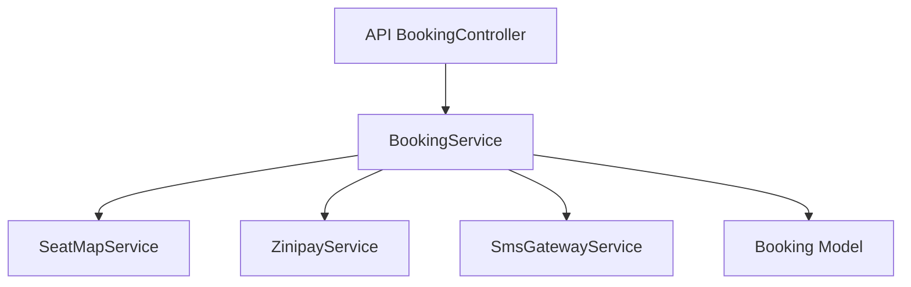
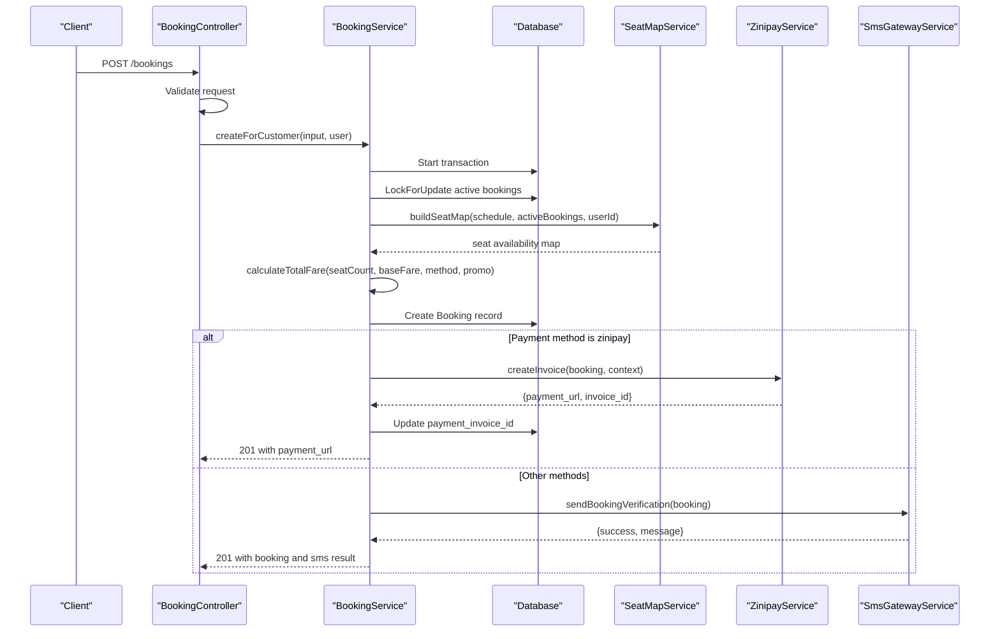
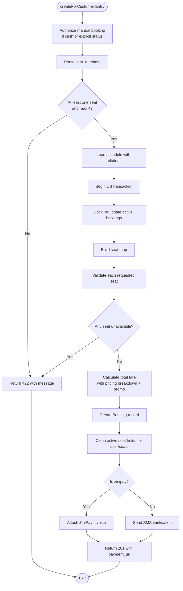
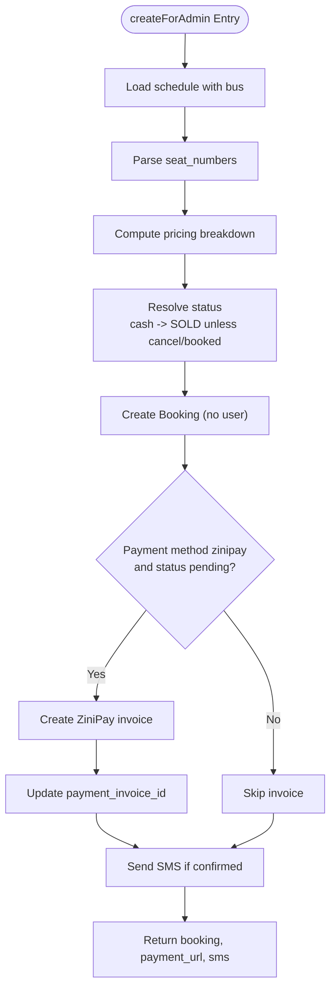
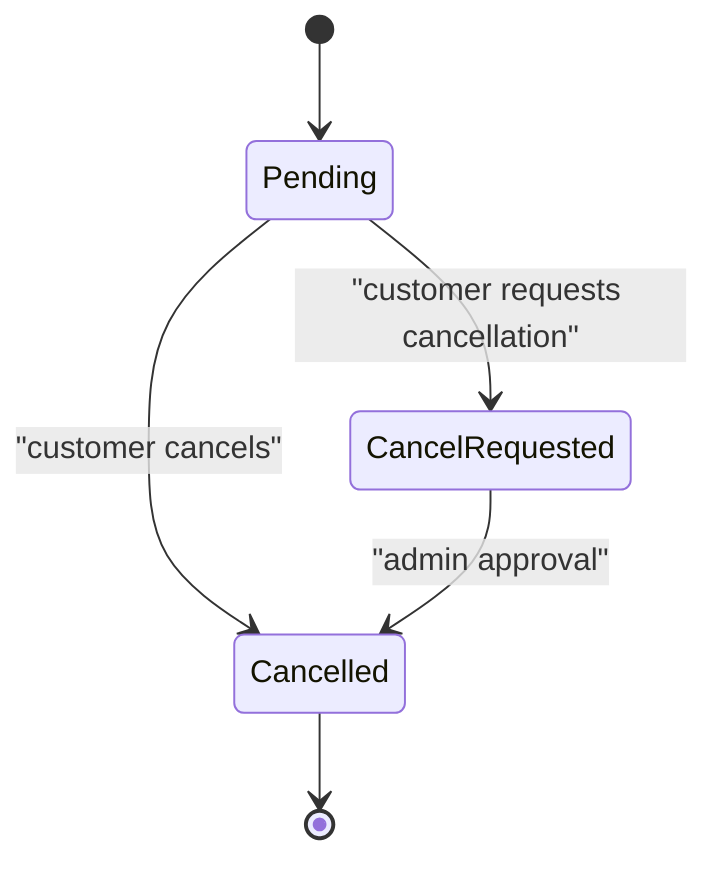
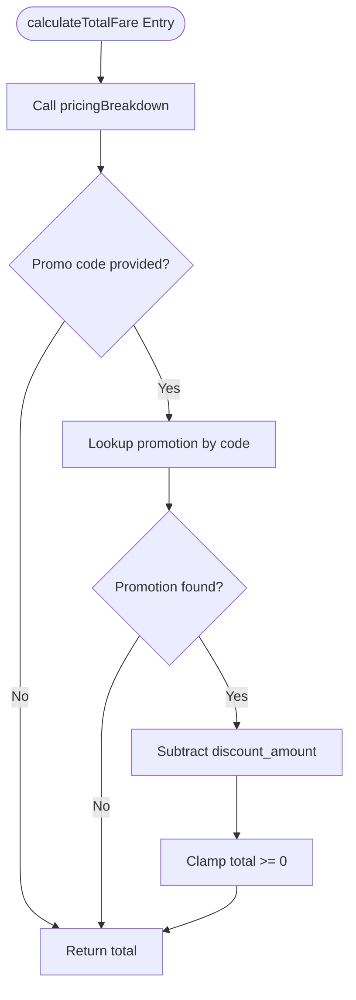
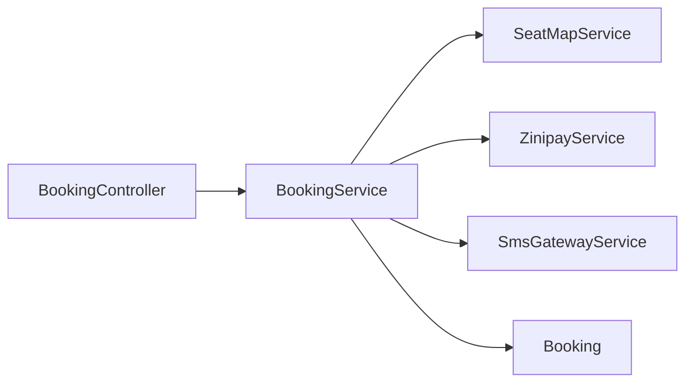

# Booking Service

<cite>
**Referenced Files in This Document**   
- [BookingService.php](file://backend/app/Services/BookingService.php)
- [SeatMapService.php](file://backend/app/Services/SeatMapService.php)
- [ZinipayService.php](file://backend/app/Services/ZinipayService.php)
- [SmsGatewayService.php](file://backend/app/Services/SmsGatewayService.php)
- [Booking.php](file://backend/app/Models/Booking.php)
- [BookingController.php](file://backend/app/Http/Controllers/API/BookingController.php)
</cite>

## Table of Contents
1. [Introduction](#introduction)
2. [Project Structure](#project-structure)
3. [Core Components](#core-components)
4. [Architecture Overview](#architecture-overview)
5. [Detailed Component Analysis](#detailed-component-analysis)
6. [Dependency Analysis](#dependency-analysis)
7. [Performance Considerations](#performance-considerations)
8. [Troubleshooting Guide](#troubleshooting-guide)
9. [Conclusion](#conclusion)

## Introduction
This document explains the booking business logic encapsulated by the `BookingService` class. It covers customer and admin booking creation, seat validation, fare calculation, promotion application, PNR generation, payment gateway integration, SMS notifications, cancellation workflow, and state transitions. The goal is to make the service understandable for both technical and non-technical readers while preserving precise implementation details from the codebase.

## Project Structure
The booking domain lives primarily under the backend services layer:
- `BookingService` coordinates booking creation, cancellation, formatting, and external integrations.
- `SeatMapService` provides seat availability, seat map construction, pricing breakdown, boarding/dropping points, and seat hold/release utilities.
- `ZinipayService` handles payment invoice creation and verification with an external payment provider.
- `SmsGatewayService` sends booking confirmation SMS through multiple configured providers.
- `Booking` model defines the booking entity, fillable fields, casts, relationships, and PNR accessor.
- `BookingController` exposes API endpoints that validate input and delegate to `BookingService`.

**Diagram sources**
- [BookingController.php:19-39](file://backend/app/Http/Controllers/API/BookingController.php#L19-L39)
- [BookingService.php:14-21](file://backend/app/Services/BookingService.php#L14-L21)
- [SeatMapService.php:9-10](file://backend/app/Services/SeatMapService.php#L9-L10)
- [ZinipayService.php:9-18](file://backend/app/Services/ZinipayService.php#L9-L18)
- [SmsGatewayService.php:11-12](file://backend/app/Services/SmsGatewayService.php#L11-L12)
- [Booking.php:8-10](file://backend/app/Models/Booking.php#L8-L10)

**Section sources**
- [BookingService.php:14-21](file://backend/app/Services/BookingService.php#L14-L21)
- [BookingController.php:19-39](file://backend/app/Http/Controllers/API/BookingController.php#L19-L39)

## Core Components
- `BookingService`: Central orchestrator for booking workflows. It validates inputs, locks seats, calculates fares, applies promotions, persists bookings, integrates with ZiniPay, and triggers SMS notifications.
- `SeatMapService`: Seat inventory and pricing engine. It builds seat maps, determines availability, computes pricing breakdowns, formats route points, and manages temporary seat holds via cache.
- `ZinipayService`: External payment integration. It creates invoices, verifies payments, and logs errors when configuration or network calls fail.
- `SmsGatewayService`: Notification delivery. It resolves active SMS configuration, normalizes phone numbers, builds messages, and dispatches through multiple drivers.
- `Booking`: Eloquent model representing a ticket. It includes booking attributes, relationships, and a computed PNR attribute.

Key responsibilities:
- Customer booking creation with transactional safety and seat locking.
- Admin booking creation without seat locking but with flexible status handling.
- Cancellation authorization and state transitions.
- Fare calculation including service/gateway charges and promotion discounts.
- PNR generation as a formatted booking identifier.

**Section sources**
- [BookingService.php:23-131](file://backend/app/Services/BookingService.php#L23-L131)
- [BookingService.php:133-193](file://backend/app/Services/BookingService.php#L133-L193)
- [BookingService.php:195-240](file://backend/app/Services/BookingService.php#L195-L240)
- [SeatMapService.php:191-244](file://backend/app/Services/SeatMapService.php#L191-L244)
- [SeatMapService.php:343-365](file://backend/app/Services/SeatMapService.php#L343-L365)
- [ZinipayService.php:20-97](file://backend/app/Services/ZinipayService.php#L20-L97)
- [SmsGatewayService.php:13-48](file://backend/app/Services/SmsGatewayService.php#L13-L48)
- [Booking.php:12-47](file://backend/app/Models/Booking.php#L12-L47)

## Architecture Overview
The booking flow follows a layered approach:
- Controllers validate HTTP requests and delegate to services.
- Services coordinate business rules, data persistence, and external integrations.
- Models represent entities and provide accessors like PNR.

**Diagram sources**
- [BookingController.php:19-39](file://backend/app/Http/Controllers/API/BookingController.php#L19-L39)
- [BookingService.php:28-131](file://backend/app/Services/BookingService.php#L28-L131)
- [SeatMapService.php:191-244](file://backend/app/Services/SeatMapService.php#L191-L244)
- [ZinipayService.php:20-97](file://backend/app/Services/ZinipayService.php#L20-L97)
- [SmsGatewayService.php:13-48](file://backend/app/Services/SmsGatewayService.php#L13-L48)

## Detailed Component Analysis

### BookingService: Customer Booking Creation (`createForCustomer`)
Responsibilities:
- Enforce authorization for manual booking (cash or explicit status).
- Parse and validate requested seats.
- Load schedule with related bus and route stations.
- Execute a database transaction with row-level locking.
- Build seat map and validate each requested seat.
- Calculate total fare including service/gateway charges and optional promotion discount.
- Persist booking with passenger details, seat numbers, seat class, and resolved status.
- Clean up any active seat holds for the current user and seats.
- Integrate with ZiniPay if payment method is zinipay; otherwise send SMS verification.

Transaction and seat locking:
- Uses a database transaction to ensure atomicity.
- Selects active bookings with `lockForUpdate()` to prevent race conditions during concurrent seat selection.
- Active bookings include paid/sold/booked statuses and recent pending bookings within a time window.

Seat validation:
- Builds seat map using `SeatMapService::buildSeatMap`, which considers blocked seats, active holds, and existing bookings.
- Validates each requested seat against the seat map; rejects unavailable seats.

Fare calculation and promotions:
- Delegates to `SeatMapService::pricingBreakdown` based on seat count, base fare, and whether gateway charges apply.
- Applies promotion discount if provided; ensures total fare does not go below zero.

Status resolution:
- For zinipay, sets status to pending until payment completes.
- For other methods, marks as sold immediately.

Return structure:
- Returns a standardized array with HTTP status and body containing message, booking payload, and SMS result.

Error handling:
- Validation failures return appropriate HTTP codes (e.g., 403 for unauthorized, 422 for invalid seats).
- Exceptions are caught and returned as 500 responses with error messages.

**Diagram sources**
- [BookingService.php:28-131](file://backend/app/Services/BookingService.php#L28-L131)
- [SeatMapService.php:191-244](file://backend/app/Services/SeatMapService.php#L191-L244)
- [ZinipayService.php:20-97](file://backend/app/Services/ZinipayService.php#L20-L97)
- [SmsGatewayService.php:13-48](file://backend/app/Services/SmsGatewayService.php#L13-L48)

**Section sources**
- [BookingService.php:28-131](file://backend/app/Services/BookingService.php#L28-L131)
- [SeatMapService.php:191-244](file://backend/app/Services/SeatMapService.php#L191-L244)
- [SeatMapService.php:343-365](file://backend/app/Services/SeatMapService.php#L343-L365)
- [ZinipayService.php:20-97](file://backend/app/Services/ZinipayService.php#L20-L97)
- [SmsGatewayService.php:13-48](file://backend/app/Services/SmsGatewayService.php#L13-L48)

### BookingService: Admin Booking Creation (`createForAdmin`)
Differences from customer flow:
- No seat locking or seat availability checks; assumes admin has authority to assign seats directly.
- Accepts optional `total_fare`; otherwise uses pricing breakdown from `SeatMapService`.
- Determines payment gateway applicability based on payment method.
- Resolves status explicitly; for cash payments, defaults to sold unless explicitly set to cancel states or booked.
- Creates booking without associating a user.
- Optionally creates ZiniPay invoice if payment method is zinipay and status is pending.
- Sends SMS only if final status is confirmed (paid/sold/booked).

Return structure:
- Returns booking object, optional payment URL, and SMS result.

**Diagram sources**
- [BookingService.php:133-193](file://backend/app/Services/BookingService.php#L133-L193)
- [SeatMapService.php:343-365](file://backend/app/Services/SeatMapService.php#L343-L365)
- [ZinipayService.php:20-97](file://backend/app/Services/ZinipayService.php#L20-L97)
- [SmsGatewayService.php:13-48](file://backend/app/Services/SmsGatewayService.php#L13-L48)

**Section sources**
- [BookingService.php:133-193](file://backend/app/Services/BookingService.php#L133-L193)

### BookingService: Customer Cancellation (`cancelForCustomer`)
Workflow:
- Authorization check: ensures the requesting user owns the booking.
- State transitions:
  - If status is pending, immediately cancel and return success.
  - If already cancelled, return bad request.
  - If cancellation request already submitted, return bad request.
  - Otherwise, set status to cancellation requested and return success.

Authorization and state diagram:

**Diagram sources**
- [BookingService.php:195-240](file://backend/app/Services/BookingService.php#L195-L240)

**Section sources**
- [BookingService.php:195-240](file://backend/app/Services/BookingService.php#L195-L240)

### Fare Calculation and Promotion Application
Fare calculation:
- Uses `SeatMapService::pricingBreakdown` to compute seat fare, service charge, gateway charge, and corresponding discounts.
- Gateway charges apply only when payment method is not cash.
- Promotion discount is applied after pricing breakdown; total fare is clamped at zero minimum.

Promotion lookup:
- Looks up promotion by code (case-insensitive) and subtracts its discount amount.

Return value:
- Returns a float total fare used when creating the booking.

**Diagram sources**
- [BookingService.php:304-318](file://backend/app/Services/BookingService.php#L304-L318)
- [SeatMapService.php:343-365](file://backend/app/Services/SeatMapService.php#L343-L365)

**Section sources**
- [BookingService.php:304-318](file://backend/app/Services/BookingService.php#L304-L318)
- [SeatMapService.php:343-365](file://backend/app/Services/SeatMapService.php#L343-L365)

### PNR Generation
PNR format:
- Generated as a string prefixed with “SE” followed by the booking ID padded to five digits with leading zeros.
- Implemented as an accessor on the `Booking` model.

Example:
- Booking ID 123 becomes PNR “SE00123”.

**Section sources**
- [Booking.php:43-47](file://backend/app/Models/Booking.php#L43-L47)

### Integration with SeatMapService
Seat availability and map:
- `buildSeatMap` constructs a seat-to-status map considering:
  - Default available seats.
  - Blocked seats from schedule configuration.
  - Temporary holds stored in cache for other users.
  - Existing bookings with paid/sold/booked statuses and recent pending bookings.
- `isSeatSelectable` returns true only for available seats.
- `pricingBreakdown` computes detailed pricing components.
- `boardingPoints` and `droppingPoints` generate route point payloads.
- `seatClassForCoach` derives seat class from coach type.

Seat holding:
- `holdSeat` validates seat code, checks DB availability, cleans expired holds, prevents conflicts with other users, and stores a temporary hold with expiration.
- `releaseSeat` removes the hold for the same user.

**Section sources**
- [SeatMapService.php:191-244](file://backend/app/Services/SeatMapService.php#L191-L244)
- [SeatMapService.php:433-447](file://backend/app/Services/SeatMapService.php#L433-L447)
- [SeatMapService.php:502-561](file://backend/app/Services/SeatMapService.php#L502-L561)
- [SeatMapService.php:563-582](file://backend/app/Services/SeatMapService.php#L563-L582)

### Integration with ZinipayService
Invoice creation:
- Requires API key configuration; logs error and returns null if missing.
- Generates redirect, cancel, and webhook URLs; adapts host to localhost in local/testing environments.
- Posts to external endpoint with headers and metadata including booking ID and source.
- Returns payment URL and invoice ID on success; logs errors otherwise.

Payment verification:
- Verifies invoice status via external API; returns status or null on failure.

Error handling:
- Logs configuration issues, HTTP failures, and exceptions.

**Section sources**
- [ZinipayService.php:20-97](file://backend/app/Services/ZinipayService.php#L20-L97)
- [ZinipayService.php:99-139](file://backend/app/Services/ZinipayService.php#L99-L139)

### Integration with SmsGatewayService
Message sending:
- Resolves active SMS configuration; returns failure if not configured.
- Validates configuration completeness (API URL, API key, sender ID depending on driver).
- Normalizes phone number to international format; rejects invalid numbers.
- Builds message using template or default text.
- Dispatches via selected driver (bulkSMSBD, smsnetbd, get_query, custom form).
- Returns success/failure with descriptive messages and logs outcomes.

**Section sources**
- [SmsGatewayService.php:13-48](file://backend/app/Services/SmsGatewayService.php#L13-L48)
- [SmsGatewayService.php:75-107](file://backend/app/Services/SmsGatewayService.php#L75-L107)
- [SmsGatewayService.php:109-150](file://backend/app/Services/SmsGatewayService.php#L109-L150)
- [SmsGatewayService.php:156-202](file://backend/app/Services/SmsGatewayService.php#L156-L202)

### API Contract and Error Handling Patterns
Input validation:
- Controller validates required fields such as schedule ID, passenger details, seat numbers, payment method, and optional fields like gender, boarding/dropping points, and promo code.

Response structure:
- Customer booking creation returns a JSON body with message, booking payload, and SMS result.
- Cancellation returns message, booking ID, and updated status.
- Payment initiation returns payment URL, invoice ID, and booking payload.

Error patterns:
- Unauthorized access returns 403.
- Validation failures return 422.
- Not found returns 404.
- Internal errors return 500 with exception message.

**Section sources**
- [BookingController.php:19-39](file://backend/app/Http/Controllers/API/BookingController.php#L19-L39)
- [BookingController.php:62-73](file://backend/app/Http/Controllers/API/BookingController.php#L62-L73)
- [BookingController.php:118-148](file://backend/app/Http/Controllers/API/BookingController.php#L118-L148)

## Dependency Analysis
Component relationships:
- `BookingController` depends on `BookingService`, `SeatMapService`, and `ZinipayService`.
- `BookingService` depends on `SeatMapService`, `SmsGatewayService`, and `ZinipayService`.
- `BookingService` interacts with `Booking` model and Laravel’s database transaction facilities.
- `SeatMapService` relies on configuration values and cache for seat holds.
- `ZinipayService` depends on HTTP client and logging.
- `SmsGatewayService` depends on HTTP client, logging, and schema checks.

**Diagram sources**
- [BookingController.php:12-16](file://backend/app/Http/Controllers/API/BookingController.php#L12-L16)
- [BookingService.php:16-21](file://backend/app/Services/BookingService.php#L16-L21)
- [SeatMapService.php:9-10](file://backend/app/Services/SeatMapService.php#L9-L10)
- [ZinipayService.php:9-18](file://backend/app/Services/ZinipayService.php#L9-L18)
- [SmsGatewayService.php:11-12](file://backend/app/Services/SmsGatewayService.php#L11-L12)
- [Booking.php:8-10](file://backend/app/Models/Booking.php#L8-L10)

**Section sources**
- [BookingController.php:12-16](file://backend/app/Http/Controllers/API/BookingController.php#L12-L16)
- [BookingService.php:16-21](file://backend/app/Services/BookingService.php#L16-L21)

## Performance Considerations
- Database transactions with `lockForUpdate` reduce race conditions during concurrent seat selection but may increase lock contention under high load.
- Selecting only necessary columns for active bookings reduces memory usage and query overhead.
- Cache-based seat holds improve responsiveness but require careful expiration management to avoid stale reservations.
- Pricing breakdown computation is lightweight and deterministic; however, repeated calls can be memoized if needed.
- SMS and payment gateway calls are external and should be monitored for latency; consider asynchronous processing for non-critical notifications.

[No sources needed since this section provides general guidance]

## Troubleshooting Guide
Common issues and resolutions:
- Unauthorized manual booking: Ensure the user has admin privileges when using cash or setting explicit booking status.
- Seat not available: Verify seat selection against the live seat map; check for blocked seats or active holds.
- Payment invoice creation fails: Confirm ZiniPay API key configuration and network connectivity; inspect logs for HTTP errors.
- SMS not sent: Validate SMS gateway configuration (API URL, API key, sender ID), ensure passenger phone number is valid, and check driver-specific requirements.
- Cancellation conflicts: Avoid submitting duplicate cancellation requests; wait for admin approval when status is cancellation requested.

Operational tips:
- Monitor Laravel logs for ZiniPay and SMS gateway errors.
- Use the public booking endpoint to verify PNR and booking details.
- Test SMS configuration using the test message endpoint before production use.

**Section sources**
- [BookingService.php:28-131](file://backend/app/Services/BookingService.php#L28-L131)
- [ZinipayService.php:20-97](file://backend/app/Services/ZinipayService.php#L20-L97)
- [SmsGatewayService.php:13-48](file://backend/app/Services/SmsGatewayService.php#L13-L48)

## Conclusion
The `BookingService` centralizes booking business logic, ensuring robust seat validation, accurate fare calculations, secure payment integration, and reliable notifications. Its design separates concerns across services, enabling clear maintenance and extensibility. By following the documented workflows and error handling patterns, developers and operators can confidently manage customer and admin booking flows, troubleshoot issues, and optimize performance.

[No sources needed since this section summarizes without analyzing specific files]