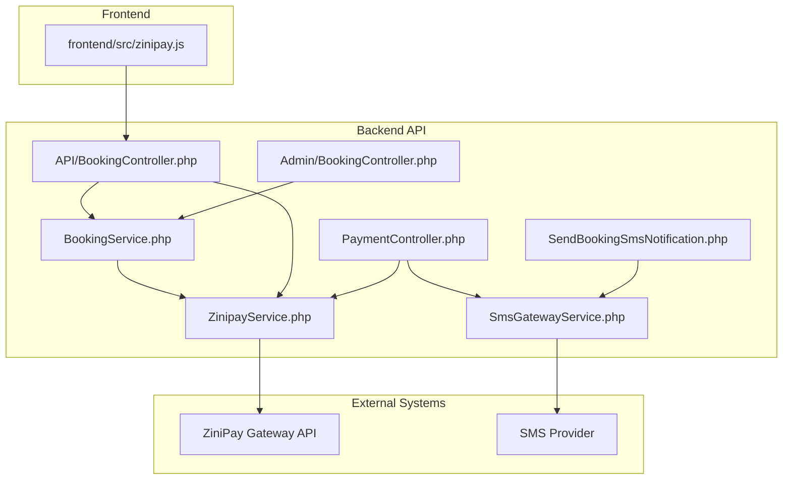
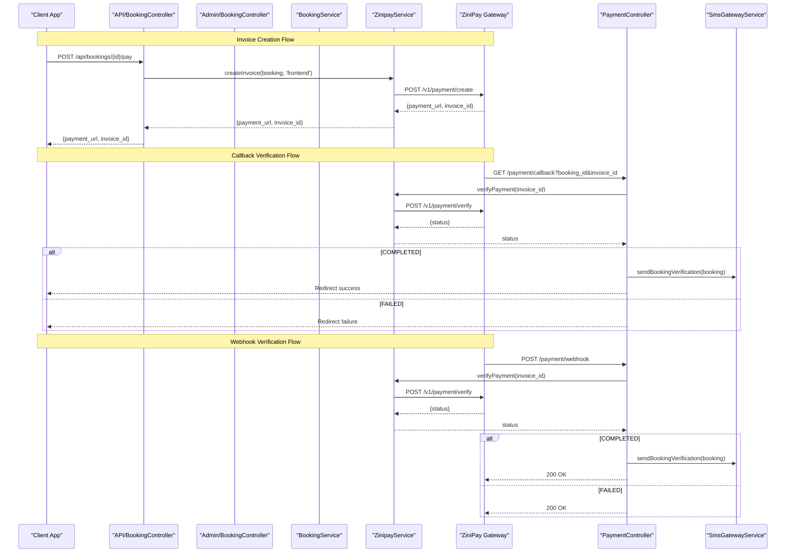
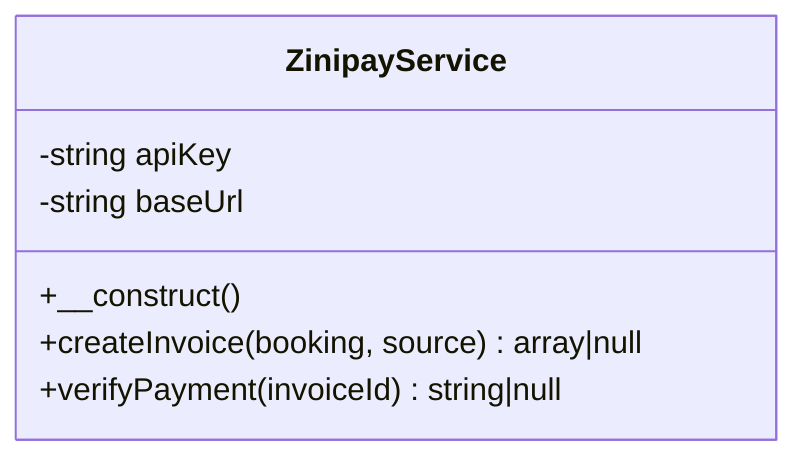
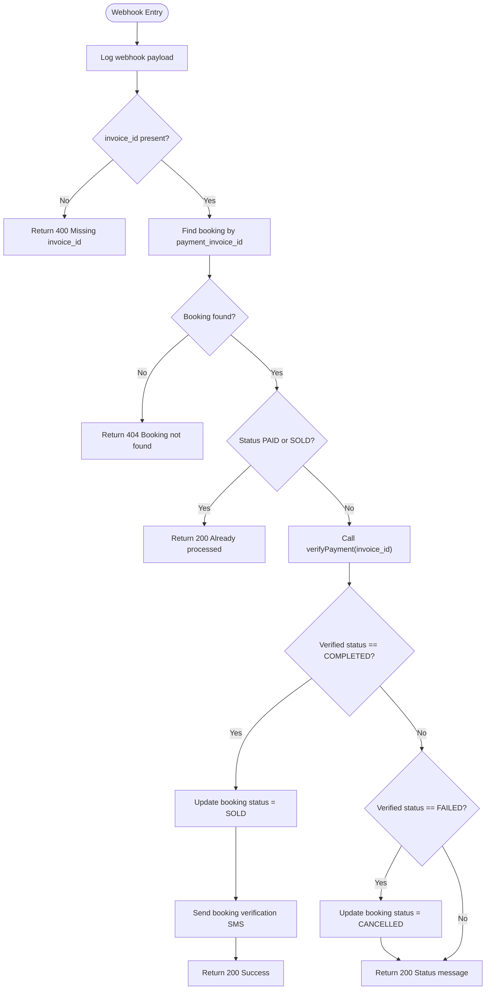
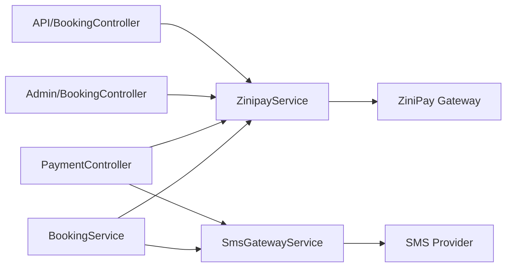

# Payment Service

<cite>
**Referenced Files in This Document**
- [ZinipayService.php](file://backend/app/Services/ZinipayService.php)
- [PaymentController.php](file://backend/app/Http/Controllers/PaymentController.php)
- [BookingController.php (API)](file://backend/app/Http/Controllers/API/BookingController.php)
- [BookingController.php (Admin)](file://backend/app/Http/Controllers/Admin/BookingController.php)
- [BookingService.php](file://backend/app/Services/BookingService.php)
- [SmsGatewayService.php](file://backend/app/Services/SmsGatewayService.php)
- [SendBookingSmsNotification.php](file://backend/app/Jobs/SendBookingSmsNotification.php)
- [zinipay.js](file://frontend/src/zinipay.js)
- [ZinipayPaymentTest.php](file://backend/tests/Feature/ZinipayPaymentTest.php)
</cite>

## Table of Contents
1. [Introduction](#introduction)
2. [Project Structure](#project-structure)
3. [Core Components](#core-components)
4. [Architecture Overview](#architecture-overview)
5. [Detailed Component Analysis](#detailed-component-analysis)
6. [Dependency Analysis](#dependency-analysis)
7. [Performance Considerations](#performance-considerations)
8. [Security and Fraud Prevention](#security-and-fraud-prevention)
9. [Troubleshooting Guide](#troubleshooting-guide)
10. [Conclusion](#conclusion)

## Introduction
This document explains the Zinipay payment integration used by the bus booking system. It focuses on the `ZinipayService` class that creates invoices, verifies payments, and supports asynchronous webhook updates. It also documents how the payment flow integrates with booking creation, callback handling, status synchronization, SMS notifications, and security considerations such as amount validation and signature verification guidance.

## Project Structure
The payment integration spans several backend components:
- A dedicated service for gateway communication.
- Controllers for customer API, admin panel, and payment callbacks/webhooks.
- Booking services that orchestrate seat selection, pricing, and invoice attachment.
- SMS services that notify passengers after successful payment.
- Frontend helpers that call the gateway directly or interact with backend endpoints.

**Diagram sources**
- [zinipay.js:1-126](file://frontend/src/zinipay.js#L1-L126)
- [BookingController.php (API):118-148](file://backend/app/Http/Controllers/API/BookingController.php#L118-L148)
- [BookingController.php (Admin):120-135](file://backend/app/Http/Controllers/Admin/BookingController.php#L120-L135)
- [PaymentController.php:21-136](file://backend/app/Http/Controllers/PaymentController.php#L21-L136)
- [BookingService.php:28-193](file://backend/app/Services/BookingService.php#L28-L193)
- [ZinipayService.php:27-139](file://backend/app/Services/ZinipayService.php#L27-L139)
- [SmsGatewayService.php:16-48](file://backend/app/Services/SmsGatewayService.php#L16-L48)
- [SendBookingSmsNotification.php:25-35](file://backend/app/Jobs/SendBookingSmsNotification.php#L25-L35)

**Section sources**
- [ZinipayService.php:1-141](file://backend/app/Services/ZinipayService.php#L1-L141)
- [PaymentController.php:1-162](file://backend/app/Http/Controllers/PaymentController.php#L1-L162)
- [BookingController.php (API):1-150](file://backend/app/Http/Controllers/API/BookingController.php#L1-L150)
- [BookingController.php (Admin):1-137](file://backend/app/Http/Controllers/Admin/BookingController.php#L1-L137)
- [BookingService.php:1-335](file://backend/app/Services/BookingService.php#L1-L335)
- [SmsGatewayService.php:1-87](file://backend/app/Services/SmsGatewayService.php#L1-L87)
- [SendBookingSmsNotification.php:1-36](file://backend/app/Jobs/SendBookingSmsNotification.php#L1-L36)
- [zinipay.js:1-126](file://frontend/src/zinipay.js#L1-L126)

## Core Components
- `ZinipayService`: Encapsulates all calls to the ZiniPay gateway. It creates invoices and verifies payment status. It reads configuration from application config and logs errors when API keys are missing or requests fail.
- `PaymentController`: Handles user redirection after payment attempts, cancels, and asynchronous webhooks. It verifies payment status via `ZinipayService`, updates booking status, and triggers SMS notifications.
- `BookingController (API)` and `BookingController (Admin)`: Initiate payment by calling `ZinipayService::createInvoice`. They store the returned invoice ID on the booking and redirect users to the payment URL.
- `BookingService`: Orchestrates booking creation, seat selection, pricing, and attaching a ZiniPay invoice when the payment method is ZiniPay.
- `SmsGatewayService` and `SendBookingSmsNotification`: Send booking confirmation SMS after successful payment, either synchronously or asynchronously.
- `zinipay.js`: Frontend helper that can create and verify payments directly with the gateway and optionally update the backend through the webhook endpoint.

**Section sources**
- [ZinipayService.php:27-139](file://backend/app/Services/ZinipayService.php#L27-L139)
- [PaymentController.php:21-136](file://backend/app/Http/Controllers/PaymentController.php#L21-L136)
- [BookingController.php (API):118-148](file://backend/app/Http/Controllers/API/BookingController.php#L118-L148)
- [BookingController.php (Admin):120-135](file://backend/app/Http/Controllers/Admin/BookingController.php#L120-L135)
- [BookingService.php:113-193](file://backend/app/Services/BookingService.php#L113-L193)
- [SmsGatewayService.php:16-48](file://backend/app/Services/SmsGatewayService.php#L16-L48)
- [SendBookingSmsNotification.php:25-35](file://backend/app/Jobs/SendBookingSmsNotification.php#L25-L35)
- [zinipay.js:1-126](file://frontend/src/zinipay.js#L1-L126)

## Architecture Overview
The payment architecture uses both synchronous and asynchronous flows:
- Synchronous: The frontend or admin UI initiates an invoice; the backend returns a payment URL; the user pays on the gateway; the gateway redirects back to the backend callback.
- Asynchronous: The gateway sends a webhook to the backend; the backend verifies the invoice independently and updates the booking status.

**Diagram sources**
- [BookingController.php (API):118-148](file://backend/app/Http/Controllers/API/BookingController.php#L118-L148)
- [ZinipayService.php:27-139](file://backend/app/Services/ZinipayService.php#L27-L139)
- [PaymentController.php:21-136](file://backend/app/Http/Controllers/PaymentController.php#L21-L136)
- [SmsGatewayService.php:16-48](file://backend/app/Services/SmsGatewayService.php#L16-L48)

## Detailed Component Analysis

### ZinipayService
Responsibilities:
- Create invoices with passenger details, amount, metadata, redirect/cancel/webhook URLs.
- Verify payment status using the gateway’s verify endpoint.
- Handle environment-specific URL adjustments for local/testing environments.
- Log errors for missing API keys, failed requests, and exceptions.

Key behaviors:
- Amount formatting: The booking total fare is cast to float before sending to the gateway.
- Callback URLs: Generates redirect, cancel, and webhook routes based on the current app configuration. In local/testing environments, hostnames are replaced with `127.0.0.1` to bypass sandbox domain checks.
- Error handling: Returns null on failures and logs detailed error information including HTTP status and response body where available.

**Diagram sources**
- [ZinipayService.php:9-18](file://backend/app/Services/ZinipayService.php#L9-L18)
- [ZinipayService.php:27-97](file://backend/app/Services/ZinipayService.php#L27-L97)
- [ZinipayService.php:105-139](file://backend/app/Services/ZinipayService.php#L105-L139)

**Section sources**
- [ZinipayService.php:27-97](file://backend/app/Services/ZinipayService.php#L27-L97)
- [ZinipayService.php:105-139](file://backend/app/Services/ZinipayService.php#L105-L139)

### PaymentController
Responsibilities:
- Handle payment callback redirections.
- Handle payment cancellation.
- Process asynchronous webhooks from the gateway.
- Update booking status based on verified payment results.
- Trigger SMS notifications upon successful payment.

Key behaviors:
- Callback flow: Validates booking existence, resolves target invoice ID, verifies payment status, updates booking to SOLD if completed, sets CANCELLED if failed, and redirects appropriately.
- Webhook flow: Logs incoming payload, validates presence of invoice ID, finds booking by invoice ID, skips already processed bookings, verifies status via gateway, updates booking, and sends SMS.

**Diagram sources**
- [PaymentController.php:90-136](file://backend/app/Http/Controllers/PaymentController.php#L90-L136)

**Section sources**
- [PaymentController.php:21-66](file://backend/app/Http/Controllers/PaymentController.php#L21-L66)
- [PaymentController.php:68-85](file://backend/app/Http/Controllers/PaymentController.php#L68-L85)
- [PaymentController.php:90-136](file://backend/app/Http/Controllers/PaymentController.php#L90-L136)

### BookingController (API)
Responsibilities:
- Enforce authorization and validate booking state before initiating payment.
- Call `ZinipayService::createInvoice` for ZiniPay bookings.
- Store the invoice ID on the booking and return the payment URL to the client.

Key validations:
- Booking must exist.
- User must be authorized to pay for the booking.
- Booking status must be PENDING and payment method must be ZiniPay.

**Section sources**
- [BookingController.php (API):118-148](file://backend/app/Http/Controllers/API/BookingController.php#L118-L148)

### BookingController (Admin)
Responsibilities:
- Provide admin-only payment initiation for pending ZiniPay bookings.
- Redirect admin users to the gateway payment URL after creating an invoice.
- Store invoice ID on the booking.

**Section sources**
- [BookingController.php (Admin):120-135](file://backend/app/Http/Controllers/Admin/BookingController.php#L120-L135)

### BookingService
Responsibilities:
- Orchestrate booking creation for customers and admins.
- Calculate total fare and apply promotions.
- Attach ZiniPay invoice when payment method is ZiniPay.
- Trigger SMS notifications for confirmed bookings.

Key behaviors:
- Customer flow: Lock seats, validate availability, calculate fare, create booking, attach invoice if ZiniPay, otherwise send SMS immediately.
- Admin flow: Create booking, optionally attach invoice if pending and ZiniPay, send SMS if final status indicates completion.

**Section sources**
- [BookingService.php:28-131](file://backend/app/Services/BookingService.php#L28-L131)
- [BookingService.php:138-193](file://backend/app/Services/BookingService.php#L138-L193)
- [BookingService.php:283-302](file://backend/app/Services/BookingService.php#L283-L302)

### SmsGatewayService and SendBookingSmsNotification
Responsibilities:
- Send booking verification SMS after successful payment.
- Validate SMS configuration and phone number format.
- Provide async job support for SMS delivery.

Key behaviors:
- Resolve active SMS configuration.
- Normalize phone numbers to Bangladesh mobile format.
- Build message and send via configured provider.
- Log warnings for failures.

**Section sources**
- [SmsGatewayService.php:16-48](file://backend/app/Services/SmsGatewayService.php#L16-L48)
- [SendBookingSmsNotification.php:25-35](file://backend/app/Jobs/SendBookingSmsNotification.php#L25-L35)

### Frontend Integration (zinipay.js)
Responsibilities:
- Create payment requests directly to the gateway.
- Verify payment status and optionally update backend via webhook.
- Handle redirect parameters and display verification status.

Key behaviors:
- Maps frontend payload fields to gateway schema.
- Uses environment variable for API key.
- Calls backend webhook to securely update database when payment is completed.

**Section sources**
- [zinipay.js:1-126](file://frontend/src/zinipay.js#L1-L126)

## Dependency Analysis
The payment integration has clear separation of concerns:
- Controllers depend on services for business logic and gateway interaction.
- Services encapsulate external integrations (gateway, SMS).
- Tests mock services to validate controller behavior without real network calls.

**Diagram sources**
- [BookingController.php (API):118-148](file://backend/app/Http/Controllers/API/BookingController.php#L118-L148)
- [BookingController.php (Admin):120-135](file://backend/app/Http/Controllers/Admin/BookingController.php#L120-L135)
- [PaymentController.php:21-136](file://backend/app/Http/Controllers/PaymentController.php#L21-L136)
- [BookingService.php:113-193](file://backend/app/Services/BookingService.php#L113-L193)
- [ZinipayService.php:27-139](file://backend/app/Services/ZinipayService.php#L27-L139)
- [SmsGatewayService.php:16-48](file://backend/app/Services/SmsGatewayService.php#L16-L48)

**Section sources**
- [ZinipayService.php:27-139](file://backend/app/Services/ZinipayService.php#L27-L139)
- [PaymentController.php:21-136](file://backend/app/Http/Controllers/PaymentController.php#L21-L136)
- [BookingService.php:113-193](file://backend/app/Services/BookingService.php#L113-L193)

## Performance Considerations
- HTTP timeouts: Both invoice creation and verification use a timeout to avoid hanging requests.
- Logging: Errors are logged with context to aid troubleshooting without impacting performance significantly.
- Idempotency: Webhook handler skips already processed bookings to prevent duplicate updates.
- Local/testing environment: Hostname replacement avoids sandbox domain validation overhead during development.

[No sources needed since this section provides general guidance]

## Security and Fraud Prevention
Current implementation characteristics:
- API key usage: Requests include a custom header for the gateway API key.
- Configuration safety: Missing API keys result in early logging and safe fallbacks.
- Environment isolation: Local/testing environments adjust URLs to avoid sandbox restrictions.
- Verification-first approach: Webhooks verify payment status via the gateway rather than trusting payload values alone.

Recommended enhancements:
- Signature verification: Implement server-side signature validation for webhook payloads if the gateway provides signatures.
- Amount validation: Compare the amount sent to the gateway with the expected booking total at both creation and verification steps.
- Fraud prevention: Add rate limiting on webhook endpoints, enforce idempotent processing, and log anomalies for review.
- Secure configuration: Ensure API keys are stored securely and not exposed to clients.

[No sources needed since this section provides general guidance]

## Troubleshooting Guide
Common issues and resolutions:
- Missing API key: The service logs an error and returns null; ensure configuration is set correctly.
- Failed invoice creation: Check HTTP status and response body in logs; verify gateway connectivity and credentials.
- Webhook not updating booking: Confirm invoice ID matches a booking and that verification returns COMPLETED; check logs for verification failures.
- SMS not sent: Verify SMS configuration is active and phone number is valid; check logs for configuration or provider errors.

Relevant test cases:
- Callback handles completed payment.
- Webhook verifies and completes payment.
- Callback handles cancelled payment.
- Webhook verifies and fails payment.
- Customer can pay pending booking via API.

**Section sources**
- [ZinipayPaymentTest.php:44-76](file://backend/tests/Feature/ZinipayPaymentTest.php#L44-L76)
- [ZinipayPaymentTest.php:78-112](file://backend/tests/Feature/ZinipayPaymentTest.php#L78-L112)
- [ZinipayPaymentTest.php:114-137](file://backend/tests/Feature/ZinipayPaymentTest.php#L114-L137)
- [ZinipayPaymentTest.php:191-221](file://backend/tests/Feature/ZinipayPaymentTest.php#L191-L221)
- [ZinipayPaymentTest.php:223-256](file://backend/tests/Feature/ZinipayPaymentTest.php#L223-L256)
- [ZinipayPaymentTest.php:258-302](file://backend/tests/Feature/ZinipayPaymentTest.php#L258-L302)

## Conclusion
The Zinipay integration is implemented with clear separation between controllers, services, and external systems. Invoice creation and payment verification are robustly handled, with asynchronous webhook support ensuring reliable status synchronization. SMS notifications are triggered upon successful payment, improving passenger experience. To strengthen security, consider adding signature verification, strict amount validation, and fraud prevention measures. The existing tests provide a solid foundation for validating core payment workflows.

[No sources needed since this section summarizes without analyzing specific files]