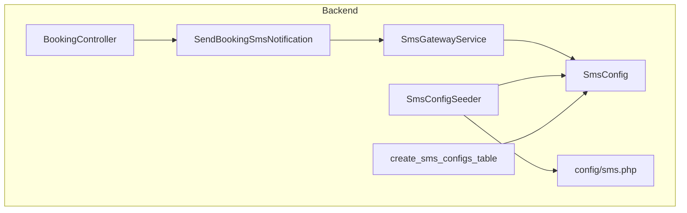
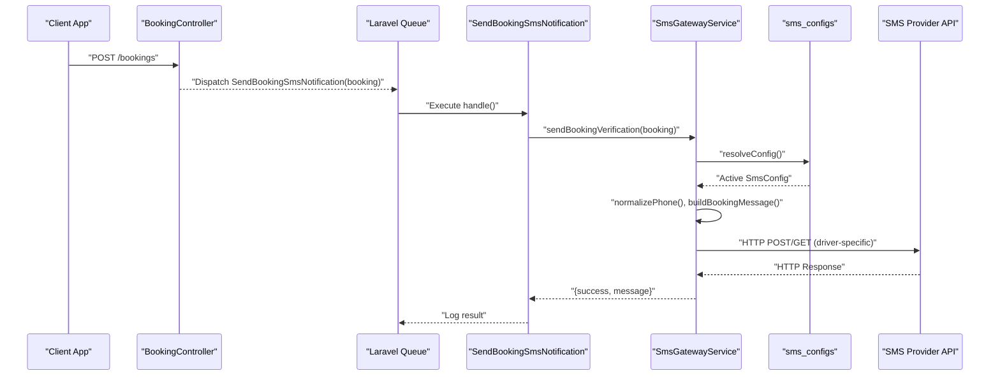
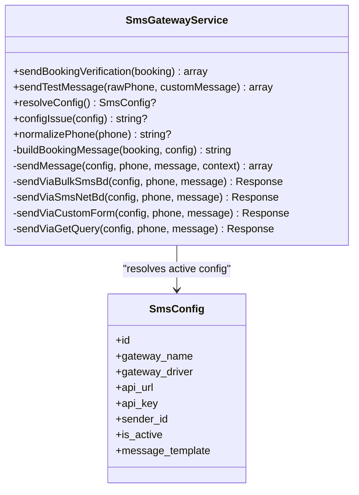
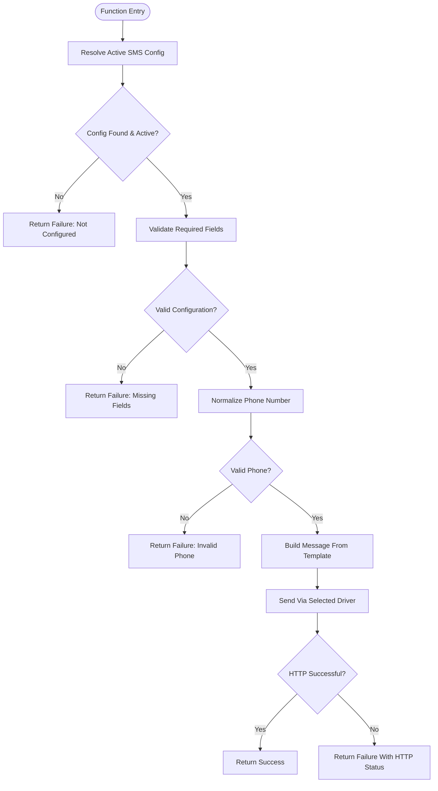
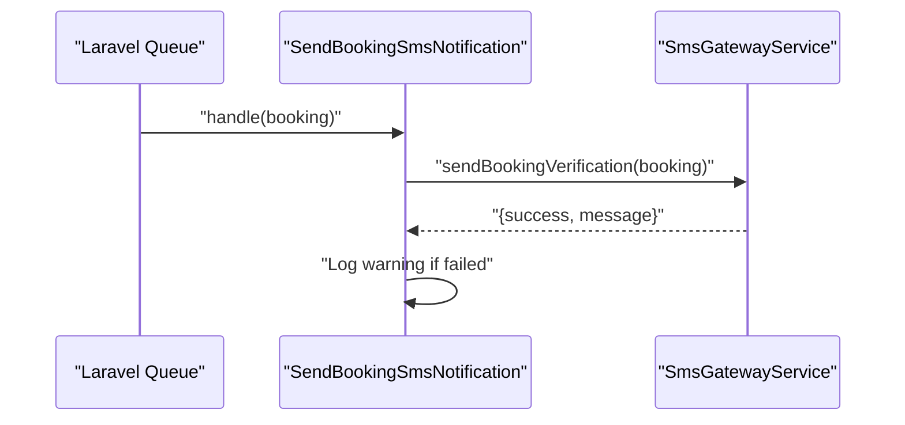
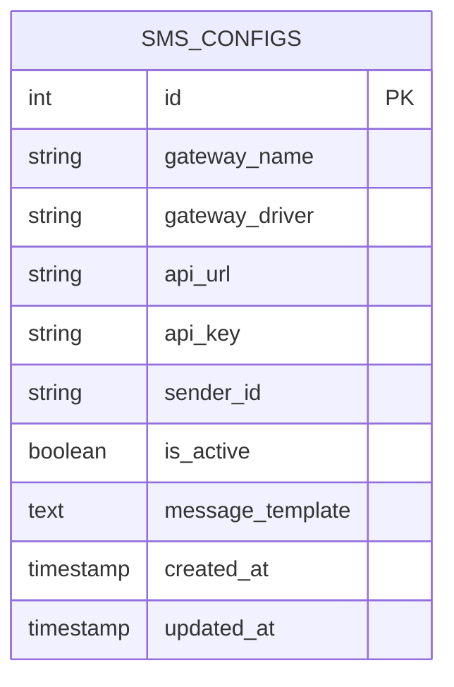
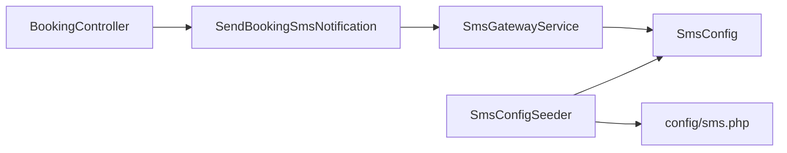

# SMS Gateway Service

<cite>
**Referenced Files in This Document**
- [SmsGatewayService.php](file://backend/app/Services/SmsGatewayService.php)
- [SendBookingSmsNotification.php](file://backend/app/Jobs/SendBookingSmsNotification.php)
- [SmsConfig.php](file://backend/app/Models/SmsConfig.php)
- [sms.php](file://backend/config/sms.php)
- [2026_06_02_090000_create_sms_configs_table.php](file://backend/database/migrations/2026_06_02_090000_create_sms_configs_table.php)
- [SmsConfigSeeder.php](file://backend/database/seeders/SmsConfigSeeder.php)
- [BookingController.php](file://backend/app/Http/Controllers/API/BookingController.php)
- [SMS_GATEWAY_SETUP.md](file://SMS_GATEWAY_SETUP.md)
</cite>

## Table of Contents
1. [Introduction](#introduction)
2. [Project Structure](#project-structure)
3. [Core Components](#core-components)
4. [Architecture Overview](#architecture-overview)
5. [Detailed Component Analysis](#detailed-component-analysis)
6. [Dependency Analysis](#dependency-analysis)
7. [Performance Considerations](#performance-considerations)
8. [Troubleshooting Guide](#troubleshooting-guide)
9. [Conclusion](#conclusion)

## Introduction
This document explains the `SmsGatewayService` class and its surrounding SMS notification system. The service provides multi-provider SMS support using a driver pattern, supports BulkSMSBD, SMS.NET.BD, and custom providers, normalizes Bangladesh phone numbers, formats booking confirmation messages through a template engine, and integrates with queue-based background processing for reliable delivery. It also documents configuration via database-driven settings and environment-backed defaults, error handling, logging, and integration points with booking workflows.

## Project Structure
The SMS feature spans services, jobs, models, configuration, migrations, seeders, and documentation:

**Diagram sources**
- [SmsGatewayService.php:11-254](file://backend/app/Services/SmsGatewayService.php#L11-L254)
- [SendBookingSmsNotification.php:11-36](file://backend/app/Jobs/SendBookingSmsNotification.php#L11-L36)
- [SmsConfig.php:7-22](file://backend/app/Models/SmsConfig.php#L7-L22)
- [sms.php:3-14](file://backend/config/sms.php#L3-L14)
- [2026_06_02_090000_create_sms_configs_table.php:14-28](file://backend/database/migrations/2026_06_02_090000_create_sms_configs_table.php#L14-L28)
- [SmsConfigSeeder.php:13-26](file://backend/database/seeders/SmsConfigSeeder.php#L13-L26)
- [BookingController.php:19-39](file://backend/app/Http/Controllers/API/BookingController.php#L19-L39)

**Section sources**
- [SmsGatewayService.php:11-254](file://backend/app/Services/SmsGatewayService.php#L11-L254)
- [SendBookingSmsNotification.php:11-36](file://backend/app/Jobs/SendBookingSmsNotification.php#L11-L36)
- [SmsConfig.php:7-22](file://backend/app/Models/SmsConfig.php#L7-L22)
- [sms.php:3-14](file://backend/config/sms.php#L3-L14)
- [2026_06_02_090000_create_sms_configs_table.php:14-28](file://backend/database/migrations/2026_06_02_090000_create_sms_configs_table.php#L14-L28)
- [SmsConfigSeeder.php:13-26](file://backend/database/seeders/SmsConfigSeeder.php#L13-L26)
- [BookingController.php:19-39](file://backend/app/Http/Controllers/API/BookingController.php#L19-L39)

## Core Components
- SmsGatewayService: Central SMS orchestration, provider dispatch, validation, templating, and HTTP transport.
- SendBookingSmsNotification: Queueable job that triggers SMS sending asynchronously.
- SmsConfig: Eloquent model representing runtime SMS gateway configuration.
- sms.php: Environment-backed default configuration used by the seeder.
- create_sms_configs_table migration: Database schema for SMS configurations.
- SmsConfigSeeder: Seeds the active SMS gateway configuration from config/sms.php.
- BookingController: API endpoint where bookings are created; SMS is typically triggered after payment success elsewhere in the workflow.

Key responsibilities:
- Driver selection based on `gateway_driver`.
- Phone normalization to international format (880...).
- Message templating with placeholders like PNR, seats, fare, and status.
- Provider-specific HTTP requests with timeouts.
- Logging and structured error responses.

**Section sources**
- [SmsGatewayService.php:11-254](file://backend/app/Services/SmsGatewayService.php#L11-L254)
- [SendBookingSmsNotification.php:11-36](file://backend/app/Jobs/SendBookingSmsNotification.php#L11-L36)
- [SmsConfig.php:7-22](file://backend/app/Models/SmsConfig.php#L7-L22)
- [sms.php:3-14](file://backend/config/sms.php#L3-L14)
- [2026_06_02_090000_create_sms_configs_table.php:14-28](file://backend/database/migrations/2026_06_02_090000_create_sms_configs_table.php#L14-L28)
- [SmsConfigSeeder.php:13-26](file://backend/database/seeders/SmsConfigSeeder.php#L13-L26)

## Architecture Overview
The SMS flow uses a layered approach:
- Controllers or business logic enqueue a job when a booking becomes payable or paid.
- The job calls `SmsGatewayService::sendBookingVerification`.
- The service resolves the active SMS configuration, validates it, normalizes the phone number, builds the message, selects the provider driver, and sends the request.
- Responses are logged and returned as structured results.

**Diagram sources**
- [BookingController.php:19-39](file://backend/app/Http/Controllers/API/BookingController.php#L19-L39)
- [SendBookingSmsNotification.php:25-35](file://backend/app/Jobs/SendBookingSmsNotification.php#L25-L35)
- [SmsGatewayService.php:16-48](file://backend/app/Services/SmsGatewayService.php#L16-L48)
- [SmsGatewayService.php:75-87](file://backend/app/Services/SmsGatewayService.php#L75-L87)
- [SmsGatewayService.php:156-202](file://backend/app/Services/SmsGatewayService.php#L156-L202)

## Detailed Component Analysis

### SmsGatewayService
Responsibilities:
- Resolve active SMS configuration from the database.
- Validate required fields per driver.
- Normalize passenger phone numbers to 880... format.
- Build booking confirmation messages using templates or defaults.
- Dispatch HTTP requests to selected provider drivers.
- Log outcomes and return structured results.

Driver pattern:
- Supported drivers: `bulksmsbd`, `smsnetbd`, `get_query`, and a generic `custom` fallback.
- Each driver maps to a dedicated method that posts form data or appends query parameters.

Phone normalization:
- Accepts multiple input formats and converts them to 880-prefixed numbers.
- Rejects invalid lengths or prefixes.

Message templating:
- Uses placeholders `{PNR}`, `{SEATS}`, `{FARE}`, `{STATUS}`.
- Falls back to a default confirmation message if no template is configured.

Error handling:
- Logs warnings for incomplete configuration or invalid phone numbers.
- Catches exceptions during HTTP requests and returns failure messages.
- Distinguishes between successful HTTP responses and non-successful ones.

**Diagram sources**
- [SmsGatewayService.php:11-254](file://backend/app/Services/SmsGatewayService.php#L11-L254)
- [SmsConfig.php:7-22](file://backend/app/Models/SmsConfig.php#L7-L22)

**Section sources**
- [SmsGatewayService.php:16-48](file://backend/app/Services/SmsGatewayService.php#L16-L48)
- [SmsGatewayService.php:53-73](file://backend/app/Services/SmsGatewayService.php#L53-L73)
- [SmsGatewayService.php:75-107](file://backend/app/Services/SmsGatewayService.php#L75-L107)
- [SmsGatewayService.php:109-134](file://backend/app/Services/SmsGatewayService.php#L109-L134)
- [SmsGatewayService.php:136-150](file://backend/app/Services/SmsGatewayService.php#L136-L150)
- [SmsGatewayService.php:156-202](file://backend/app/Services/SmsGatewayService.php#L156-L202)
- [SmsGatewayService.php:204-253](file://backend/app/Services/SmsGatewayService.php#L204-L253)

#### sendBookingVerification Flow

**Diagram sources**
- [SmsGatewayService.php:16-48](file://backend/app/Services/SmsGatewayService.php#L16-L48)
- [SmsGatewayService.php:75-107](file://backend/app/Services/SmsGatewayService.php#L75-L107)
- [SmsGatewayService.php:109-134](file://backend/app/Services/SmsGatewayService.php#L109-L134)
- [SmsGatewayService.php:136-150](file://backend/app/Services/SmsGatewayService.php#L136-L150)
- [SmsGatewayService.php:156-202](file://backend/app/Services/SmsGatewayService.php#L156-L202)

### SendBookingSmsNotification Job
Responsibilities:
- Implements Laravel’s queue contract to run asynchronously.
- Injects `SmsGatewayService` and invokes `sendBookingVerification`.
- Logs failures without blocking the calling process.

Integration:
- Typically dispatched after a booking reaches a payable or paid state.
- Ensures SMS sending does not block API response times.

**Diagram sources**
- [SendBookingSmsNotification.php:11-36](file://backend/app/Jobs/SendBookingSmsNotification.php#L11-L36)
- [SmsGatewayService.php:16-48](file://backend/app/Services/SmsGatewayService.php#L16-L48)

**Section sources**
- [SendBookingSmsNotification.php:11-36](file://backend/app/Jobs/SendBookingSmsNotification.php#L11-L36)

### Provider Configuration System
Database-driven configuration:
- `sms_configs` table stores provider details including driver type, API URL, API key, sender ID, active flag, and message template.
- The latest active record is selected at runtime.

Environment-backed defaults:
- `config/sms.php` defines default values for name, driver, URL, key, sender ID, active flag, and template.
- `SmsConfigSeeder` seeds the database with these defaults.

Validation rules:
- API URL and API key are required.
- Sender ID is required except for the `smsnetbd` driver.

**Diagram sources**
- [2026_06_02_090000_create_sms_configs_table.php:14-28](file://backend/database/migrations/2026_06_02_090000_create_sms_configs_table.php#L14-L28)

**Section sources**
- [SmsConfig.php:7-22](file://backend/app/Models/SmsConfig.php#L7-L22)
- [sms.php:3-14](file://backend/config/sms.php#L3-L14)
- [2026_06_02_090000_create_sms_configs_table.php:14-28](file://backend/database/migrations/2026_06_02_090000_create_sms_configs_table.php#L14-L28)
- [SmsConfigSeeder.php:13-26](file://backend/database/seeders/SmsConfigSeeder.php#L13-L26)
- [SmsGatewayService.php:75-107](file://backend/app/Services/SmsGatewayService.php#L75-L107)

### Message Templating Engine
- Placeholders supported: `{PNR}`, `{SEATS}`, `{FARE}`, `{STATUS}`.
- If a template is configured, it replaces placeholders with booking data.
- Otherwise, a default confirmation message is used.

Example usage:
- Admin panel can set a custom template via the database configuration.
- Default template includes PNR, seat numbers, fare, and booking status.

**Section sources**
- [SmsGatewayService.php:136-150](file://backend/app/Services/SmsGatewayService.php#L136-L150)

### Delivery Tracking Mechanisms
- Logging:
  - Success logs include phone, driver, and HTTP status.
  - Warning logs capture rejected requests with HTTP status and response body.
  - Error logs capture exceptions thrown during HTTP requests.
- Structured results:
  - Methods return arrays with `success` and `message` fields for callers to inspect outcomes.

Operational notes:
- Use application logs to monitor SMS events.
- Inspect HTTP status codes and provider response bodies for troubleshooting.

**Section sources**
- [SmsGatewayService.php:168-202](file://backend/app/Services/SmsGatewayService.php#L168-L202)

### Queue-Based Processing and Retry Logic
- Asynchronous processing:
  - `SendBookingSmsNotification` implements `ShouldQueue` and runs outside the request lifecycle.
- Retry behavior:
  - No explicit retry policy is implemented in the job.
  - Reliability depends on Laravel queue worker configuration and backend infrastructure.

Recommendations:
- Configure queue workers with appropriate concurrency and retry policies at the platform level.
- Monitor failed jobs and re-run them if transient provider errors occur.

**Section sources**
- [SendBookingSmsNotification.php:11-36](file://backend/app/Jobs/SendBookingSmsNotification.php#L11-L36)

### Integration With Booking Workflows and Notification Preferences
- Booking creation:
  - `BookingController::store` accepts booking data and delegates to `BookingService`.
- Payment initiation:
  - `BookingController::pay` initiates payment via Zinipay and updates invoice references.
- SMS triggering:
  - The SMS job is designed to be dispatched after payment success; ensure your workflow enqueues `SendBookingSmsNotification` when a booking transitions to a paid state.
- Notification preferences:
  - SMS sending is controlled by the active SMS configuration (`is_active`).
  - There is no per-user preference toggle in the current implementation; control is centralized at the gateway configuration level.

Best practices:
- Dispatch the SMS job only after confirmed payment success.
- Avoid sending duplicate SMS notifications by guarding against multiple dispatches.

**Section sources**
- [BookingController.php:19-39](file://backend/app/Http/Controllers/API/BookingController.php#L19-L39)
- [BookingController.php:118-148](file://backend/app/Http/Controllers/API/BookingController.php#L118-L148)
- [SmsGatewayService.php:16-48](file://backend/app/Services/SmsGatewayService.php#L16-L48)

## Dependency Analysis
Component relationships:
- `SmsGatewayService` depends on `SmsConfig` for runtime provider settings.
- `SendBookingSmsNotification` depends on `SmsGatewayService` to perform SMS delivery.
- `SmsConfigSeeder` depends on `config/sms.php` to populate initial settings.
- `BookingController` orchestrates booking operations and should dispatch the SMS job upon payment success.

**Diagram sources**
- [BookingController.php:19-39](file://backend/app/Http/Controllers/API/BookingController.php#L19-L39)
- [SendBookingSmsNotification.php:11-36](file://backend/app/Jobs/SendBookingSmsNotification.php#L11-L36)
- [SmsGatewayService.php:11-254](file://backend/app/Services/SmsGatewayService.php#L11-L254)
- [SmsConfig.php:7-22](file://backend/app/Models/SmsConfig.php#L7-L22)
- [SmsConfigSeeder.php:13-26](file://backend/database/seeders/SmsConfigSeeder.php#L13-L26)
- [sms.php:3-14](file://backend/config/sms.php#L3-L14)

**Section sources**
- [BookingController.php:19-39](file://backend/app/Http/Controllers/API/BookingController.php#L19-L39)
- [SendBookingSmsNotification.php:11-36](file://backend/app/Jobs/SendBookingSmsNotification.php#L11-L36)
- [SmsGatewayService.php:11-254](file://backend/app/Services/SmsGatewayService.php#L11-L254)
- [SmsConfig.php:7-22](file://backend/app/Models/SmsConfig.php#L7-L22)
- [SmsConfigSeeder.php:13-26](file://backend/database/seeders/SmsConfigSeeder.php#L13-L26)
- [sms.php:3-14](file://backend/config/sms.php#L3-L14)

## Performance Considerations
- HTTP timeouts:
  - All provider requests use a 15-second timeout to avoid hanging requests.
- Asynchronous processing:
  - Queueing SMS jobs prevents blocking API responses.
- Validation early exit:
  - Early checks for missing configuration or invalid phone numbers reduce unnecessary network calls.
- Logging overhead:
  - Excessive logging may impact performance; ensure log levels are tuned appropriately in production.

[No sources needed since this section provides general guidance]

## Troubleshooting Guide
Common issues and resolutions:
- SMS not configured or inactive:
  - Ensure an active SMS configuration exists and is enabled.
- Missing required fields:
  - Provide API URL and API key; provide sender ID unless using SMS.NET.BD.
- Invalid phone number:
  - Use valid Bangladesh mobile formats; the service normalizes inputs but rejects invalid patterns.
- Provider rejection:
  - Check HTTP status codes and provider response bodies in logs.
- Network connectivity:
  - Verify firewall/proxy settings and API URLs.

Operational steps:
- Run the SMS seeder to initialize configuration.
- Test SMS via admin panel or Tinker.
- Monitor logs for SMS-related entries.
- Confirm queue workers are running for asynchronous jobs.

**Section sources**
- [SMS_GATEWAY_SETUP.md:228-268](file://SMS_GATEWAY_SETUP.md#L228-L268)
- [SmsGatewayService.php:16-48](file://backend/app/Services/SmsGatewayService.php#L16-L48)
- [SmsGatewayService.php:168-202](file://backend/app/Services/SmsGatewayService.php#L168-L202)

## Conclusion
The `SmsGatewayService` provides a robust, extensible SMS delivery layer with a clear driver pattern supporting multiple providers. It integrates seamlessly with queue-based processing, ensures phone number normalization, supports customizable message templates, and offers comprehensive logging and error handling. By configuring the active SMS gateway via the database and environment-backed defaults, operators can switch providers and manage messaging behavior without code changes. For production reliability, ensure proper queue worker configuration, monitoring, and adherence to provider rate limits and authentication requirements.