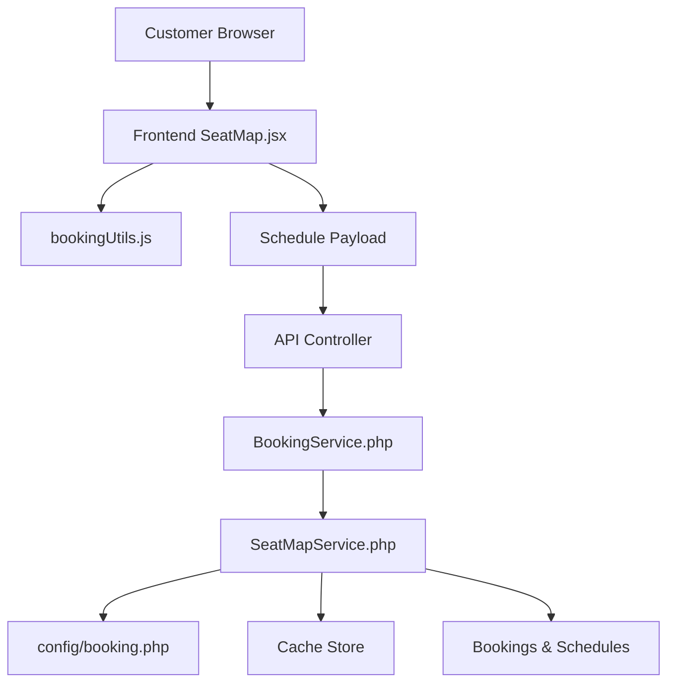
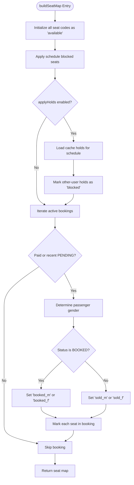
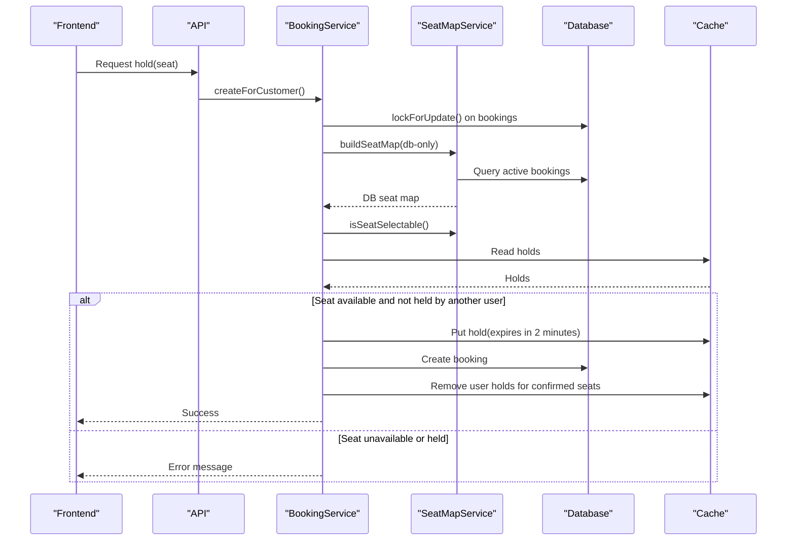
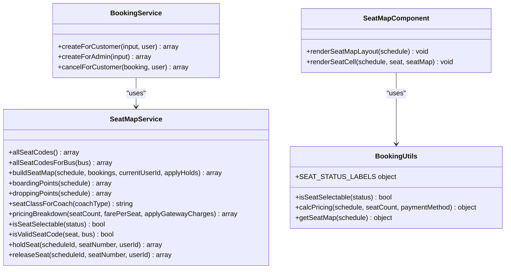

# Seat Map Service

<cite>
**Referenced Files in This Document**
- [SeatMapService.php](file://backend/app/Services/SeatMapService.php)
- [BookingService.php](file://backend/app/Services/BookingService.php)
- [booking.php](file://backend/config/booking.php)
- [SeatMap.jsx](file://frontend/src/components/SeatMap.jsx)
- [bookingUtils.js](file://frontend/src/bookingUtils.js)
</cite>

## Table of Contents
1. [Introduction](#introduction)
2. [Project Structure](#project-structure)
3. [Core Components](#core-components)
4. [Architecture Overview](#architecture-overview)
5. [Detailed Component Analysis](#detailed-component-analysis)
6. [Dependency Analysis](#dependency-analysis)
7. [Performance Considerations](#performance-considerations)
8. [Troubleshooting Guide](#troubleshooting-guide)
9. [Conclusion](#conclusion)

## Introduction
This document explains the backend `SeatMapService` that powers interactive seat maps, real-time availability, route stop management, fare calculations, and concurrent seat holding for a bus booking system. It also documents how the frontend seat map component consumes this service through schedule payloads and client-side utilities.

The service is central to:
- Building seat maps with gender-aware status tracking.
- Validating whether seats can be selected.
- Managing boarding and dropping points.
- Calculating pricing including gateway charges and discounts.
- Mapping coach types to seat classes.
- Holding seats temporarily during checkout.

## Project Structure
The seat map feature spans backend services, configuration, and frontend components:

**Diagram sources**
- [SeatMap.jsx:1-612](file://frontend/src/components/SeatMap.jsx#L1-L612)
- [bookingUtils.js:1-173](file://frontend/src/bookingUtils.js#L1-L173)
- [BookingService.php:1-335](file://backend/app/Services/BookingService.php#L1-L335)
- [SeatMapService.php:1-593](file://backend/app/Services/SeatMapService.php#L1-L593)
- [booking.php:1-11](file://backend/config/booking.php#L1-L11)

**Section sources**
- [SeatMapService.php:1-593](file://backend/app/Services/SeatMapService.php#L1-L593)
- [BookingService.php:1-335](file://backend/app/Services/BookingService.php#L1-L335)
- [SeatMap.jsx:1-612](file://frontend/src/components/SeatMap.jsx#L1-L612)
- [bookingUtils.js:1-173](file://frontend/src/bookingUtils.js#L1-L173)
- [booking.php:1-11](file://backend/config/booking.php#L1-L11)

## Core Components
- `SeatMapService`: Core logic for seat map construction, availability checks, route points, pricing, coach mapping, seat blocking, and temporary seat holds.
- `BookingService`: Orchestrates customer bookings using `SeatMapService`, enforces concurrency via database locks, and integrates payment and SMS flows.
- `SeatMap.jsx`: Renders the interactive seat layout, applies status labels, and displays hold timers.
- `bookingUtils.js`: Provides client-side seat selection rules, pricing helpers, and fallback seat map generation.
- `config/booking.php`: Defines service charges, gateway charges, discounts, default seat class, and default seat rows.

**Section sources**
- [SeatMapService.php:1-593](file://backend/app/Services/SeatMapService.php#L1-L593)
- [BookingService.php:1-335](file://backend/app/Services/BookingService.php#L1-L335)
- [SeatMap.jsx:1-612](file://frontend/src/components/SeatMap.jsx#L1-L612)
- [bookingUtils.js:1-173](file://frontend/src/bookingUtils.js#L1-L173)
- [booking.php:1-11](file://backend/config/booking.php#L1-L11)

## Architecture Overview
The seat map workflow connects the frontend UI to backend business logic and persistence:

```mermaid
sequenceDiagram
participant User as "User"
participant FE as "SeatMap.jsx"
participant API as "API Layer"
participant BS as "BookingService"
participant SMS as "SeatMapService"
participant DB as "Database"
participant C as "Cache"
User->>FE : Open booking page
FE->>API : Fetch schedule payload
API->>BS : Prepare schedule data
BS->>SMS : buildSeatMap(schedule, bookings, userId)
SMS->>DB : Query active bookings
SMS->>C : Read schedule holds
SMS-->>BS : Seat map + booked seats
BS-->>API : Schedule payload
API-->>FE : seat_map, booked_seats, boarding/dropping points, pricing
User->>FE : Select seats
FE->>API : Hold seat(s)
API->>BS : createForCustomer()
BS->>DB : lockForUpdate() on bookings
BS->>SMS : buildSeatMap() again
BS->>SMS : isSeatSelectable()
BS->>C : Write 2-minute hold
BS->>DB : Create booking record
BS->>C : Clean user holds after confirmation
```

**Diagram sources**
- [SeatMapService.php:194-244](file://backend/app/Services/SeatMapService.php#L194-L244)
- [SeatMapService.php:502-561](file://backend/app/Services/SeatMapService.php#L502-L561)
- [BookingService.php:52-131](file://backend/app/Services/BookingService.php#L52-L131)
- [SeatMap.jsx:31-46](file://frontend/src/components/SeatMap.jsx#L31-L46)

## Detailed Component Analysis

### SeatMapService
`SeatMapService` encapsulates all seat-related business logic.

Key responsibilities:
- Generate all valid seat codes based on bus layout or custom grid.
- Build an interactive seat map with statuses: available, blocked, sold_m/sold_f, booked_m/booked_f.
- Apply active holds from cache so other users cannot select reserved seats.
- Provide boarding and dropping point formatting.
- Calculate pricing breakdowns including service and gateway charges and discounts.
- Map coach type to seat class.
- Validate seat codes and block/unblock seats.
- Implement 2-minute seat holding with concurrent access protection.

#### buildSeatMap
Constructs the seat map for a schedule:
- Initializes every generated seat code as `available`.
- Applies blocked seats from the schedule.
- Applies active holds from cache unless disabled; marks seats held by other users as `blocked`.
- Processes paid or recent pending bookings to mark seats as gender-aware statuses:
  - Paid/Sold/Booked bookings produce `sold_m` or `sold_f`.
  - Booked status produces `booked_m` or `booked_f`.
- Skips invalid or already blocked seats.

**Diagram sources**
- [SeatMapService.php:194-244](file://backend/app/Services/SeatMapService.php#L194-L244)

**Section sources**
- [SeatMapService.php:194-244](file://backend/app/Services/SeatMapService.php#L194-L244)

#### isSeatSelectable
Validates whether a seat can be selected:
- Returns true only when the seat status is `available`.

Usage pattern:
- Frontend uses a matching rule to disable non-available seats.
- Backend uses it during booking validation to reject unavailable selections.

**Section sources**
- [SeatMapService.php:433-436](file://backend/app/Services/SeatMapService.php#L433-L436)
- [bookingUtils.js:18-20](file://frontend/src/bookingUtils.js#L18-L20)
- [BookingService.php:68-76](file://backend/app/Services/BookingService.php#L68-L76)

#### boardingPoints and droppingPoints
Route stop management:
- If the route defines explicit boarding or dropping points, they are formatted into standardized objects containing id, name, value, label, and time fields.
- Otherwise, defaults are created from the departure or arrival station with formatted times.

Formatting details:
- Boarding points include reporting_time and departure_time.
- Dropping points include arrival_time.
- Labels combine time and station name where applicable.

**Section sources**
- [SeatMapService.php:246-332](file://backend/app/Services/SeatMapService.php#L246-L332)

#### pricingBreakdown
Fare calculation:
- Computes seat fare, service charge, gateway charge, and corresponding discounts.
- Gateway charges and discounts are applied conditionally based on payment method.
- Total is clamped to zero minimum.

Configuration-driven values:
- Service charge, gateway charge, and discounts come from `config/booking.php`.
- Default seat class comes from configuration.

Example output structure:
- `seat_fare`
- `service_charge`
- `gateway_charge`
- `sc_discount`
- `gc_discount`
- `total`

**Section sources**
- [SeatMapService.php:343-365](file://backend/app/Services/SeatMapService.php#L343-L365)
- [booking.php:1-11](file://backend/config/booking.php#L1-L11)

#### seatClassForCoach
Coach type mapping:
- If the coach type contains “AC”, returns `E-Class`.
- Otherwise, returns the configured default seat class.

**Section sources**
- [SeatMapService.php:334-341](file://backend/app/Services/SeatMapService.php#L334-L341)

#### Seat Holding Mechanism (2 Minutes)
Temporary seat reservation:
- `holdSeat` validates the schedule and seat code.
- Checks database-based availability without applying cache holds to avoid false positives.
- Reads cache holds, cleans expired entries, and ensures another user does not hold the same seat.
- Stores a hold with an expiration timestamp set to 2 minutes from now.
- The hold key is stored in cache with a longer TTL to allow cleanup.

Release mechanism:
- `releaseSeat` removes the current user’s hold if present.

Concurrency handling:
- Customer booking flow uses `lockForUpdate()` on active bookings to prevent race conditions.
- Seat selection is validated again inside the transaction using `isSeatSelectable`.
- Holds are cleaned up after successful booking.

**Diagram sources**
- [SeatMapService.php:502-561](file://backend/app/Services/SeatMapService.php#L502-L561)
- [BookingService.php:52-131](file://backend/app/Services/BookingService.php#L52-L131)

**Section sources**
- [SeatMapService.php:502-582](file://backend/app/Services/SeatMapService.php#L502-L582)
- [BookingService.php:52-131](file://backend/app/Services/BookingService.php#L52-L131)

#### Seat Status Arrays and Availability Patterns
Backend status keys:
- `available`: Not taken, not blocked, not held by another user.
- `blocked`: Administratively blocked or held by another user.
- `sold_m` / `sold_f`: Paid, sold, or booked with male/female gender.
- `booked_m` / `booked_f`: Explicitly booked status with male/female gender.

Frontend status labels:
- `available`, `selected`, `blocked`, `booked_m`, `booked_f`, `sold_m`, `sold_f`.

Selection rules:
- Only `available` seats are selectable.
- Selected seats override visual status but do not change backend availability until confirmed.

**Section sources**
- [SeatMapService.php:194-244](file://backend/app/Services/SeatMapService.php#L194-L244)
- [bookingUtils.js:3-20](file://frontend/src/bookingUtils.js#L3-L20)
- [SeatMap.jsx:192-208](file://frontend/src/components/SeatMap.jsx#L192-L208)

#### Integration with Booking Transactions
Customer booking flow:
- Loads active bookings with a database row lock.
- Builds seat map and validates each requested seat.
- Calculates total fare using `pricingBreakdown`.
- Creates booking record and cleans up holds.
- Integrates payment gateway and SMS notifications.

Admin booking flow:
- Uses `pricingBreakdown` directly.
- Determines status based on payment method and admin input.

**Section sources**
- [BookingService.php:28-131](file://backend/app/Services/BookingService.php#L28-L131)
- [BookingService.php:138-193](file://backend/app/Services/BookingService.php#L138-L193)
- [SeatMapService.php:343-365](file://backend/app/Services/SeatMapService.php#L343-L365)

### Frontend SeatMap Component
The React component renders:
- Bus layout grids for standard and sleeper configurations.
- Seat cells with status-based styling and selection behavior.
- Boarding and dropping point selectors.
- Passenger details form.
- Pricing breakdown display.
- Hold timer countdown per selected seat.

Integration points:
- Uses `getSeatMap` and `isSeatSelectable` from `bookingUtils.js`.
- Displays `seatExpirations` provided by parent state to show remaining hold time.
- Submits booking through parent handlers which call backend APIs.

**Section sources**
- [SeatMap.jsx:1-612](file://frontend/src/components/SeatMap.jsx#L1-L612)
- [bookingUtils.js:1-173](file://frontend/src/bookingUtils.js#L1-L173)

## Dependency Analysis
The following diagram shows how components depend on each other:

**Diagram sources**
- [SeatMapService.php:1-593](file://backend/app/Services/SeatMapService.php#L1-L593)
- [BookingService.php:1-335](file://backend/app/Services/BookingService.php#L1-L335)
- [SeatMap.jsx:1-612](file://frontend/src/components/SeatMap.jsx#L1-L612)
- [bookingUtils.js:1-173](file://frontend/src/bookingUtils.js#L1-L173)

**Section sources**
- [SeatMapService.php:1-593](file://backend/app/Services/SeatMapService.php#L1-L593)
- [BookingService.php:1-335](file://backend/app/Services/BookingService.php#L1-L335)
- [SeatMap.jsx:1-612](file://frontend/src/components/SeatMap.jsx#L1-L612)
- [bookingUtils.js:1-173](file://frontend/src/bookingUtils.js#L1-L173)

## Performance Considerations
- Use minimal columns for paid bookings to reduce payload size.
- Avoid loading full booking rows when building seat maps.
- Prefer cache reads for holds to minimize database load.
- Keep seat map generation deterministic and fast by iterating only necessary seat codes.
- Ensure database transactions use row-level locking to prevent double bookings under high concurrency.

[No sources needed since this section provides general guidance]

## Troubleshooting Guide
Common issues and resolutions:
- Seat appears available but cannot be selected:
  - Another user may have a cache hold; check schedule holds and expiration.
- Seat becomes unavailable after selection:
  - Validation occurs inside the booking transaction; ensure no race conditions.
- Pricing mismatch:
  - Verify configuration values for service and gateway charges and discounts.
- Boarding/dropping points missing:
  - Confirm route has explicit points or fallback stations are defined.
- Coach class incorrect:
  - Check coach type and default seat class configuration.

Operational checks:
- Inspect cache keys for schedule holds.
- Review database locks during peak booking periods.
- Validate seat code format against bus layout.

**Section sources**
- [SeatMapService.php:502-582](file://backend/app/Services/SeatMapService.php#L502-L582)
- [BookingService.php:52-131](file://backend/app/Services/BookingService.php#L52-L131)
- [booking.php:1-11](file://backend/config/booking.php#L1-L11)

## Conclusion
`SeatMapService` is the backbone of seat allocation and availability management in the bus booking system. It provides robust seat map construction, gender-aware status tracking, route stop formatting, configurable pricing, and safe concurrent seat holding. Together with `BookingService`, the frontend `SeatMap` component, and client-side utilities, it delivers a reliable, interactive booking experience that scales under concurrent load.

[No sources needed since this section summarizes without analyzing specific files]