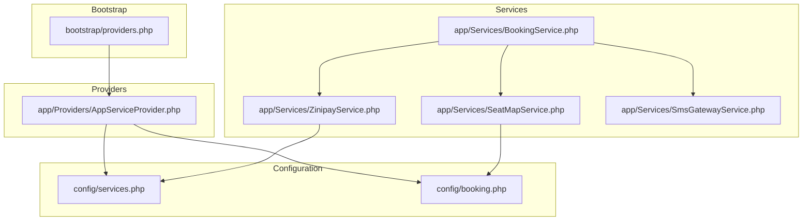
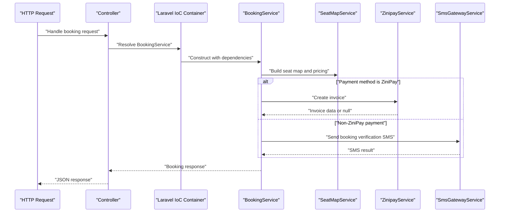
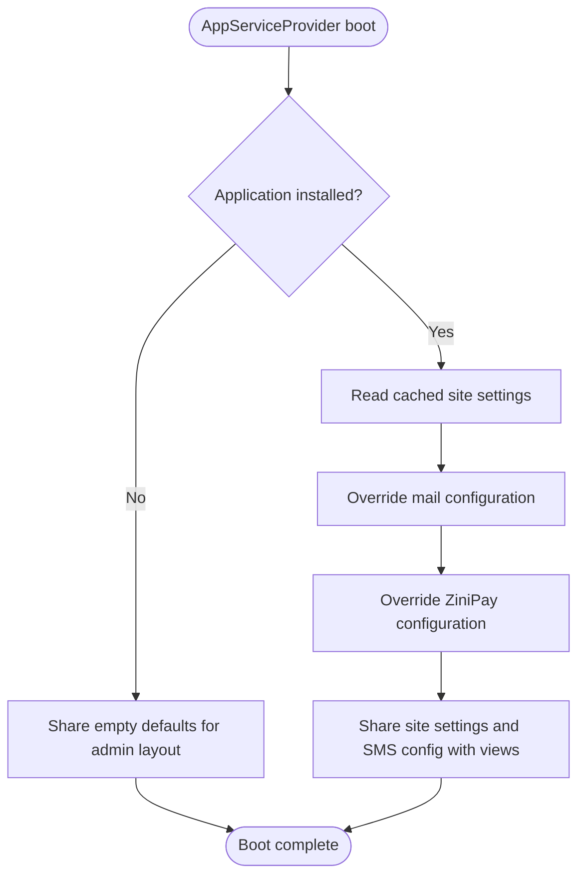
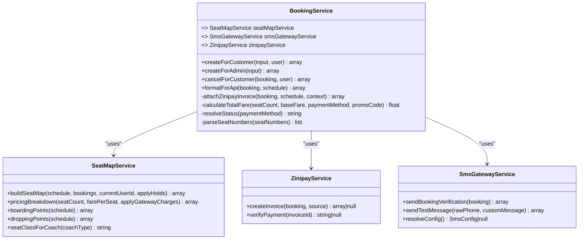
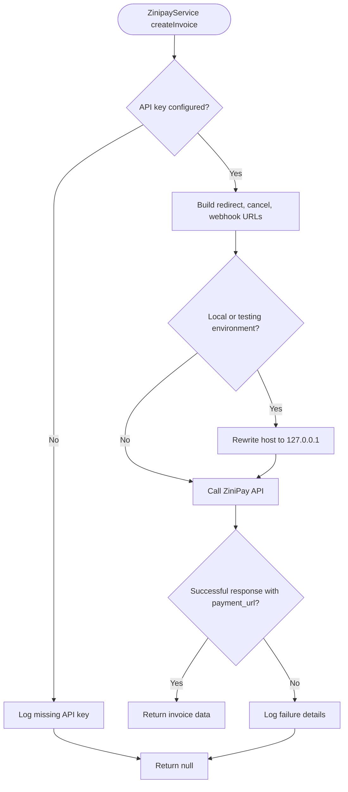
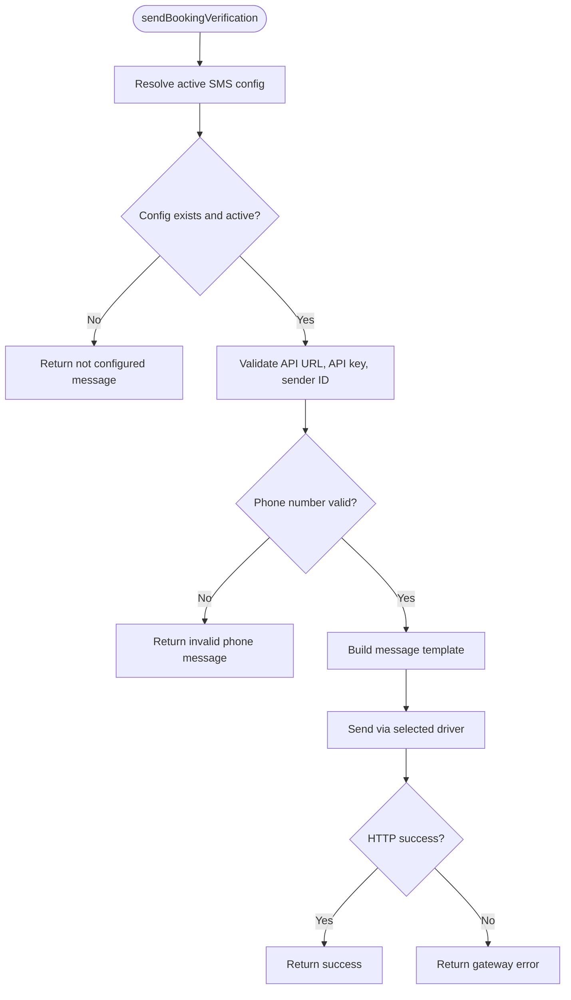
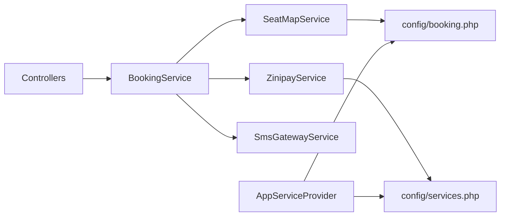

# Service Container Integration

<cite>
**Referenced Files in This Document**
- [AppServiceProvider.php](file://backend/app/Providers/AppServiceProvider.php)
- [BookingService.php](file://backend/app/Services/BookingService.php)
- [SeatMapService.php](file://backend/app/Services/SeatMapService.php)
- [ZinipayService.php](file://backend/app/Services/ZinipayService.php)
- [SmsGatewayService.php](file://backend/app/Services/SmsGatewayService.php)
- [providers.php](file://backend/bootstrap/providers.php)
- [services.php](file://backend/config/services.php)
- [booking.php](file://backend/config/booking.php)
</cite>

## Table of Contents
1. [Introduction](#introduction)
2. [Project Structure](#project-structure)
3. [Core Components](#core-components)
4. [Architecture Overview](#architecture-overview)
5. [Detailed Component Analysis](#detailed-component-analysis)
6. [Dependency Analysis](#dependency-analysis)
7. [Performance Considerations](#performance-considerations)
8. [Troubleshooting Guide](#troubleshooting-guide)
9. [Conclusion](#conclusion)

## Introduction
This document explains how the service layer uses Laravel’s IoC container through constructor injection, focusing on `BookingService` and its dependencies: `SeatMapService`, `ZinipayService`, and `SmsGatewayService`. It also documents configuration binding for third-party services, service lifecycle behavior, testing strategies with mocks, and performance considerations for service resolution.

The project follows a clean separation between controllers and business logic by placing domain operations in the `App\Services` namespace. Services are resolved automatically by Laravel when they are type-hinted in controller or command constructors.

## Project Structure
The relevant parts of the backend structure for this topic are:

- Providers: application bootstrap and configuration overrides.
- Services: domain logic classes using constructor injection.
- Configuration: environment-driven settings for booking pricing and payment integrations.
- Bootstrap: provider registration that enables the application to load `AppServiceProvider`.

**Diagram sources**
- [providers.php:1-7](file://backend/bootstrap/providers.php#L1-L7)
- [AppServiceProvider.php:10-103](file://backend/app/Providers/AppServiceProvider.php#L10-L103)
- [services.php:38-41](file://backend/config/services.php#L38-L41)
- [booking.php:3-10](file://backend/config/booking.php#L3-L10)
- [BookingService.php:14-21](file://backend/app/Services/BookingService.php#L14-L21)
- [SeatMapService.php:9-10](file://backend/app/Services/SeatMapService.php#L9-L10)
- [ZinipayService.php:9-18](file://backend/app/Services/ZinipayService.php#L9-L18)
- [SmsGatewayService.php:11-16](file://backend/app/Services/SmsGatewayService.php#L11-L16)

**Section sources**
- [providers.php:1-7](file://backend/bootstrap/providers.php#L1-L7)
- [AppServiceProvider.php:10-103](file://backend/app/Providers/AppServiceProvider.php#L10-L103)
- [services.php:38-41](file://backend/config/services.php#L38-L41)
- [booking.php:3-10](file://backend/config/booking.php#L3-L10)

## Core Components
The core service components involved in service container integration are:

| Component | Responsibility | Container Behavior |
|---|---|---|
| `BookingService` | Orchestrates customer and admin booking flows, seat validation, pricing, SMS notifications, and ZiniPay invoice creation. | Resolved via constructor injection; depends on three other services. |
| `SeatMapService` | Builds seat maps, calculates pricing breakdowns, manages boarding/dropping points, and handles seat holds. | Stateless utility-like service; no explicit container binding required. |
| `ZinipayService` | Creates and verifies ZiniPay invoices using HTTP requests. | Reads configuration from `services.zinipay`; no explicit container binding required. |
| `SmsGatewayService` | Normalizes phone numbers, validates SMS gateway configuration, and sends messages through multiple drivers. | Reads active SMS configuration from the database; no explicit container binding required. |

Key observations:

- `BookingService` uses PHP 8-style typed constructor properties for dependency injection.
- Dependencies are declared as types, so Laravel’s container resolves them automatically.
- No manual `bind` or `singleton` registrations exist in `AppServiceProvider::register`, meaning default container resolution applies.
- Third-party configuration is centralized in `config/services.php` and `config/booking.php`.

**Section sources**
- [BookingService.php:14-21](file://backend/app/Services/BookingService.php#L14-L21)
- [SeatMapService.php:9-10](file://backend/app/Services/SeatMapService.php#L9-L10)
- [ZinipayService.php:9-18](file://backend/app/Services/ZinipayService.php#L9-L18)
- [SmsGatewayService.php:11-16](file://backend/app/Services/SmsGatewayService.php#L11-L16)
- [services.php:38-41](file://backend/config/services.php#L38-L41)
- [booking.php:3-10](file://backend/config/booking.php#L3-L10)

## Architecture Overview
At runtime, Laravel loads providers from `bootstrap/providers.php`. `AppServiceProvider` is registered and executed during application boot. While it does not register custom service bindings, it performs important configuration overrides and view composition.

**Diagram sources**
- [providers.php:1-7](file://backend/bootstrap/providers.php#L1-L7)
- [AppServiceProvider.php:10-103](file://backend/app/Providers/AppServiceProvider.php#L10-L103)
- [BookingService.php:28-130](file://backend/app/Services/BookingService.php#L28-L130)
- [BookingService.php:138-193](file://backend/app/Services/BookingService.php#L138-L193)
- [ZinipayService.php:27-97](file://backend/app/Services/ZinipayService.php#L27-L97)
- [SmsGatewayService.php:16-48](file://backend/app/Services/SmsGatewayService.php#L16-L48)

## Detailed Component Analysis

### AppServiceProvider and Configuration Binding
`AppServiceProvider` is responsible for:

- Skipping database-dependent logic when the application is not installed.
- Sharing site settings and SMS configuration with admin views.
- Overriding mail and ZiniPay configuration values from the database at runtime.

Important behaviors:

- The `register()` method is empty, so no custom service bindings are defined here.
- The `boot()` method updates configuration arrays such as `mail.*` and `services.zinipay.*`.
- Dynamic configuration allows administrators to change credentials without redeploying code.

**Diagram sources**
- [AppServiceProvider.php:20-103](file://backend/app/Providers/AppServiceProvider.php#L20-L103)

**Section sources**
- [AppServiceProvider.php:10-103](file://backend/app/Providers/AppServiceProvider.php#L10-L103)
- [services.php:38-41](file://backend/config/services.php#L38-L41)

### BookingService Dependency Injection
`BookingService` demonstrates constructor injection:

- It requires `SeatMapService`, `SmsGatewayService`, and `ZinipayService`.
- These dependencies are typed and stored as protected properties.
- Laravel resolves these dependencies automatically when the container constructs `BookingService`.

Benefits:

- **Testability**: Each dependency can be replaced with a mock or fake implementation.
- **Loose coupling**: `BookingService` depends on interfaces or concrete service contracts rather than global state.
- **Maintainability**: Changes to one service do not require changes in unrelated services.

**Diagram sources**
- [BookingService.php:14-21](file://backend/app/Services/BookingService.php#L14-L21)
- [BookingService.php:28-130](file://backend/app/Services/BookingService.php#L28-L130)
- [BookingService.php:138-193](file://backend/app/Services/BookingService.php#L138-L193)
- [SeatMapService.php:194-244](file://backend/app/Services/SeatMapService.php#L194-L244)
- [SeatMapService.php:343-365](file://backend/app/Services/SeatMapService.php#L343-L365)
- [ZinipayService.php:27-97](file://backend/app/Services/ZinipayService.php#L27-L97)
- [SmsGatewayService.php:16-48](file://backend/app/Services/SmsGatewayService.php#L16-L48)

**Section sources**
- [BookingService.php:14-21](file://backend/app/Services/BookingService.php#L14-L21)
- [BookingService.php:28-130](file://backend/app/Services/BookingService.php#L28-L130)
- [BookingService.php:138-193](file://backend/app/Services/BookingService.php#L138-L193)

### SeatMapService Responsibilities
`SeatMapService` is primarily a stateless domain helper:

- Generates all possible seat codes based on bus layout or configuration.
- Builds a seat availability map considering booked seats, recent pending bookings, and temporary cache holds.
- Calculates pricing breakdowns including service charges, gateway charges, and discounts.
- Provides boarding and dropping point formatting.

It reads configuration through `config('booking.*')`, making it easy to adjust pricing rules and seat row definitions without changing service code.

**Section sources**
- [SeatMapService.php:49-59](file://backend/app/Services/SeatMapService.php#L49-L59)
- [SeatMapService.php:194-244](file://backend/app/Services/SeatMapService.php#L194-L244)
- [SeatMapService.php:343-365](file://backend/app/Services/SeatMapService.php#L343-L365)
- [booking.php:3-10](file://backend/config/booking.php#L3-L10)

### ZinipayService Configuration Resolution
`ZinipayService` reads API credentials from `config('services.zinipay.*')`:

- `api_key` comes from environment configuration.
- `base_url` defaults to the production ZiniPay endpoint if not overridden.
- During local or testing environments, URLs are rewritten to `127.0.0.1` to support sandbox workflows.
- Database-driven overrides in `AppServiceProvider` can replace these values at runtime.

**Diagram sources**
- [ZinipayService.php:14-18](file://backend/app/Services/ZinipayService.php#L14-L18)
- [ZinipayService.php:27-97](file://backend/app/Services/ZinipayService.php#L27-L97)
- [AppServiceProvider.php:71-77](file://backend/app/Providers/AppServiceProvider.php#L71-L77)
- [services.php:38-41](file://backend/config/services.php#L38-L41)

**Section sources**
- [ZinipayService.php:14-18](file://backend/app/Services/ZinipayService.php#L14-L18)
- [ZinipayService.php:27-97](file://backend/app/Services/ZinipayService.php#L27-L97)
- [AppServiceProvider.php:71-77](file://backend/app/Providers/AppServiceProvider.php#L71-L77)
- [services.php:38-41](file://backend/config/services.php#L38-L41)

### SmsGatewayService Configuration and Drivers
`SmsGatewayService` resolves the active SMS configuration from the database and supports multiple drivers:

- `bulksmsbd`
- `smsnetbd`
- `get_query`
- Custom form-based driver

It normalizes phone numbers to a standard format and validates required fields such as API URL, API key, and sender ID.

**Diagram sources**
- [SmsGatewayService.php:16-48](file://backend/app/Services/SmsGatewayService.php#L16-L48)
- [SmsGatewayService.php:75-107](file://backend/app/Services/SmsGatewayService.php#L75-L107)
- [SmsGatewayService.php:156-202](file://backend/app/Services/SmsGatewayService.php#L156-L202)

**Section sources**
- [SmsGatewayService.php:16-48](file://backend/app/Services/SmsGatewayService.php#L16-L48)
- [SmsGatewayService.php:75-107](file://backend/app/Services/SmsGatewayService.php#L75-L107)
- [SmsGatewayService.php:156-202](file://backend/app/Services/SmsGatewayService.php#L156-L202)

## Dependency Analysis
The dependency graph shows how services interact and where configuration enters the system.

**Diagram sources**
- [BookingService.php:14-21](file://backend/app/Services/BookingService.php#L14-L21)
- [ZinipayService.php:14-18](file://backend/app/Services/ZinipayService.php#L14-L18)
- [SeatMapService.php:343-365](file://backend/app/Services/SeatMapService.php#L343-L365)
- [AppServiceProvider.php:40-77](file://backend/app/Providers/AppServiceProvider.php#L40-L77)
- [services.php:38-41](file://backend/config/services.php#L38-L41)
- [booking.php:3-10](file://backend/config/booking.php#L3-L10)

**Section sources**
- [BookingService.php:14-21](file://backend/app/Services/BookingService.php#L14-L21)
- [ZinipayService.php:14-18](file://backend/app/Services/ZinipayService.php#L14-L18)
- [SeatMapService.php:343-365](file://backend/app/Services/SeatMapService.php#L343-L365)
- [AppServiceProvider.php:40-77](file://backend/app/Providers/AppServiceProvider.php#L40-L77)
- [services.php:38-41](file://backend/config/services.php#L38-L41)
- [booking.php:3-10](file://backend/config/booking.php#L3-L10)

## Performance Considerations
Current behavior and implications:

- **Default container resolution**: Since there are no explicit `singleton` or `bind` registrations for these services, Laravel resolves them according to its default behavior. In modern Laravel versions, unbound classes are typically resolved as singletons after first resolution, but this should not be relied upon without explicit binding.
- **Stateless services**: `SeatMapService` is mostly stateless and cheap to construct.
- **External I/O services**: `ZinipayService` and `SmsGatewayService` perform HTTP requests; their cost is dominated by network latency, not object construction.
- **Database access**: `SmsGatewayService::resolveConfig` queries the database for the latest SMS configuration. If SMS sending becomes a hot path, consider caching the active SMS configuration.
- **Configuration overrides**: `AppServiceProvider` dynamically overrides configuration values at boot time. This is safe but means configuration is not purely static.

Recommendations:

- Explicitly bind services if you need predictable lifecycles:
  - Use singleton for stateless services like `SeatMapService` if you want to reuse instances.
  - Keep transient behavior for services that hold per-request state.
- Cache expensive lookups such as SMS configuration if needed.
- Avoid heavy work in constructors; keep constructors focused on dependency injection.

[No sources needed since this section provides general guidance]

## Troubleshooting Guide

### Service Not Resolving
If a service cannot be resolved:

- Ensure the service class exists in the expected namespace.
- Verify that the class is autoloadable by Composer.
- Confirm that the class has a resolvable constructor.
- If you add custom bindings, ensure they are registered in a provider’s `register()` method.

### ZiniPay Invoice Creation Fails
Common causes:

- Missing or empty `services.zinipay.api_key`.
- Incorrect `services.zinipay.base_url`.
- Database-driven override replacing the configured value.
- Network timeout or invalid response from ZiniPay.

Check logs for error entries related to ZiniPay API calls and verify environment variables.

**Section sources**
- [ZinipayService.php:27-97](file://backend/app/Services/ZinipayService.php#L27-L97)
- [AppServiceProvider.php:71-77](file://backend/app/Providers/AppServiceProvider.php#L71-L77)
- [services.php:38-41](file://backend/config/services.php#L38-L41)

### SMS Not Sent
Common causes:

- No active SMS configuration in the database.
- Missing required fields such as API URL, API key, or sender ID.
- Invalid passenger phone number.
- Gateway returning an HTTP error.

Use `sendTestMessage` to validate configuration independently of booking flow.

**Section sources**
- [SmsGatewayService.php:16-48](file://backend/app/Services/SmsGatewayService.php#L16-L48)
- [SmsGatewayService.php:75-107](file://backend/app/Services/SmsGatewayService.php#L75-L107)
- [SmsGatewayService.php:156-202](file://backend/app/Services/SmsGatewayService.php#L156-L202)

### Booking Pricing Unexpected
Common causes:

- Changed values in `config/booking.php`.
- Environment variables overriding default pricing.
- Gateway charges applied differently depending on payment method.

Review `SeatMapService::pricingBreakdown` and the booking configuration file.

**Section sources**
- [SeatMapService.php:343-365](file://backend/app/Services/SeatMapService.php#L343-L365)
- [booking.php:3-10](file://backend/config/booking.php#L3-L10)

## Conclusion
The service layer uses Laravel’s IoC container effectively through constructor injection. `BookingService` depends on `SeatMapService`, `ZinipayService`, and `SmsGatewayService`, which promotes testability, loose coupling, and maintainability. Configuration is centralized and can be overridden at runtime through `AppServiceProvider`. While no explicit service bindings are currently defined, the design is ready for explicit lifecycle management if singleton or transient behavior needs to be enforced. For production reliability, consider adding explicit bindings, caching expensive configuration lookups, and ensuring robust logging around external HTTP calls.

[No sources needed since this section summarizes without analyzing specific files]