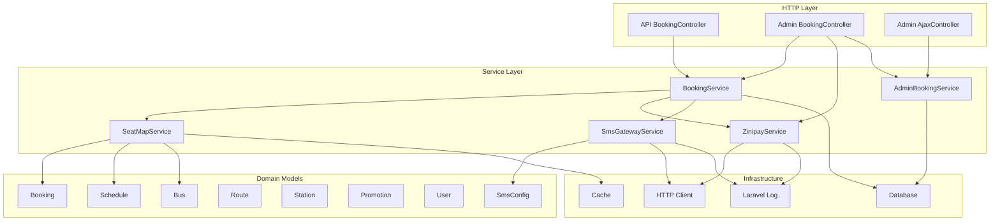
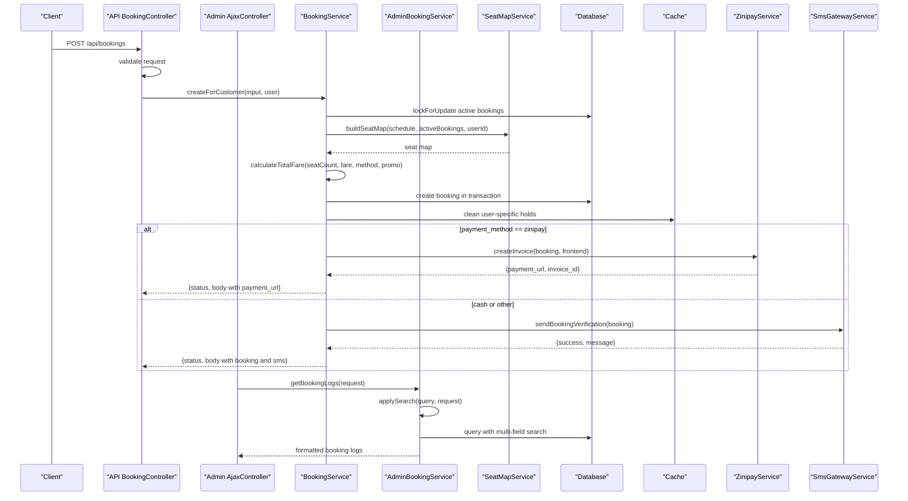
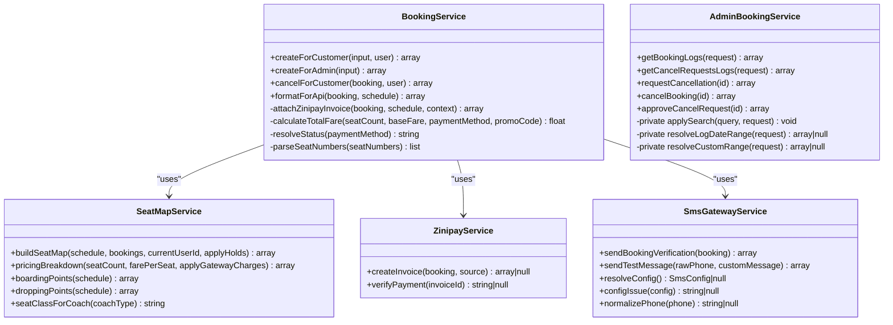
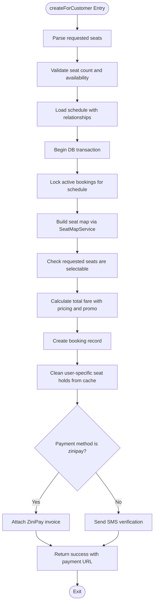
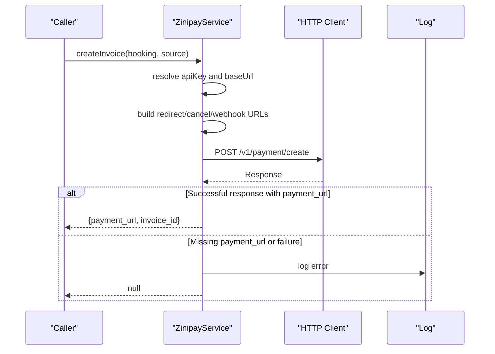
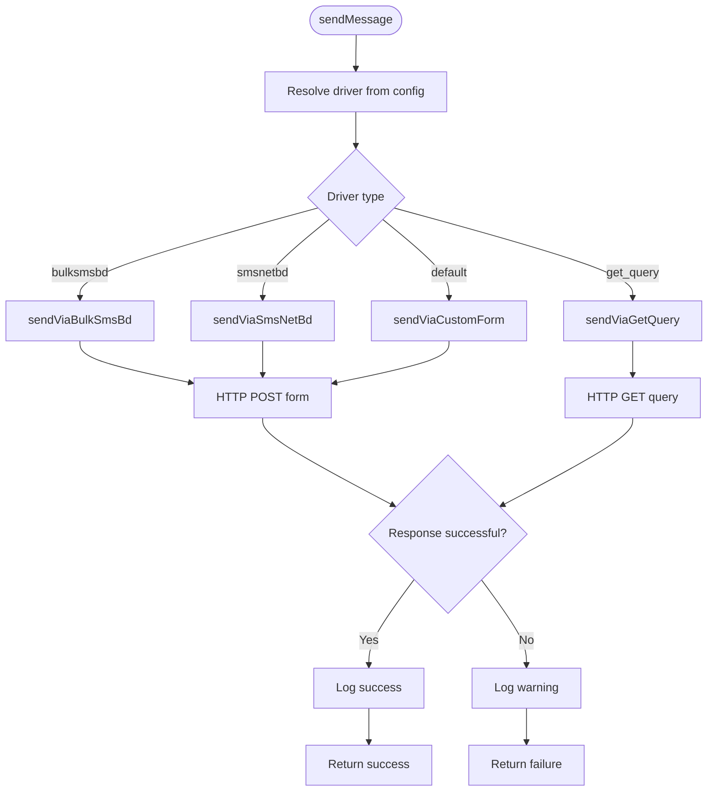
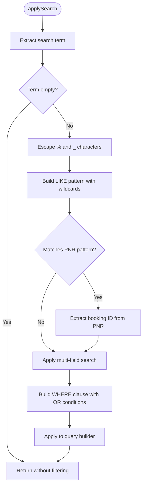
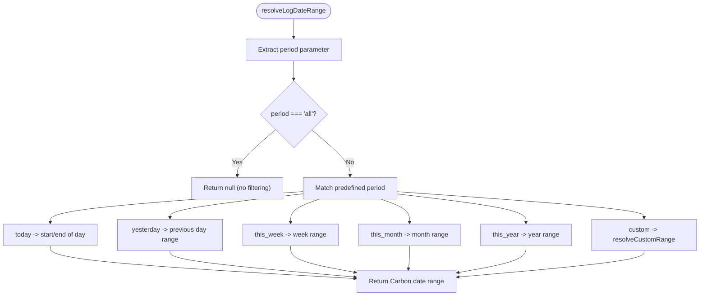
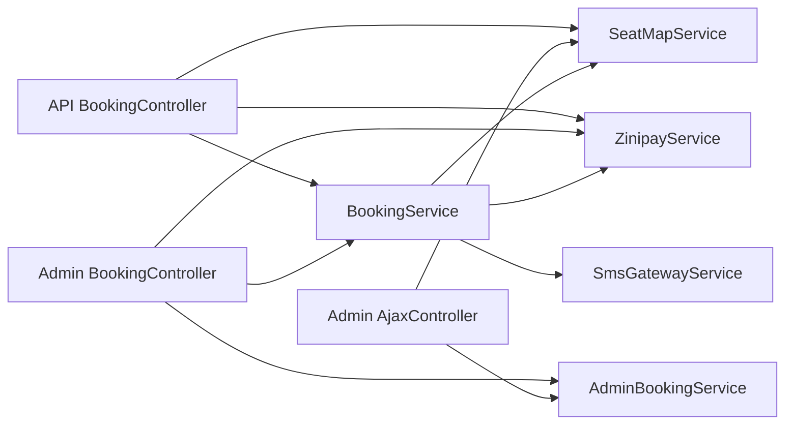

# Service Layer Design

<cite>
**Referenced Files in This Document**
- [BookingService.php](file://backend/app/Services/BookingService.php)
- [SeatMapService.php](file://backend/app/Services/SeatMapService.php)
- [ZinipayService.php](file://backend/app/Services/ZinipayService.php)
- [SmsGatewayService.php](file://backend/app/Services/SmsGatewayService.php)
- [AdminBookingService.php](file://backend/app/Services/AdminBookingService.php)
- [API BookingController.php](file://backend/app/Http/Controllers/API/BookingController.php)
- [Admin BookingController.php](file://backend/app/Http/Controllers/Admin/BookingController.php)
- [AjaxController.php](file://backend/app/Http/Controllers/Admin/AjaxController.php)
- [AppServiceProvider.php](file://backend/app/Providers/AppServiceProvider.php)
- [providers.php](file://backend/bootstrap/providers.php)
</cite>

## Update Summary
**Changes Made**
- Added comprehensive documentation for AdminBookingService with focus on the new applySearch() method
- Updated service layer architecture to include AdminBookingService as a core component
- Enhanced search functionality documentation with SQL wildcard escaping details
- Added new section covering admin-specific booking operations and log management

## Table of Contents
1. [Introduction](#introduction)
2. [Project Structure](#project-structure)
3. [Core Components](#core-components)
4. [Architecture Overview](#architecture-overview)
5. [Detailed Component Analysis](#detailed-component-analysis)
6. [Dependency Analysis](#dependency-analysis)
7. [Performance Considerations](#performance-considerations)
8. [Troubleshooting Guide](#troubleshooting-guide)
9. [Conclusion](#conclusion)
10. [Appendices](#appendices)

## Introduction
This document explains the service layer architecture for the bus booking application. It focuses on how business logic is encapsulated in dedicated service classes, how controllers interact with services, and how concerns such as seat availability, payment integration, SMS notifications, pricing, transaction safety, and administrative operations are separated from HTTP handling.

The key service classes analyzed here are:
- `BookingService`: orchestrates customer and admin booking flows.
- `SeatMapService`: computes seat codes, seat map state, boarding/dropping points, pricing breakdowns, and temporary seat holds.
- `ZinipayService`: integrates with an external payment gateway to create invoices and verify payments.
- `SmsGatewayService`: sends booking confirmation SMS through multiple configured gateways.
- `AdminBookingService`: handles administrative booking operations including intelligent search across multiple fields, cancellation workflows, and booking log management.

## Project Structure
The service layer lives under `backend/app/Services`. Controllers under `backend/app/Http/Controllers` delegate business operations to these services. Configuration and dynamic runtime overrides are handled by `AppServiceProvider`, while Laravel's container resolves dependencies automatically through constructor injection.

**Diagram sources**
- [API BookingController.php:1-150](file://backend/app/Http/Controllers/API/BookingController.php#L1-L150)
- [Admin BookingController.php:1-137](file://backend/app/Http/Controllers/Admin/BookingController.php#L1-L137)
- [AjaxController.php:1-150](file://backend/app/Http/Controllers/Admin/AjaxController.php#L1-L150)
- [BookingService.php:1-335](file://backend/app/Services/BookingService.php#L1-L335)
- [SeatMapService.php:1-593](file://backend/app/Services/SeatMapService.php#L1-L593)
- [ZinipayService.php:1-141](file://backend/app/Services/ZinipayService.php#L1-L141)
- [SmsGatewayService.php:1-255](file://backend/app/Services/SmsGatewayService.php#L1-L255)
- [AdminBookingService.php:1-296](file://backend/app/Services/AdminBookingService.php#L1-L296)

**Section sources**
- [providers.php:1-7](file://backend/bootstrap/providers.php#L1-L7)
- [AppServiceProvider.php:1-106](file://backend/app/Providers/AppServiceProvider.php#L1-L106)

## Core Components
This section summarizes each service's responsibility, main methods, input/output patterns, and interaction boundaries.

### BookingService
Responsibilities:
- Enforce business rules for customer and admin bookings.
- Validate seat selection limits and user permissions.
- Compute total fare, including promotions and gateway charges.
- Manage transactions around seat locking and booking creation.
- Coordinate payment invoice creation and SMS notifications.

Key public methods:
- `createForCustomer(array $input, User $user): array`
  - Validates payment method and seat selection.
  - Locks active bookings for concurrency control.
  - Builds a seat map and checks seat availability.
  - Creates a booking inside a database transaction.
  - Integrates with ZiniPay when required.
  - Sends SMS verification after successful booking.
  - Returns structured response arrays with HTTP status and body.
- `createForAdmin(array $input): array`
  - Creates admin-initiated bookings without seat locking.
  - Applies gateway pricing and optional ZiniPay invoice creation.
  - Sends SMS only for confirmed statuses.
- `cancelForCustomer(Booking $booking, User $user): array`
  - Enforces ownership and cancellation state rules.
  - Supports immediate cancellation or request-based cancellation.
- `formatForApi(Booking $booking, ?Schedule $schedule = null): array`
  - Loads related schedule, bus, and route data.
  - Formats booking and schedule information for API responses.

Return value pattern:
- Customer-facing methods return arrays like `{status, body}` where `status` is an HTTP-like integer and `body` contains the payload.
- Admin-facing methods return arrays like `{booking, payment_url, sms}`.

Error handling:
- Business validation returns explicit error payloads instead of throwing exceptions.
- Transactional failures are caught and converted into a generic server error response.

**Section sources**
- [BookingService.php:16-21](file://backend/app/Services/BookingService.php#L16-L21)
- [BookingService.php:23-131](file://backend/app/Services/BookingService.php#L23-L131)
- [BookingService.php:133-193](file://backend/app/Services/BookingService.php#L133-L193)
- [BookingService.php:195-240](file://backend/app/Services/BookingService.php#L195-L240)
- [BookingService.php:242-281](file://backend/app/Services/BookingService.php#L242-L281)
- [BookingService.php:283-333](file://backend/app/Services/BookingService.php#L283-L333)

### SeatMapService
Responsibilities:
- Generate all valid seat codes based on bus configuration or default layout.
- Build a seat map showing available, sold, booked, blocked, and held seats.
- Provide boarding and dropping point formatting.
- Calculate pricing breakdowns including service and gateway charges.
- Manage temporary seat holds using cache.

Key public methods:
- `allSeatCodes(): array`
- `allSeatCodesForBus(?Bus $bus = null): array`
- `buildSeatMap(Schedule $schedule, iterable $bookings, ?int $currentUserId = null, bool $applyHolds = true): array`
- `boardingPoints(Schedule $schedule): array`
- `droppingPoints(Schedule $schedule): array`
- `pricingBreakdown(int $seatCount, float $farePerSeat, bool $applyGatewayCharges = true): array`
- `formatSchedulePayload(Schedule $schedule, iterable $bookings, ?int $currentUserId = null): array`
- `seatClassForCoach(?string $coachType): string`
- `isSeatSelectable(string $status): bool`
- `isValidSeatCode(string $seat, ?Bus $bus = null): bool`
- `toggleBlockedSeat(Schedule $schedule, string $seat, iterable $bookings): array`
- `holdSeat(int $scheduleId, string $seatNumber, int $userId): array`
- `releaseSeat(int $scheduleId, string $seatNumber, int $userId): array`

Concurrency and seat holding:
- Temporary seat holds are stored in cache with expiration timestamps.
- Holds are visible to other users but not to the holder.
- Hold release removes the hold for the owning user.

Validation and errors:
- Invalid seat codes throw `InvalidArgumentException`.
- Availability checks return structured success/failure arrays.

**Section sources**
- [SeatMapService.php:16-47](file://backend/app/Services/SeatMapService.php#L16-L47)
- [SeatMapService.php:49-189](file://backend/app/Services/SeatMapService.php#L49-L189)
- [SeatMapService.php:191-244](file://backend/app/Services/SeatMapService.php#L191-L244)
- [SeatMapService.php:246-341](file://backend/app/Services/SeatMapService.php#L246-L341)
- [SeatMapService.php:343-382](file://backend/app/Services/SeatMapService.php#L343-L382)
- [SeatMapService.php:384-447](file://backend/app/Services/SeatMapService.php#L384-L447)
- [SeatMapService.php:449-500](file://backend/app/Services/SeatMapService.php#L449-L500)
- [SeatMapService.php:502-582](file://backend/app/Services/SeatMapService.php#L502-L582)
- [SeatMapService.php:584-591](file://backend/app/Services/SeatMapService.php#L584-L591)

### ZinipayService
Responsibilities:
- Create payment invoices for bookings.
- Verify payment status via the external gateway.
- Handle missing API keys and network errors gracefully.

Key public methods:
- `createInvoice(Booking $booking, string $source = 'frontend'): ?array`
  - Builds redirect, cancel, and webhook URLs.
  - Adjusts URLs for local/testing environments.
  - Posts to the gateway endpoint with timeout and headers.
  - Returns payment URL and invoice ID on success; logs and returns null on failure.
- `verifyPayment(string $invoiceId): ?string`
  - Verifies invoice status and returns the status string or null.

Error handling:
- Missing API key results in logged error and null return.
- HTTP failures and exceptions are logged and do not bubble up to callers.

**Section sources**
- [ZinipayService.php:11-18](file://backend/app/Services/ZinipayService.php#L11-L18)
- [ZinipayService.php:20-97](file://backend/app/Services/ZinipayService.php#L20-L97)
- [ZinipayService.php:99-139](file://backend/app/Services/ZinipayService.php#L99-L139)

### SmsGatewayService
Responsibilities:
- Resolve active SMS configuration.
- Validate configuration completeness.
- Normalize phone numbers to international format.
- Build booking messages using templates or defaults.
- Send SMS through multiple drivers: BulkSMS BD, SMS Net BD, custom form, or GET query.

Key public methods:
- `sendBookingVerification(Booking $booking): array`
- `sendTestMessage(string $rawPhone, ?string $customMessage = null): array`
- `resolveConfig(): ?SmsConfig`
- `configIssue(SmsConfig $config): ?string`
- `normalizePhone(string $phone): ?string`
- `buildBookingMessage(Booking $booking, SmsConfig $config): string`
- `sendMessage(SmsConfig $config, string $phone, string $message, array $context = []): array`

Driver dispatch:
- Uses a match expression to select the appropriate driver implementation.
- Each driver method performs an HTTP request with timeouts.

Error handling:
- Incomplete configuration returns a clear message.
- Gateway rejections and exceptions are logged and returned as failure responses.

**Section sources**
- [SmsGatewayService.php:13-48](file://backend/app/Services/SmsGatewayService.php#L13-L48)
- [SmsGatewayService.php:50-87](file://backend/app/Services/SmsGatewayService.php#L50-L87)
- [SmsGatewayService.php:89-134](file://backend/app/Services/SmsGatewayService.php#L89-L134)
- [SmsGatewayService.php:136-150](file://backend/app/Services/SmsGatewayService.php#L136-L150)
- [SmsGatewayService.php:152-202](file://backend/app/Services/SmsGatewayService.php#L152-L202)
- [SmsGatewayService.php:204-253](file://backend/app/Services/SmsGatewayService.php#L204-L253)

### AdminBookingService
**Updated** New service added to handle administrative booking operations with intelligent search capabilities.

Responsibilities:
- Provide intelligent search across multiple booking fields including PNR codes, passenger names, phone numbers, and email addresses.
- Implement proper SQL wildcard escaping to prevent injection attacks.
- Manage booking cancellation workflows and approval processes.
- Format booking log entries for administrative interfaces.
- Handle date range filtering for booking logs and cancel requests.

Key public methods:
- `getBookingLogs(Request $request): array`
  - Retrieves recent bookings with intelligent search filtering.
  - Supports date range filtering with predefined periods or custom ranges.
  - Applies search terms across passenger_name, passenger_phone, passenger_email, and booking ID.
  - Returns formatted booking data with schedule and route information.
- `getCancelRequestsLogs(Request $request): array`
  - Retrieves cancellation requests with the same search capabilities.
  - Filters by CANCEL_REQUESTED status and applies date range constraints.
  - Returns formatted cancellation request data.
- `requestCancellation(int $id): array`
  - Sets a booking to CANCEL_REQUESTED status.
  - Validates booking existence and current status.
  - Prevents duplicate cancellation requests.
- `cancelBooking(int $id): array`
  - Directly cancels a booking (admin override).
  - Updates booking status to CANCELLED.
- `approveCancelRequest(int $id): array`
  - Approves a pending cancellation request.
  - Validates booking exists and has CANCEL_REQUESTED status.
  - Updates booking status to CANCELLED.

Intelligent Search Implementation:
- **Multi-field search**: Searches across passenger_name, passenger_phone, passenger_email, and booking ID simultaneously.
- **PNR code recognition**: Automatically detects PNR patterns like "SE00042", "se42", or "42" and converts them to booking IDs.
- **SQL wildcard escaping**: Properly escapes "%" and "_" characters to prevent unintended pattern matching.
- **Flexible term matching**: Supports partial matches for names, phone numbers, and email addresses.

Date Range Filtering:
- **Predefined periods**: today, yesterday, this_week, this_month, this_year.
- **Custom date ranges**: from_date and to_date parameters.
- **All data option**: period="all" disables date filtering.

Return value patterns:
- Log methods return arrays with 'bookings' or 'cancel_requests' collections and 'updated_at' timestamps.
- Cancellation methods return arrays with 'success', 'status', and 'body' containing operation results.

**Section sources**
- [AdminBookingService.php:9-94](file://backend/app/Services/AdminBookingService.php#L9-L94)
- [AdminBookingService.php:96-147](file://backend/app/Services/AdminBookingService.php#L96-L147)
- [AdminBookingService.php:154-265](file://backend/app/Services/AdminBookingService.php#L154-L265)
- [AdminBookingService.php:267-294](file://backend/app/Services/AdminBookingService.php#L267-L294)

## Architecture Overview
The service layer separates business rules from HTTP concerns:
- Controllers validate requests and delegate domain logic to services.
- Services coordinate models, external integrations, caching, and database transactions.
- External integrations (payment gateway, SMS gateway) are isolated in their own services.
- Administrative operations are handled by specialized services like AdminBookingService.

**Diagram sources**
- [API BookingController.php:19-40](file://backend/app/Http/Controllers/API/BookingController.php#L19-L40)
- [AjaxController.php:36-48](file://backend/app/Http/Controllers/Admin/AjaxController.php#L36-L48)
- [BookingService.php:23-131](file://backend/app/Services/BookingService.php#L23-L131)
- [AdminBookingService.php:96-147](file://backend/app/Services/AdminBookingService.php#L96-L147)
- [SeatMapService.php:191-244](file://backend/app/Services/SeatMapService.php#L191-L244)
- [ZinipayService.php:20-97](file://backend/app/Services/ZinipayService.php#L20-L97)
- [SmsGatewayService.php:13-48](file://backend/app/Services/SmsGatewayService.php#L13-L48)

## Detailed Component Analysis

### BookingService Analysis
BookingService is the central orchestrator for booking workflows. It enforces authorization, validates inputs, manages concurrency, calculates pricing, creates bookings, coordinates payment, and sends SMS notifications.

#### Class Diagram

**Diagram sources**
- [BookingService.php:16-333](file://backend/app/Services/BookingService.php#L16-L333)
- [SeatMapService.php:191-382](file://backend/app/Services/SeatMapService.php#L191-L382)
- [ZinipayService.php:20-139](file://backend/app/Services/ZinipayService.php#L20-L139)
- [SmsGatewayService.php:13-202](file://backend/app/Services/SmsGatewayService.php#L13-L202)
- [AdminBookingService.php:9-294](file://backend/app/Services/AdminBookingService.php#L9-L294)

#### Transaction Management Flow

**Diagram sources**
- [BookingService.php:23-131](file://backend/app/Services/BookingService.php#L23-L131)
- [SeatMapService.php:191-244](file://backend/app/Services/SeatMapService.php#L191-L244)
- [ZinipayService.php:20-97](file://backend/app/Services/ZinipayService.php#L20-L97)
- [SmsGatewayService.php:13-48](file://backend/app/Services/SmsGatewayService.php#L13-L48)

**Section sources**
- [BookingService.php:23-131](file://backend/app/Services/BookingService.php#L23-L131)
- [BookingService.php:133-193](file://backend/app/Services/BookingService.php#L133-L193)
- [BookingService.php:195-240](file://backend/app/Services/BookingService.php#L195-L240)
- [BookingService.php:242-333](file://backend/app/Services/BookingService.php#L242-L333)

### SeatMapService Analysis
SeatMapService provides reusable seat-related logic used by both customer and admin flows. It abstracts seat code generation, seat map construction, boarding/dropping point formatting, pricing calculations, and temporary seat holds.

#### Key Algorithms
- Seat code generation supports default layouts, customized grid layouts, sleeper buses, and special layouts like `2+2_last5`.
- Seat map building combines blocked seats, cache-based holds, and paid/recent pending bookings to determine seat status.
- Pricing breakdown includes seat fare, service charge, gateway charge, and discounts.

**Section sources**
- [SeatMapService.php:49-189](file://backend/app/Services/SeatMapService.php#L49-L189)
- [SeatMapService.php:191-244](file://backend/app/Services/SeatMapService.php#L191-L244)
- [SeatMapService.php:246-341](file://backend/app/Services/SeatMapService.php#L246-L341)
- [SeatMapService.php:343-382](file://backend/app/Services/SeatMapService.php#L343-L382)
- [SeatMapService.php:502-582](file://backend/app/Services/SeatMapService.php#L502-L582)

### ZinipayService Analysis
ZinipayService isolates external payment gateway interactions. It handles configuration, URL generation, HTTP requests, logging, and error cases.

#### Sequence Diagram: Invoice Creation

**Diagram sources**
- [ZinipayService.php:20-97](file://backend/app/Services/ZinipayService.php#L20-L97)

**Section sources**
- [ZinipayService.php:11-18](file://backend/app/Services/ZinipayService.php#L11-L18)
- [ZinipayService.php:20-97](file://backend/app/Services/ZinipayService.php#L20-L97)
- [ZinipayService.php:99-139](file://backend/app/Services/ZinipayService.php#L99-L139)

### SmsGatewayService Analysis
SmsGatewayService encapsulates SMS sending logic across multiple providers. It validates configuration, normalizes phone numbers, builds messages, and dispatches requests through the appropriate driver.

#### Driver Dispatch Flow

**Diagram sources**
- [SmsGatewayService.php:152-202](file://backend/app/Services/SmsGatewayService.php#L152-L202)
- [SmsGatewayService.php:204-253](file://backend/app/Services/SmsGatewayService.php#L204-L253)

**Section sources**
- [SmsGatewayService.php:13-48](file://backend/app/Services/SmsGatewayService.php#L13-L48)
- [SmsGatewayService.php:75-107](file://backend/app/Services/SmsGatewayService.php#L75-L107)
- [SmsGatewayService.php:109-150](file://backend/app/Services/SmsGatewayService.php#L109-L150)
- [SmsGatewayService.php:152-253](file://backend/app/Services/SmsGatewayService.php#L152-L253)

### AdminBookingService Analysis
**Updated** Enhanced with intelligent search capabilities for administrative booking operations.

AdminBookingService provides specialized functionality for administrative tasks including sophisticated search across multiple booking fields, cancellation workflows, and log management. The service implements security measures like SQL wildcard escaping and provides flexible date range filtering.

#### Intelligent Search Algorithm

**Diagram sources**
- [AdminBookingService.php:67-94](file://backend/app/Services/AdminBookingService.php#L67-L94)

#### Date Range Resolution Flow

**Diagram sources**
- [AdminBookingService.php:17-56](file://backend/app/Services/AdminBookingService.php#L17-L56)

**Section sources**
- [AdminBookingService.php:9-94](file://backend/app/Services/AdminBookingService.php#L9-L94)
- [AdminBookingService.php:96-147](file://backend/app/Services/AdminBookingService.php#L96-L147)
- [AdminBookingService.php:154-265](file://backend/app/Services/AdminBookingService.php#L154-L265)
- [AdminBookingService.php:267-294](file://backend/app/Services/AdminBookingService.php#L267-L294)

## Dependency Analysis
The service layer uses constructor dependency injection. Controllers receive services directly from Laravel's container. There is no manual binding in `AppServiceProvider`; services are resolved by convention.

**Diagram sources**
- [API BookingController.php:12-17](file://backend/app/Http/Controllers/API/BookingController.php#L12-L17)
- [Admin BookingController.php:13-18](file://backend/app/Http/Controllers/Admin/BookingController.php#L13-L18)
- [AjaxController.php:17-23](file://backend/app/Http/Controllers/Admin/AjaxController.php#L17-L23)
- [BookingService.php:16-21](file://backend/app/Services/BookingService.php#L16-L21)

**Section sources**
- [providers.php:1-7](file://backend/bootstrap/providers.php#L1-L7)
- [AppServiceProvider.php:15-18](file://backend/app/Providers/AppServiceProvider.php#L15-L18)
- [API BookingController.php:12-17](file://backend/app/Http/Controllers/API/BookingController.php#L12-L17)
- [Admin BookingController.php:13-18](file://backend/app/Http/Controllers/Admin/BookingController.php#L13-L18)
- [AjaxController.php:17-23](file://backend/app/Http/Controllers/Admin/AjaxController.php#L17-L23)

## Performance Considerations
- **Selective column loading**: `SeatMapService::paidBookingColumns()` reduces payload size when building seat maps.
- **Concurrent seat locking**: `lockForUpdate()` prevents double-booking during high-concurrency scenarios.
- **Cache-based seat holds**: Temporary holds avoid expensive repeated queries and provide fast visibility across users.
- **External call timeouts**: Both `ZinipayService` and `SmsGatewayService` use HTTP timeouts to prevent long-running requests.
- **Pricing calculation efficiency**: Pricing breakdown is computed once per booking and reused for totals.
- **Eager loading**: `formatForApi` loads missing relationships to reduce N+1 queries in API responses.
- **Efficient search queries**: AdminBookingService uses optimized WHERE clauses with OR conditions for multi-field searches.
- **Date range optimization**: Predefined period handling avoids unnecessary date parsing for common timeframes.
- **Result limiting**: Log queries limit results to 100 records to prevent large dataset performance issues.

[No sources needed since this section provides general guidance]

## Troubleshooting Guide
Common issues and strategies:
- **Missing SMS configuration**: `SmsGatewayService::resolveConfig` returns null if no active configuration exists; callers should handle this gracefully.
- **Incomplete SMS gateway settings**: `configIssue` returns a descriptive reason; log and surface it to administrators.
- **Invalid phone numbers**: `normalizePhone` returns null for unsupported formats; validate before sending.
- **ZiniPay API key missing**: `ZinipayService::createInvoice` logs an error and returns null; check environment configuration.
- **Transaction failures**: `BookingService::createForCustomer` catches exceptions and returns a server error response; inspect logs for underlying causes.
- **Seat conflicts**: Use `SeatMapService::holdSeat` and `releaseSeat` to manage temporary reservations; ensure frontend releases holds on user actions.
- **Search query performance**: Ensure proper indexing on passenger_name, passenger_phone, passenger_email, and id columns for optimal search performance.
- **Date parsing errors**: Validate date formats before passing to Carbon::parse() to avoid parsing exceptions.
- **PNR code ambiguity**: The regex pattern `/^(?:SE)?0*(\d{1,6})$/i` ensures only numeric sequences up to 6 digits are treated as PNR codes.

**Section sources**
- [SmsGatewayService.php:75-107](file://backend/app/Services/SmsGatewayService.php#L75-L107)
- [SmsGatewayService.php:109-134](file://backend/app/Services/SmsGatewayService.php#L109-L134)
- [ZinipayService.php:20-32](file://backend/app/Services/ZinipayService.php#L20-L32)
- [BookingService.php:128-130](file://backend/app/Services/BookingService.php#L128-L130)
- [SeatMapService.php:502-582](file://backend/app/Services/SeatMapService.php#L502-L582)
- [AdminBookingService.php:75-94](file://backend/app/Services/AdminBookingService.php#L75-L94)

## Conclusion
The service layer cleanly separates business logic from HTTP concerns. `BookingService` orchestrates complex workflows, `SeatMapService` encapsulates seat-related algorithms, `ZinipayService` isolates payment gateway integration, `SmsGatewayService` abstracts multi-provider SMS delivery, and `AdminBookingService` provides specialized administrative functionality with intelligent search capabilities. Controllers focus on validation and response formatting, while services manage transactions, caching, external calls, domain rules, and administrative operations. This design improves testability, maintainability, and scalability while providing robust search and filtering capabilities for administrative interfaces.

[No sources needed since this section summarizes without analyzing specific files]

## Appendices

### Controller-to-Service Interaction Examples

#### API BookingController.store
- Validates request fields.
- Delegates to `BookingService::createForCustomer`.
- Returns JSON with status and body.

**Section sources**
- [API BookingController.php:19-40](file://backend/app/Http/Controllers/API/BookingController.php#L19-L40)

#### Admin BookingController.store
- Validates request fields.
- Delegates to `BookingService::createForAdmin`.
- Handles JSON and redirect responses.

**Section sources**
- [Admin BookingController.php:20-52](file://backend/app/Http/Controllers/Admin/BookingController.php#L20-L52)

#### Admin AjaxController.bookingLogsApi
- Validates search parameter.
- Delegates to `AdminBookingService::getBookingLogs`.
- Returns JSON with booking logs and metadata.

**Section sources**
- [AjaxController.php:36-41](file://backend/app/Http/Controllers/Admin/AjaxController.php#L36-L41)

### Service Method Signatures Summary

| Service | Method | Parameters | Return Type | Notes |
|---|---|---|---|---|
| BookingService | `createForCustomer` | `array $input`, `User $user` | `array{status: int, body: array}` | Customer booking with seat locking and transaction. |
| BookingService | `createForAdmin` | `array $input` | `array{booking, payment_url, sms}` | Admin booking without seat locking. |
| BookingService | `cancelForCustomer` | `Booking $booking`, `User $user` | `array{status: int, body: array}` | Ownership and state validation. |
| BookingService | `formatForApi` | `Booking $booking`, `?Schedule $schedule` | `array` | Formats booking and schedule for API. |
| SeatMapService | `buildSeatMap` | `Schedule $schedule`, `iterable $bookings`, `?int $currentUserId`, `bool $applyHolds` | `array<string, string>` | Computes seat status map. |
| SeatMapService | `pricingBreakdown` | `int $seatCount`, `float $farePerSeat`, `bool $applyGatewayCharges` | `array` | Calculates fare components and total. |
| SeatMapService | `holdSeat` | `int $scheduleId`, `string $seatNumber`, `int $userId` | `array` | Temporarily reserves a seat via cache. |
| SeatMapService | `releaseSeat` | `int $scheduleId`, `string $seatNumber`, `int $userId` | `array` | Releases a held seat. |
| ZinipayService | `createInvoice` | `Booking $booking`, `string $source` | `array|null` | Creates payment invoice or logs failure. |
| ZinipayService | `verifyPayment` | `string $invoiceId` | `string|null` | Verifies payment status. |
| SmsGatewayService | `sendBookingVerification` | `Booking $booking` | `array{success: bool, message: string}` | Sends SMS with validation and driver dispatch. |
| SmsGatewayService | `sendTestMessage` | `string $rawPhone`, `?string $customMessage` | `array{success: bool, message: string}` | Sends test SMS. |
| SmsGatewayService | `resolveConfig` | none | `?SmsConfig` | Returns active SMS configuration. |
| SmsGatewayService | `configIssue` | `SmsConfig $config` | `?string` | Returns configuration issue or null. |
| SmsGatewayService | `normalizePhone` | `string $phone` | `?string` | Normalizes to international format. |
| AdminBookingService | `getBookingLogs` | `Request $request` | `array{bookings: array, updated_at: string}` | Retrieves recent bookings with intelligent search. |
| AdminBookingService | `getCancelRequestsLogs` | `Request $request` | `array{cancel_requests: array, updated_at: string}` | Retrieves cancellation requests with search. |
| AdminBookingService | `requestCancellation` | `int $id` | `array{success: bool, status: int, body: array}` | Sets booking to CANCEL_REQUESTED status. |
| AdminBookingService | `cancelBooking` | `int $id` | `array{success: bool, status: int, body: array}` | Directly cancels a booking. |
| AdminBookingService | `approveCancelRequest` | `int $id` | `array{success: bool, status: int, body: array}` | Approves pending cancellation request. |

**Section sources**
- [BookingService.php:23-333](file://backend/app/Services/BookingService.php#L23-L333)
- [SeatMapService.php:191-582](file://backend/app/Services/SeatMapService.php#L191-L582)
- [ZinipayService.php:20-139](file://backend/app/Services/ZinipayService.php#L20-L139)
- [SmsGatewayService.php:13-253](file://backend/app/Services/SmsGatewayService.php#L13-L253)
- [AdminBookingService.php:96-265](file://backend/app/Services/AdminBookingService.php#L96-L265)