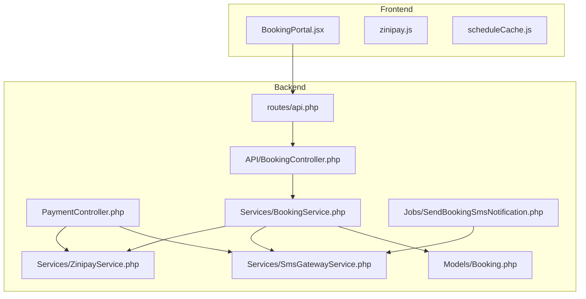
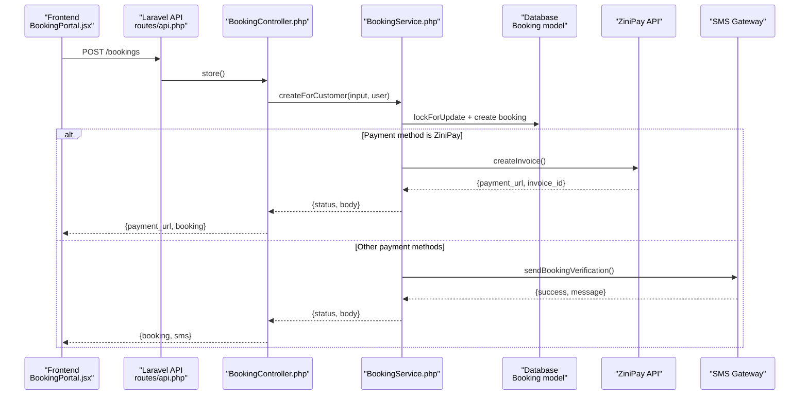
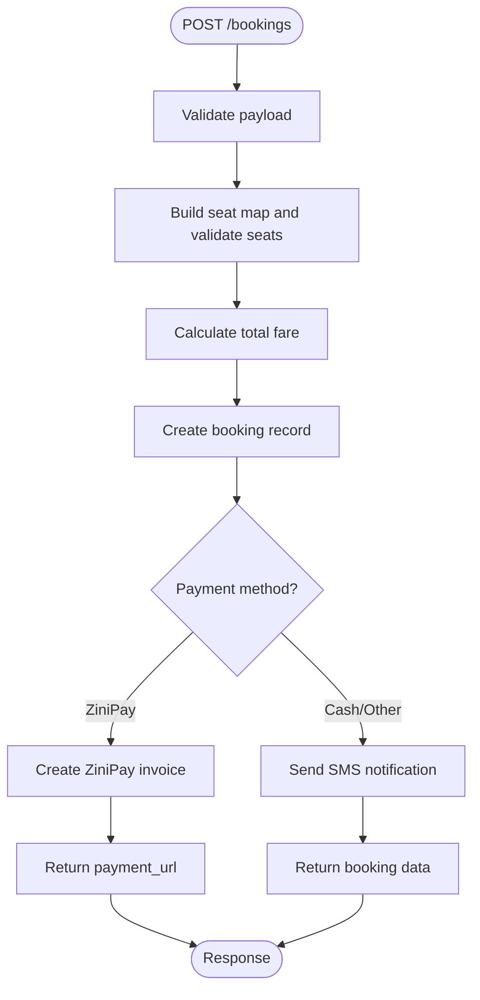
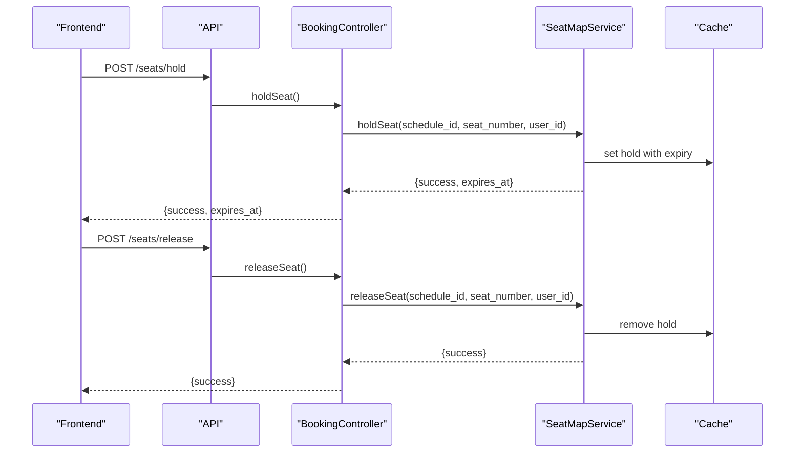
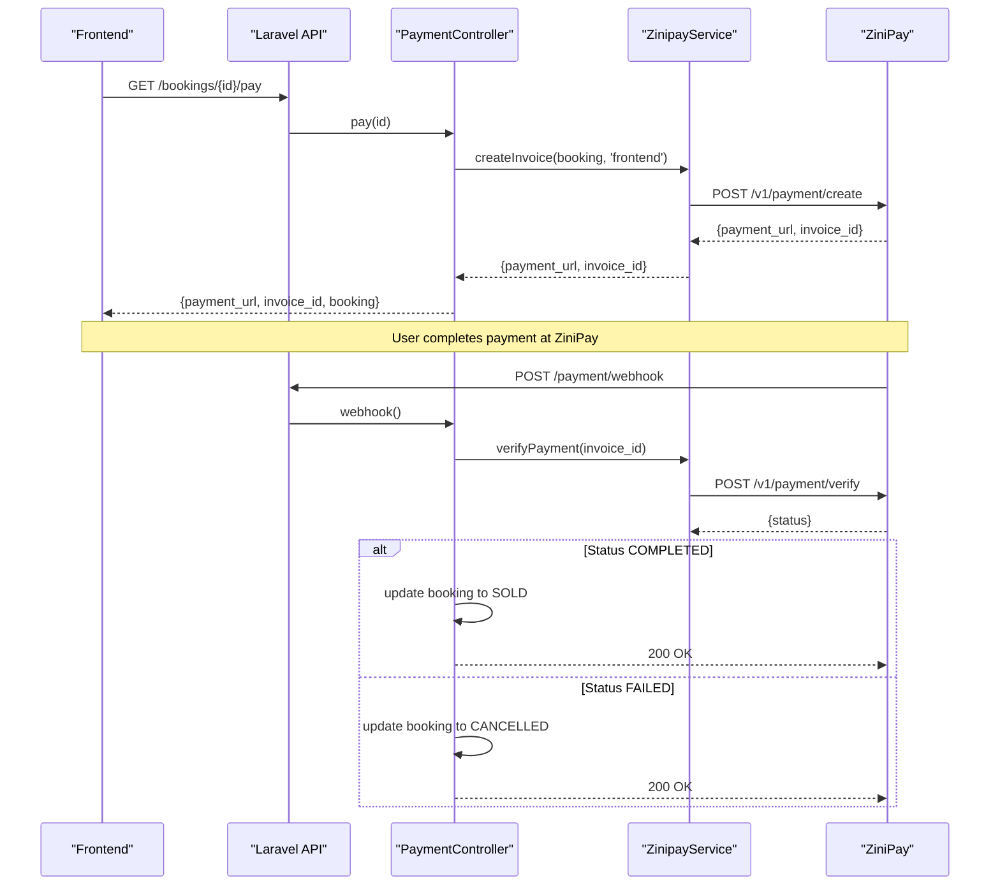
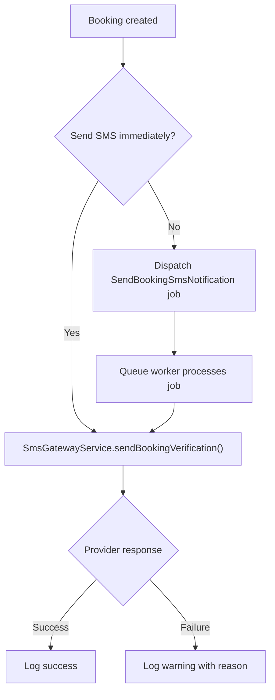
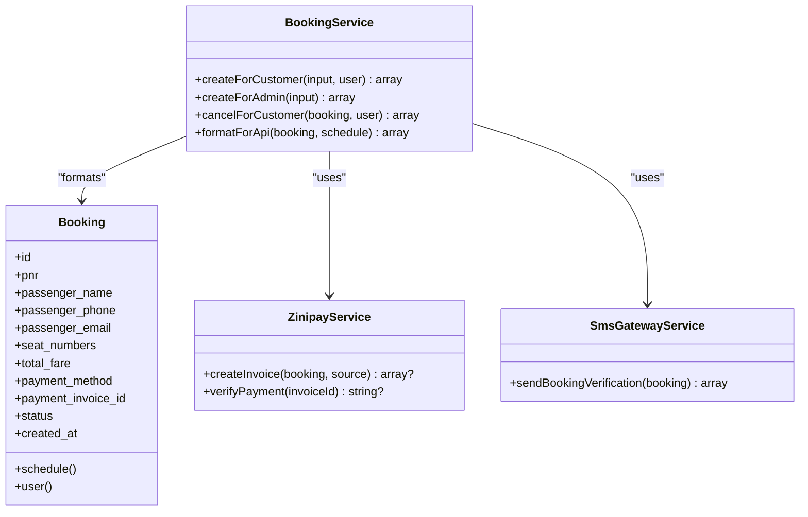
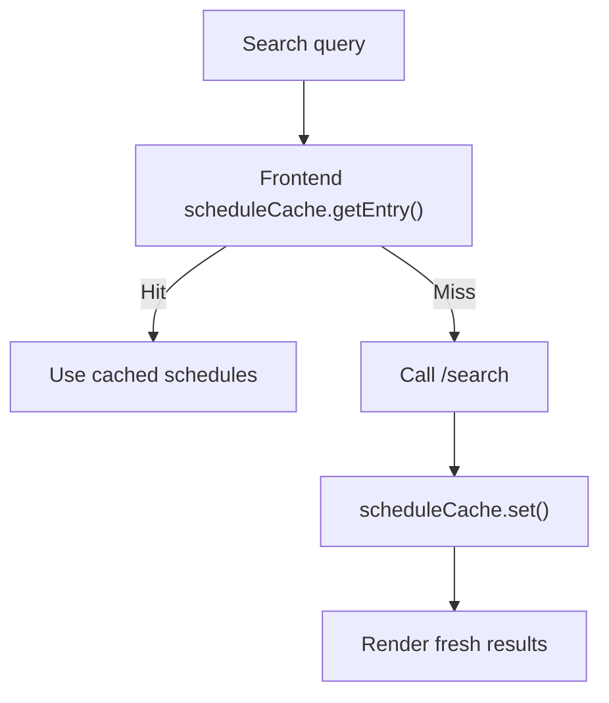
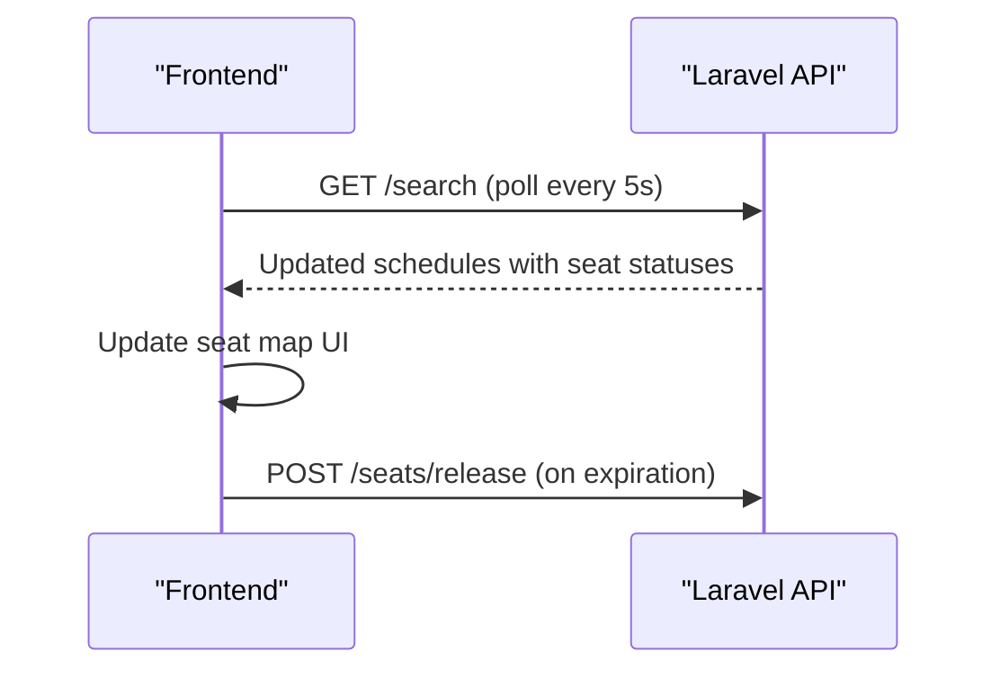
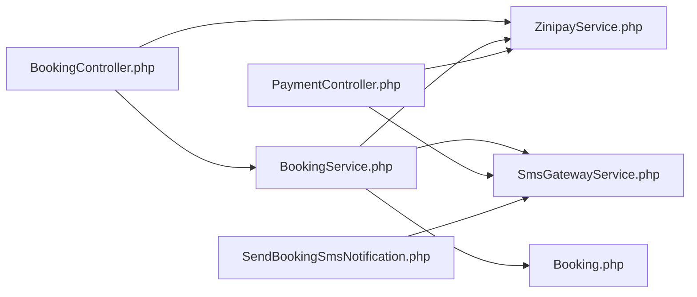

# Data Flow & Integration Patterns

<cite>
**Referenced Files in This Document**
- [api.php](file://backend/routes/api.php)
- [BookingController.php](file://backend/app/Http/Controllers/API/BookingController.php)
- [BaseController.php](file://backend/app/Http/Controllers/API/BaseController.php)
- [PaymentController.php](file://backend/app/Http/Controllers/PaymentController.php)
- [BookingService.php](file://backend/app/Services/BookingService.php)
- [ZinipayService.php](file://backend/app/Services/ZinipayService.php)
- [SmsGatewayService.php](file://backend/app/Services/SmsGatewayService.php)
- [SendBookingSmsNotification.php](file://backend/app/Jobs/SendBookingSmsNotification.php)
- [Booking.php](file://backend/app/Models/Booking.php)
- [queue.php](file://backend/config/queue.php)
- [cache.php](file://backend/config/cache.php)
- [session.php](file://backend/config/session.php)
- [services.php](file://backend/config/services.php)
- [BookingPortal.jsx](file://frontend/src/components/BookingPortal.jsx)
- [zinipay.js](file://frontend/src/zinipay.js)
- [scheduleCache.js](file://frontend/src/scheduleCache.js)
</cite>

## Table of Contents
1. [Introduction](#introduction)
2. [Project Structure](#project-structure)
3. [Core Components](#core-components)
4. [Architecture Overview](#architecture-overview)
5. [Detailed Component Analysis](#detailed-component-analysis)
6. [Dependency Analysis](#dependency-analysis)
7. [Performance Considerations](#performance-considerations)
8. [Troubleshooting Guide](#troubleshooting-guide)
9. [Conclusion](#conclusion)

## Introduction
This document explains the end-to-end data flow and integration patterns in SonyaBus, focusing on:
- Request-response lifecycle from React frontend to Laravel API controllers, service layer, and database operations.
- External integrations with ZiniPay payment gateway and SMS providers.
- Asynchronous processing using Laravel queues for SMS notifications.
- Data transformation patterns, DTO usage, and API response formatting.
- Caching strategies, session management, and real-time seat availability synchronization.

## Project Structure
SonyaBus is a Laravel backend paired with a React frontend:
- Frontend components orchestrate user flows, caching, and external payment verification.
- Backend routes expose REST endpoints protected by Sanctum and maintenance mode middleware.
- Controllers validate input and delegate business logic to services.
- Services encapsulate domain logic, coordinate external APIs, and format responses.
- Models represent persistent entities such as bookings.
- Configuration files define queue backends, cache stores, sessions, and third-party service credentials.

**Diagram sources**
- [api.php:1-77](file://backend/routes/api.php#L1-L77)
- [BookingController.php:1-150](file://backend/app/Http/Controllers/API/BookingController.php#L1-L150)
- [PaymentController.php:1-162](file://backend/app/Http/Controllers/PaymentController.php#L1-L162)
- [BookingService.php:1-335](file://backend/app/Services/BookingService.php#L1-L335)
- [ZinipayService.php:1-141](file://backend/app/Services/ZinipayService.php#L1-L141)
- [SmsGatewayService.php:1-255](file://backend/app/Services/SmsGatewayService.php#L1-L255)
- [SendBookingSmsNotification.php:1-37](file://backend/app/Jobs/SendBookingSmsNotification.php#L1-L37)
- [Booking.php:1-49](file://backend/app/Models/Booking.php#L1-L49)

**Section sources**
- [api.php:1-77](file://backend/routes/api.php#L1-L77)
- [BookingController.php:1-150](file://backend/app/Http/Controllers/API/BookingController.php#L1-L150)
- [PaymentController.php:1-162](file://backend/app/Http/Controllers/PaymentController.php#L1-L162)
- [BookingService.php:1-335](file://backend/app/Services/BookingService.php#L1-L335)
- [ZinipayService.php:1-141](file://backend/app/Services/ZinipayService.php#L1-L141)
- [SmsGatewayService.php:1-255](file://backend/app/Services/SmsGatewayService.php#L1-L255)
- [SendBookingSmsNotification.php:1-37](file://backend/app/Jobs/SendBookingSmsNotification.php#L1-L37)
- [Booking.php:1-49](file://backend/app/Models/Booking.php#L1-L49)

## Core Components
- API Routes: Public search, promotions, stations; authenticated booking, seat hold/release; payment webhooks and public booking view.
- API Controllers: Validate requests, call services, return JSON responses.
- Service Layer: Encapsulates booking creation, pricing, payment invoice creation, SMS dispatch, and cancellation workflows.
- External Integrations: ZiniPay for payments; multiple SMS gateways via a unified service.
- Queue Jobs: Background SMS delivery to avoid blocking request/response.
- Models: Booking entity with relationships and computed PNR.
- Configuration: Queue drivers, cache stores, session storage, and third-party service credentials.

**Section sources**
- [api.php:1-77](file://backend/routes/api.php#L1-L77)
- [BookingController.php:1-150](file://backend/app/Http/Controllers/API/BookingController.php#L1-L150)
- [BookingService.php:1-335](file://backend/app/Services/BookingService.php#L1-L335)
- [ZinipayService.php:1-141](file://backend/app/Services/ZinipayService.php#L1-L141)
- [SmsGatewayService.php:1-255](file://backend/app/Services/SmsGatewayService.php#L1-L255)
- [SendBookingSmsNotification.php:1-37](file://backend/app/Jobs/SendBookingSmsNotification.php#L1-L37)
- [Booking.php:1-49](file://backend/app/Models/Booking.php#L1-L49)

## Architecture Overview
The system follows a layered architecture:
- Presentation (React): User interactions, local caching, and UI state.
- API Layer (Laravel): Route definitions, controllers, validation, and response formatting.
- Domain Layer (Services): Business rules, external integrations, and data transformations.
- Persistence (Eloquent Models): Database access and relationships.
- External Systems: Payment gateway and SMS providers.

**Diagram sources**
- [api.php:63-75](file://backend/routes/api.php#L63-L75)
- [BookingController.php:19-40](file://backend/app/Http/Controllers/API/BookingController.php#L19-L40)
- [BookingService.php:28-131](file://backend/app/Services/BookingService.php#L28-L131)
- [ZinipayService.php:27-97](file://backend/app/Services/ZinipayService.php#L27-L97)
- [SmsGatewayService.php:16-48](file://backend/app/Services/SmsGatewayService.php#L16-L48)
- [Booking.php:1-49](file://backend/app/Models/Booking.php#L1-L49)

## Detailed Component Analysis

### Request-Response Lifecycle: Customer Booking
- Frontend collects passenger details, selected seats, boarding/dropping points, and promo code.
- It calls the authenticated booking endpoint with required fields.
- Controller validates input and delegates to service.
- Service performs seat availability checks, calculates fare, creates booking, handles payment or SMS, and formats response.

**Diagram sources**
- [BookingController.php:19-40](file://backend/app/Http/Controllers/API/BookingController.php#L19-L40)
- [BookingService.php:28-131](file://backend/app/Services/BookingService.php#L28-L131)
- [ZinipayService.php:27-97](file://backend/app/Services/ZinipayService.php#L27-L97)
- [SmsGatewayService.php:16-48](file://backend/app/Services/SmsGatewayService.php#L16-L48)

**Section sources**
- [BookingPortal.jsx:469-575](file://frontend/src/components/BookingPortal.jsx#L469-L575)
- [api.php:63-75](file://backend/routes/api.php#L63-L75)
- [BookingController.php:19-40](file://backend/app/Http/Controllers/API/BookingController.php#L19-L40)
- [BookingService.php:28-131](file://backend/app/Services/BookingService.php#L28-L131)

### Seat Hold and Release Workflow
- Frontend optimistically updates UI when selecting/deselecting seats.
- It calls seat hold/release endpoints to synchronize server-side reservations.
- Server uses cache-based holds with expiration to prevent conflicts.

**Diagram sources**
- [BookingController.php:82-116](file://backend/app/Http/Controllers/API/BookingController.php#L82-L116)
- [BookingPortal.jsx:108-161](file://frontend/src/components/BookingPortal.jsx#L108-L161)
- [BookingPortal.jsx:209-289](file://frontend/src/components/BookingPortal.jsx#L209-L289)

**Section sources**
- [BookingController.php:82-116](file://backend/app/Http/Controllers/API/BookingController.php#L82-L116)
- [BookingPortal.jsx:108-161](file://frontend/src/components/BookingPortal.jsx#L108-L161)
- [BookingPortal.jsx:209-289](file://frontend/src/components/BookingPortal.jsx#L209-L289)

### Payment Integration with ZiniPay
- Backend creates invoices via ZiniPay service, storing invoice IDs on bookings.
- Frontend redirects users to payment URLs returned by the backend.
- After payment, ZiniPay redirects to callback or sends webhook; backend verifies status and updates booking.

**Diagram sources**
- [BookingController.php:118-148](file://backend/app/Http/Controllers/API/BookingController.php#L118-L148)
- [PaymentController.php:21-66](file://backend/app/Http/Controllers/PaymentController.php#L21-L66)
- [PaymentController.php:90-136](file://backend/app/Http/Controllers/PaymentController.php#L90-L136)
- [ZinipayService.php:27-97](file://backend/app/Services/ZinipayService.php#L27-L97)
- [ZinipayService.php:105-139](file://backend/app/Services/ZinipayService.php#L105-L139)

**Section sources**
- [api.php:54-55](file://backend/routes/api.php#L54-L55)
- [BookingController.php:118-148](file://backend/app/Http/Controllers/API/BookingController.php#L118-L148)
- [PaymentController.php:21-66](file://backend/app/Http/Controllers/PaymentController.php#L21-L66)
- [PaymentController.php:90-136](file://backend/app/Http/Controllers/PaymentController.php#L90-L136)
- [ZinipayService.php:27-97](file://backend/app/Services/ZinipayService.php#L27-L97)
- [ZinipayService.php:105-139](file://backend/app/Services/ZinipayService.php#L105-L139)

### SMS Notifications and Queues
- SMS sending can be executed synchronously during booking or asynchronously via a queued job.
- The SMS service supports multiple providers through a unified interface.
- Queue configuration defaults to database driver; jobs are persisted and processed by workers.

**Diagram sources**
- [SmsGatewayService.php:16-48](file://backend/app/Services/SmsGatewayService.php#L16-L48)
- [SendBookingSmsNotification.php:11-35](file://backend/app/Jobs/SendBookingSmsNotification.php#L11-L35)
- [queue.php:16-45](file://backend/config/queue.php#L16-L45)

**Section sources**
- [SmsGatewayService.php:16-48](file://backend/app/Services/SmsGatewayService.php#L16-L48)
- [SendBookingSmsNotification.php:11-35](file://backend/app/Jobs/SendBookingSmsNotification.php#L11-L35)
- [queue.php:16-45](file://backend/config/queue.php#L16-L45)

### Data Transformation and API Response Formatting
- Service methods transform models into structured DTOs for API consumers.
- Responses include normalized fields, ISO timestamps, and nested schedule/bus/route information.
- Admin and customer flows share formatting utilities to ensure consistency.

**Diagram sources**
- [Booking.php:1-49](file://backend/app/Models/Booking.php#L1-L49)
- [BookingService.php:242-281](file://backend/app/Services/BookingService.php#L242-L281)
- [ZinipayService.php:27-97](file://backend/app/Services/ZinipayService.php#L27-L97)
- [SmsGatewayService.php:16-48](file://backend/app/Services/SmsGatewayService.php#L16-L48)

**Section sources**
- [BookingService.php:242-281](file://backend/app/Services/BookingService.php#L242-L281)
- [BookingController.php:42-60](file://backend/app/Http/Controllers/API/BookingController.php#L42-L60)

### Caching Strategies
- Frontend schedule cache: In-memory Map with TTL to reduce repeated searches.
- Backend cache store: Configurable via environment (database, redis, memcached).
- Seat holds: Stored in cache with expiration to support concurrent seat selection.

**Diagram sources**
- [scheduleCache.js:1-65](file://frontend/src/scheduleCache.js#L1-L65)
- [BookingPortal.jsx:319-379](file://frontend/src/components/BookingPortal.jsx#L319-L379)
- [cache.php:18-48](file://backend/config/cache.php#L18-L48)

**Section sources**
- [scheduleCache.js:1-65](file://frontend/src/scheduleCache.js#L1-L65)
- [BookingPortal.jsx:319-379](file://frontend/src/components/BookingPortal.jsx#L319-L379)
- [cache.php:18-48](file://backend/config/cache.php#L18-L48)

### Session Management
- Sessions default to database driver with configurable lifetime and cookie attributes.
- Sanctum authentication relies on secure cookies and CORS settings for SPA communication.

Key considerations:
- Ensure SESSION_SECURE_COOKIE aligns with HTTPS deployments.
- Configure SESSION_SAME_SITE appropriately for cross-site contexts.
- Align FRONTEND_URL and CORS policies for SPA access.

**Section sources**
- [session.php:21-36](file://backend/config/session.php#L21-L36)
- [session.php:172-202](file://backend/config/session.php#L172-L202)

### Real-Time Data Synchronization
- Seat availability: Frontend polls search endpoint periodically to refresh seat maps.
- Expiration handling: Frontend tracks hold expirations and releases expired seats.
- Optimistic UI: Immediate feedback before server confirmation, with rollback on failure.

**Diagram sources**
- [BookingPortal.jsx:400-443](file://frontend/src/components/BookingPortal.jsx#L400-L443)
- [BookingPortal.jsx:163-207](file://frontend/src/components/BookingPortal.jsx#L163-L207)

**Section sources**
- [BookingPortal.jsx:400-443](file://frontend/src/components/BookingPortal.jsx#L400-L443)
- [BookingPortal.jsx:163-207](file://frontend/src/components/BookingPortal.jsx#L163-L207)

## Dependency Analysis
- Controllers depend on services for business logic and external integrations.
- Services depend on models and external HTTP clients.
- Jobs depend on services for side effects like SMS delivery.
- Configuration centralizes third-party credentials and runtime behavior.

**Diagram sources**
- [BookingController.php:1-150](file://backend/app/Http/Controllers/API/BookingController.php#L1-L150)
- [PaymentController.php:1-162](file://backend/app/Http/Controllers/PaymentController.php#L1-L162)
- [BookingService.php:1-335](file://backend/app/Services/BookingService.php#L1-L335)
- [ZinipayService.php:1-141](file://backend/app/Services/ZinipayService.php#L1-L141)
- [SmsGatewayService.php:1-255](file://backend/app/Services/SmsGatewayService.php#L1-L255)
- [SendBookingSmsNotification.php:1-37](file://backend/app/Jobs/SendBookingSmsNotification.php#L1-L37)
- [Booking.php:1-49](file://backend/app/Models/Booking.php#L1-L49)

**Section sources**
- [BookingController.php:1-150](file://backend/app/Http/Controllers/API/BookingController.php#L1-L150)
- [PaymentController.php:1-162](file://backend/app/Http/Controllers/PaymentController.php#L1-L162)
- [BookingService.php:1-335](file://backend/app/Services/BookingService.php#L1-L335)
- [ZinipayService.php:1-141](file://backend/app/Services/ZinipayService.php#L1-L141)
- [SmsGatewayService.php:1-255](file://backend/app/Services/SmsGatewayService.php#L1-L255)
- [SendBookingSmsNotification.php:1-37](file://backend/app/Jobs/SendBookingSmsNotification.php#L1-L37)
- [Booking.php:1-49](file://backend/app/Models/Booking.php#L1-L49)

## Performance Considerations
- Prefer queued SMS delivery for non-blocking operations.
- Use Redis or Memcached for cache and sessions under high load.
- Limit polling frequency for seat map refreshes to balance freshness and load.
- Apply database indexing on frequently queried columns (e.g., schedule_id, status).
- Use lockForUpdate and transactions to prevent race conditions during seat selection.

[No sources needed since this section provides general guidance]

## Troubleshooting Guide
- Payment not completing:
  - Verify ZiniPay API key and base URL in services configuration.
  - Inspect logs for webhook payloads and verification failures.
  - Ensure redirect and cancel URLs are reachable and correctly configured.
- SMS not sent:
  - Confirm active SMS gateway configuration and valid phone normalization.
  - Check provider-specific parameters and sender ID requirements.
  - Review queue worker status and failed jobs table if using queues.
- Seat conflicts:
  - Validate cache store connectivity and TTL settings.
  - Monitor hold expiration and release endpoints for errors.

**Section sources**
- [services.php:38-41](file://backend/config/services.php#L38-L41)
- [PaymentController.php:90-136](file://backend/app/Http/Controllers/PaymentController.php#L90-L136)
- [SmsGatewayService.php:75-107](file://backend/app/Services/SmsGatewayService.php#L75-L107)
- [queue.php:123-127](file://backend/config/queue.php#L123-L127)

## Conclusion
SonyaBus implements a robust, layered architecture that cleanly separates concerns across frontend, API, services, and persistence layers. External integrations with ZiniPay and SMS providers are abstracted behind dedicated services, enabling consistent error handling and logging. Asynchronous processing via queues ensures responsive user experiences, while caching and optimistic UI patterns improve perceived performance. Proper configuration of queues, cache, and sessions is essential for scalability and reliability.

[No sources needed since this section summarizes without analyzing specific files]