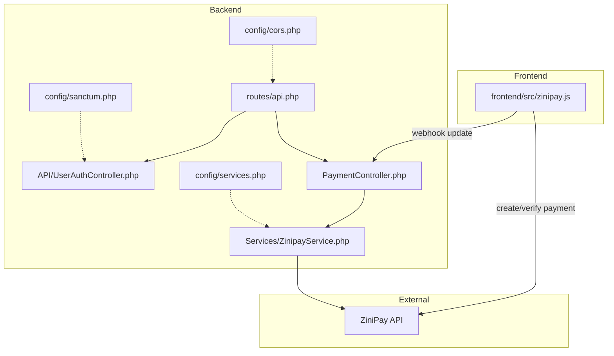
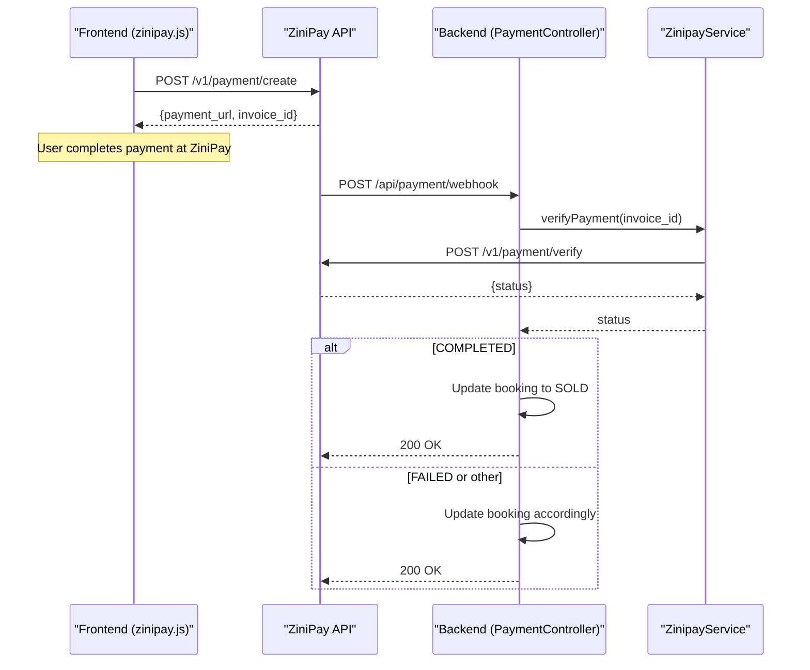
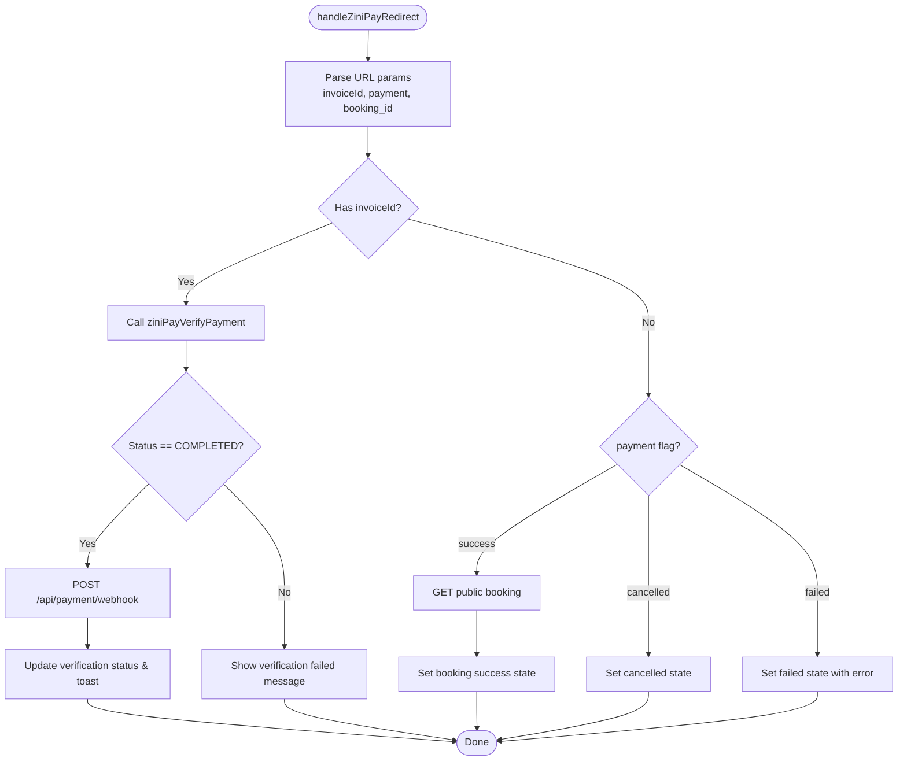
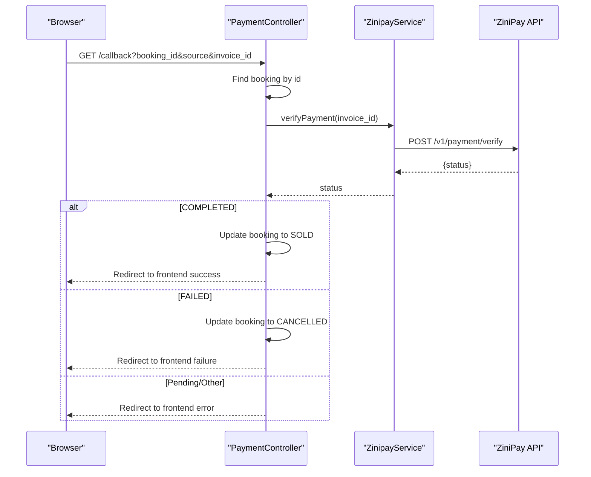
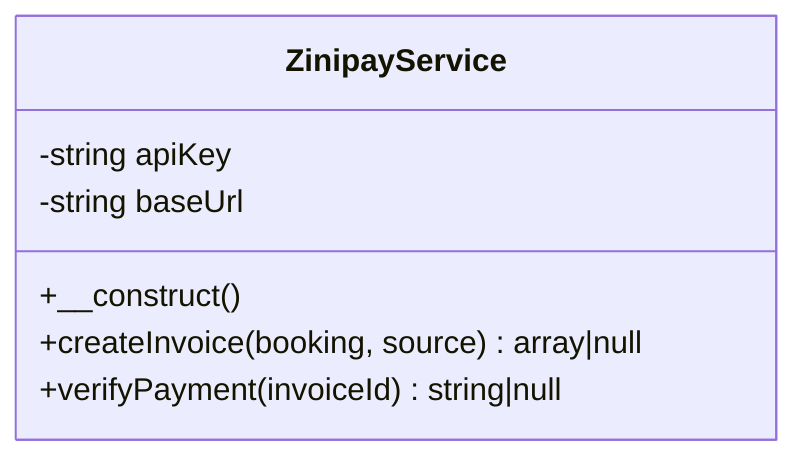
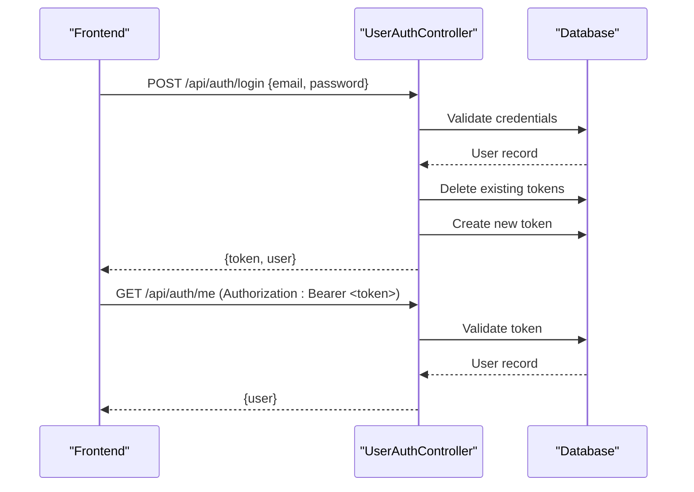
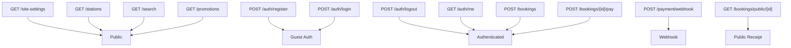
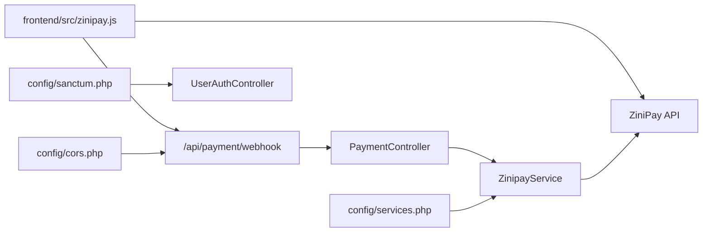

# API Integration Layer

<cite>
**Referenced Files in This Document**
- [zinipay.js](file://frontend/src/zinipay.js)
- [PaymentController.php](file://backend/app/Http/Controllers/PaymentController.php)
- [ZinipayService.php](file://backend/app/Services/ZinipayService.php)
- [api.php](file://backend/routes/api.php)
- [cors.php](file://backend/config/cors.php)
- [sanctum.php](file://backend/config/sanctum.php)
- [UserAuthController.php](file://backend/app/Http/Controllers/API/UserAuthController.php)
- [services.php](file://backend/config/services.php)
- [http.js](file://k6/lib/http.js)
</cite>

## Table of Contents
1. [Introduction](#introduction)
2. [Project Structure](#project-structure)
3. [Core Components](#core-components)
4. [Architecture Overview](#architecture-overview)
5. [Detailed Component Analysis](#detailed-component-analysis)
6. [Dependency Analysis](#dependency-analysis)
7. [Performance Considerations](#performance-considerations)
8. [Troubleshooting Guide](#troubleshooting-guide)
9. [Conclusion](#conclusion)

## Introduction
This document describes the API integration layer that connects the React frontend to the Laravel backend and the ZiniPay payment provider. It covers HTTP client usage, authentication with Sanctum tokens, request/response handling, error strategies, CORS configuration, cancellation patterns, retry mechanisms, timeouts, and the end-to-end ZiniPay payment flow including webhooks and status updates.

## Project Structure
The integration spans three layers:
- Frontend (React): Uses native fetch for direct calls to ZiniPay and the backend; includes a helper module for payment flows.
- Backend (Laravel): Provides REST APIs, Sanctum-based authentication, routing, and a service layer for ZiniPay interactions.
- External Provider (ZiniPay): Payment creation, verification, and webhook notifications.

**Diagram sources**
- [zinipay.js:1-179](file://frontend/src/zinipay.js#L1-L179)
- [api.php:1-77](file://backend/routes/api.php#L1-L77)
- [UserAuthController.php:1-220](file://backend/app/Http/Controllers/API/UserAuthController.php#L1-L220)
- [PaymentController.php:1-162](file://backend/app/Http/Controllers/PaymentController.php#L1-L162)
- [ZinipayService.php:1-141](file://backend/app/Services/ZinipayService.php#L1-L141)
- [cors.php:1-35](file://backend/config/cors.php#L1-L35)
- [sanctum.php:1-88](file://backend/config/sanctum.php#L1-L88)
- [services.php:1-45](file://backend/config/services.php#L1-L45)

**Section sources**
- [api.php:1-77](file://backend/routes/api.php#L1-L77)
- [cors.php:1-35](file://backend/config/cors.php#L1-L35)
- [sanctum.php:1-88](file://backend/config/sanctum.php#L1-L88)

## Core Components
- Frontend ZiniPay helper: Functions to create and verify payments against ZiniPay and to handle redirect flows back into the app.
- Backend Payment controller: Handles callback redirects, cancel flows, and asynchronous webhooks from ZiniPay.
- Backend ZiniPay service: Encapsulates HTTP calls to ZiniPay with timeouts, headers, and logging.
- Authentication: Sanctum token issuance on login/register and bearer token validation for protected routes.
- CORS configuration: Allows cross-origin requests for API endpoints.
- Services configuration: Centralizes ZiniPay credentials and base URL.

**Section sources**
- [zinipay.js:1-179](file://frontend/src/zinipay.js#L1-L179)
- [PaymentController.php:1-162](file://backend/app/Http/Controllers/PaymentController.php#L1-L162)
- [ZinipayService.php:1-141](file://backend/app/Services/ZinipayService.php#L1-L141)
- [UserAuthController.php:1-220](file://backend/app/Http/Controllers/API/UserAuthController.php#L1-L220)
- [cors.php:1-35](file://backend/config/cors.php#L1-L35)
- [services.php:1-45](file://backend/config/services.php#L1-L45)

## Architecture Overview
The system uses a hybrid approach:
- Direct ZiniPay calls from the frontend for initial payment creation and verification.
- Secure backend webhook endpoint to reconcile payment state and update bookings.
- Sanctum bearer tokens for authenticated customer operations.
- Explicit timeouts and logging around external calls.

**Diagram sources**
- [zinipay.js:1-179](file://frontend/src/zinipay.js#L1-L179)
- [PaymentController.php:87-136](file://backend/app/Http/Controllers/PaymentController.php#L87-L136)
- [ZinipayService.php:99-139](file://backend/app/Services/ZinipayService.php#L99-L139)

## Detailed Component Analysis

### Frontend ZiniPay Helper (fetch-based)
Responsibilities:
- Map frontend payload to ZiniPay schema and call create endpoint.
- Verify payment by invoice ID.
- Handle redirect parameters to update local UI state and call backend webhook to persist status.

Key behaviors:
- Headers include API key and JSON content types.
- Errors are caught and re-thrown after logging.
- Redirect handler verifies via ZiniPay, then posts to backend webhook to update DB and returns booking info.

**Diagram sources**
- [zinipay.js:64-177](file://frontend/src/zinipay.js#L64-L177)

**Section sources**
- [zinipay.js:1-179](file://frontend/src/zinipay.js#L1-L179)

### Backend Payment Controller
Responsibilities:
- Handle ZiniPay callback redirects and determine success/failure based on verification.
- Process cancellations.
- Implement secure webhook endpoint to reconcile payment status and update bookings.

Key behaviors:
- Callback route verifies invoice via service and updates booking status accordingly.
- Webhook route validates invoice existence, re-verifies with provider, updates booking, and responds with minimal data.
- Redirect helpers route users back to frontend with appropriate query flags.

**Diagram sources**
- [PaymentController.php:21-66](file://backend/app/Http/Controllers/PaymentController.php#L21-L66)
- [ZinipayService.php:99-139](file://backend/app/Services/ZinipayService.php#L99-L139)

**Section sources**
- [PaymentController.php:1-162](file://backend/app/Http/Controllers/PaymentController.php#L1-L162)

### Backend ZiniPay Service
Responsibilities:
- Create invoice with proper headers, timeout, and metadata.
- Verify payment status securely.
- Log errors and responses for observability.

Key behaviors:
- Reads API key and base URL from services config.
- Sets explicit timeouts for external calls.
- Returns structured results or null on failure.

**Diagram sources**
- [ZinipayService.php:1-141](file://backend/app/Services/ZinipayService.php#L1-L141)

**Section sources**
- [ZinipayService.php:1-141](file://backend/app/Services/ZinipayService.php#L1-L141)
- [services.php:38-41](file://backend/config/services.php#L38-L41)

### Authentication Flow (Sanctum Tokens)
Responsibilities:
- Issue bearer tokens on register/login.
- Validate bearer tokens for protected routes.
- Provide logout and user profile endpoints.

Key behaviors:
- Login creates a new token and deletes previous ones for security.
- Protected routes use Sanctum middleware.
- Token prefix and expiration are configurable.

**Diagram sources**
- [UserAuthController.php:41-86](file://backend/app/Http/Controllers/API/UserAuthController.php#L41-L86)
- [api.php:63-75](file://backend/routes/api.php#L63-L75)
- [sanctum.php:21-26](file://backend/config/sanctum.php#L21-L26)

**Section sources**
- [UserAuthController.php:1-220](file://backend/app/Http/Controllers/API/UserAuthController.php#L1-L220)
- [api.php:63-75](file://backend/routes/api.php#L63-L75)
- [sanctum.php:1-88](file://backend/config/sanctum.php#L1-L88)

### API Routes and Webhooks
- Public routes: stations, search, promotions, auth guest routes.
- Authenticated routes: logout, me, bookings CRUD, seat hold/release.
- Webhooks and public receipt retrieval: payment webhook and public booking show.

**Diagram sources**
- [api.php:1-77](file://backend/routes/api.php#L1-L77)

**Section sources**
- [api.php:1-77](file://backend/routes/api.php#L1-L77)

## Dependency Analysis
- Frontend zinipay.js depends on environment variables for ZiniPay API key and calls both ZiniPay and backend endpoints.
- Backend PaymentController depends on ZinipayService for provider communication.
- ZinipayService depends on services config for credentials and base URL.
- CORS and Sanctum configs influence how frontend can reach backend and how tokens are validated.

**Diagram sources**
- [zinipay.js:1-179](file://frontend/src/zinipay.js#L1-L179)
- [PaymentController.php:1-162](file://backend/app/Http/Controllers/PaymentController.php#L1-L162)
- [ZinipayService.php:1-141](file://backend/app/Services/ZinipayService.php#L1-L141)
- [cors.php:1-35](file://backend/config/cors.php#L1-L35)
- [sanctum.php:1-88](file://backend/config/sanctum.php#L1-L88)
- [services.php:1-45](file://backend/config/services.php#L1-L45)

**Section sources**
- [zinipay.js:1-179](file://frontend/src/zinipay.js#L1-L179)
- [PaymentController.php:1-162](file://backend/app/Http/Controllers/PaymentController.php#L1-L162)
- [ZinipayService.php:1-141](file://backend/app/Services/ZinipayService.php#L1-L141)
- [cors.php:1-35](file://backend/config/cors.php#L1-L35)
- [sanctum.php:1-88](file://backend/config/sanctum.php#L1-L88)
- [services.php:1-45](file://backend/config/services.php#L1-L45)

## Performance Considerations
- Timeouts: Backend service sets explicit timeouts for external ZiniPay calls to avoid hanging connections.
- Logging: All external failures and unexpected responses are logged for observability and faster debugging.
- Minimal payloads: Webhook responses return only necessary fields to reduce bandwidth.
- Idempotency: Webhook handler checks already processed states to prevent duplicate updates.

Recommendations:
- Add exponential backoff retries for transient network errors when calling ZiniPay from the frontend if needed.
- Cache non-sensitive read-only data (e.g., site settings) at the edge or CDN.
- Use connection pooling and keep-alive where possible in server-side HTTP clients.

[No sources needed since this section provides general guidance]

## Troubleshooting Guide
Common issues and resolutions:
- Missing ZiniPay API key: Ensure environment variables are set for both frontend and backend. The frontend helper reads the API key from environment variables; the backend service reads it from services config.
- CORS errors: Verify backend CORS configuration allows your frontend origin and methods.
- Sanctum token issues: Confirm stateful domains include your frontend host and port; ensure Authorization header is sent correctly.
- Webhook not updating booking: Check logs for webhook payload and verify invoice_id matches a booking; confirm provider sends expected status values.

Operational tips:
- Inspect network tab for request/response details during payment flows.
- Review backend logs for ZiniPay service exceptions and response bodies.
- Validate environment variables and routes are correct in each environment.

**Section sources**
- [zinipay.js:88-92](file://frontend/src/zinipay.js#L88-L92)
- [cors.php:18-32](file://backend/config/cors.php#L18-L32)
- [sanctum.php:21-26](file://backend/config/sanctum.php#L21-L26)
- [PaymentController.php:90-136](file://backend/app/Http/Controllers/PaymentController.php#L90-L136)
- [ZinipayService.php:53-96](file://backend/app/Services/ZinipayService.php#L53-L96)

## Conclusion
The integration combines a straightforward frontend fetch-based client with a robust backend service layer for ZiniPay. Authentication relies on Sanctum bearer tokens, while CORS is configured to allow cross-origin access. The payment flow leverages both synchronous callbacks and asynchronous webhooks to ensure reliable state reconciliation. Timeouts, logging, and idempotent webhook handling improve resilience. For further reliability, consider adding retry logic and stronger error propagation in the frontend client.