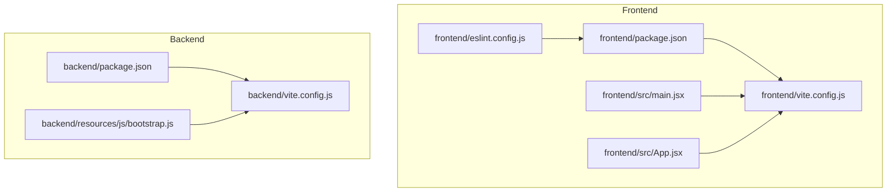
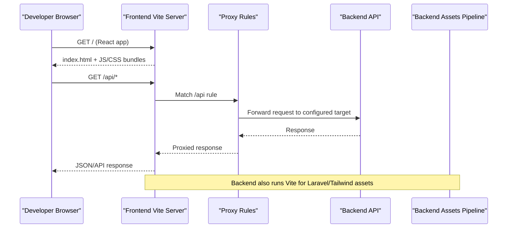
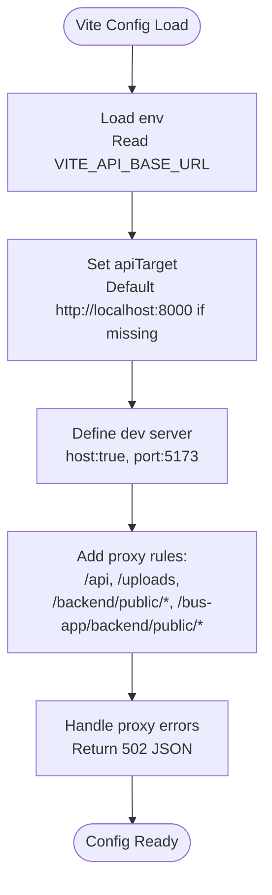
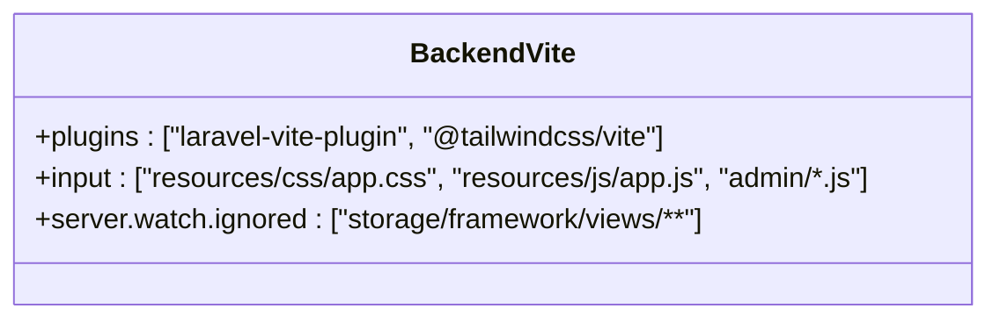
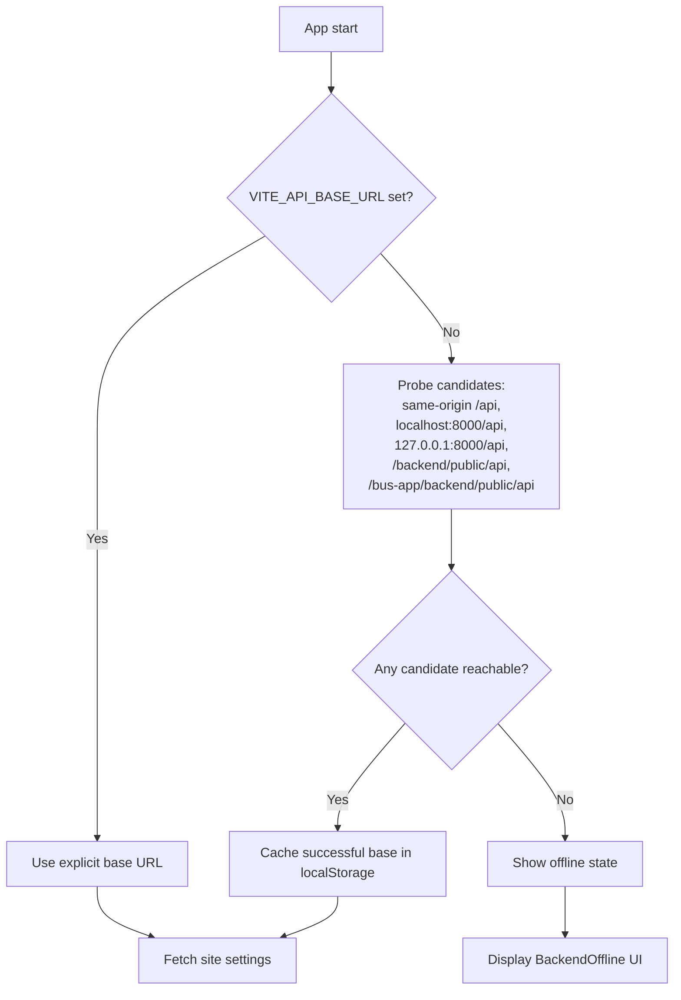
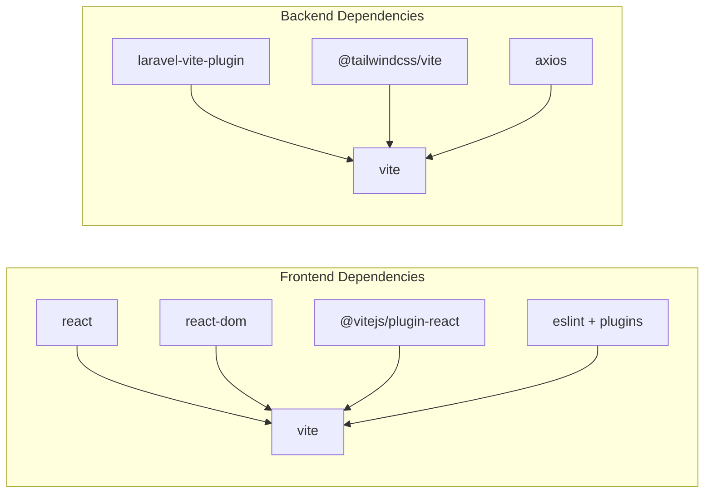

# Build Configuration & Development Workflow

<cite>
**Referenced Files in This Document**
- [frontend/vite.config.js](file://frontend/vite.config.js)
- [frontend/package.json](file://frontend/package.json)
- [frontend/eslint.config.js](file://frontend/eslint.config.js)
- [backend/vite.config.js](file://backend/vite.config.js)
- [backend/package.json](file://backend/package.json)
- [frontend/src/main.jsx](file://frontend/src/main.jsx)
- [frontend/src/App.jsx](file://frontend/src/App.jsx)
- [backend/resources/js/bootstrap.js](file://backend/resources/js/bootstrap.js)
</cite>

## Table of Contents
1. [Introduction](#introduction)
2. [Project Structure](#project-structure)
3. [Core Components](#core-components)
4. [Architecture Overview](#architecture-overview)
5. [Detailed Component Analysis](#detailed-component-analysis)
6. [Dependency Analysis](#dependency-analysis)
7. [Performance Considerations](#performance-considerations)
8. [Troubleshooting Guide](#troubleshooting-guide)
9. [Conclusion](#conclusion)

## Introduction
This document explains the Vite-based build configuration and development workflow for both the frontend React application and the backend Laravel assets. It covers:
- Vite configuration options, plugins, and server behavior
- Package scripts for development, building, linting, and preview
- ESLint setup for code quality
- Asset management and CSS processing
- Environment variable handling and API base resolution
- Development server proxying, hot module replacement (HMR), and debugging
- Production builds, bundle analysis guidance, and performance monitoring recommendations

## Project Structure
The repository contains two Vite projects:
- Frontend: a React application under `frontend/`
- Backend: Laravel asset pipeline under `backend/` using `laravel-vite-plugin`

**Diagram sources**
- [frontend/vite.config.js:1-74](file://frontend/vite.config.js#L1-L74)
- [frontend/package.json:1-28](file://frontend/package.json#L1-L28)
- [frontend/eslint.config.js:1-22](file://frontend/eslint.config.js#L1-L22)
- [frontend/src/main.jsx:1-12](file://frontend/src/main.jsx#L1-L12)
- [frontend/src/App.jsx:31-63](file://frontend/src/App.jsx#L31-L63)
- [backend/vite.config.js:1-34](file://backend/vite.config.js#L1-L34)
- [backend/package.json:1-18](file://backend/package.json#L1-L18)
- [backend/resources/js/bootstrap.js:1-5](file://backend/resources/js/bootstrap.js#L1-L5)

**Section sources**
- [frontend/vite.config.js:1-74](file://frontend/vite.config.js#L1-L74)
- [frontend/package.json:1-28](file://frontend/package.json#L1-L28)
- [frontend/eslint.config.js:1-22](file://frontend/eslint.config.js#L1-L22)
- [backend/vite.config.js:1-34](file://backend/vite.config.js#L1-L34)
- [backend/package.json:1-18](file://backend/package.json#L1-L18)

## Core Components
- Frontend Vite config defines the React plugin, dev server host/port, and proxy rules for `/api`, `/uploads`, and Laragon-style paths.
- Frontend package scripts provide `dev`, `build`, `lint`, and `preview`.
- Frontend ESLint uses flat config with recommended rules, React Hooks, and React Refresh integration.
- Backend Vite config integrates Laravel and Tailwind CSS, listing multiple admin entry points and enabling refresh.
- Backend package scripts provide `dev` and `build` for Laravel assets.

**Section sources**
- [frontend/vite.config.js:1-74](file://frontend/vite.config.js#L1-L74)
- [frontend/package.json:1-28](file://frontend/package.json#L1-L28)
- [frontend/eslint.config.js:1-22](file://frontend/eslint.config.js#L1-L22)
- [backend/vite.config.js:1-34](file://backend/vite.config.js#L1-L34)
- [backend/package.json:1-18](file://backend/package.json#L1-L18)

## Architecture Overview
The frontend runs on Vite’s dev server and proxies API requests to the backend. The backend also has its own Vite pipeline for Laravel assets and Tailwind CSS.

**Diagram sources**
- [frontend/vite.config.js:18-70](file://frontend/vite.config.js#L18-L70)
- [backend/vite.config.js:5-32](file://backend/vite.config.js#L5-L32)

## Detailed Component Analysis

### Frontend Vite Configuration
Key behaviors:
- Uses `@vitejs/plugin-react` for JSX support and HMR.
- Loads environment variables via `loadEnv` and reads `VITE_API_BASE_URL`.
- Dev server:
  - Hosts on all interfaces (`host: true`) for LAN access.
  - Serves on port `5173`.
  - Proxies `/api` to the configured or default backend target with error handling that returns a 502 JSON payload when unreachable.
  - Proxies `/uploads` to the same backend target.
  - Includes fallback routes for Laragon-style subdirectory layouts (`/backend/public/api`, `/bus-app/backend/public/api`, `/backend/public/uploads`) rewriting paths to strip the prefix.

**Diagram sources**
- [frontend/vite.config.js:5-70](file://frontend/vite.config.js#L5-L70)

**Section sources**
- [frontend/vite.config.js:1-74](file://frontend/vite.config.js#L1-L74)

### Frontend Scripts and Linting
Scripts:
- `dev`: Starts Vite dev server with HMR.
- `build`: Produces optimized production assets.
- `lint`: Runs ESLint across the project.
- `preview`: Serves the built output locally.

ESLint:
- Flat config format.
- Extends recommended rules from `@eslint/js`.
- Enables React Hooks rules and React Refresh integration.
- Ignores `dist` directory.
- Targets `.js` and `.jsx` files with browser globals enabled.

**Section sources**
- [frontend/package.json:6-11](file://frontend/package.json#L6-L11)
- [frontend/eslint.config.js:1-22](file://frontend/eslint.config.js#L1-L22)

### Backend Vite Configuration
Key behaviors:
- Integrates `laravel-vite-plugin` with multiple input entries for CSS and JS, including several admin pages.
- Enables `refresh: true` for HMR within Laravel views.
- Adds Tailwind CSS via `@tailwindcss/vite`.
- Excludes Laravel compiled view files from file watching to improve performance.

**Diagram sources**
- [backend/vite.config.js:5-32](file://backend/vite.config.js#L5-L32)

**Section sources**
- [backend/vite.config.js:1-34](file://backend/vite.config.js#L1-L34)
- [backend/package.json:5-8](file://backend/package.json#L5-L8)

### Environment Variables and API Base Resolution
Environment handling:
- Frontend Vite loads `VITE_API_BASE_URL` from `.env` and uses it to set the proxy target.
- At runtime, the React app checks `import.meta.env.VITE_API_BASE_URL`. If set, it trusts this value; otherwise, it probes candidate URLs and caches the working base URL in `localStorage`.

Candidate order includes:
- Explicit `VITE_API_BASE_URL`
- Same-origin `/api`
- Common local backends (`http://localhost:8000/api`, `http://127.0.0.1:8000/api`)
- Laragon-style paths (`/backend/public/api`, `/bus-app/backend/public/api`)

**Diagram sources**
- [frontend/vite.config.js:5-8](file://frontend/vite.config.js#L5-L8)
- [frontend/src/App.jsx:31-63](file://frontend/src/App.jsx#L31-L63)
- [frontend/src/App.jsx:329-378](file://frontend/src/App.jsx#L329-L378)

**Section sources**
- [frontend/vite.config.js:5-8](file://frontend/vite.config.js#L5-L8)
- [frontend/src/App.jsx:31-63](file://frontend/src/App.jsx#L31-L63)
- [frontend/src/App.jsx:329-378](file://frontend/src/App.jsx#L329-L378)

### Asset Management and CSS Processing
- Frontend:
  - Entry point imports global CSS and theme variables before rendering the React app.
  - CSS is processed by Vite’s default pipeline; no additional preprocessors are configured.
- Backend:
  - Tailwind CSS is integrated via `@tailwindcss/vite`.
  - Multiple admin JS modules are bundled alongside the main app and dashboard entry points.

**Section sources**
- [frontend/src/main.jsx:1-12](file://frontend/src/main.jsx#L1-L12)
- [backend/vite.config.js:6-26](file://backend/vite.config.js#L6-L26)

### Development Server, HMR, and Debugging
- Frontend:
  - HMR is provided by `@vitejs/plugin-react`.
  - Dev server listens on port `5173` and is accessible from the local network due to `host: true`.
  - Proxy errors for `/api` return a structured JSON error to avoid breaking the dev experience.
- Backend:
  - `laravel-vite-plugin` enables refresh for Laravel views.
  - File watcher ignores compiled Blade views to reduce overhead.

Debugging tips:
- Use browser DevTools Network tab to inspect proxied `/api` requests.
- Check console logs for proxy error messages when backend is unreachable.
- For backend assets, verify Tailwind classes are applied after running `npm run dev` in the backend directory.

**Section sources**
- [frontend/vite.config.js:18-70](file://frontend/vite.config.js#L18-L70)
- [backend/vite.config.js:24-32](file://backend/vite.config.js#L24-L32)

### Backend Axios Bootstrap
The backend initializes Axios globally and sets a common header for AJAX requests.

**Section sources**
- [backend/resources/js/bootstrap.js:1-5](file://backend/resources/js/bootstrap.js#L1-L5)

## Dependency Analysis
Frontend dependencies relevant to build and dev:
- Runtime: React and ReactDOM.
- Dev: Vite, React plugin, ESLint ecosystem, React Hooks and Refresh plugins.

Backend dependencies relevant to build and dev:
- Vite, Laravel Vite plugin, Tailwind CSS, Axios, and concurrency utilities.

**Diagram sources**
- [frontend/package.json:12-26](file://frontend/package.json#L12-L26)
- [backend/package.json:9-16](file://backend/package.json#L9-L16)

**Section sources**
- [frontend/package.json:12-26](file://frontend/package.json#L12-L26)
- [backend/package.json:9-16](file://backend/package.json#L9-L16)

## Performance Considerations
- Frontend:
  - Keep `VITE_API_BASE_URL` set in development to skip runtime probing and reduce unnecessary network calls.
  - Avoid importing heavy libraries at startup; use dynamic imports where appropriate.
- Backend:
  - Ensure Tailwind purge/minification is active in production builds.
  - Limit the number of admin entry points if not needed to reduce bundle size.
- General:
  - Use `npm run build` to generate optimized assets.
  - Analyze bundle sizes with tools like `rollup-plugin-visualizer` or Vite’s built-in analyzer plugin if added later.

[No sources needed since this section provides general guidance]

## Troubleshooting Guide
Common issues and resolutions:
- Backend unreachable during development:
  - Verify the backend server is running on the expected port.
  - Confirm `VITE_API_BASE_URL` matches your backend address.
  - Inspect proxy error responses returned by Vite when the target is down.
- API path mismatches:
  - Ensure the frontend expects `/api` endpoints and the backend serves them at the configured target.
  - For Laragon setups, confirm the rewrite rules for `/backend/public/api` and `/bus-app/backend/public/api` are correct.
- Tailwind styles not applied:
  - Run `npm run dev` in the backend directory.
  - Verify Tailwind is included in the CSS pipeline.
- Linting errors:
  - Run `npm run lint` in the frontend directory and fix reported issues.

**Section sources**
- [frontend/vite.config.js:23-40](file://frontend/vite.config.js#L23-L40)
- [frontend/vite.config.js:49-70](file://frontend/vite.config.js#L49-L70)
- [backend/vite.config.js:24-32](file://backend/vite.config.js#L24-L32)
- [frontend/eslint.config.js:1-22](file://frontend/eslint.config.js#L1-L22)

## Conclusion
The project uses Vite for both frontend and backend asset pipelines. The frontend React app benefits from fast HMR, robust proxying, and flexible environment-driven API base resolution. The backend integrates Laravel and Tailwind CSS through Vite, providing a smooth development experience. With clear scripts, ESLint configuration, and thoughtful proxy rules, developers can focus on building features while maintaining consistent code quality and reliable local workflows.

[No sources needed since this section summarizes without analyzing specific files]