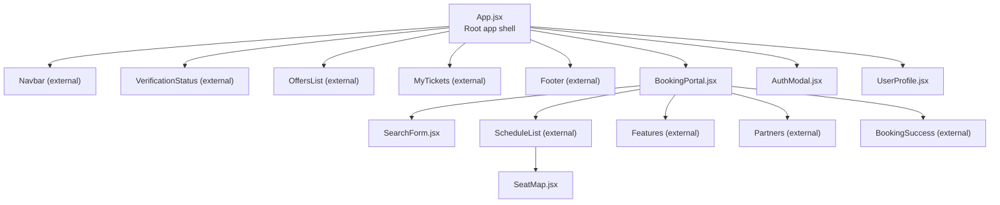
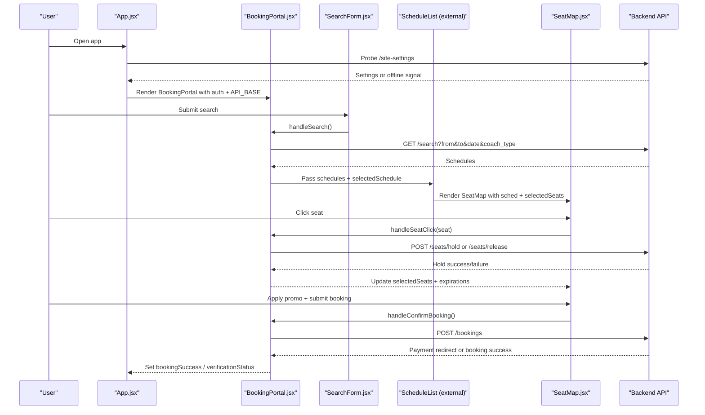
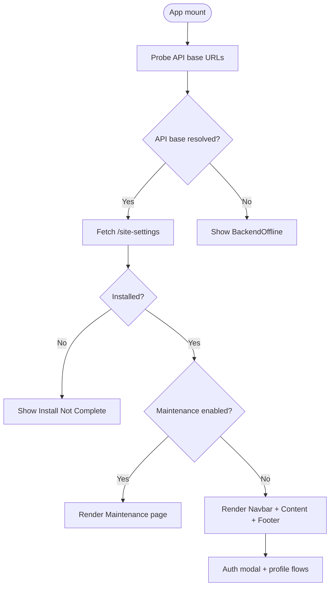
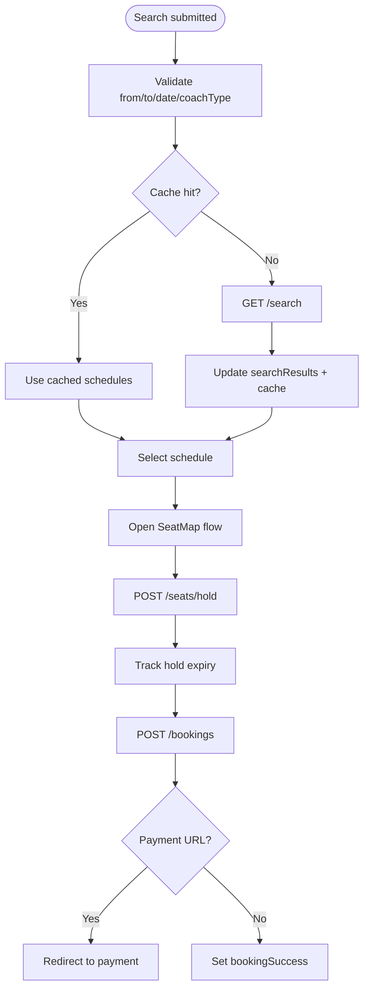
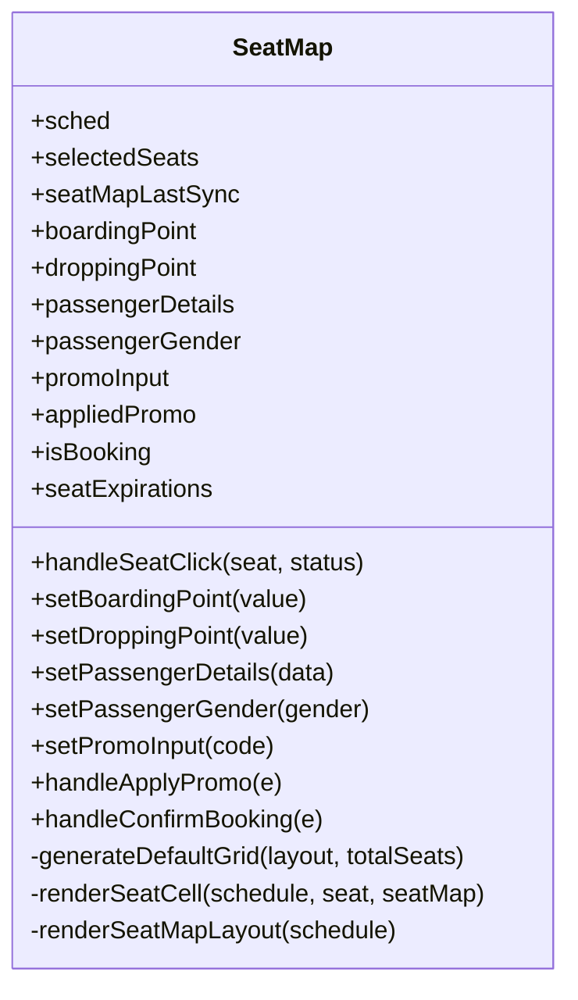
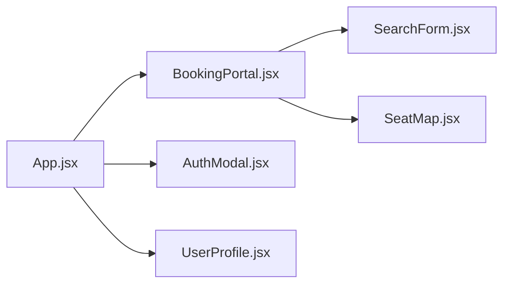

# Component Architecture

<cite>
**Referenced Files in This Document**   
- [App.jsx](file://frontend/src/App.jsx)
- [BookingPortal.jsx](file://frontend/src/components/BookingPortal.jsx)
- [SearchForm.jsx](file://frontend/src/components/SearchForm.jsx)
- [SeatMap.jsx](file://frontend/src/components/SeatMap.jsx)
- [AuthModal.jsx](file://frontend/src/components/AuthModal.jsx)
- [UserProfile.jsx](file://frontend/src/components/UserProfile.jsx)
</cite>

## Table of Contents
1. [Introduction](#introduction)
2. [Project Structure](#project-structure)
3. [Core Components](#core-components)
4. [Architecture Overview](#architecture-overview)
5. [Detailed Component Analysis](#detailed-component-analysis)
6. [Dependency Analysis](#dependency-analysis)
7. [Performance Considerations](#performance-considerations)
8. [Troubleshooting Guide](#troubleshooting-guide)
9. [Conclusion](#conclusion)

## Introduction
This document explains the React component architecture for the bus booking application frontend. It focuses on the modular structure, parent-child relationships, and composition patterns used by the main components: BookingPortal, SearchForm, SeatMap, AuthModal, and UserProfile. It also documents props interfaces, local state management, event handling patterns, lifecycle behaviors, error boundaries, and performance techniques such as memoization and lazy loading.

## Project Structure
The frontend is a React application under `frontend/src`. The root component orchestrates authentication, site settings, backend connectivity, routing tabs, and global UI state. Feature-specific logic lives in sibling components under `frontend/src/components`.

**Diagram sources**
- [App.jsx:94-800](file://frontend/src/App.jsx#L94-L800)
- [BookingPortal.jsx:9-654](file://frontend/src/components/BookingPortal.jsx#L9-L654)
- [SearchForm.jsx:3-109](file://frontend/src/components/SearchForm.jsx#L3-L109)
- [SeatMap.jsx:10-612](file://frontend/src/components/SeatMap.jsx#L10-L612)
- [AuthModal.jsx:3-165](file://frontend/src/components/AuthModal.jsx#L3-L165)
- [UserProfile.jsx:3-150](file://frontend/src/components/UserProfile.jsx#L3-L150)

**Section sources**
- [App.jsx:1-800](file://frontend/src/App.jsx#L1-L800)

## Core Components
- App: Root container managing auth state, API base URL probing, site settings, navigation tabs, toast notifications, and child component composition.
- BookingPortal: Orchestrates search, schedule selection, seat holding, promo validation, passenger details, and booking submission.
- SearchForm: Controlled form for departure, destination, date, and coach type.
- SeatMap: Visual seat grid with layout generation, hold timers, boarding/dropping points, passenger inputs, promo application, and pricing summary.
- AuthModal: Modal supporting login, register, forgot password, and reset password flows.
- UserProfile: Password update flow with session validation and user state refresh.

Key responsibilities:
- Data fetching: App probes backend; BookingPortal fetches stations, schedules, promotions, and bookings; UserProfile updates password.
- State ownership: Parent components own most state and pass it down via props.
- Event handling: Controlled inputs, optimistic UI updates for seats, and server-backed confirmation.
- Lifecycle: Effects for polling, cleanup, and side effects like beforeunload handlers.

**Section sources**
- [App.jsx:94-800](file://frontend/src/App.jsx#L94-L800)
- [BookingPortal.jsx:9-654](file://frontend/src/components/BookingPortal.jsx#L9-L654)
- [SearchForm.jsx:3-109](file://frontend/src/components/SearchForm.jsx#L3-L109)
- [SeatMap.jsx:10-612](file://frontend/src/components/SeatMap.jsx#L10-L612)
- [AuthModal.jsx:3-165](file://frontend/src/components/AuthModal.jsx#L3-L165)
- [UserProfile.jsx:3-150](file://frontend/src/components/UserProfile.jsx#L3-L150)

## Architecture Overview
The application uses a top-down data flow pattern. App holds global state and passes callbacks and data to children. BookingPortal composes SearchForm and ScheduleList (which renders SeatMap). AuthModal and UserProfile are invoked from App and BookingPortal through shared callbacks.

**Diagram sources**
- [App.jsx:293-427](file://frontend/src/App.jsx#L293-L427)
- [BookingPortal.jsx:291-575](file://frontend/src/components/BookingPortal.jsx#L291-L575)
- [SearchForm.jsx:20-102](file://frontend/src/components/SearchForm.jsx#L20-L102)
- [SeatMap.jsx:192-605](file://frontend/src/components/SeatMap.jsx#L192-L605)

## Detailed Component Analysis

### App.jsx
Responsibilities:
- Backend connectivity probing and caching of API base URL.
- Site settings retrieval and maintenance/installation gating.
- Authentication state persistence and token validation.
- Navigation tab control and child component composition.
- Toast notification system.

Props passed to children:
- BookingPortal: bookingSuccess, setBookingSuccess, verificationStatus, setVerificationStatus, authUser, authToken, clearAuth, openAuthModal, showToast, API_BASE.
- UserProfile: authUser, authToken, clearAuth, openAuthModal, setActiveTab, showToast, API_BASE, setAuthUser, AUTH_USER_KEY.
- AuthModal: showAuthModal, closeAuthModal, authMode, setAuthMode, authForm, setAuthForm, handleAuthSubmit, isAuthLoading, devResetCode.

State management highlights:
- Active tab, toast, booking/verification/payment states.
- Auth user/token and modal controls.
- Site settings, backendOffline, installNotComplete flags.
- Resolved apiBase and probing status.

Lifecycle and side effects:
- Probing effect runs once to resolve apiBase.
- Settings fetch effect polls every 30 seconds after apiBase resolves.
- Token restoration and validation effect.
- Dynamic document title, favicon, SEO meta tags.

Error handling:
- Network errors during probing/settings/auth handled gracefully.
- Installation not complete and backend offline screens rendered conditionally.

Performance considerations:
- Early return while probing backend avoids heavy rendering.
- Conditional rendering based on siteSettings and auth state.

**Diagram sources**
- [App.jsx:69-92](file://frontend/src/App.jsx#L69-L92)
- [App.jsx:293-427](file://frontend/src/App.jsx#L293-L427)
- [App.jsx:526-689](file://frontend/src/App.jsx#L526-L689)

**Section sources**
- [App.jsx:1-800](file://frontend/src/App.jsx#L1-L800)

### BookingPortal.jsx
Responsibilities:
- Manage search parameters, results, and cache integration.
- Handle station list fetching.
- Coordinate seat selection, hold/expiry, promo validation, and booking submission.
- Compose SearchForm and ScheduleList (which renders SeatMap).

Props interface:
- bookingSuccess, setBookingSuccess
- verificationStatus, setVerificationStatus
- authUser, authToken, clearAuth, openAuthModal, showToast, API_BASE

Local state:
- stations, searchParams, searchResults, searchDone, isLoading, isFromCache, lastFetched
- selectedSchedule, selectedSeats, seatExpirations
- promoInput, appliedPromo
- passengerDetails, boardingPoint, droppingPoint, passengerGender
- seatMapLastSync, isBooking

Event handling patterns:
- handleSearch validates inputs, checks cache, calls backend, updates cache and UI.
- handleSeatClick implements optimistic UI with rollback on failure and hold expiry tracking.
- handleApplyPromo validates promo code and updates discount state.
- handleConfirmBooking validates passenger details, submits booking, handles payment redirect or success.

Lifecycle methods:
- useEffect to fetch stations on mount.
- useEffect to release held seats when schedule changes or collapses.
- beforeunload handler to release held seats on tab close.
- Expiration checker interval to remove expired holds and notify users.
- Polling effect to refresh seat map every 5 seconds while a schedule is selected.

Error handling:
- Network errors during station fetch, seat hold/release, promo check, and booking submission are caught and surfaced via toast.
- Rollback strategies ensure UI consistency when server responses fail.

Performance considerations:
- In-memory schedule cache reduces redundant network requests.
- Optimistic UI updates improve perceived responsiveness.
- Interval-based polling scoped to active schedule selection.

**Diagram sources**
- [BookingPortal.jsx:291-575](file://frontend/src/components/BookingPortal.jsx#L291-L575)

**Section sources**
- [BookingPortal.jsx:1-654](file://frontend/src/components/BookingPortal.jsx#L1-L654)

### SearchForm.jsx
Responsibilities:
- Provide controlled inputs for departure station, arrival station, journey date, and coach type.
- Trigger search via handleSearch callback.

Props interface:
- stations: array of station objects
- searchParams: object with from, to, date, coachType
- setSearchParams: function to update searchParams
- minDateStr: string for minimum date constraint
- handleSearch: function to execute search
- isLoading: boolean to disable button during search

Event handling:
- onChange handlers update searchParams immutably.
- onSubmit triggers handleSearch.

Accessibility and UX:
- Labels and icons for input groups.
- Disabled submit button while loading.

**Section sources**
- [SearchForm.jsx:1-109](file://frontend/src/components/SearchForm.jsx#L1-L109)

### SeatMap.jsx
Responsibilities:
- Generate bus seat layouts (2+2, 1+2, sleeper) and render interactive seat grid.
- Display boarding/dropping point selectors, passenger details, payment method toggle, promo code input, and fare breakdown.
- Integrate with BookingPortal for seat click handling, hold expiration display, and booking submission.

Props interface:
- sched: schedule object
- selectedSeats: array of selected seat identifiers
- handleSeatClick: function to handle seat selection/release
- seatMapLastSync: timestamp for live status
- boardingPoint, setBoardingPoint
- droppingPoint, setDroppingPoint
- passengerDetails, setPassengerDetails
- passengerGender, setPassengerGender
- promoInput, setPromoInput
- appliedPromo
- handleApplyPromo
- handleConfirmBooking
- isBooking
- seatExpirations: object mapping seat to expiry time

Complex logic:
- generateDefaultGrid constructs seat grids based on layout and total seats.
- renderSeatMapLayout supports single-deck and sleeper decks with driver/engine placeholders.
- Pricing calculation and promo discount integration.
- Live countdown timer for hold expiration.

Error handling:
- Graceful fallbacks if custom seat_layout_grid is invalid JSON.
- Disabled inputs until seats are selected to prevent invalid submissions.

Performance considerations:
- Local tick state drives countdown updates without re-rendering entire map unnecessarily.
- Conditional rendering of deck sections based on sleeper layout.

**Diagram sources**
- [SeatMap.jsx:10-612](file://frontend/src/components/SeatMap.jsx#L10-L612)

**Section sources**
- [SeatMap.jsx:1-612](file://frontend/src/components/SeatMap.jsx#L1-L612)

### AuthModal.jsx
Responsibilities:
- Present login, register, forgot password, and reset password forms within a modal overlay.
- Delegate submission to handleAuthSubmit provided by App.

Props interface:
- showAuthModal: boolean
- closeAuthModal: function
- authMode: string ('login' | 'register' | 'forgot' | 'reset')
- setAuthMode: function
- authForm: object with name, email, password, password_confirmation, code
- setAuthForm: function
- handleAuthSubmit: async function
- isAuthLoading: boolean
- devResetCode: string|null

Event handling:
- Tab switching between login/register.
- Conditional fields based on authMode.
- Dev mode shows reset code inline for testing.

UX considerations:
- Overlay dismissible by clicking outside.
- Clear labels and helper text per mode.
- Disabled submit while loading.

**Section sources**
- [AuthModal.jsx:1-165](file://frontend/src/components/AuthModal.jsx#L1-L165)

### UserProfile.jsx
Responsibilities:
- Allow authenticated users to update their password.
- Enforce session validation and refresh user state upon successful update.

Props interface:
- authUser: object|null
- authToken: string|null
- clearAuth: function
- openAuthModal: function
- setActiveTab: function
- showToast: function
- API_BASE: string
- setAuthUser: function
- AUTH_USER_KEY: string

State management:
- profileForm with current_password, password, password_confirmation.
- isUpdatingProfile flag.

Event handling:
- requireAuth guard opens modal with return action if unauthenticated.
- handleProfilePasswordSubmit validates inputs, calls backend, updates localStorage and user state.

Error handling:
- Session expired (401) clears auth and prompts login.
- Network errors and server errors surfaced via toast.

**Section sources**
- [UserProfile.jsx:1-150](file://frontend/src/components/UserProfile.jsx#L1-L150)

## Dependency Analysis
Component dependency graph:

Observations:
- App is the central orchestrator and depends on multiple feature components.
- BookingPortal composes SearchForm and SeatMap indirectly via ScheduleList.
- AuthModal and UserProfile are independent UI modules invoked by App and BookingPortal.

External dependencies:
- scheduleCache module used by BookingPortal for in-memory caching of search results.
- bookingUtils module used by SeatMap for seat status labels, pricing, and grid helpers.

Potential circular dependencies:
- None observed among the analyzed components; data flows downward via props.

**Diagram sources**
- [App.jsx:94-800](file://frontend/src/App.jsx#L94-L800)
- [BookingPortal.jsx:9-654](file://frontend/src/components/BookingPortal.jsx#L9-L654)
- [SearchForm.jsx:3-109](file://frontend/src/components/SearchForm.jsx#L3-L109)
- [SeatMap.jsx:10-612](file://frontend/src/components/SeatMap.jsx#L10-L612)
- [AuthModal.jsx:3-165](file://frontend/src/components/AuthModal.jsx#L3-L165)
- [UserProfile.jsx:3-150](file://frontend/src/components/UserProfile.jsx#L3-L150)

**Section sources**
- [App.jsx:1-800](file://frontend/src/App.jsx#L1-L800)
- [BookingPortal.jsx:1-654](file://frontend/src/components/BookingPortal.jsx#L1-L654)

## Performance Considerations
Optimization techniques present in the codebase:
- In-memory schedule cache: Reduces repeated network requests for identical search queries.
- Optimistic UI updates: Immediate seat selection feedback with rollback on failure improves perceived responsiveness.
- Conditional rendering: Early returns for backend probing, installation incomplete, and backend offline states avoid unnecessary work.
- Interval scoping: Seat map polling only runs while a schedule is selected; cleanup prevents leaks.
- Localized state: Each component manages its own focused state, reducing prop drilling complexity.

Recommended enhancements:
- Memoization: Wrap expensive computations (e.g., pricing, grid generation) with useMemo where appropriate.
- Lazy loading: Use React.lazy and Suspense for heavy components like SeatMap or ScheduleList to reduce initial bundle size.
- Stable callbacks: Stabilize event handlers with useCallback to prevent unnecessary re-renders in child components.
- Debounced search: Debounce search submissions to avoid rapid repeated requests.
- Error boundaries: Implement error boundary components around critical trees (e.g., SeatMap) to isolate failures.

[No sources needed since this section provides general guidance]

## Troubleshooting Guide
Common issues and resolutions:
- Backend unreachable: App shows BackendOffline screen; retry mechanism attempts candidate URLs and caches successful base.
- Installation not complete: App redirects to install wizard; ensure backend installation steps finish before using customer features.
- Maintenance mode: App renders Maintenance page; wait for admin to disable maintenance.
- Seat hold expiration: SeatMap displays remaining time; expired seats are removed automatically and released on backend.
- Authentication session expired: UserProfile and BookingPortal detect 401 responses, clear auth, and prompt login.
- Promo code invalid: BookingPortal shows error toast; verify code validity and expiration.

Debugging tips:
- Check browser console for network errors during probing, settings fetch, and API calls.
- Verify localStorage keys for auth tokens and API base cache.
- Inspect intervals and timeouts in developer tools to ensure proper cleanup.

**Section sources**
- [App.jsx:293-427](file://frontend/src/App.jsx#L293-L427)
- [BookingPortal.jsx:163-207](file://frontend/src/components/BookingPortal.jsx#L163-L207)
- [UserProfile.jsx:29-76](file://frontend/src/components/UserProfile.jsx#L29-L76)

## Conclusion
The React component architecture follows a clean, modular design with clear parent-child relationships and composition patterns. App serves as the root orchestrator, while BookingPortal coordinates the core booking workflow, composing SearchForm and SeatMap. AuthModal and UserProfile provide focused authentication and account management experiences. The codebase employs effective state management, event handling, and lifecycle patterns, along with performance optimizations like caching and optimistic UI. Future improvements can include memoization, lazy loading, debouncing, and error boundaries to further enhance scalability and resilience.

[No sources needed since this section summarizes without analyzing specific files]