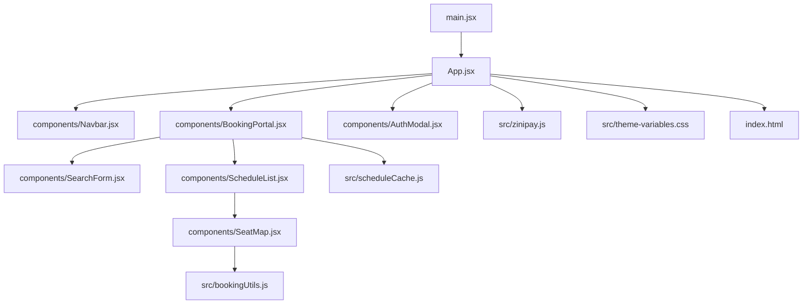
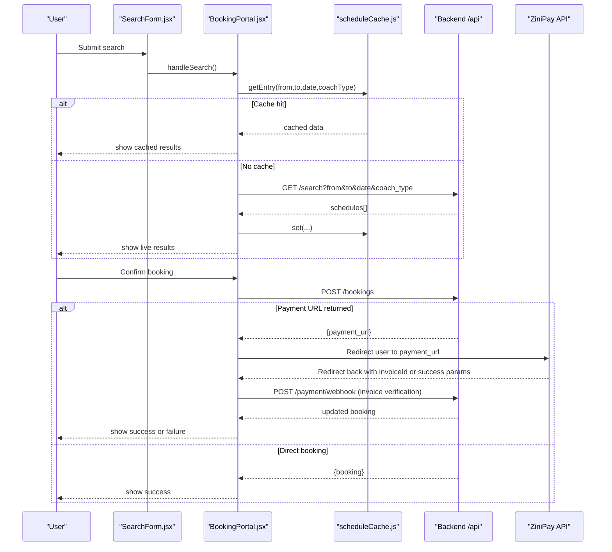
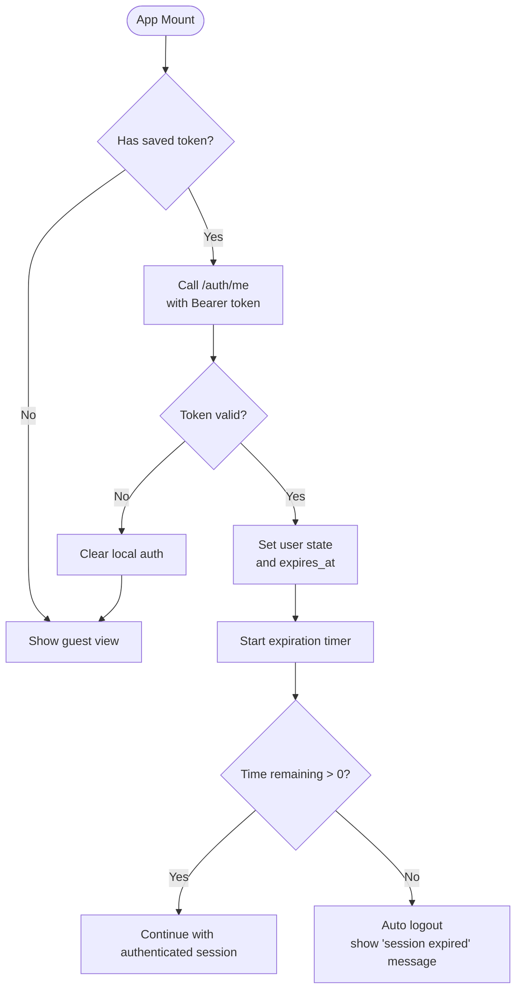
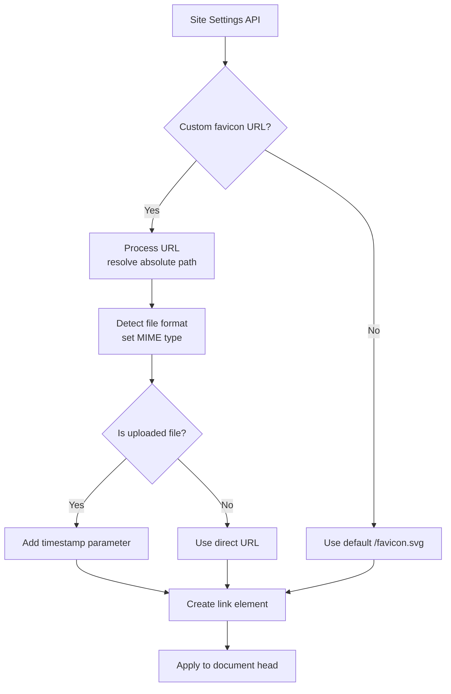
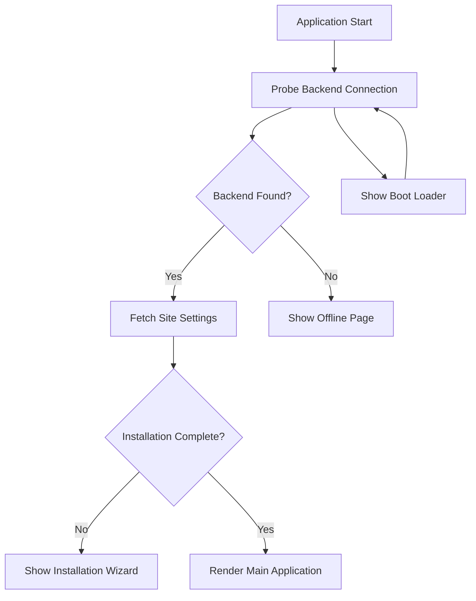
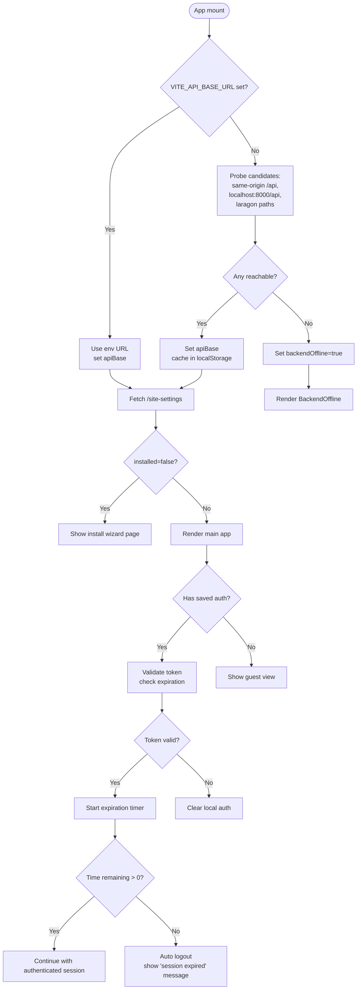
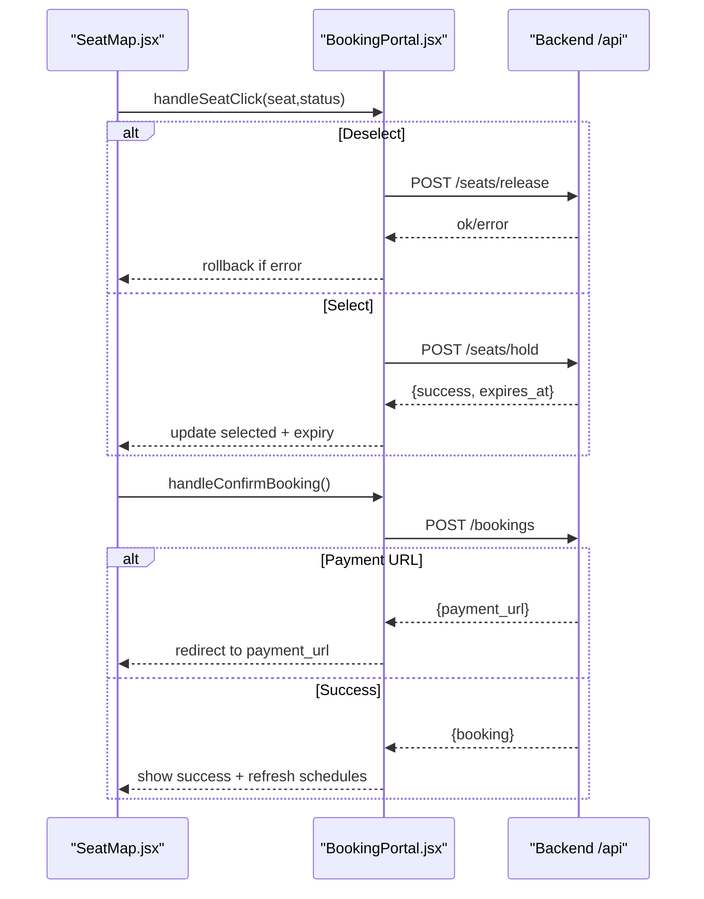
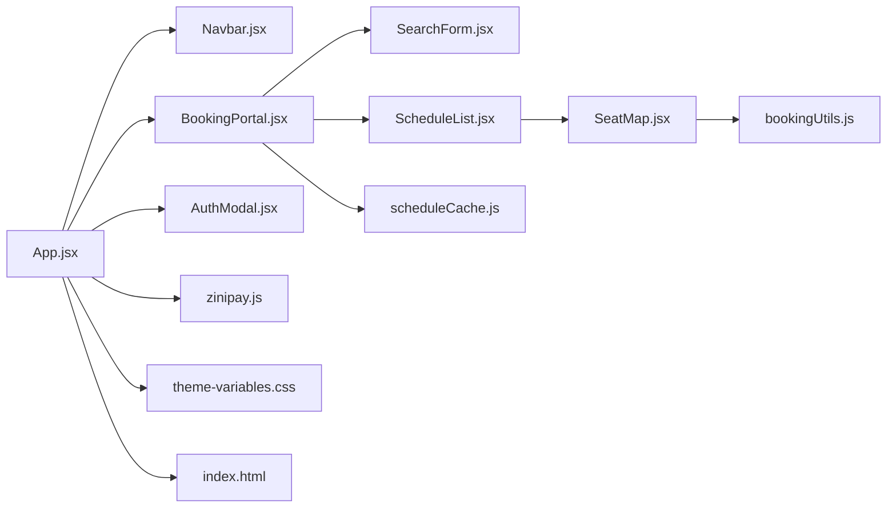

# Frontend Architecture

<cite>
**Referenced Files in This Document**
- [package.json](file://frontend/package.json)
- [vite.config.js](file://frontend/vite.config.js)
- [main.jsx](file://frontend/src/main.jsx)
- [App.jsx](file://frontend/src/App.jsx)
- [index.html](file://frontend/index.html)
- [theme-variables.css](file://frontend/src/theme-variables.css)
- [Navbar.jsx](file://frontend/src/components/Navbar.jsx)
- [BookingPortal.jsx](file://frontend/src/components/BookingPortal.jsx)
- [SearchForm.jsx](file://frontend/src/components/SearchForm.jsx)
- [ScheduleList.jsx](file://frontend/src/components/ScheduleList.jsx)
- [SeatMap.jsx](file://frontend/src/components/SeatMap.jsx)
- [AuthModal.jsx](file://frontend/src/components/AuthModal.jsx)
- [scheduleCache.js](file://frontend/src/scheduleCache.js)
- [bookingUtils.js](file://frontend/src/bookingUtils.js)
- [zinipay.js](file://frontend/src/zinipay.js)
</cite>

## Update Summary
**Changes Made**
- Updated favicon system integration documentation to reflect enhanced dynamic favicon management and backend-driven branding
- Enhanced loading state management section with improved boot loader implementation and silent ring animation
- Updated brand references from SonyaBus to JourneyGo throughout component documentation
- Added comprehensive favicon handling details including MIME type detection, cache busting for uploaded files, and fallback mechanisms
- Updated theme system documentation to reflect the new data-theme attribute approach and dark/light mode support

## Table of Contents
1. [Introduction](#introduction)
2. [Project Structure](#project-structure)
3. [Core Components](#core-components)
4. [Architecture Overview](#architecture-overview)
5. [Authentication and Token Management](#authentication-and-token-management)
6. [Favicon and Branding System](#favicon-and-branding-system)
7. [Loading State Management](#loading-state-management)
8. [Detailed Component Analysis](#detailed-component-analysis)
9. [Dependency Analysis](#dependency-analysis)
10. [Performance Considerations](#performance-considerations)
11. [Security Considerations](#security-considerations)
12. [Troubleshooting Guide](#troubleshooting-guide)
13. [Conclusion](#conclusion)

## Introduction
This document explains the React 19 frontend architecture for the JourneyGo bus booking application. It covers component organization, state management patterns, API communication using native fetch with environment-driven backend discovery, routing via tab-based navigation, UI composition, build configuration with Vite, asset handling, responsive design, accessibility considerations, and performance techniques such as in-memory caching and optimistic UI updates. The frontend implements comprehensive authentication with token expiration handling, enhanced favicon system integration, and improved loading state management.

## Project Structure
The frontend is a Vite + React 19 application. The entry point mounts the root App component under StrictMode. Application logic is organized into:
- Root orchestration and global state (App.jsx)
- Feature components (BookingPortal, SearchForm, ScheduleList, SeatMap, AuthModal, Navbar)
- Utilities (bookingUtils.js)
- Payment integration (zinipay.js)
- In-memory schedule cache (scheduleCache.js)
- Build configuration (vite.config.js) and package metadata (package.json)
- Theme variables and styling (theme-variables.css)

**Diagram sources**
- [main.jsx:1-12](file://frontend/src/main.jsx#L1-L12)
- [App.jsx:1-861](file://frontend/src/App.jsx#L1-L861)
- [index.html:1-23](file://frontend/index.html#L1-L23)
- [theme-variables.css:1-153](file://frontend/src/theme-variables.css#L1-L153)

**Section sources**
- [main.jsx:1-12](file://frontend/src/main.jsx#L1-L12)
- [package.json:1-28](file://frontend/package.json#L1-L28)

## Core Components
- App.jsx: Orchestrates global state (auth, site settings, toast, active tab), resolves backend base URL, renders layout and feature views, handles payment redirections, and manages dynamic favicon and SEO meta tags. Implements comprehensive token expiration handling.
- BookingPortal.jsx: Implements search flow, seat selection, promo validation, and booking submission. Integrates with schedule cache and live seat map refresh.
- SearchForm.jsx: Presents station/date/coach filters and triggers search.
- ScheduleList.jsx: Renders available schedules and expands to SeatMap for selected routes.
- SeatMap.jsx: Visualizes bus layouts, manages seat selection UI, pricing breakdown, boarding/dropping points, and booking form fields.
- AuthModal.jsx: Modal for login/register/forgot/reset flows; delegates authentication to App.jsx.
- Navbar.jsx: Navigation tabs, logo rendering from site settings (image or text fallback), and auth actions. Now displays "JourneyGo" branding.
- zinipay.js: Handles ZiniPay create/verify and redirect processing.
- scheduleCache.js: In-memory TTL-based cache for search results.
- bookingUtils.js: Shared helpers for seat mapping, status labels, and pricing calculations.

**Section sources**
- [App.jsx:1-861](file://frontend/src/App.jsx#L1-L861)
- [BookingPortal.jsx:1-654](file://frontend/src/components/BookingPortal.jsx#L1-L654)
- [SearchForm.jsx:1-109](file://frontend/src/components/SearchForm.jsx#L1-L109)
- [ScheduleList.jsx:1-225](file://frontend/src/components/ScheduleList.jsx#L1-L225)
- [SeatMap.jsx:1-612](file://frontend/src/components/SeatMap.jsx#L1-L612)
- [AuthModal.jsx:1-165](file://frontend/src/components/AuthModal.jsx#L1-L165)
- [Navbar.jsx:1-149](file://frontend/src/components/Navbar.jsx#L1-L149)
- [zinipay.js:1-179](file://frontend/src/zinipay.js#L1-L179)
- [scheduleCache.js:1-65](file://frontend/src/scheduleCache.js#L1-L65)
- [bookingUtils.js:1-173](file://frontend/src/bookingUtils.js#L1-L173)

## Architecture Overview
The frontend uses a single-page application pattern with tab-based navigation instead of a client-side router. Global state is managed at the App level and passed down via props. Backend connectivity is resolved at runtime through environment variables and probing heuristics. API calls use the Fetch API with JSON payloads and Bearer tokens where required. The system implements comprehensive token expiration handling with automatic logout when sessions expire, enhanced favicon system integration, and improved loading state management.

**Diagram sources**
- [SearchForm.jsx:1-109](file://frontend/src/components/SearchForm.jsx#L1-L109)
- [BookingPortal.jsx:1-654](file://frontend/src/components/BookingPortal.jsx#L1-L654)
- [scheduleCache.js:1-65](file://frontend/src/scheduleCache.js#L1-L65)
- [zinipay.js:1-179](file://frontend/src/zinipay.js#L1-L179)

## Authentication and Token Management

### Current Implementation
The frontend implements comprehensive authentication with token expiration handling:

**Token Storage and Lifecycle:**
- Tokens are stored in localStorage with corresponding expiration timestamps
- Automatic token validation on app startup by calling `/auth/me` endpoint
- Session timers automatically log out users when their configured lifetime expires
- Support for both expiring and non-expiring tokens (when admin sets lifetime to 0)

**Key Features:**
- **Automatic Expiration Handling**: Users are automatically logged out when their session expires
- **Graceful Degradation**: Network errors during token validation clear local auth state
- **Persistent Sessions**: User preferences and auth state persist across browser restarts
- **Configurable Lifetime**: Token lifetimes are controlled by admin settings and applied dynamically

**Diagram sources**
- [App.jsx:434-485](file://frontend/src/App.jsx#L434-L485)
- [App.jsx:164-184](file://frontend/src/App.jsx#L164-L184)

**Section sources**
- [App.jsx:164-184](file://frontend/src/App.jsx#L164-L184)
- [App.jsx:434-485](file://frontend/src/App.jsx#L434-L485)

## Favicon and Branding System

### Enhanced Favicon Integration
The frontend now features a sophisticated favicon system that dynamically manages browser icons based on backend site settings:

**Dynamic Favicon Management:**
- **Backend-Driven Configuration**: Favicon URLs are fetched from the `/site-settings` endpoint and applied dynamically
- **MIME Type Detection**: Automatic detection of favicon formats (SVG, ICO, PNG, JPG, GIF, WebP) with appropriate content types
- **Cache Busting**: Uploaded files receive timestamp parameters to prevent browser caching issues
- **Fallback Mechanism**: Falls back to default `/favicon.svg` when no custom favicon is configured
- **Document Head Management**: Dynamically creates and removes link elements to update favicons without page reload

**Brand Updates:**
- **JourneyGo Branding**: All hardcoded references have been updated from "SonyaBus" to "JourneyGo"
- **Logo System**: Supports both image logos and text-based logos with customizable branding
- **Theme Integration**: Uses CSS custom properties for consistent theming across light and dark modes

**Diagram sources**
- [App.jsx:487-558](file://frontend/src/App.jsx#L487-L558)
- [index.html:13](file://frontend/index.html#L13)

**Section sources**
- [App.jsx:487-558](file://frontend/src/App.jsx#L487-L558)
- [index.html:13](file://frontend/index.html#L13)
- [Navbar.jsx:23-27](file://frontend/src/components/Navbar.jsx#L23-L27)

## Loading State Management

### Improved Boot Loader
The frontend now features an enhanced loading state system with a sophisticated boot loader:

**Silent Ring Animation:**
- **Visual Design**: Elegant circular spinner with gradient colors (indigo to cyan)
- **Responsive Behavior**: Respects `prefers-reduced-motion` for accessibility
- **CSS Variables**: Uses theme-aware color variables for consistent appearance
- **Minimal Footprint**: Lightweight implementation with inline styles for fast rendering

**Boot Sequence Management:**
- **Backend Probing Phase**: Shows loader while determining API base URL
- **Installation Check**: Displays specific messaging when installation wizard is incomplete
- **Error States**: Provides clear feedback for backend connectivity issues
- **Smooth Transitions**: Seamless switching between different loading states

**Diagram sources**
- [App.jsx:584-619](file://frontend/src/App.jsx#L584-L619)
- [App.jsx:340-389](file://frontend/src/App.jsx#L340-L389)

**Section sources**
- [App.jsx:584-619](file://frontend/src/App.jsx#L584-L619)
- [App.jsx:340-389](file://frontend/src/App.jsx#L340-L389)

## Detailed Component Analysis

### App.jsx — Global Orchestration and State
Responsibilities:
- Resolve backend base URL using explicit env variable or candidate probing.
- Manage auth state (user/token), site settings, toast notifications, and active tab.
- Render layout and route-like views based on activeTab.
- Handle ZiniPay redirect verification and error states.
- Implement comprehensive token expiration handling with automatic logout.
- **Enhanced**: Dynamic favicon management and SEO meta tag updates.
- **Enhanced**: Improved loading state management with boot loader.

Key implementation highlights:
- Candidate list includes explicit env, same-origin /api, common local URLs, and Laragon-style subdirectory paths.
- Probing uses HEAD/GET against /site-settings with timeout and CORS-safe headers.
- Site settings are polled periodically to reflect branding changes.
- **Updated**: Dynamic document title, favicon, and SEO meta tags are applied from site settings with enhanced favicon handling.
- **Updated**: Silent boot loader with ring animation during backend probing phase.

**Diagram sources**
- [App.jsx:23-92](file://frontend/src/App.jsx#L23-L92)
- [App.jsx:329-378](file://frontend/src/App.jsx#L329-L378)
- [App.jsx:429-500](file://frontend/src/App.jsx#L429-L500)
- [App.jsx:502-524](file://frontend/src/App.jsx#L502-L524)
- [App.jsx:565-689](file://frontend/src/App.jsx#L565-L689)
- [App.jsx:434-485](file://frontend/src/App.jsx#L434-L485)

**Section sources**
- [App.jsx:1-861](file://frontend/src/App.jsx#L1-L861)

### BookingPortal.jsx — Search, Seats, Promo, Booking
Responsibilities:
- Load stations, manage search parameters, and call /search.
- Integrate scheduleCache for fast repeated queries.
- Manage seat holds/releases, expiration timers, and optimistic UI.
- Validate passenger details, apply promo codes, and submit bookings.
- Handle payment redirects and background schedule refresh after booking.

Key implementation highlights:
- Optimistic seat selection with placeholder expiry; server response patches real expiry.
- Periodic polling refreshes seat map every 5 seconds while a schedule is expanded.
- Beforeunload handler releases held seats if the user navigates away.
- Promo code validation calls /promotions/check and updates UI accordingly.

**Diagram sources**
- [BookingPortal.jsx:209-289](file://frontend/src/components/BookingPortal.jsx#L209-L289)
- [BookingPortal.jsx:469-575](file://frontend/src/components/BookingPortal.jsx#L469-L575)

**Section sources**
- [BookingPortal.jsx:1-654](file://frontend/src/components/BookingPortal.jsx#L1-L654)

### SearchForm.jsx — Search Inputs
Responsibilities:
- Provide From/To station selects, date picker, coach type filter.
- Trigger search via parent-provided handler.

Accessibility:
- Uses labeled inputs and semantic form structure.

**Section sources**
- [SearchForm.jsx:1-109](file://frontend/src/components/SearchForm.jsx#L1-L109)

### ScheduleList.jsx — Results and Expansion
Responsibilities:
- Display search results with operator, times, duration, availability, and price.
- Expand/collapse SeatMap per schedule.
- Indicate cache vs live status and allow manual refresh.

**Section sources**
- [ScheduleList.jsx:1-225](file://frontend/src/components/ScheduleList.jsx#L1-L225)

### SeatMap.jsx — Bus Layout and Booking Form
Responsibilities:
- Generate seat grids for multiple layouts (2+2, 1+2, sleeper, 2+2_last5).
- Render seat cells with statuses and tooltips.
- Present boarding/dropping points, passenger info, payment method toggle, promo input, and fare breakdown.

Utilities used:
- bookingUtils.js for seat mapping, status labels, and pricing calculation.

**Section sources**
- [SeatMap.jsx:1-612](file://frontend/src/components/SeatMap.jsx#L1-L612)
- [bookingUtils.js:1-173](file://frontend/src/bookingUtils.js#L1-L173)

### AuthModal.jsx — Authentication UI
Responsibilities:
- Modal UI for login, register, forgot password, and reset password flows.
- Delegates actual requests to App.jsx handlers.

**Section sources**
- [AuthModal.jsx:1-165](file://frontend/src/components/AuthModal.jsx#L1-L165)

### Navbar.jsx — Navigation and Branding
Responsibilities:
- Tab navigation (home, my tickets, offers, profile).
- Logo rendering from site settings (image or text fallback).
- Auth buttons and logout action.
- **Updated**: Displays "JourneyGo" branding with enhanced logo handling.

**Section sources**
- [Navbar.jsx:1-149](file://frontend/src/components/Navbar.jsx#L1-L149)

### zinipay.js — Payment Integration
Responsibilities:
- Create payment request to ZiniPay API.
- Verify payment by invoice ID.
- Handle redirect parameters to update verification status or display success/failure.

Security note:
- Requires VITE_ZINIPAY_API_KEY environment variable.

**Section sources**
- [zinipay.js:1-179](file://frontend/src/zinipay.js#L1-L179)

### scheduleCache.js — In-Memory Cache
Responsibilities:
- Store search results keyed by from/to/date/coachType with TTL.
- Expose methods to get/set/invalidate/clear.
- Debug exposure in development via window.__scheduleCache.

Complexity:
- O(1) average time for get/set operations; TTL check is constant-time.

**Section sources**
- [scheduleCache.js:1-65](file://frontend/src/scheduleCache.js#L1-L65)

### bookingUtils.js — Shared Helpers
Responsibilities:
- Seat status labels and selection rules.
- Currency formatting.
- Pricing computation including service/gateway charges and discounts.
- Seat map generation from schedule data and bus layout.

**Section sources**
- [bookingUtils.js:1-173](file://frontend/src/bookingUtils.js#L1-L173)

## Dependency Analysis
Component relationships and imports:

**Diagram sources**
- [App.jsx:1-861](file://frontend/src/App.jsx#L1-L861)
- [BookingPortal.jsx:1-654](file://frontend/src/components/BookingPortal.jsx#L1-L654)
- [SearchForm.jsx:1-109](file://frontend/src/components/SearchForm.jsx#L1-L109)
- [ScheduleList.jsx:1-225](file://frontend/src/components/ScheduleList.jsx#L1-L225)
- [SeatMap.jsx:1-612](file://frontend/src/components/SeatMap.jsx#L1-L612)
- [scheduleCache.js:1-65](file://frontend/src/scheduleCache.js#L1-L65)
- [bookingUtils.js:1-173](file://frontend/src/bookingUtils.js#L1-L173)
- [zinipay.js:1-179](file://frontend/src/zinipay.js#L1-L179)
- [theme-variables.css:1-153](file://frontend/src/theme-variables.css#L1-L153)
- [index.html:1-23](file://frontend/index.html#L1-L23)

**Section sources**
- [App.jsx:1-861](file://frontend/src/App.jsx#L1-L861)
- [BookingPortal.jsx:1-654](file://frontend/src/components/BookingPortal.jsx#L1-L654)
- [ScheduleList.jsx:1-225](file://frontend/src/components/ScheduleList.jsx#L1-L225)
- [SeatMap.jsx:1-612](file://frontend/src/components/SeatMap.jsx#L1-L612)
- [scheduleCache.js:1-65](file://frontend/src/scheduleCache.js#L1-L65)
- [bookingUtils.js:1-173](file://frontend/src/bookingUtils.js#L1-L173)
- [zinipay.js:1-179](file://frontend/src/zinipay.js#L1-L179)
- [theme-variables.css:1-153](file://frontend/src/theme-variables.css#L1-L153)
- [index.html:1-23](file://frontend/index.html#L1-L23)

## Performance Considerations
- In-memory schedule cache: Reduces redundant network calls for identical searches within TTL window.
- Optimistic UI for seat selection: Improves perceived responsiveness; rollbacks occur on errors.
- Live seat map polling: Refreshes every 5 seconds only when a schedule is expanded to limit overhead.
- Vite dev proxy: Centralizes backend endpoints (/api, /uploads) and provides fallback routes for local environments.
- Environment-driven API base: Avoids hardcoding and reduces misconfiguration latency.
- **Enhanced**: Efficient token validation with minimal network calls and automatic cleanup of expired sessions.
- **Enhanced**: Dynamic favicon updates without page reloads reduce unnecessary reflows.
- **Enhanced**: Lightweight boot loader with CSS animations for better perceived performance.

Recommendations:
- Consider lazy loading heavy components (e.g., SeatMap) with dynamic imports when not visible.
- Debounce search submissions and throttle polling intervals based on user activity.
- Use HTTP caching headers on backend for /search to leverage browser cache.
- Consider implementing axios interceptors for centralized error handling and token refresh logic.
- Monitor favicon load performance and consider preloading critical brand assets.

## Security Considerations

### Token Security
- **Secure Storage**: Authentication tokens are stored in localStorage with expiration timestamps
- **Automatic Cleanup**: Expired tokens are automatically cleared from storage
- **Network Security**: All API calls use HTTPS when configured and include proper CORS headers
- **Session Validation**: Server-side token validation prevents unauthorized access

### Authentication Flow Security
- **Password Protection**: Passwords are never stored locally or transmitted in plain text
- **CSRF Protection**: API endpoints implement CSRF protection mechanisms
- **Rate Limiting**: Authentication endpoints should implement rate limiting to prevent brute force attacks
- **Session Timeout**: Configurable session timeouts prevent long-lived unauthorized access

### Favicon Security
- **MIME Type Validation**: Only trusted favicon formats are accepted (SVG, ICO, PNG, JPG, GIF, WebP)
- **URL Sanitization**: Favicon URLs are validated and sanitized before being applied to document head
- **CORS Compliance**: External favicon URLs respect CORS policies and origin restrictions

### Future Admin API Security
When implementing admin API integration, consider:
- **Role-Based Access Control**: Separate authentication flows for admin and customer users
- **Enhanced Token Security**: Shorter token lifetimes for admin sessions
- **Audit Logging**: Track admin actions for security monitoring
- **IP Whitelisting**: Restrict admin access to specific IP ranges in production

**Section sources**
- [App.jsx:156-184](file://frontend/src/App.jsx#L156-L184)
- [App.jsx:434-485](file://frontend/src/App.jsx#L434-L485)
- [App.jsx:487-558](file://frontend/src/App.jsx#L487-L558)

## Troubleshooting Guide
Common issues and resolutions:
- Backend unreachable:
  - Ensure VITE_API_BASE_URL is set correctly or start the Laravel backend.
  - Use retry button to re-probe candidates.
- Installation not complete:
  - Complete the backend install wizard before accessing customer/admin routes.
- ZiniPay verification failures:
  - Verify VITE_ZINIPAY_API_KEY is configured.
  - Check redirect parameters and webhook endpoint responses.
- Seat hold expired:
  - Re-select seats; holds have limited lifetimes enforced by the backend.
- **New**: Authentication session expired:
  - Users are automatically logged out when their configured session lifetime expires
  - Check admin session settings if sessions expire too quickly
  - Verify network connectivity for token validation calls
- **New**: Token validation failures:
  - Clear browser storage and log in again
  - Check if admin has changed session lifetime settings
  - Verify backend API is responding to /auth/me endpoint
- **New**: Favicon not displaying:
  - Check if custom favicon URL is accessible and properly formatted
  - Verify MIME type detection is working correctly
  - Clear browser cache if uploaded favicon isn't updating
- **New**: Boot loader stuck:
  - Check backend connectivity and API base URL resolution
  - Verify site settings endpoint is responding
  - Check browser console for network errors

Operational checks:
- Confirm Vite dev server proxies /api and /uploads.
- Validate CORS and credentials behavior for cross-origin setups.
- Monitor browser console for authentication-related errors.
- Check localStorage for proper token and expiration timestamp storage.
- Verify favicon URL resolution and MIME type detection.
- Test boot loader transitions between different states.

**Section sources**
- [App.jsx:502-524](file://frontend/src/App.jsx#L502-L524)
- [App.jsx:565-689](file://frontend/src/App.jsx#L565-L689)
- [App.jsx:487-558](file://frontend/src/App.jsx#L487-L558)
- [App.jsx:584-619](file://frontend/src/App.jsx#L584-L619)
- [zinipay.js:64-179](file://frontend/src/zinipay.js#L64-L179)
- [vite.config.js:1-74](file://frontend/vite.config.js#L1-L74)

## Conclusion
The frontend follows a clear component-based architecture with strong separation of concerns: App orchestrates global state and routing-like behavior, BookingPortal drives the core booking workflow, and supporting components render specialized UI. State is primarily local with shared context passed via props, and API communication uses Fetch with robust backend discovery and error handling. Vite config simplifies development with proxying and environment variables. Performance is addressed through in-memory caching, optimistic UI, and targeted polling. 

**Enhanced**: The system now includes comprehensive authentication with automatic token expiration handling, enhanced favicon system integration with dynamic branding support, and improved loading state management with sophisticated boot loader functionality. The architecture is well-positioned for future admin API integration, with existing authentication infrastructure that can be extended to support administrative functionality. Responsive design and accessibility are supported through semantic HTML, labeled inputs, CSS variables, and theme-aware styling. The JourneyGo branding has been consistently applied throughout all components, providing a cohesive user experience.