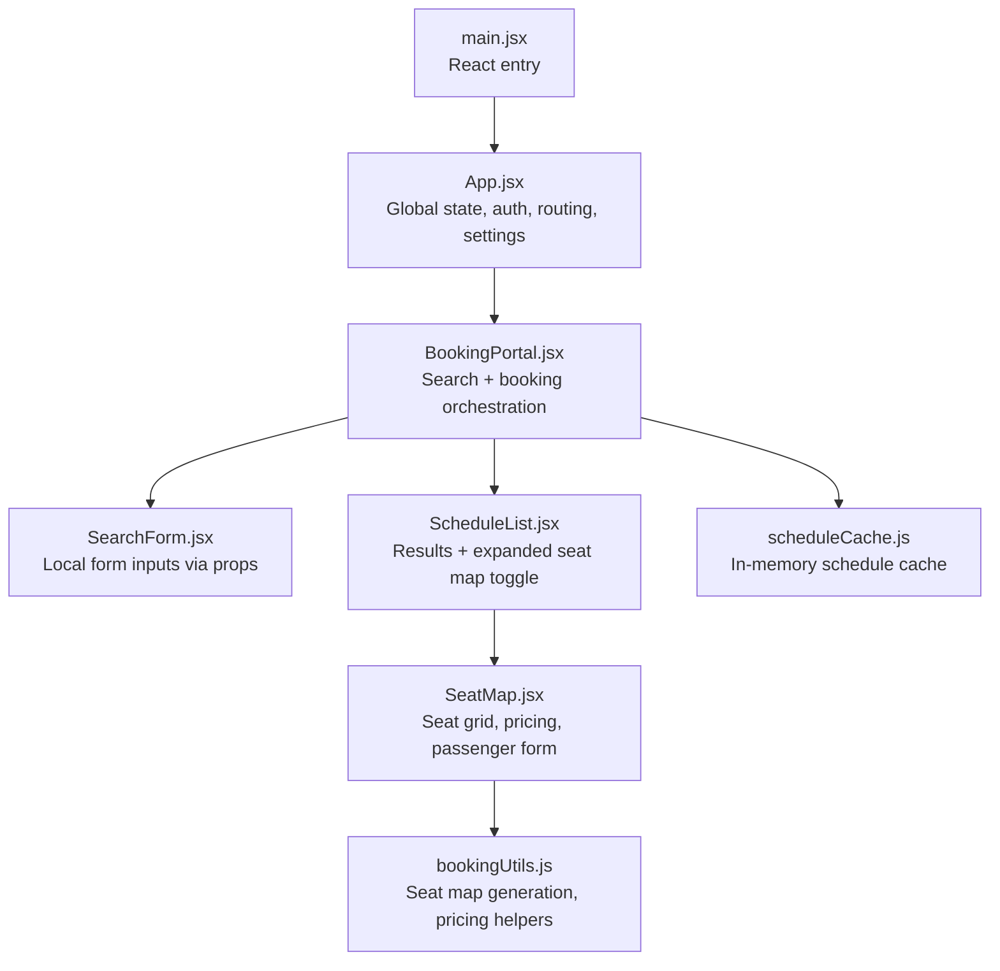
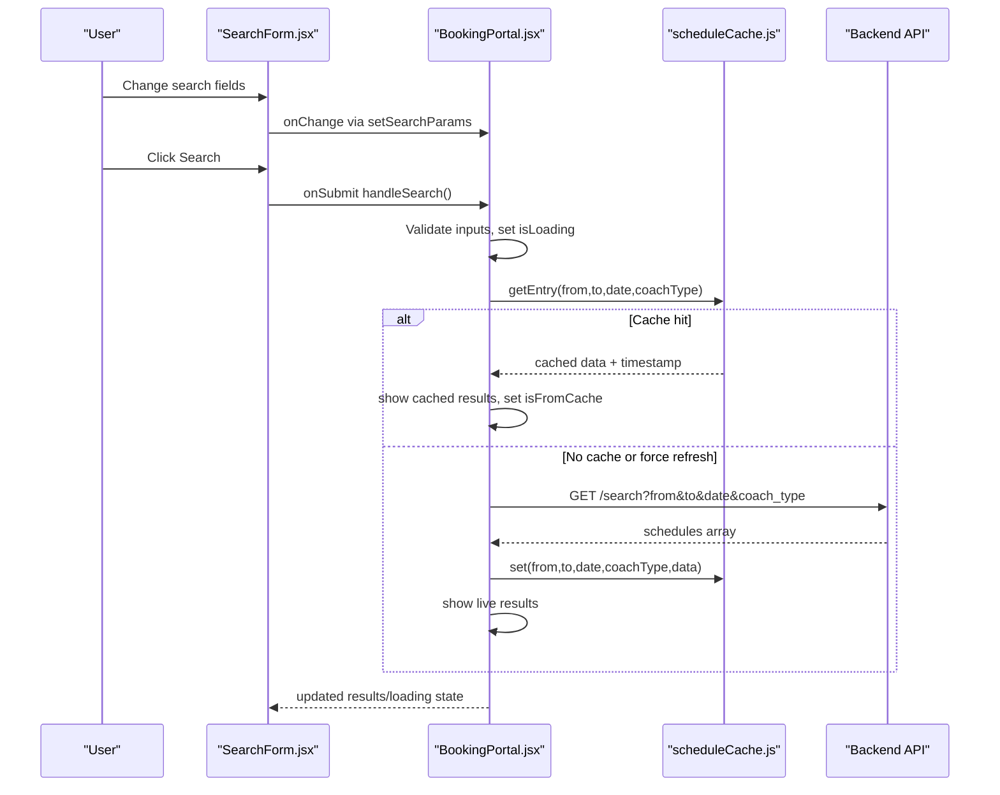
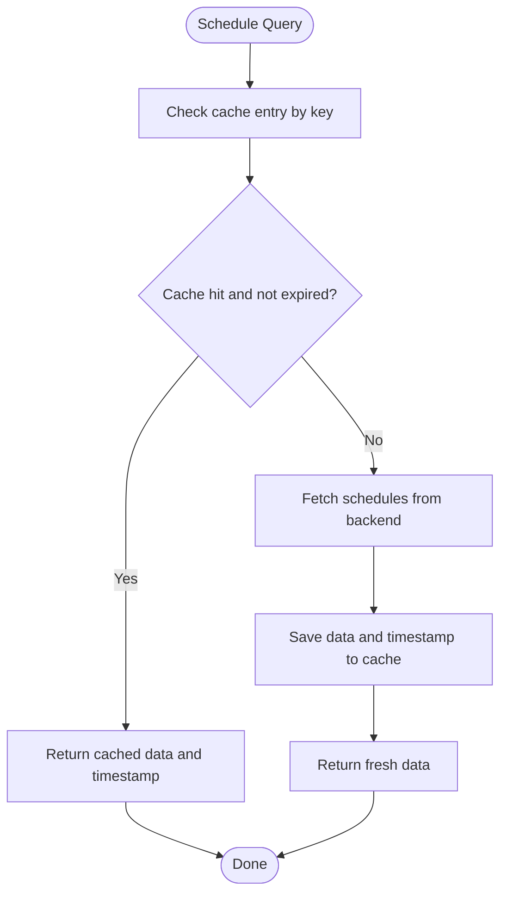
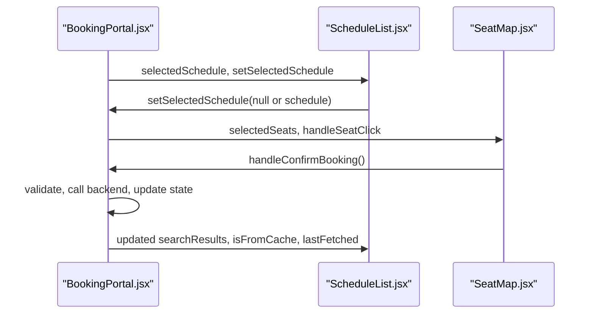
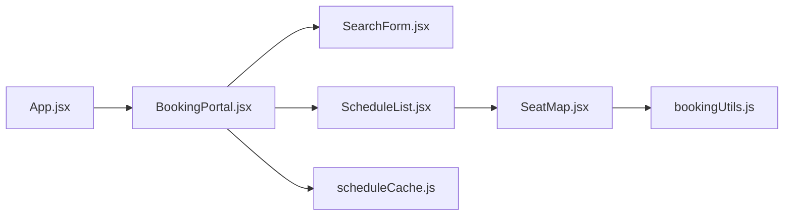

# State Management

<cite>
**Referenced Files in This Document**
- [App.jsx](file://frontend/src/App.jsx)
- [main.jsx](file://frontend/src/main.jsx)
- [BookingPortal.jsx](file://frontend/src/components/BookingPortal.jsx)
- [SearchForm.jsx](file://frontend/src/components/SearchForm.jsx)
- [ScheduleList.jsx](file://frontend/src/components/ScheduleList.jsx)
- [SeatMap.jsx](file://frontend/src/components/SeatMap.jsx)
- [scheduleCache.js](file://frontend/src/scheduleCache.js)
- [bookingUtils.js](file://frontend/src/bookingUtils.js)
</cite>

## Table of Contents
1. [Introduction](#introduction)
2. [Project Structure](#project-structure)
3. [Core Components](#core-components)
4. [Architecture Overview](#architecture-overview)
5. [Detailed Component Analysis](#detailed-component-analysis)
6. [Dependency Analysis](#dependency-analysis)
7. [Performance Considerations](#performance-considerations)
8. [Troubleshooting Guide](#troubleshooting-guide)
9. [Conclusion](#conclusion)

## Introduction
This document explains the frontend state management approach used by the booking application. The system primarily uses:
- Local component state with React hooks for UI and workflow state.
- Props drilling to share selected search parameters, results, and booking data across sibling components.
- A module-level schedule cache for optimizing repeated API calls.
- Application-level state in the root component for authentication, site settings, navigation, and global notifications.

There is no global context provider or external state library in the analyzed files. Instead, shared state is passed down through props from the top-level application component into the booking portal and its child components.

## Project Structure
The relevant frontend source code lives under `frontend/src`. The key state-related files are:
- Root application shell and global state: `App.jsx`
- Booking flow container: `components/BookingPortal.jsx`
- Search form and result list: `components/SearchForm.jsx`, `components/ScheduleList.jsx`
- Seat selection and booking form: `components/SeatMap.jsx`
- Schedule query cache: `scheduleCache.js`
- Booking utilities: `bookingUtils.js`
- App entry point: `main.jsx`

**Diagram sources**
- [main.jsx:1-12](file://frontend/src/main.jsx#L1-L12)
- [App.jsx:94-800](file://frontend/src/App.jsx#L94-L800)
- [BookingPortal.jsx:1-654](file://frontend/src/components/BookingPortal.jsx#L1-L654)
- [SearchForm.jsx:1-109](file://frontend/src/components/SearchForm.jsx#L1-L109)
- [ScheduleList.jsx:1-225](file://frontend/src/components/ScheduleList.jsx#L1-L225)
- [SeatMap.jsx:1-612](file://frontend/src/components/SeatMap.jsx#L1-L612)
- [scheduleCache.js:1-65](file://frontend/src/scheduleCache.js#L1-L65)
- [bookingUtils.js:1-173](file://frontend/src/bookingUtils.js#L1-L173)

**Section sources**
- [main.jsx:1-12](file://frontend/src/main.jsx#L1-L12)
- [App.jsx:94-800](file://frontend/src/App.jsx#L94-L800)

## Core Components
The core state management pattern is a combination of local state and props-based sharing:

- **Root application (`App.jsx`)**
  - Holds global UI state such as active tab, toast notifications, booking success, verification status, payment failure, backend offline state, installation status, resolved API base URL, and probing state.
  - Manages authentication state and persistence using `localStorage`.
  - Probes and caches the working API base URL.
  - Fetches site settings and applies dynamic document metadata.
  - Passes shared callbacks like `showToast`, `openAuthModal`, and `clearAuth` down to child components.

- **Booking portal (`BookingPortal.jsx`)**
  - Owns the main booking workflow state: search parameters, search results, loading flags, cache indicators, selected schedule, selected seats, seat expiration times, promo input, applied promo, passenger details, boarding/dropping points, passenger gender, seat map last sync time, and booking processing flag.
  - Coordinates API calls for stations, search, seat hold/release, promotions, and bookings.
  - Uses the module-level schedule cache to avoid redundant searches.
  - Polls for live seat availability updates when a schedule is selected.
  - Renders `SearchForm`, `ScheduleList`, and other UI sections while passing state and handlers down.

- **Search form (`SearchForm.jsx`)**
  - Pure presentational component that renders station selectors, date picker, coach type selector, and search button.
  - Updates parent-provided `searchParams` via `setSearchParams`.
  - Disables submission while the parent reports loading.

- **Schedule list (`ScheduleList.jsx`)**
  - Displays search results and toggles the expanded seat map view per schedule.
  - Shows cache/live status and refresh control.
  - Delegates seat interaction to the parent’s `handleSeatClick`.
  - Passes booking-related props down to `SeatMap`.

- **Seat map (`SeatMap.jsx`)**
  - Renders the bus seat layout based on configuration or generated defaults.
  - Computes pricing and displays fare breakdown.
  - Manages local tick timer for countdown visuals.
  - Handles passenger details, boarding/dropping points, promo input, and confirmation callback.

- **Schedule cache (`scheduleCache.js`)**
  - Provides an in-memory cache keyed by search parameters.
  - Stores both data and timestamp, supports TTL-based invalidation, single-key invalidation, and full cache clearing.
  - Exposes a singleton instance for use across modules.

- **Booking utilities (`bookingUtils.js`)**
  - Provides constants, seat status helpers, formatting helpers, pricing calculator, and seat map generator.
  - Used by `SeatMap` and related logic to derive seat grids and pricing.

**Section sources**
- [App.jsx:94-800](file://frontend/src/App.jsx#L94-L800)
- [BookingPortal.jsx:1-654](file://frontend/src/components/BookingPortal.jsx#L1-L654)
- [SearchForm.jsx:1-109](file://frontend/src/components/SearchForm.jsx#L1-L109)
- [ScheduleList.jsx:1-225](file://frontend/src/components/ScheduleList.jsx#L1-L225)
- [SeatMap.jsx:1-612](file://frontend/src/components/SeatMap.jsx#L1-L612)
- [scheduleCache.js:1-65](file://frontend/src/scheduleCache.js#L1-L65)
- [bookingUtils.js:1-173](file://frontend/src/bookingUtils.js#L1-L173)

## Architecture Overview
The application follows a unidirectional data flow:
- User interactions update local state in the component where they occur.
- Parent components lift necessary state up and pass it down as props.
- Side effects (API calls, timers, polling) are handled in `useEffect` hooks within the owning component.
- Global concerns like authentication, site settings, and toast notifications are centralized in `App.jsx`.
- Repeated schedule queries are optimized through the module-level cache.

**Diagram sources**
- [SearchForm.jsx:1-109](file://frontend/src/components/SearchForm.jsx#L1-L109)
- [BookingPortal.jsx:291-380](file://frontend/src/components/BookingPortal.jsx#L291-L380)
- [scheduleCache.js:1-65](file://frontend/src/scheduleCache.js#L1-L65)

## Detailed Component Analysis

### Local Component State with useState Hooks
Most components manage their own local state:
- `SearchForm.jsx` receives controlled inputs from parent state and updates them through `setSearchParams`.
- `ScheduleList.jsx` manages a seconds-ago counter for cache freshness display.
- `SeatMap.jsx` maintains a tick interval for countdown visuals and computes derived values from props.
- `BookingPortal.jsx` owns the bulk of workflow state, including search parameters, results, selection state, passenger details, promo state, and booking lifecycle flags.

Examples of state synchronization between components:
- `SearchForm.jsx` updates `searchParams` in `BookingPortal.jsx` via `setSearchParams`.
- `ScheduleList.jsx` toggles `selectedSchedule` and clears `selectedSeats` through props provided by `BookingPortal.jsx`.
- `SeatMap.jsx` receives `selectedSeats`, `passengerDetails`, `boardingPoint`, `droppingPoint`, and `appliedPromo` from `BookingPortal.jsx` and triggers callbacks like `handleConfirmBooking`.

Error state handling patterns:
- Validation errors are shown via `showToast` with error type before making API calls.
- Network failures during station fetching, search, promo validation, and booking are caught and surfaced through toast messages.
- Authentication failures redirect to login modal and clear persisted auth state.

Loading states management:
- `isLoading` disables the search submit button and prevents duplicate submissions.
- `isBooking` disables the booking submit button and shows a processing label.
- `probingBackend` in `App.jsx` shows a connecting screen until the API base is resolved.
- `backendOffline` and `installNotComplete` switch the app into dedicated offline/install screens.

State persistence strategies:
- Authentication user and token are persisted in `localStorage` and restored on app start.
- Resolved API base URL is cached in `localStorage` to speed up subsequent visits.
- Schedule search results are cached in memory via `scheduleCache.js` for the current page session.

Data flow patterns:
- Top-down props flow from `App.jsx` → `BookingPortal.jsx` → `ScheduleList.jsx` → `SeatMap.jsx`.
- Callbacks bubble events upward: seat clicks, promo application, and booking confirmation are handled in `BookingPortal.jsx`.
- Side effects are isolated in `useEffect` hooks for polling, expiration checks, and cleanup.

**Section sources**
- [SearchForm.jsx:1-109](file://frontend/src/components/SearchForm.jsx#L1-L109)
- [ScheduleList.jsx:1-225](file://frontend/src/components/ScheduleList.jsx#L1-L225)
- [SeatMap.jsx:1-612](file://frontend/src/components/SeatMap.jsx#L1-L612)
- [BookingPortal.jsx:1-654](file://frontend/src/components/BookingPortal.jsx#L1-L654)
- [App.jsx:94-800](file://frontend/src/App.jsx#L94-L800)

### Schedule Caching Mechanism in scheduleCache.js
The schedule cache is a simple in-memory class with the following responsibilities:
- Key generation from search parameters: departure station, arrival station, journey date, and coach type.
- Entry retrieval with TTL check; expired entries are removed automatically.
- Data-only getter for convenience.
- Setter to store data and timestamp.
- Single-key invalidation for targeted cache busting.
- Full cache clearing utility.
- Development-only exposure of the singleton instance on the global window object for debugging.

Complexity analysis:
- Key lookup and insertion are O(1) average due to Map usage.
- TTL check is O(1).
- Clearing all entries is O(n) where n is the number of cached keys.

Optimization opportunities:
- Add configurable TTL per key or per route.
- Add size limits and least-recently-used eviction.
- Persist cache to sessionStorage or IndexedDB for cross-tab/session durability.
- Add cache statistics for monitoring hit rates.

**Diagram sources**
- [scheduleCache.js:1-65](file://frontend/src/scheduleCache.js#L1-L65)
- [BookingPortal.jsx:319-379](file://frontend/src/components/BookingPortal.jsx#L319-L379)

**Section sources**
- [scheduleCache.js:1-65](file://frontend/src/scheduleCache.js#L1-L65)
- [BookingPortal.jsx:319-379](file://frontend/src/components/BookingPortal.jsx#L319-L379)

### Booking Utilities and Shared State Patterns
`bookingUtils.js` provides reusable helpers:
- Seat row labels and status labels.
- Seat status class mapping and selection rules.
- BDT currency formatting.
- Pricing calculation considering fare, service charge, gateway charge, and discounts.
- Seat map generation supporting custom layouts, default layouts, sleeper buses, and special configurations.

Shared state patterns:
- `SeatMap.jsx` consumes these utilities to render consistent seat grids and pricing.
- `ScheduleList.jsx` and `SeatMap.jsx` rely on props from `BookingPortal.jsx` for shared selection and passenger data.
- `BookingPortal.jsx` centralizes side effects and API coordination, keeping child components focused on presentation and local interactions.

**Section sources**
- [bookingUtils.js:1-173](file://frontend/src/bookingUtils.js#L1-L173)
- [SeatMap.jsx:1-612](file://frontend/src/components/SeatMap.jsx#L1-L612)
- [ScheduleList.jsx:1-225](file://frontend/src/components/ScheduleList.jsx#L1-L225)
- [BookingPortal.jsx:1-654](file://frontend/src/components/BookingPortal.jsx#L1-L654)

### State Synchronization Between Components
Key synchronization flows:
- Search parameters are synchronized from `SearchForm.jsx` to `BookingPortal.jsx` via controlled inputs and `setSearchParams`.
- Selected schedule and seats are synchronized from `ScheduleList.jsx` to `BookingPortal.jsx` via props and callbacks.
- Passenger details, boarding/dropping points, and promo state are synchronized from `SeatMap.jsx` to `BookingPortal.jsx` via props and callbacks.
- Live seat availability is synchronized by polling the backend and updating both search results and cache.

**Diagram sources**
- [BookingPortal.jsx:38-55](file://frontend/src/components/BookingPortal.jsx#L38-L55)
- [ScheduleList.jsx:103-211](file://frontend/src/components/ScheduleList.jsx#L103-L211)
- [SeatMap.jsx:386-605](file://frontend/src/components/SeatMap.jsx#L386-L605)

**Section sources**
- [BookingPortal.jsx:38-55](file://frontend/src/components/BookingPortal.jsx#L38-L55)
- [ScheduleList.jsx:103-211](file://frontend/src/components/ScheduleList.jsx#L103-L211)
- [SeatMap.jsx:386-605](file://frontend/src/components/SeatMap.jsx#L386-L605)

### Error State Handling and Loading States
Error handling examples:
- Station fetch failure shows a toast indicating backend connectivity issues.
- Search validation errors prevent API calls and inform users.
- Promo validation errors clear applied promo and show user-friendly messages.
- Booking failures show error toasts and keep the UI responsive.
- Authentication failures trigger login modal and clear persisted auth.

Loading state examples:
- Search button disabled while `isLoading` is true.
- Booking button disabled while `isBooking` is true.
- Backend probing screen displayed while `probingBackend` is true.
- Offline/install screens displayed when backend is unreachable or installation is incomplete.

**Section sources**
- [BookingPortal.jsx:84-99](file://frontend/src/components/BookingPortal.jsx#L84-L99)
- [BookingPortal.jsx:291-380](file://frontend/src/components/BookingPortal.jsx#L291-L380)
- [BookingPortal.jsx:445-575](file://frontend/src/components/BookingPortal.jsx#L445-L575)
- [App.jsx:329-378](file://frontend/src/App.jsx#L329-L378)
- [App.jsx:502-524](file://frontend/src/App.jsx#L502-L524)
- [App.jsx:526-689](file://frontend/src/App.jsx#L526-L689)

### State Persistence Strategies
Persistence mechanisms observed:
- Auth user and token stored in `localStorage` and restored on app start.
- Resolved API base URL cached in `localStorage` to avoid repeated probing.
- In-memory schedule cache for search results within the current page session.

Recommendations for additional persistence:
- Persist last search parameters in `sessionStorage` to improve UX on reload.
- Persist selected seats temporarily if needed for recovery after unexpected navigation.
- Use IndexedDB for larger datasets or cross-tab cache sharing.

**Section sources**
- [App.jsx:161-173](file://frontend/src/App.jsx#L161-L173)
- [App.jsx:329-378](file://frontend/src/App.jsx#L329-L378)
- [scheduleCache.js:1-65](file://frontend/src/scheduleCache.js#L1-L65)

## Dependency Analysis
The dependency relationships among stateful components and utilities are straightforward:
- `App.jsx` depends on child components and exposes global state and callbacks.
- `BookingPortal.jsx` depends on `SearchForm.jsx`, `ScheduleList.jsx`, `scheduleCache.js`, and backend APIs.
- `ScheduleList.jsx` depends on `SeatMap.jsx` and props from `BookingPortal.jsx`.
- `SeatMap.jsx` depends on `bookingUtils.js` and props from `BookingPortal.jsx`.
- `SearchForm.jsx` is a presentational component depending only on props.

**Diagram sources**
- [App.jsx:94-800](file://frontend/src/App.jsx#L94-L800)
- [BookingPortal.jsx:1-654](file://frontend/src/components/BookingPortal.jsx#L1-L654)
- [SearchForm.jsx:1-109](file://frontend/src/components/SearchForm.jsx#L1-L109)
- [ScheduleList.jsx:1-225](file://frontend/src/components/ScheduleList.jsx#L1-L225)
- [SeatMap.jsx:1-612](file://frontend/src/components/SeatMap.jsx#L1-L612)
- [scheduleCache.js:1-65](file://frontend/src/scheduleCache.js#L1-L65)
- [bookingUtils.js:1-173](file://frontend/src/bookingUtils.js#L1-L173)

**Section sources**
- [App.jsx:94-800](file://frontend/src/App.jsx#L94-L800)
- [BookingPortal.jsx:1-654](file://frontend/src/components/BookingPortal.jsx#L1-L654)
- [SearchForm.jsx:1-109](file://frontend/src/components/SearchForm.jsx#L1-L109)
- [ScheduleList.jsx:1-225](file://frontend/src/components/ScheduleList.jsx#L1-L225)
- [SeatMap.jsx:1-612](file://frontend/src/components/SeatMap.jsx#L1-L612)
- [scheduleCache.js:1-65](file://frontend/src/scheduleCache.js#L1-L65)
- [bookingUtils.js:1-173](file://frontend/src/bookingUtils.js#L1-L173)

## Performance Considerations
- In-memory schedule cache reduces redundant API calls for identical search queries within the same page session.
- Polling for live seat availability is limited to when a schedule is selected, minimizing unnecessary network traffic.
- Local UI updates (like optimistic seat selection) improve perceived responsiveness while backend confirmation occurs asynchronously.
- Avoiding global state libraries reduces bundle size and complexity for this application’s scale.

Potential improvements:
- Debounce rapid search parameter changes to reduce excessive re-renders and API calls.
- Implement request deduplication for concurrent identical requests.
- Add cache versioning or invalidation strategies tied to backend schema changes.
- Monitor cache hit ratios and adjust TTL or eviction policies accordingly.

[No sources needed since this section provides general guidance]

## Troubleshooting Guide
Common issues and resolutions:
- Backend connectivity problems:
  - The app probes multiple candidate API bases and persists the first successful one. If all fail, it shows an offline screen with retry options.
  - Verify environment variables and CORS settings if using explicit API base URLs.

- Installation not complete:
  - When the backend returns an indication that installation is incomplete, the app redirects to the install wizard.

- Search returns no results:
  - Ensure valid departure, destination, and date parameters.
  - Check cache status indicator to determine whether results are cached or live.

- Seat selection fails:
  - Optimistic selection rolls back on server rejection or network error.
  - Verify authentication token validity and seat availability.

- Booking fails:
  - Validate passenger details, phone format, boarding/dropping points, and selected seats.
  - Handle 401 responses by clearing auth and prompting login.

**Section sources**
- [App.jsx:329-378](file://frontend/src/App.jsx#L329-L378)
- [App.jsx:502-524](file://frontend/src/App.jsx#L502-L524)
- [App.jsx:565-689](file://frontend/src/App.jsx#L565-L689)
- [BookingPortal.jsx:209-289](file://frontend/src/components/BookingPortal.jsx#L209-L289)
- [BookingPortal.jsx:445-575](file://frontend/src/components/BookingPortal.jsx#L445-L575)

## Conclusion
The frontend state management strategy relies on local component state, props-based sharing, and a module-level schedule cache. This approach keeps the codebase simple, avoids heavy global state dependencies, and delivers good performance for typical booking workflows. Global concerns like authentication, site settings, and notifications are centralized in the root component, while child components remain focused on presentation and localized interactions. The schedule cache significantly reduces redundant API calls, and careful error and loading state handling ensures a responsive and user-friendly experience.

[No sources needed since this section summarizes without analyzing specific files]