# Security Architecture

<cite>
**Referenced Files in This Document**
- [sanctum.php](file://backend/config/sanctum.php)
- [auth.php](file://backend/config/auth.php)
- [User.php](file://backend/app/Models/User.php)
- [EnsureUserIsAdmin.php](file://backend/app/Http/Middleware/EnsureUserIsAdmin.php)
- [EnsureUserIsSuperAdmin.php](file://backend/app/Http/Middleware/EnsureUserIsSuperAdmin.php)
- [CheckMaintenanceMode.php](file://backend/app/Http/Middleware/CheckMaintenanceMode.php)
- [api.php](file://backend/routes/api.php)
- [web.php](file://backend/routes/web.php)
- [cors.php](file://backend/config/cors.php)
- [session.php](file://backend/config/session.php)
- [logging.php](file://backend/config/logging.php)
- [database.php](file://backend/config/database.php)
- [UserAuthController.php](file://backend/app/Http/Controllers/API/UserAuthController.php)
- [AuthController.php](file://backend/app/Http/Controllers/Admin/AuthController.php)
</cite>

## Table of Contents
1. Introduction
2. Project Structure
3. Core Components
4. Architecture Overview
5. Detailed Component Analysis
6. Dependency Analysis
7. Performance Considerations
8. Troubleshooting Guide
9. Conclusion

## Introduction
This document describes the multi-layered security architecture for the application, covering authentication, authorization, input validation, CSRF protection, XSS prevention, SQL injection safeguards, security headers, rate limiting, maintenance mode, sensitive data handling, encryption strategies, and audit logging. The system uses Laravel Sanctum for API tokens and session-based authentication for the admin panel, with role-based access control enforced via middleware.

## Project Structure
Security-related components are organized across configuration files, routes, controllers, models, and middleware:
- Authentication configuration and token handling live under config (Sanctum, Auth, Session).
- Authorization is implemented through middleware that checks roles and permissions.
- Routes define public, authenticated, and admin endpoints with appropriate guards and rate limits.
- Controllers implement validated input flows and secure credential handling.
- Logging and database configurations provide foundations for secure operations and auditing.

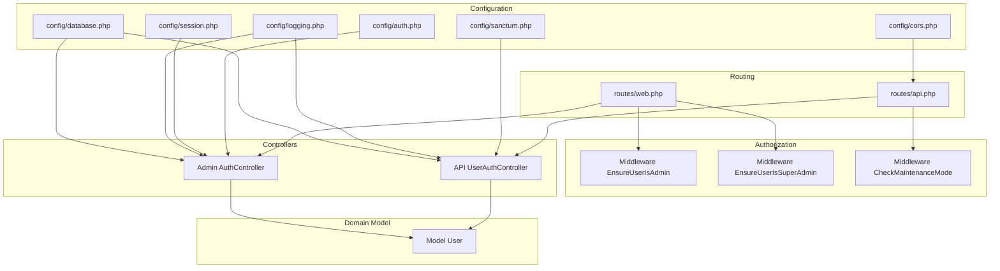

**Diagram sources**
- [auth.php:1-118](file://backend/config/auth.php#L1-L118)
- [sanctum.php:1-88](file://backend/config/sanctum.php#L1-L88)
- [session.php:1-218](file://backend/config/session.php#L1-L218)
- [cors.php:1-35](file://backend/config/cors.php#L1-L35)
- [logging.php:1-133](file://backend/config/logging.php#L1-L133)
- [database.php:1-185](file://backend/config/database.php#L1-L185)
- [api.php:1-77](file://backend/routes/api.php#L1-L77)
- [web.php:1-293](file://backend/routes/web.php#L1-L293)
- [EnsureUserIsAdmin.php:1-41](file://backend/app/Http/Middleware/EnsureUserIsAdmin.php#L1-L41)
- [EnsureUserIsSuperAdmin.php:1-38](file://backend/app/Http/Middleware/EnsureUserIsSuperAdmin.php#L1-L38)
- [CheckMaintenanceMode.php:1-49](file://backend/app/Http/Middleware/CheckMaintenanceMode.php#L1-L49)
- [UserAuthController.php:1-220](file://backend/app/Http/Controllers/API/UserAuthController.php#L1-L220)
- [AuthController.php:1-83](file://backend/app/Http/Controllers/Admin/AuthController.php#L1-L83)
- [User.php:1-76](file://backend/app/Models/User.php#L1-L76)

**Section sources**
- [auth.php:1-118](file://backend/config/auth.php#L1-L118)
- [sanctum.php:1-88](file://backend/config/sanctum.php#L1-L88)
- [session.php:1-218](file://backend/config/session.php#L1-L218)
- [cors.php:1-35](file://backend/config/cors.php#L1-L35)
- [logging.php:1-133](file://backend/config/logging.php#L1-L133)
- [database.php:1-185](file://backend/config/database.php#L1-L185)
- [api.php:1-77](file://backend/routes/api.php#L1-L77)
- [web.php:1-293](file://backend/routes/web.php#L1-L293)
- [EnsureUserIsAdmin.php:1-41](file://backend/app/Http/Middleware/EnsureUserIsAdmin.php#L1-L41)
- [EnsureUserIsSuperAdmin.php:1-38](file://backend/app/Http/Middleware/EnsureUserIsSuperAdmin.php#L1-L38)
- [CheckMaintenanceMode.php:1-49](file://backend/app/Http/Middleware/CheckMaintenanceMode.php#L1-L49)
- [UserAuthController.php:1-220](file://backend/app/Http/Controllers/API/UserAuthController.php#L1-L220)
- [AuthController.php:1-83](file://backend/app/Http/Controllers/Admin/AuthController.php#L1-L83)
- [User.php:1-76](file://backend/app/Models/User.php#L1-L76)

## Core Components
- Authentication
  - API tokens via Laravel Sanctum for customer-facing APIs.
  - Session-based authentication for the admin panel using the web guard.
- Authorization (RBAC)
  - Role checks via User model methods and middleware enforcing admin and super-admin roles.
  - Menu-level permissions enforced by a menu permission middleware used on admin routes.
- Input Validation
  - Request validation in controllers to enforce schema and constraints.
- CSRF Protection
  - Sanctum middleware includes CSRF validation; session cookies configured for SameSite and HTTPS.
- XSS Prevention
  - Browser-side rendering and framework defaults; recommended security headers can be applied globally.
- SQL Injection Safeguards
  - Eloquent ORM usage and strict database settings reduce risk; avoid raw queries where possible.
- Security Headers
  - Recommended global middleware to set X-Content-Type-Options, X-Frame-Options, CSP, HSTS, etc.
- Rate Limiting
  - Throttle middleware applied to authentication endpoints to prevent brute-force attacks.
- Maintenance Mode
  - Middleware returns 503 responses when maintenance is enabled, with exceptions for site-settings endpoints.
- Sensitive Data Handling
  - Passwords hashed via casts; reset codes stored hashed; logs exclude sensitive values.
- Encryption Strategies
  - Database credentials via environment variables; optional session encryption; SSL/TLS options for DB connections.
- Audit Logging
  - Structured logging channels configured; error paths log failures without exposing secrets.

**Section sources**
- [UserAuthController.php:17-208](file://backend/app/Http/Controllers/API/UserAuthController.php#L17-L208)
- [AuthController.php:24-81](file://backend/app/Http/Controllers/Admin/AuthController.php#L24-L81)
- [User.php:17-74](file://backend/app/Models/User.php#L17-L74)
- [EnsureUserIsAdmin.php:12-38](file://backend/app/Http/Middleware/EnsureUserIsAdmin.php#L12-L38)
- [EnsureUserIsSuperAdmin.php:12-35](file://backend/app/Http/Middleware/EnsureUserIsSuperAdmin.php#L12-L35)
- [CheckMaintenanceMode.php:22-47](file://backend/app/Http/Middleware/CheckMaintenanceMode.php#L22-L47)
- [api.php:41-75](file://backend/routes/api.php#L41-L75)
- [web.php:68-90](file://backend/routes/web.php#L68-L90)
- [sanctum.php:81-85](file://backend/config/sanctum.php#L81-L85)
- [session.php:162-202](file://backend/config/session.php#L162-L202)
- [logging.php:53-124](file://backend/config/logging.php#L53-L124)
- [database.php:47-65](file://backend/config/database.php#L47-L65)

## Architecture Overview
The security architecture layers protect requests at multiple points:
- Routing layer applies rate limiting and maintenance checks.
- Middleware enforces authentication and authorization.
- Controllers validate inputs and handle sensitive operations securely.
- Configuration centralizes security posture (CORS, sessions, logging, DB).

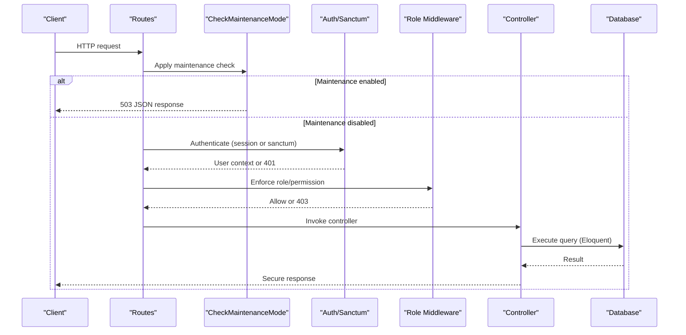

**Diagram sources**
- [api.php:26-75](file://backend/routes/api.php#L26-L75)
- [web.php:80-90](file://backend/routes/web.php#L80-L90)
- [CheckMaintenanceMode.php:22-47](file://backend/app/Http/Middleware/CheckMaintenanceMode.php#L22-L47)
- [EnsureUserIsAdmin.php:12-38](file://backend/app/Http/Middleware/EnsureUserIsAdmin.php#L12-L38)
- [EnsureUserIsSuperAdmin.php:12-35](file://backend/app/Http/Middleware/EnsureUserIsSuperAdmin.php#L12-L35)
- [UserAuthController.php:17-208](file://backend/app/Http/Controllers/API/UserAuthController.php#L17-L208)
- [AuthController.php:24-81](file://backend/app/Http/Controllers/Admin/AuthController.php#L24-L81)

## Detailed Component Analysis

### Authentication System
- API Tokens (Laravel Sanctum)
  - Sanctum stateful domains, guard, expiration, token prefix, and middleware are configured for SPA integration and cookie handling.
  - Customer registration and login create and manage personal access tokens; logout deletes the current token.
- Admin Panel (Session-Based)
  - Web guard uses session driver; login/logout flow validates credentials, enforces admin role, and manages session lifecycle.

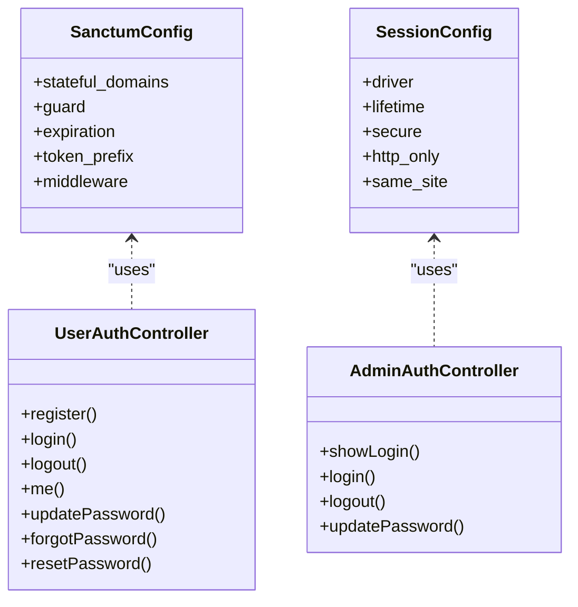

**Diagram sources**
- [sanctum.php:21-85](file://backend/config/sanctum.php#L21-L85)
- [session.php:21-202](file://backend/config/session.php#L21-L202)
- [UserAuthController.php:17-208](file://backend/app/Http/Controllers/API/UserAuthController.php#L17-L208)
- [AuthController.php:11-81](file://backend/app/Http/Controllers/Admin/AuthController.php#L11-L81)

**Section sources**
- [sanctum.php:21-85](file://backend/config/sanctum.php#L21-L85)
- [auth.php:18-45](file://backend/config/auth.php#L18-L45)
- [session.php:21-202](file://backend/config/session.php#L21-L202)
- [UserAuthController.php:17-208](file://backend/app/Http/Controllers/API/UserAuthController.php#L17-L208)
- [AuthController.php:11-81](file://backend/app/Http/Controllers/Admin/AuthController.php#L11-L81)

### Role-Based Access Control (RBAC)
- Roles and Permissions
  - User model provides isAdmin(), isSuperAdmin(), and hasMenuPermission() to determine access.
- Middleware Enforcement
  - EnsureUserIsAdmin blocks non-admin users and handles JSON vs HTML responses appropriately.
  - EnsureUserIsSuperAdmin restricts sensitive admin features to super-admins.
- Route-Level Guards
  - Admin routes grouped under auth and admin middleware; menu_permission middleware gates specific sections.

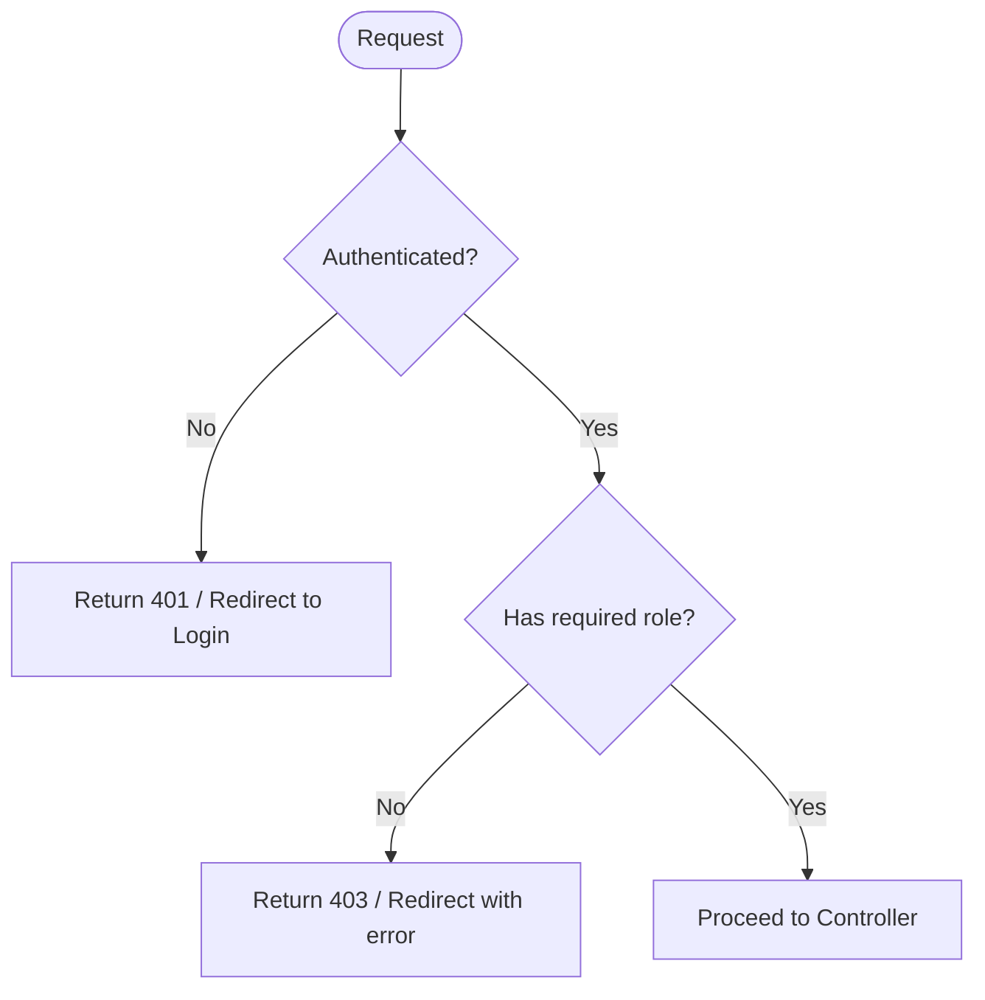

**Diagram sources**
- [User.php:44-74](file://backend/app/Models/User.php#L44-L74)
- [EnsureUserIsAdmin.php:12-38](file://backend/app/Http/Middleware/EnsureUserIsAdmin.php#L12-L38)
- [EnsureUserIsSuperAdmin.php:12-35](file://backend/app/Http/Middleware/EnsureUserIsSuperAdmin.php#L12-L35)
- [web.php:80-90](file://backend/routes/web.php#L80-L90)

**Section sources**
- [User.php:44-74](file://backend/app/Models/User.php#L44-L74)
- [EnsureUserIsAdmin.php:12-38](file://backend/app/Http/Middleware/EnsureUserIsAdmin.php#L12-L38)
- [EnsureUserIsSuperAdmin.php:12-35](file://backend/app/Http/Middleware/EnsureUserIsSuperAdmin.php#L12-L35)
- [web.php:80-90](file://backend/routes/web.php#L80-L90)

### Input Validation and CSRF/XSS/SQL Injection Safeguards
- Input Validation
  - Controllers validate incoming payloads using Laravel’s validator rules to ensure type, length, uniqueness, and format constraints.
- CSRF Protection
  - Sanctum middleware includes ValidateCsrfToken for stateful SPAs; session cookies configured with SameSite and HTTPS flags.
- XSS Prevention
  - Framework defaults and browser rendering mitigate XSS; apply global security headers middleware to harden responses.
- SQL Injection Safeguards
  - Prefer Eloquent over raw queries; database config enables strict mode and SSL options where applicable.

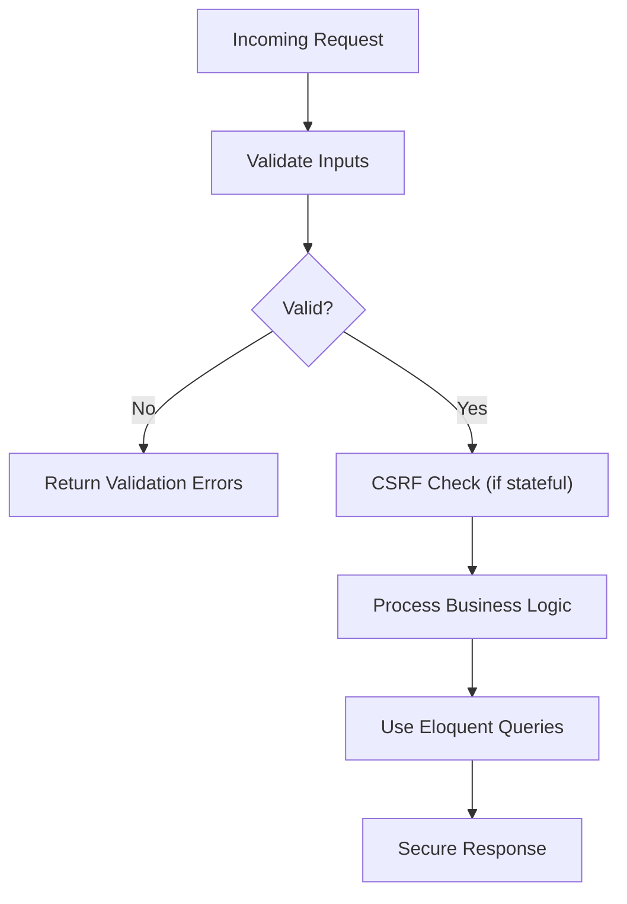

**Diagram sources**
- [UserAuthController.php:17-208](file://backend/app/Http/Controllers/API/UserAuthController.php#L17-L208)
- [sanctum.php:81-85](file://backend/config/sanctum.php#L81-L85)
- [session.php:162-202](file://backend/config/session.php#L162-L202)
- [database.php:47-65](file://backend/config/database.php#L47-L65)

**Section sources**
- [UserAuthController.php:17-208](file://backend/app/Http/Controllers/API/UserAuthController.php#L17-L208)
- [sanctum.php:81-85](file://backend/config/sanctum.php#L81-L85)
- [session.php:162-202](file://backend/config/session.php#L162-L202)
- [database.php:47-65](file://backend/config/database.php#L47-L65)

### Security Headers and CORS
- Security Headers
  - Implement a global middleware to set X-Content-Type-Options, X-Frame-Options, X-XSS-Protection, Referrer-Policy, Content-Security-Policy, and Strict-Transport-Security in production.
- CORS
  - Configure allowed paths, origins, methods, headers, and credentials according to deployment needs.

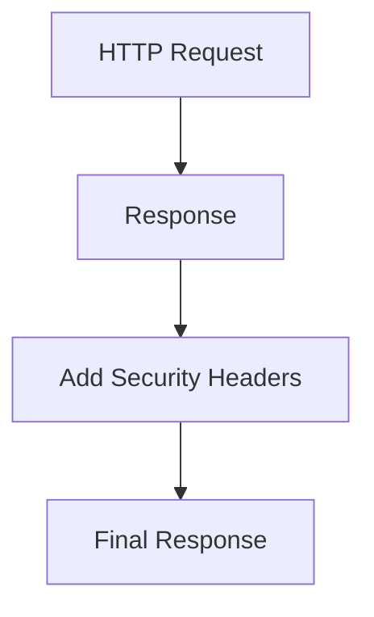

[No sources needed since this diagram shows conceptual workflow, not actual code structure]

**Section sources**
- [cors.php:18-32](file://backend/config/cors.php#L18-L32)

### Rate Limiting
- Authentication Endpoints
  - Throttle middleware applied to login/register/forgot-password/reset-password routes to limit attempts per IP per minute.
- Admin Login
  - Throttle applied to admin login route to prevent brute-force attacks.

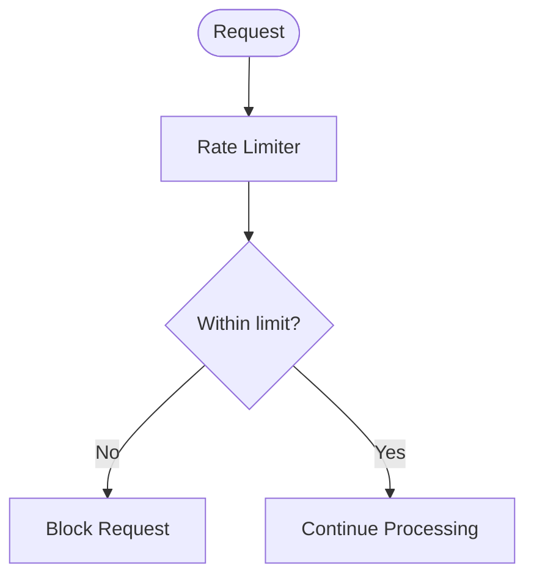

**Diagram sources**
- [api.php:41-46](file://backend/routes/api.php#L41-L46)
- [web.php:68-70](file://backend/routes/web.php#L68-L70)

**Section sources**
- [api.php:41-46](file://backend/routes/api.php#L41-L46)
- [web.php:68-70](file://backend/routes/web.php#L68-L70)

### Maintenance Mode
- Behavior
  - CheckMaintenanceMode reads maintenance status from SiteSetting; returns 503 JSON with message when enabled.
  - Excludes site-settings endpoints so clients can still fetch maintenance status.

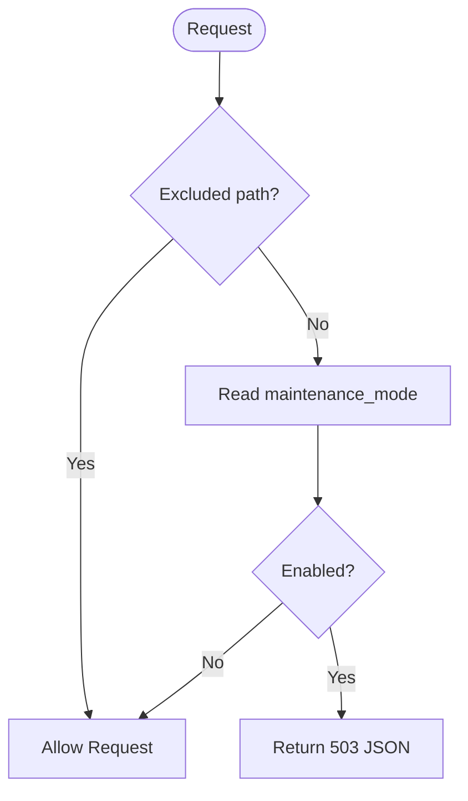

**Diagram sources**
- [CheckMaintenanceMode.php:17-47](file://backend/app/Http/Middleware/CheckMaintenanceMode.php#L17-L47)
- [api.php:18-32](file://backend/routes/api.php#L18-L32)

**Section sources**
- [CheckMaintenanceMode.php:17-47](file://backend/app/Http/Middleware/CheckMaintenanceMode.php#L17-L47)
- [api.php:18-32](file://backend/routes/api.php#L18-L32)

### Sensitive Data Handling and Encryption
- Passwords
  - Casted as hashed; reset codes hashed before storage; logs do not include reset codes.
- Sessions
  - Optional encryption flag available; httpOnly and sameSite configured to mitigate theft and CSRF.
- Database
  - Credentials via environment variables; SSL options configurable for MySQL/MariaDB.

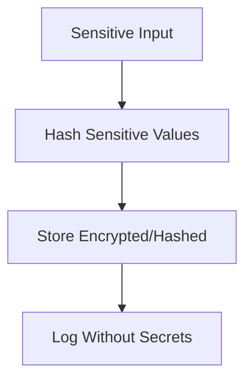

**Diagram sources**
- [User.php:30-36](file://backend/app/Models/User.php#L30-L36)
- [UserAuthController.php:127-163](file://backend/app/Http/Controllers/API/UserAuthController.php#L127-L163)
- [session.php:49-50](file://backend/config/session.php#L49-L50)
- [session.php:172-202](file://backend/config/session.php#L172-L202)
- [database.php:47-65](file://backend/config/database.php#L47-L65)

**Section sources**
- [User.php:30-36](file://backend/app/Models/User.php#L30-L36)
- [UserAuthController.php:127-163](file://backend/app/Http/Controllers/API/UserAuthController.php#L127-L163)
- [session.php:49-50](file://backend/config/session.php#L49-L50)
- [session.php:172-202](file://backend/config/session.php#L172-L202)
- [database.php:47-65](file://backend/config/database.php#L47-L65)

### Audit Logging for Security Events
- Logging Channels
  - Configurable channels (stack, single, daily, slack, papertrail, stderr, syslog, errorlog) with levels and processors.
- Error Paths
  - Controllers log errors without exposing sensitive data; local/testing environments may return additional debug info safely.

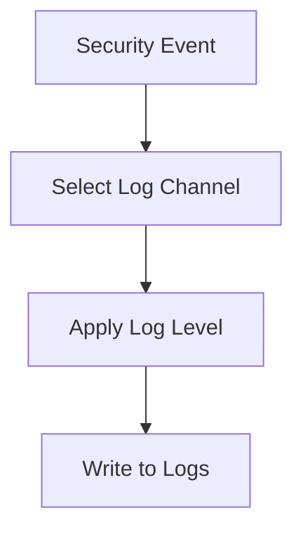

**Diagram sources**
- [logging.php:53-124](file://backend/config/logging.php#L53-L124)
- [UserAuthController.php:142-151](file://backend/app/Http/Controllers/API/UserAuthController.php#L142-L151)

**Section sources**
- [logging.php:53-124](file://backend/config/logging.php#L53-L124)
- [UserAuthController.php:142-151](file://backend/app/Http/Controllers/API/UserAuthController.php#L142-L151)

## Dependency Analysis
Key dependencies between security components:
- Routes depend on middleware for maintenance checks and role enforcement.
- Controllers depend on models for user roles and permissions.
- Configuration files influence behavior of authentication, sessions, CORS, logging, and database security.

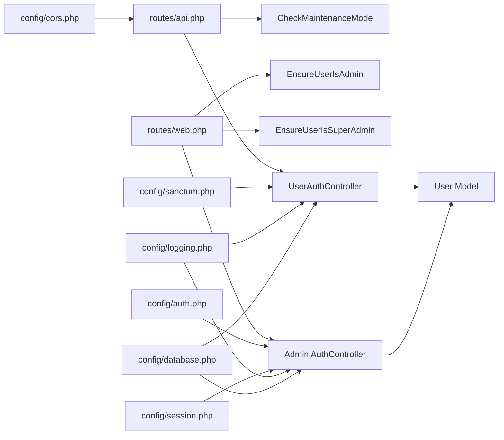

**Diagram sources**
- [api.php:26-75](file://backend/routes/api.php#L26-L75)
- [web.php:80-90](file://backend/routes/web.php#L80-L90)
- [CheckMaintenanceMode.php:22-47](file://backend/app/Http/Middleware/CheckMaintenanceMode.php#L22-L47)
- [EnsureUserIsAdmin.php:12-38](file://backend/app/Http/Middleware/EnsureUserIsAdmin.php#L12-L38)
- [EnsureUserIsSuperAdmin.php:12-35](file://backend/app/Http/Middleware/EnsureUserIsSuperAdmin.php#L12-L35)
- [UserAuthController.php:17-208](file://backend/app/Http/Controllers/API/UserAuthController.php#L17-L208)
- [AuthController.php:24-81](file://backend/app/Http/Controllers/Admin/AuthController.php#L24-L81)
- [User.php:17-74](file://backend/app/Models/User.php#L17-L74)
- [sanctum.php:21-85](file://backend/config/sanctum.php#L21-L85)
- [auth.php:18-45](file://backend/config/auth.php#L18-L45)
- [session.php:21-202](file://backend/config/session.php#L21-L202)
- [cors.php:18-32](file://backend/config/cors.php#L18-L32)
- [logging.php:53-124](file://backend/config/logging.php#L53-L124)
- [database.php:47-65](file://backend/config/database.php#L47-L65)

**Section sources**
- [api.php:26-75](file://backend/routes/api.php#L26-L75)
- [web.php:80-90](file://backend/routes/web.php#L80-L90)
- [CheckMaintenanceMode.php:22-47](file://backend/app/Http/Middleware/CheckMaintenanceMode.php#L22-L47)
- [EnsureUserIsAdmin.php:12-38](file://backend/app/Http/Middleware/EnsureUserIsAdmin.php#L12-L38)
- [EnsureUserIsSuperAdmin.php:12-35](file://backend/app/Http/Middleware/EnsureUserIsSuperAdmin.php#L12-L35)
- [UserAuthController.php:17-208](file://backend/app/Http/Controllers/API/UserAuthController.php#L17-L208)
- [AuthController.php:24-81](file://backend/app/Http/Controllers/Admin/AuthController.php#L24-L81)
- [User.php:17-74](file://backend/app/Models/User.php#L17-L74)
- [sanctum.php:21-85](file://backend/config/sanctum.php#L21-L85)
- [auth.php:18-45](file://backend/config/auth.php#L18-L45)
- [session.php:21-202](file://backend/config/session.php#L21-L202)
- [cors.php:18-32](file://backend/config/cors.php#L18-L32)
- [logging.php:53-124](file://backend/config/logging.php#L53-L124)
- [database.php:47-65](file://backend/config/database.php#L47-L65)

## Performance Considerations
- Use Eloquent to minimize query complexity and leverage indexing.
- Keep rate limits reasonable to balance security and usability.
- Avoid excessive logging in hot paths; use appropriate log levels.
- Enable session encryption only if necessary due to overhead.

[No sources needed since this section provides general guidance]

## Troubleshooting Guide
- Authentication Failures
  - Verify Sanctum stateful domains and CORS settings for SPA integration.
  - Confirm session driver and cookie settings (secure, httpOnly, sameSite).
- Authorization Denials
  - Check role methods and middleware assignments on routes.
- Maintenance Mode Blocking
  - Ensure site-settings endpoints are excluded and maintenance flag is correctly read.
- Rate Limiting Blocks
  - Adjust throttle policies for authentication endpoints if legitimate traffic is blocked.
- Logging Issues
  - Inspect configured channels and file permissions; ensure sensitive data is not logged.

**Section sources**
- [sanctum.php:21-85](file://backend/config/sanctum.php#L21-L85)
- [cors.php:18-32](file://backend/config/cors.php#L18-L32)
- [session.php:162-202](file://backend/config/session.php#L162-L202)
- [EnsureUserIsAdmin.php:12-38](file://backend/app/Http/Middleware/EnsureUserIsAdmin.php#L12-L38)
- [CheckMaintenanceMode.php:22-47](file://backend/app/Http/Middleware/CheckMaintenanceMode.php#L22-L47)
- [api.php:41-46](file://backend/routes/api.php#L41-L46)
- [logging.php:53-124](file://backend/config/logging.php#L53-L124)

## Conclusion
The application implements a comprehensive, multi-layered security architecture leveraging Laravel Sanctum for API tokens, session-based authentication for the admin panel, and robust middleware for authorization. Input validation, CSRF protection, XSS prevention, and SQL injection safeguards are integrated throughout. Security headers, rate limiting, maintenance mode, sensitive data handling, encryption strategies, and audit logging further strengthen the system’s resilience against common threats.

[No sources needed since this section summarizes without analyzing specific files]