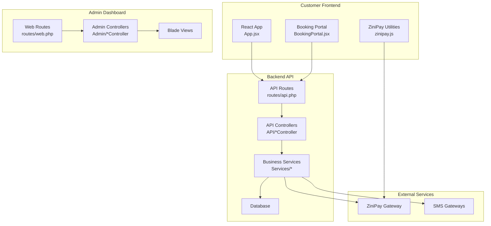
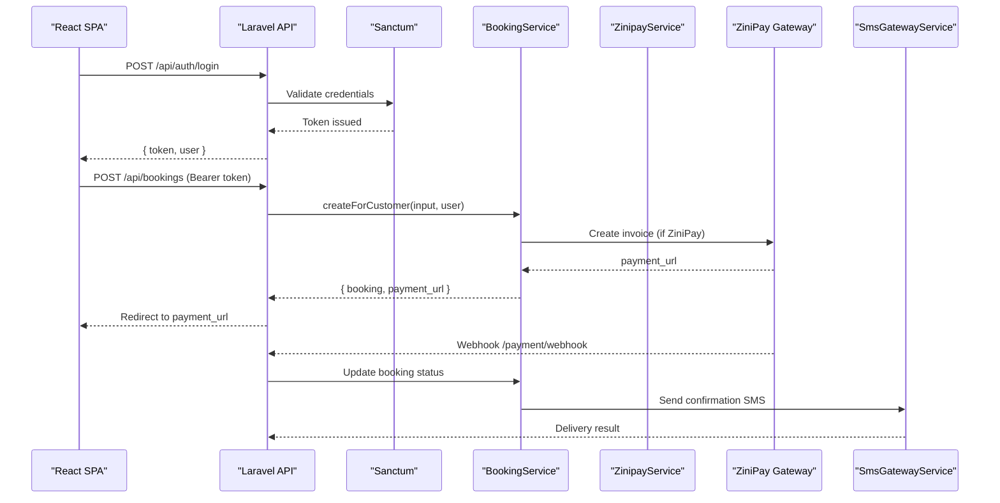
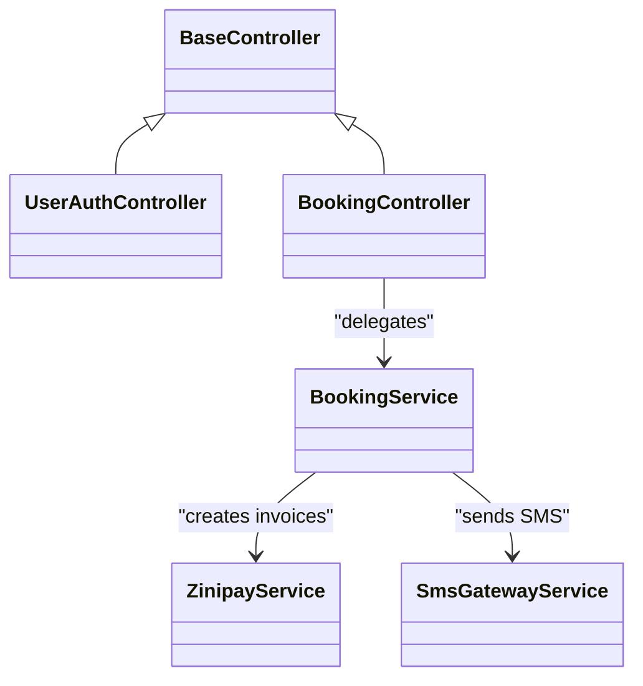
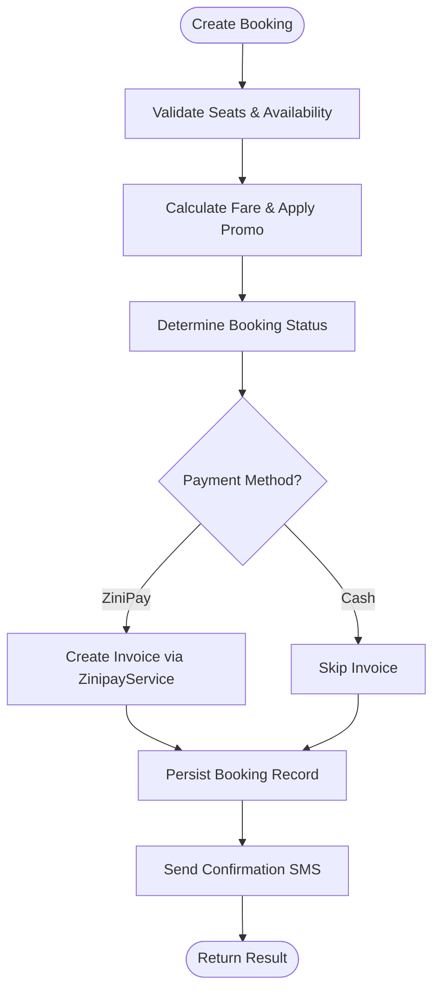
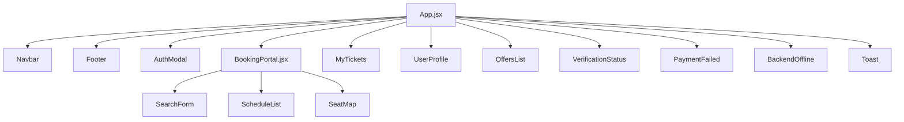
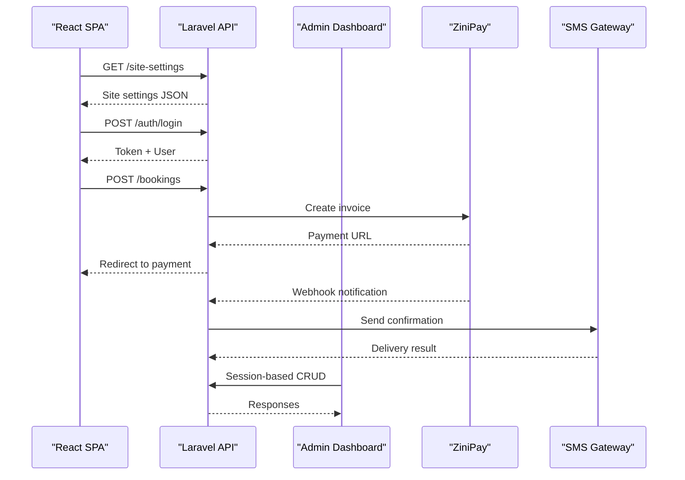
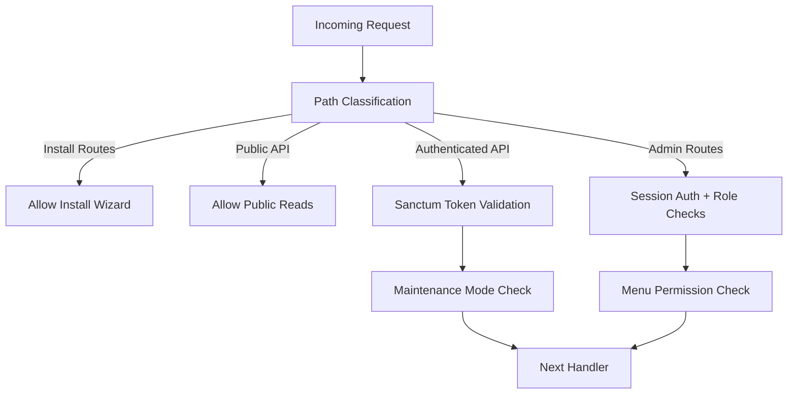
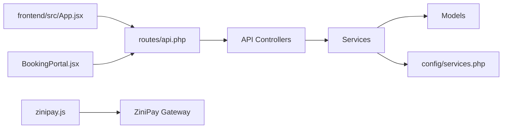

# System Architecture

<cite>
**Referenced Files in This Document**
- [README.md](file://README.md)
- [backend/ARCHITECTURE.md](file://backend/ARCHITECTURE.md)
- [backend/routes/api.php](file://backend/routes/api.php)
- [backend/routes/web.php](file://backend/routes/web.php)
- [frontend/src/App.jsx](file://frontend/src/App.jsx)
- [frontend/src/components/BookingPortal.jsx](file://frontend/src/components/BookingPortal.jsx)
- [frontend/src/zinipay.js](file://frontend/src/zinipay.js)
- [backend/app/Http/Controllers/API/BaseController.php](file://backend/app/Http/Controllers/API/BaseController.php)
- [backend/app/Http/Controllers/API/UserAuthController.php](file://backend/app/Http/Controllers/API/UserAuthController.php)
- [backend/app/Http/Controllers/API/BookingController.php](file://backend/app/Http/Controllers/API/BookingController.php)
- [backend/app/Services/BookingService.php](file://backend/app/Services/BookingService.php)
- [backend/app/Services/ZinipayService.php](file://backend/app/Services/ZinipayService.php)
- [backend/app/Services/SmsGatewayService.php](file://backend/app/Services/SmsGatewayService.php)
- [backend/app/Http/Middleware/CheckMaintenanceMode.php](file://backend/app/Http/Middleware/CheckMaintenanceMode.php)
- [backend/app/Http/Middleware/EnsureLicenseIsActivated.php](file://backend/app/Http/Middleware/EnsureLicenseIsActivated.php)
- [backend/app/Http/Controllers/PaymentController.php](file://backend/app/Http/Controllers/PaymentController.php)
- [backend/config/services.php](file://backend/config/services.php)
</cite>

## Table of Contents
1. [Introduction](#introduction)
2. [Project Structure](#project-structure)
3. [Core Components](#core-components)
4. [Architecture Overview](#architecture-overview)
5. [Detailed Component Analysis](#detailed-component-analysis)
6. [Dependency Analysis](#dependency-analysis)
7. [Performance Considerations](#performance-considerations)
8. [Troubleshooting Guide](#troubleshooting-guide)
9. [Conclusion](#conclusion)

## Introduction
SonyaBus is a full-stack bus ticket booking system with a clear separation between:
- A Laravel 12 backend API for customer-facing JSON endpoints and an admin Blade dashboard.
- A React 19 frontend SPA that drives the customer experience, including search, seat selection, checkout, and payment redirection.

The system supports:
- Customer application flows for searching schedules, selecting seats, creating bookings, and paying via ZiniPay.
- Admin dashboard flows for managing routes, buses, schedules, stations, promotions, reports, and system settings.
- External integrations for payments (ZiniPay) and SMS notifications through configurable gateways.

Technology stack highlights include Laravel Sanctum for API authentication, queue-based SMS dispatch, PDF generation for tickets, and a component-based React frontend with Vite.

**Section sources**
- [README.md:9-44](file://README.md#L9-L44)

## Project Structure
The repository follows a conventional monorepo layout:
- `backend/` contains the Laravel application, including controllers, services, models, middleware, routes, views, migrations, and configuration.
- `frontend/` contains the React SPA built with Vite, including components, utilities, and build configuration.
- `k6/` contains performance test scenarios for smoke, load, spike, and stress testing.
- Documentation and deployment guides are at the repository root.

**Diagram sources**
- [backend/routes/api.php:1-77](file://backend/routes/api.php#L1-L77)
- [backend/routes/web.php:1-293](file://backend/routes/web.php#L1-L293)
- [frontend/src/App.jsx:1-800](file://frontend/src/App.jsx#L1-L800)
- [frontend/src/components/BookingPortal.jsx:1-200](file://frontend/src/components/BookingPortal.jsx#L1-L200)
- [frontend/src/zinipay.js:1-179](file://frontend/src/zinipay.js#L1-L179)

**Section sources**
- [README.md:46-80](file://README.md#L46-L80)
- [backend/ARCHITECTURE.md:15-35](file://backend/ARCHITECTURE.md#L15-L35)

## Core Components
Key architectural components:
- API routing layer under `routes/api.php` exposes public and authenticated endpoints for stations, search, promotions, authentication, bookings, and seat holds/releases.
- Admin routing layer under `routes/web.php` serves Blade views and session-based AJAX endpoints for administrative operations.
- Service layer encapsulates business logic such as booking creation, pricing, seat management, SMS dispatch, and payment integration.
- Middleware enforces maintenance mode, license activation, and role-based access control.

Responsibilities:
- Controllers validate input and delegate to services.
- Services coordinate domain logic, external calls, and data persistence.
- Models represent entities like Booking, Schedule, Route, Bus, User.
- Frontend components manage user interactions and state, calling the API with Bearer tokens where required.

**Section sources**
- [backend/ARCHITECTURE.md:39-53](file://backend/ARCHITECTURE.md#L39-L53)
- [backend/ARCHITECTURE.md:91-107](file://backend/ARCHITECTURE.md#L91-L107)

## Architecture Overview
High-level architecture:
- The React SPA probes and resolves the backend base URL, then communicates with `/api/*` endpoints using Axios-like fetch calls.
- Authentication uses Laravel Sanctum tokens stored in localStorage; protected routes require Authorization headers.
- Payment flow integrates ZiniPay via redirect and webhook; the backend verifies invoice status and updates booking records.
- SMS notifications are sent through configured gateways after successful bookings or payment completion.
- Admin dashboard uses session-based authentication and Blade templates, with AJAX endpoints under `/admin/api/*`.

System boundaries:
- Customer boundary: React SPA interacting with public and authenticated API endpoints.
- Admin boundary: Browser-driven Blade dashboard with session auth.
- External boundaries: ZiniPay payment gateway and SMS providers.

Security architecture:
- Rate limiting on authentication endpoints.
- License activation middleware gating non-public routes.
- Maintenance mode middleware returning 503 responses while allowing site-settings access.
- CSRF protection for state-changing web routes.
- MIME-based file validation and path traversal prevention in configuration writers.

**Diagram sources**
- [backend/routes/api.php:41-75](file://backend/routes/api.php#L41-L75)
- [backend/app/Http/Controllers/API/UserAuthController.php:17-70](file://backend/app/Http/Controllers/API/UserAuthController.php#L17-L70)
- [backend/app/Http/Controllers/API/BookingController.php:19-40](file://backend/app/Http/Controllers/API/BookingController.php#L19-L40)
- [backend/app/Services/BookingService.php:28-131](file://backend/app/Services/BookingService.php#L28-L131)
- [backend/app/Services/ZinipayService.php:27-97](file://backend/app/Services/ZinipayService.php#L27-L97)
- [backend/app/Services/SmsGatewayService.php:16-48](file://backend/app/Services/SmsGatewayService.php#L16-L48)
- [backend/app/Http/Controllers/PaymentController.php:90-136](file://backend/app/Http/Controllers/PaymentController.php#L90-L136)

## Detailed Component Analysis

### MVC Pattern Implementation
- Controllers: Thin layers validating requests and delegating to services. Examples include API controllers for authentication and bookings, and admin controllers for CRUD operations.
- Models: Eloquent models representing domain entities such as Booking, Schedule, Route, Bus, User.
- Views: Blade templates render the admin dashboard and install wizard pages.
- Services: Business logic resides in dedicated service classes, ensuring controllers remain focused on HTTP concerns.

**Diagram sources**
- [backend/app/Http/Controllers/API/BaseController.php:1-8](file://backend/app/Http/Controllers/API/BaseController.php#L1-L8)
- [backend/app/Http/Controllers/API/UserAuthController.php:15-70](file://backend/app/Http/Controllers/API/UserAuthController.php#L15-L70)
- [backend/app/Http/Controllers/API/BookingController.php:10-40](file://backend/app/Http/Controllers/API/BookingController.php#L10-L40)
- [backend/app/Services/BookingService.php:14-33](file://backend/app/Services/BookingService.php#L14-L33)
- [backend/app/Services/ZinipayService.php:9-18](file://backend/app/Services/ZinipayService.php#L9-L18)
- [backend/app/Services/SmsGatewayService.php:11-18](file://backend/app/Services/SmsGatewayService.php#L11-L18)

**Section sources**
- [backend/ARCHITECTURE.md:15-35](file://backend/ARCHITECTURE.md#L15-L35)
- [backend/ARCHITECTURE.md:83-90](file://backend/ARCHITECTURE.md#L83-L90)

### Service Layer Architecture
The service layer centralizes complex business rules:
- BookingService handles seat availability checks, fare calculation, promotion discounts, status resolution, and coordination with payment and SMS services.
- ZinipayService abstracts payment invoice creation and verification, handling environment-specific URL adjustments and logging.
- SmsGatewayService normalizes phone numbers, validates configurations, builds messages, and dispatches via multiple drivers.

**Diagram sources**
- [backend/app/Services/BookingService.php:28-131](file://backend/app/Services/BookingService.php#L28-L131)
- [backend/app/Services/BookingService.php:304-327](file://backend/app/Services/BookingService.php#L304-L327)
- [backend/app/Services/ZinipayService.php:27-97](file://backend/app/Services/ZinipayService.php#L27-L97)
- [backend/app/Services/SmsGatewayService.php:16-48](file://backend/app/Services/SmsGatewayService.php#L16-L48)

**Section sources**
- [backend/app/Services/BookingService.php:28-131](file://backend/app/Services/BookingService.php#L28-L131)
- [backend/app/Services/ZinipayService.php:27-97](file://backend/app/Services/ZinipayService.php#L27-L97)
- [backend/app/Services/SmsGatewayService.php:16-48](file://backend/app/Services/SmsGatewayService.php#L16-L48)

### Component-Based Frontend Structure
The React SPA organizes functionality into reusable components:
- App.jsx manages global state, backend probing, authentication, site settings, and route rendering.
- BookingPortal orchestrates search, schedule listing, seat selection, passenger details, and booking submission.
- zinipay.js provides utilities for direct ZiniPay interactions and redirect handling.

**Diagram sources**
- [frontend/src/App.jsx:1-800](file://frontend/src/App.jsx#L1-L800)
- [frontend/src/components/BookingPortal.jsx:1-200](file://frontend/src/components/BookingPortal.jsx#L1-L200)

**Section sources**
- [frontend/src/App.jsx:1-800](file://frontend/src/App.jsx#L1-L800)
- [frontend/src/components/BookingPortal.jsx:1-200](file://frontend/src/components/BookingPortal.jsx#L1-L200)
- [frontend/src/zinipay.js:1-179](file://frontend/src/zinipay.js#L1-L179)

### Data Flow Between Customer Application, Admin Dashboard, and External Services
- Customer application:
  - Probes backend availability and resolves API base URL.
  - Authenticates via Sanctum and stores tokens.
  - Submits booking requests, receives payment URLs, and handles redirects.
- Admin dashboard:
  - Uses session-based authentication and Blade views.
  - Performs CRUD operations via form submissions and AJAX endpoints.
- External services:
  - ZiniPay: Backend creates invoices, verifies status, and updates bookings.
  - SMS gateways: Backend sends confirmation messages based on booking status.

**Diagram sources**
- [frontend/src/App.jsx:69-92](file://frontend/src/App.jsx#L69-L92)
- [backend/routes/api.php:18-32](file://backend/routes/api.php#L18-L32)
- [backend/app/Http/Controllers/PaymentController.php:21-66](file://backend/app/Http/Controllers/PaymentController.php#L21-L66)
- [backend/app/Services/BookingService.php:113-127](file://backend/app/Services/BookingService.php#L113-L127)

**Section sources**
- [frontend/src/App.jsx:293-325](file://frontend/src/App.jsx#L293-L325)
- [backend/app/Http/Controllers/PaymentController.php:21-66](file://backend/app/Http/Controllers/PaymentController.php#L21-L66)

### Routing Strategy and Middleware Pipeline
- API routes:
  - Public endpoints for site settings, stations, search, promotions.
  - Authenticated endpoints for bookings, seat holds/releases, and user profile.
  - Webhooks and public booking view endpoints.
- Web routes:
  - Installation wizard steps.
  - Admin authentication and dashboard routes.
  - Admin AJAX APIs grouped by menu permissions.
  - Reports, bookings, stations, buses, routes, schedules, promotions, license, and gateway settings.
- Middleware:
  - CheckMaintenanceMode blocks non-excluded routes when maintenance is enabled.
  - EnsureLicenseIsActivated enforces installation and license activation gates.

**Diagram sources**
- [backend/routes/api.php:18-75](file://backend/routes/api.php#L18-L75)
- [backend/routes/web.php:27-293](file://backend/routes/web.php#L27-L293)
- [backend/app/Http/Middleware/CheckMaintenanceMode.php:10-49](file://backend/app/Http/Middleware/CheckMaintenanceMode.php#L10-L49)
- [backend/app/Http/Middleware/EnsureLicenseIsActivated.php:22-169](file://backend/app/Http/Middleware/EnsureLicenseIsActivated.php#L22-L169)

**Section sources**
- [backend/routes/api.php:18-75](file://backend/routes/api.php#L18-L75)
- [backend/routes/web.php:27-293](file://backend/routes/web.php#L27-L293)
- [backend/app/Http/Middleware/CheckMaintenanceMode.php:10-49](file://backend/app/Http/Middleware/CheckMaintenanceMode.php#L10-L49)
- [backend/app/Http/Middleware/EnsureLicenseIsActivated.php:22-169](file://backend/app/Http/Middleware/EnsureLicenseIsActivated.php#L22-L169)

## Dependency Analysis
Component dependencies:
- API controllers depend on services for business logic.
- Services depend on models, external HTTP clients, and configuration.
- Frontend components depend on API endpoints and environment variables.

**Diagram sources**
- [backend/routes/api.php:1-77](file://backend/routes/api.php#L1-L77)
- [backend/app/Http/Controllers/API/BookingController.php:10-40](file://backend/app/Http/Controllers/API/BookingController.php#L10-L40)
- [backend/app/Services/BookingService.php:14-33](file://backend/app/Services/BookingService.php#L14-L33)
- [backend/config/services.php:38-41](file://backend/config/services.php#L38-L41)
- [frontend/src/App.jsx:1-800](file://frontend/src/App.jsx#L1-L800)
- [frontend/src/components/BookingPortal.jsx:1-200](file://frontend/src/components/BookingPortal.jsx#L1-L200)
- [frontend/src/zinipay.js:1-179](file://frontend/src/zinipay.js#L1-L179)

**Section sources**
- [backend/app/Http/Controllers/API/BookingController.php:10-40](file://backend/app/Http/Controllers/API/BookingController.php#L10-L40)
- [backend/app/Services/BookingService.php:14-33](file://backend/app/Services/BookingService.php#L14-L33)
- [backend/config/services.php:38-41](file://backend/config/services.php#L38-L41)

## Performance Considerations
- Use database transactions for critical sections like booking creation to ensure consistency.
- Leverage caching for seat holds and frequently accessed data.
- Offload SMS sending to queues to avoid blocking request cycles.
- Optimize queries with eager loading for related entities.
- Implement rate limiting on sensitive endpoints to prevent abuse.
- Monitor external service timeouts and failures gracefully.

[No sources needed since this section provides general guidance]

## Troubleshooting Guide
Common issues and resolutions:
- Backend offline detection: The frontend probes multiple candidate URLs and displays a backend-offline state if none respond.
- Installation not complete: The frontend shows a call-to-action directing users to the install wizard when the backend indicates incomplete installation.
- Maintenance mode: Requests return 503 responses except for excluded routes like site settings.
- License activation: Non-public routes are blocked until the license is verified.
- Payment callback failures: Verify invoice IDs and webhook payloads; check logs for ZiniPay response details.
- SMS delivery failures: Validate gateway configuration, phone number normalization, and driver-specific parameters.

**Section sources**
- [frontend/src/App.jsx:502-524](file://frontend/src/App.jsx#L502-L524)
- [frontend/src/App.jsx:565-678](file://frontend/src/App.jsx#L565-L678)
- [backend/app/Http/Middleware/CheckMaintenanceMode.php:22-49](file://backend/app/Http/Middleware/CheckMaintenanceMode.php#L22-L49)
- [backend/app/Http/Middleware/EnsureLicenseIsActivated.php:86-169](file://backend/app/Http/Middleware/EnsureLicenseIsActivated.php#L86-L169)
- [backend/app/Http/Controllers/PaymentController.php:21-66](file://backend/app/Http/Controllers/PaymentController.php#L21-L66)
- [backend/app/Services/SmsGatewayService.php:75-107](file://backend/app/Services/SmsGatewayService.php#L75-L107)

## Conclusion
SonyaBus implements a clean separation between a Laravel 12 backend API and a React 19 frontend SPA. The MVC pattern is enforced with thin controllers and robust services. The system integrates external payment and SMS services securely, with comprehensive middleware for security and operational controls. The architecture supports scalability through queuing, caching, and modular service design, while maintaining clarity in routing and component organization.

[No sources needed since this section summarizes without analyzing specific files]