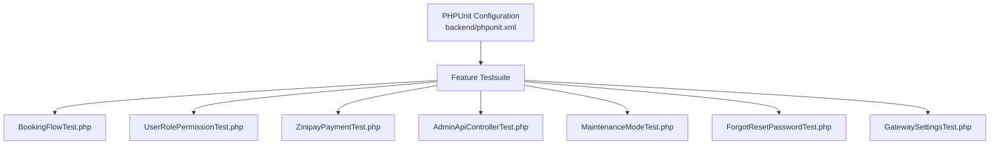
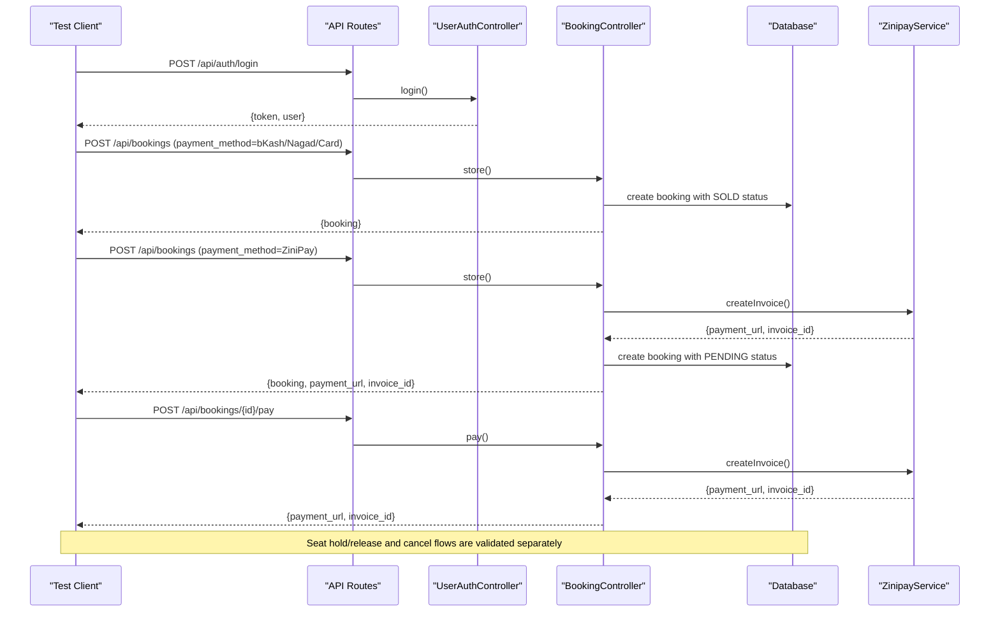
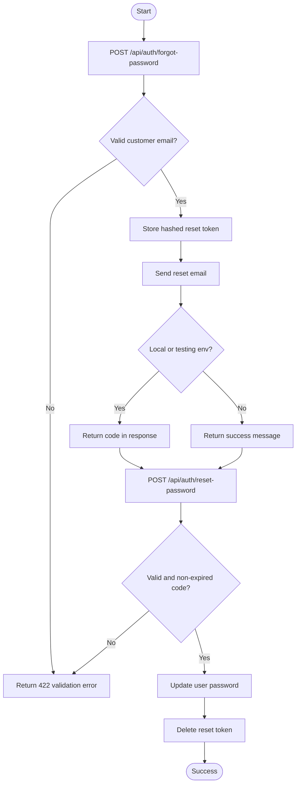
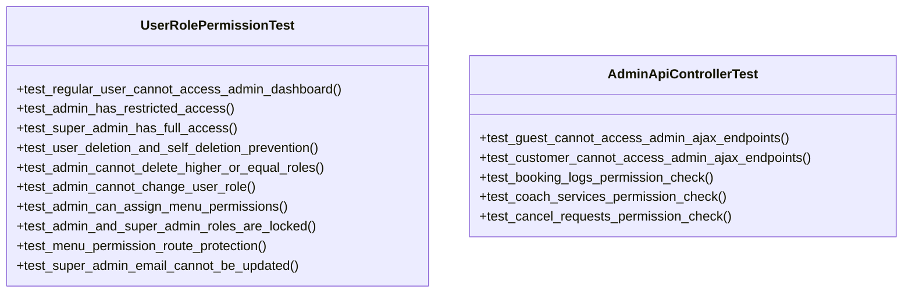
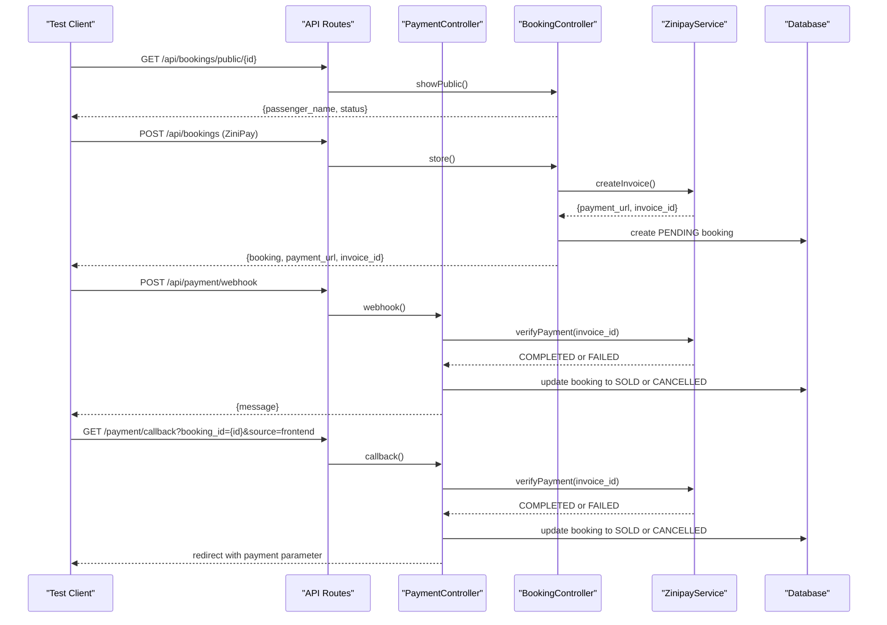
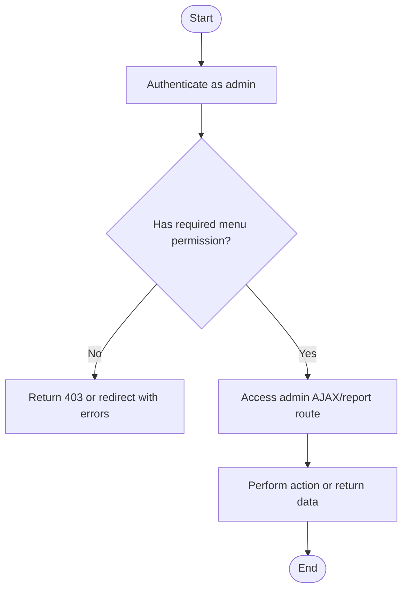
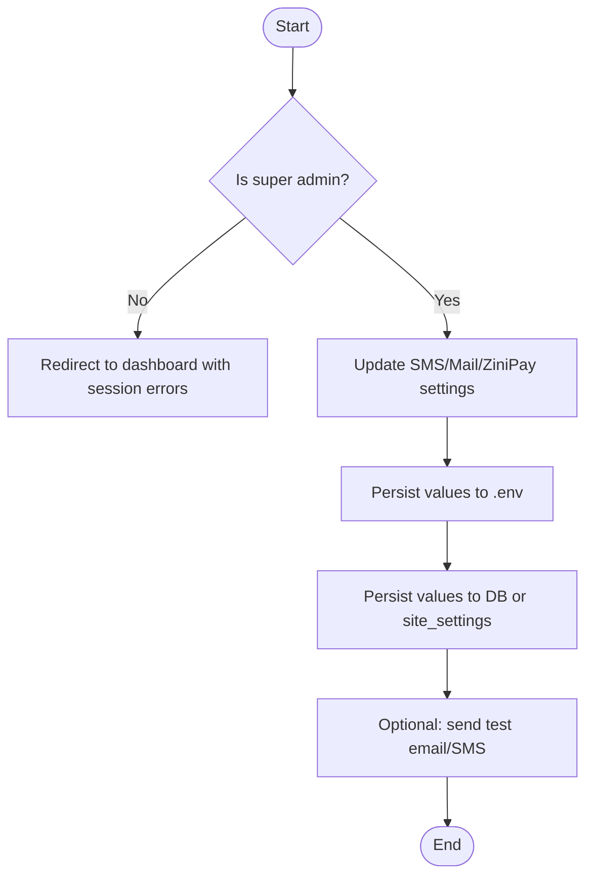
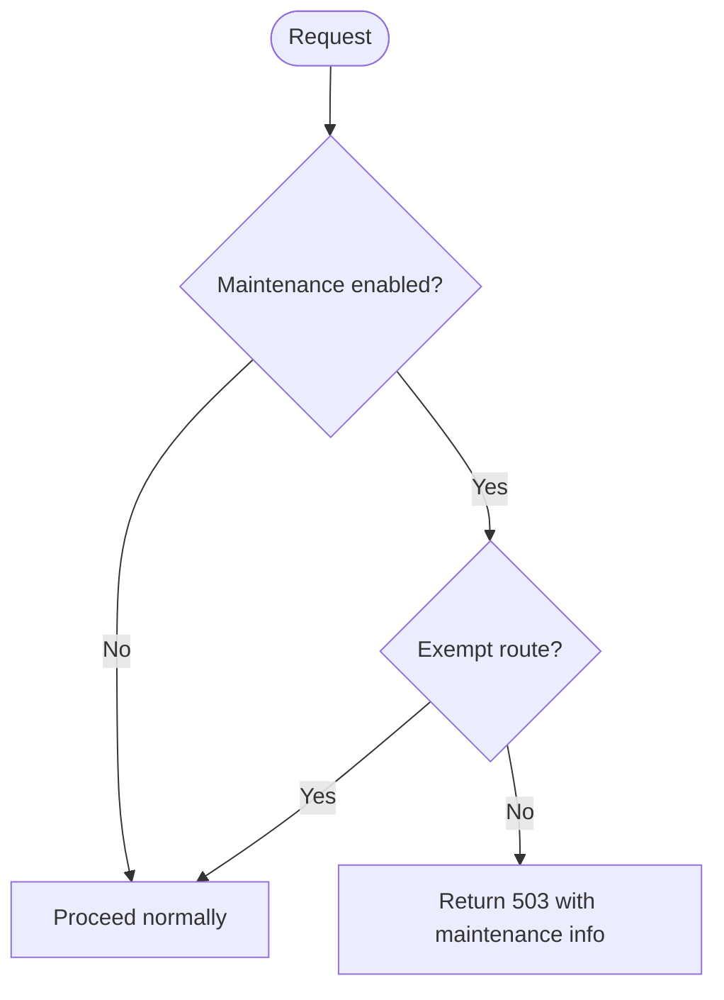
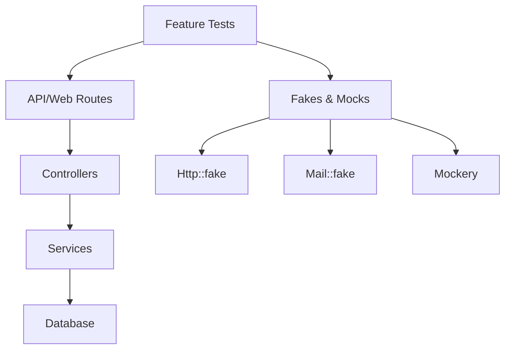

# Integration Testing

<cite>
**Referenced Files in This Document**
- [phpunit.xml](file://backend/phpunit.xml)
- [TestCase.php](file://backend/tests/TestCase.php)
- [api.php](file://backend/routes/api.php)
- [web.php](file://backend/routes/web.php)
- [UserAuthController.php](file://backend/app/Http/Controllers/API/UserAuthController.php)
- [BookingFlowTest.php](file://backend/tests/Feature/BookingFlowTest.php)
- [UserRolePermissionTest.php](file://backend/tests/Feature/UserRolePermissionTest.php)
- [ZinipayPaymentTest.php](file://backend/tests/Feature/ZinipayPaymentTest.php)
- [AdminApiControllerTest.php](file://backend/tests/Feature/AdminApiControllerTest.php)
- [MaintenanceModeTest.php](file://backend/tests/Feature/MaintenanceModeTest.php)
- [ForgotResetPasswordTest.php](file://backend/tests/Feature/ForgotResetPasswordTest.php)
- [GatewaySettingsTest.php](file://backend/tests/Feature/GatewaySettingsTest.php)
</cite>

## Table of Contents
1. [Introduction](#introduction)
2. [Project Structure](#project-structure)
3. [Core Components](#core-components)
4. [Architecture Overview](#architecture-overview)
5. [Detailed Component Analysis](#detailed-component-analysis)
6. [Dependency Analysis](#dependency-analysis)
7. [Performance Considerations](#performance-considerations)
8. [Troubleshooting Guide](#troubleshooting-guide)
9. [Conclusion](#conclusion)

## Introduction
This document explains how to run and understand the integration tests for SonyaBus feature workflows. It focuses on end-to-end testing of booking flows, user authentication, role-based permissions, payment gateway integration, admin workflows, report generation entry points, and system configuration changes. It also documents test environment setup, fixture management, database state isolation, external service mocking, and cleanup procedures.

The tests cover:
- Customer search, seat hold/release, booking creation, cancellation, and my-bookings listing.
- Authentication via Sanctum tokens, password reset code flow, and login restrictions for admin accounts.
- Role-based access control for regular users, admins, and super admins.
- Payment gateway integration with ZiniPay through callbacks, webhooks, and invoice creation.
- Admin AJAX endpoints protected by menu permissions.
- Maintenance mode behavior across public and authenticated routes.
- Gateway settings updates for SMS, email, and ZiniPay, including environment file persistence and test helpers.

## Project Structure
The integration tests live under `backend/tests/Feature`. The test suite is configured in `phpunit.xml`, which defines unit and feature test directories and sets a testing-friendly runtime environment.

**Diagram sources**
- [phpunit.xml:7-14](file://backend/phpunit.xml#L7-L14)

**Section sources**
- [phpunit.xml:1-37](file://backend/phpunit.xml#L1-L37)

## Core Components
The integration test suite is built around several core components:

- Test base class: `Tests\TestCase` extends Laravel’s base test case and provides a common foundation for all feature tests.
- Database isolation: Most tests use `RefreshDatabase` to ensure each test runs against a fresh in-memory SQLite database seeded with baseline data.
- API route coverage: Public customer APIs, authenticated customer APIs, admin session-based routes, and payment callback/webhook routes are covered.
- External service mocking: SMS, email, HTTP calls, and ZiniPay services are mocked to avoid real network calls during tests.
- Fixture management: Users, schedules, bookings, promotions, and site settings are created or seeded within tests to represent realistic states.

Key responsibilities:
- Validate business rules such as maximum seats per booking, seat availability, blocked seats, promo discounts, and PNR format.
- Enforce authorization boundaries between guests, customers, admins, and super admins.
- Verify side effects like database state transitions, environment file updates, and notification triggers.

**Section sources**
- [TestCase.php:1-11](file://backend/tests/TestCase.php#L1-L11)
- [BookingFlowTest.php:30-64](file://backend/tests/Feature/BookingFlowTest.php#L30-L64)
- [ZinipayPaymentTest.php:11-19](file://backend/tests/Feature/ZinipayPaymentTest.php#L11-L19)
- [GatewaySettingsTest.php:21-57](file://backend/tests/Feature/GatewaySettingsTest.php#L21-L57)

## Architecture Overview
The integration tests exercise the full request lifecycle from HTTP entry points through middleware, controllers, services, and database operations. The following diagram maps the primary API routes used by the tests to their corresponding controller actions.

```mermaid
graph TB
subgraph "Public API"
Search["GET /api/search"]
Stations["GET /api/stations"]
Promotions["GET /api/promotions"]
SiteSettings["GET /api/site-settings"]
end
subgraph "Authentication"
Register["POST /api/auth/register"]
Login["POST /api/auth/login"]
Forgot["POST /api/auth/forgot-password"]
Reset["POST /api/auth/reset-password"]
Logout["POST /api/auth/logout"]
Me["GET /api/auth/me"]
UpdatePassword["POST /api/auth/password"]
end
subgraph "Customer Bookings"
CreateBooking["POST /api/bookings"]
MineBookings["GET /api/bookings/mine"]
CancelBooking["POST /api/bookings/{id}/cancel"]
PayBooking["POST /api/bookings/{id}/pay"]
ShowPublic["GET /api/bookings/public/{id}"]
end
subgraph "Seat Management"
HoldSeat["POST /api/seats/hold"]
ReleaseSeat["POST /api/seats/release"]
end
subgraph "Payments"
Webhook["POST /api/payment/webhook"]
Callback["GET /payment/callback"]
Cancel["GET /payment/cancel"]
end
Search --> |Middleware CheckMaintenanceMode| Stations
Search --> |Middleware CheckMaintenanceMode| Promotions
SiteSettings --> |Always accessible| SiteSettings
Register --> UserAuth["UserAuthController"]
Login --> UserAuth
Forgot --> UserAuth
Reset --> UserAuth
Logout --> UserAuth
Me --> UserAuth
UpdatePassword --> UserAuth
CreateBooking --> BookingCtrl["BookingController"]
MineBookings --> BookingCtrl
CancelBooking --> BookingCtrl
PayBooking --> BookingCtrl
HoldSeat --> BookingCtrl
ReleaseSeat --> BookingCtrl
ShowPublic --> BookingCtrl
Webhook --> PaymentCtrl["PaymentController"]
Callback --> PaymentCtrl
Cancel --> PaymentCtrl
```

**Diagram sources**
- [api.php:18-75](file://backend/routes/api.php#L18-L75)
- [UserAuthController.php:17-218](file://backend/app/Http/Controllers/API/UserAuthController.php#L17-L218)

**Section sources**
- [api.php:1-77](file://backend/routes/api.php#L1-L77)
- [UserAuthController.php:1-220](file://backend/app/Http/Controllers/API/UserAuthController.php#L1-L220)

## Detailed Component Analysis

### End-to-End Booking Flow
The booking flow covers the complete customer journey from searching available schedules to completing a booking, handling payments, and managing cancellations.

Key scenarios:
- Creating bookings with different payment methods (bKash, Nagad, Card, Cash, ZiniPay).
- Applying valid and invalid promotion codes.
- Validating seat selection constraints (maximum 4 seats, already sold seats, blocked seats).
- Holding and releasing seats.
- Cancelling pending vs paid bookings.
- Listing own bookings and verifying PNR format.

**Diagram sources**
- [BookingFlowTest.php:70-152](file://backend/tests/Feature/BookingFlowTest.php#L70-L152)
- [ZinipayPaymentTest.php:258-302](file://backend/tests/Feature/ZinipayPaymentTest.php#L258-L302)

**Section sources**
- [BookingFlowTest.php:30-598](file://backend/tests/Feature/BookingFlowTest.php#L30-L598)

### User Authentication and Password Reset
Authentication tests validate registration, login, logout, profile retrieval, password updates, and the forgot/reset password flow. They also enforce that admin accounts cannot authenticate through the customer API.

Important behaviors:
- Registration creates a user with role `user` and returns a Sanctum token.
- Login rejects admin accounts and returns a validation error.
- Forgot password stores a hashed reset code and optionally returns the code in local/testing environments.
- Reset password validates the code, enforces expiration, updates the password, and clears the token record.

**Diagram sources**
- [UserAuthController.php:113-208](file://backend/app/Http/Controllers/API/UserAuthController.php#L113-L208)
- [ForgotResetPasswordTest.php:29-100](file://backend/tests/Feature/ForgotResetPasswordTest.php#L29-L100)

**Section sources**
- [UserAuthController.php:1-220](file://backend/app/Http/Controllers/API/UserAuthController.php#L1-L220)
- [ForgotResetPasswordTest.php:1-102](file://backend/tests/Feature/ForgotResetPasswordTest.php#L1-L102)

### Role-Based Permissions
Role-based permission tests verify that regular users cannot access admin areas, admins have restricted access, and super admins have full access. They also validate menu permissions for AJAX endpoints and user management operations.

Scenarios include:
- Redirecting non-admin users to the admin login page.
- Preventing admins from updating site settings or changing roles without proper permissions.
- Allowing super admins to update user details and roles.
- Protecting admin AJAX endpoints based on menu permissions.
- Preventing self-deletion and deletion of higher/equal roles.

**Diagram sources**
- [UserRolePermissionTest.php:9-255](file://backend/tests/Feature/UserRolePermissionTest.php#L9-L255)
- [AdminApiControllerTest.php:12-161](file://backend/tests/Feature/AdminApiControllerTest.php#L12-L161)

**Section sources**
- [UserRolePermissionTest.php:1-255](file://backend/tests/Feature/UserRolePermissionTest.php#L1-L255)
- [AdminApiControllerTest.php:1-161](file://backend/tests/Feature/AdminApiControllerTest.php#L1-L161)

### Payment Gateway Integration (ZiniPay)
Payment tests cover public booking lookup, callback handling, webhook verification, failed/cancelled payment handling, and paying a pending booking via API.

Key behaviors:
- Public booking lookup returns passenger and status without authentication.
- Callback redirects with success or failure parameters and updates booking status accordingly.
- Webhook verifies payment status and completes or cancels bookings.
- Invoice creation returns a payment URL and invoice ID.

**Diagram sources**
- [ZinipayPaymentTest.php:21-302](file://backend/tests/Feature/ZinipayPaymentTest.php#L21-L302)
- [api.php:54-55](file://backend/routes/api.php#L54-L55)

**Section sources**
- [ZinipayPaymentTest.php:1-304](file://backend/tests/Feature/ZinipayPaymentTest.php#L1-L304)
- [api.php:1-77](file://backend/routes/api.php#L1-L77)

### Admin Workflows and Report Generation Entry Points
Admin workflow tests validate AJAX endpoint protection and menu permissions. Report generation entry points are defined in the web routes and can be tested by asserting access control and expected responses.

Coverage includes:
- Guest and customer rejection for admin AJAX endpoints.
- Menu permission checks for booking logs, coach services, and cancel requests.
- Approving cancel requests only for authorized admins.
- Report preview/export routes are exposed under `/admin/reports/*` and protected by menu permissions.

**Diagram sources**
- [AdminApiControllerTest.php:76-159](file://backend/tests/Feature/AdminApiControllerTest.php#L76-L159)
- [web.php:95-175](file://backend/routes/web.php#L95-L175)

**Section sources**
- [AdminApiControllerTest.php:1-161](file://backend/tests/Feature/AdminApiControllerTest.php#L1-L161)
- [web.php:80-175](file://backend/routes/web.php#L80-L175)

### System Configuration Changes and Gateway Settings
Gateway settings tests verify that only super admins can update SMS, email, and ZiniPay configurations. They also assert that environment files are updated and that test helpers for sending emails and SMS work correctly.

Important behaviors:
- Non-super admins are redirected with session errors when attempting to update gateway settings.
- Super admins can independently update SMS, mail, and ZiniPay settings.
- Environment file contents are asserted to contain updated keys.
- Email testing uses `Mail::fake()` to assert sent messages.
- SMS testing uses `Http::fake()` to mock external SMS provider calls.

**Diagram sources**
- [GatewaySettingsTest.php:59-235](file://backend/tests/Feature/GatewaySettingsTest.php#L59-L235)

**Section sources**
- [GatewaySettingsTest.php:1-237](file://backend/tests/Feature/GatewaySettingsTest.php#L1-L237)

### Maintenance Mode Behavior
Maintenance mode tests ensure that public search, stations, promotions, and authenticated booking endpoints return 503 during maintenance, while site settings remain accessible. Auth routes are not wrapped in maintenance mode.

Key assertions:
- Public endpoints return 503 with maintenance flag and message.
- `/api/site-settings` remains accessible even during maintenance.
- Authenticated endpoints are blocked during maintenance.
- Auth routes are exempt from maintenance blocking.

**Diagram sources**
- [MaintenanceModeTest.php:37-126](file://backend/tests/Feature/MaintenanceModeTest.php#L37-L126)
- [api.php:26-32](file://backend/routes/api.php#L26-L32)

**Section sources**
- [MaintenanceModeTest.php:1-128](file://backend/tests/Feature/MaintenanceModeTest.php#L1-L128)
- [api.php:1-77](file://backend/routes/api.php#L1-L77)

## Dependency Analysis
The integration tests depend on:
- Laravel’s testing utilities (`RefreshDatabase`, `actingAs`, `assertStatus`, `assertJsonPath`).
- Mockery for service mocking (`SmsGatewayService`, `ZinipayService`).
- Laravel HTTP client fakes (`Http::fake`) and mail fakes (`Mail::fake`).
- Route definitions in `api.php` and `web.php`.
- Controllers and services invoked by the routes.

**Diagram sources**
- [BookingFlowTest.php:10-14](file://backend/tests/Feature/BookingFlowTest.php#L10-L14)
- [ZinipayPaymentTest.php:5-9](file://backend/tests/Feature/ZinipayPaymentTest.php#L5-L9)
- [GatewaySettingsTest.php:9-11](file://backend/tests/Feature/GatewaySettingsTest.php#L9-L11)

**Section sources**
- [BookingFlowTest.php:1-598](file://backend/tests/Feature/BookingFlowTest.php#L1-L598)
- [ZinipayPaymentTest.php:1-304](file://backend/tests/Feature/ZinipayPaymentTest.php#L1-L304)
- [GatewaySettingsTest.php:1-237](file://backend/tests/Feature/GatewaySettingsTest.php#L1-L237)

## Performance Considerations
- Use in-memory SQLite for fast test execution; avoid heavy seeders where possible.
- Prefer targeted seeding over full database resets when feasible.
- Mock external services to eliminate network latency.
- Keep test cases focused on one scenario to reduce setup/teardown overhead.
- Avoid unnecessary assertions that do not impact test stability.

[No sources needed since this section provides general guidance]

## Troubleshooting Guide
Common issues and resolutions:
- **Authentication failures**: Ensure tests use `actingAs($user, 'sanctum')` for API routes and correct credentials.
- **Permission denied**: Verify menu permissions are set on admin users before accessing protected routes.
- **External service calls**: Use `Http::fake` or service mocks to prevent real network calls.
- **Environment file changes**: Gateway settings tests backup and restore `.env`; ensure tests run in an isolated environment.
- **Maintenance mode interference**: Always clear or reset maintenance flags in `tearDown` if modifying site settings.

**Section sources**
- [GatewaySettingsTest.php:21-57](file://backend/tests/Feature/GatewaySettingsTest.php#L21-L57)
- [MaintenanceModeTest.php:21-35](file://backend/tests/Feature/MaintenanceModeTest.php#L21-L35)

## Conclusion
The SonyaBus integration test suite provides comprehensive coverage of critical feature workflows, including booking flows, authentication, role-based permissions, payment gateway integration, admin workflows, and system configuration changes. By leveraging Laravel’s testing utilities, mocking strategies, and route definitions, the tests ensure reliability and maintainability across the application’s core functionality.

[No sources needed since this section summarizes without analyzing specific files]