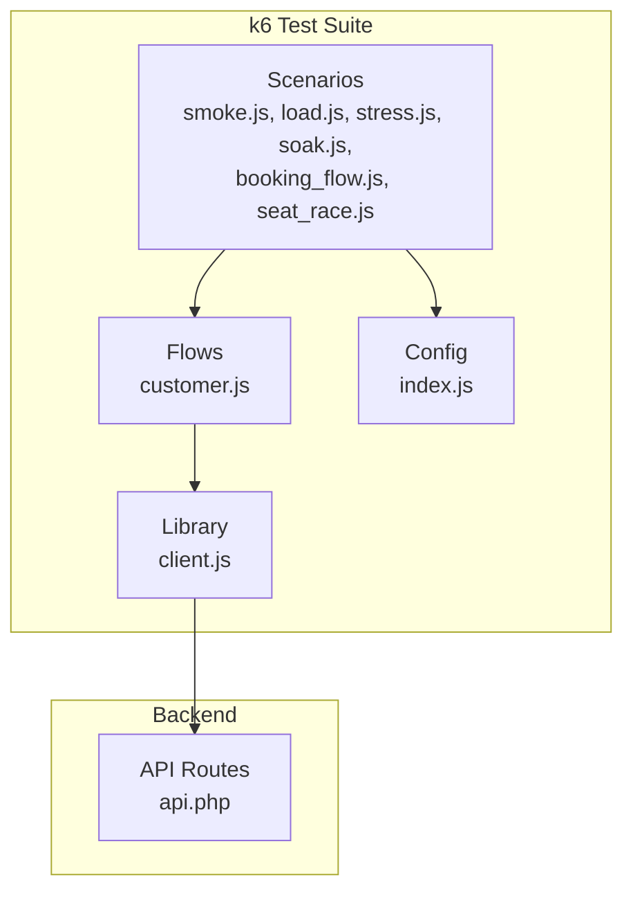
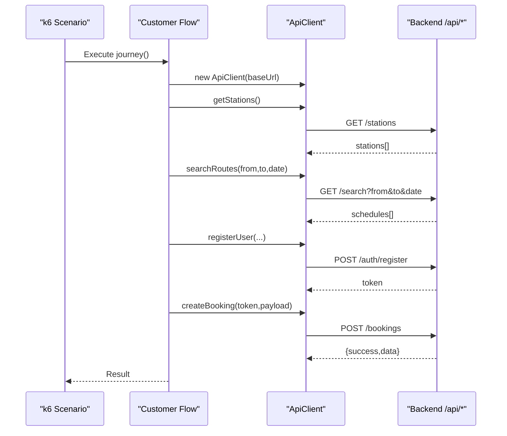
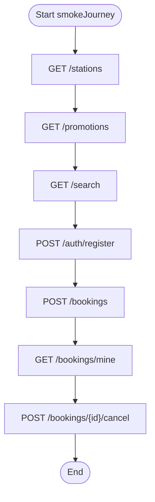
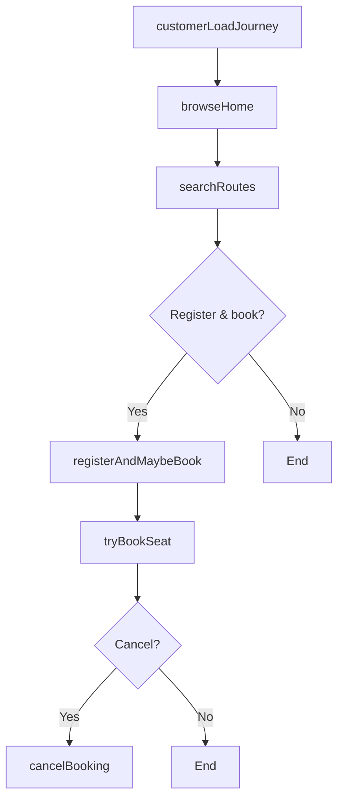
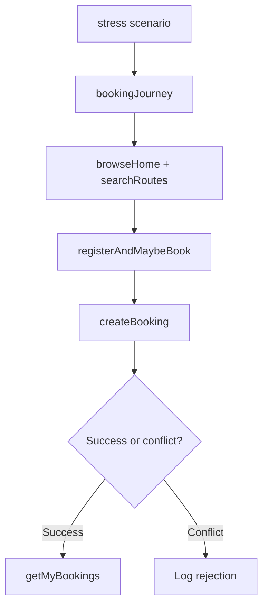
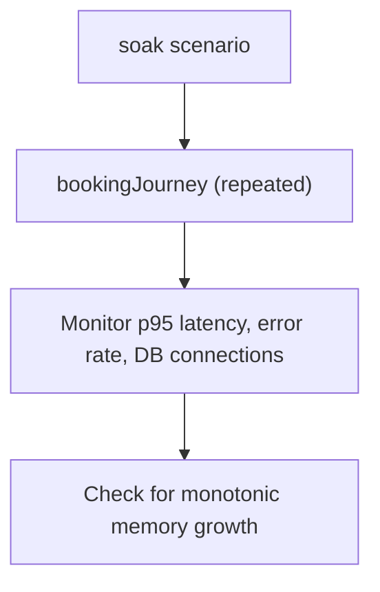
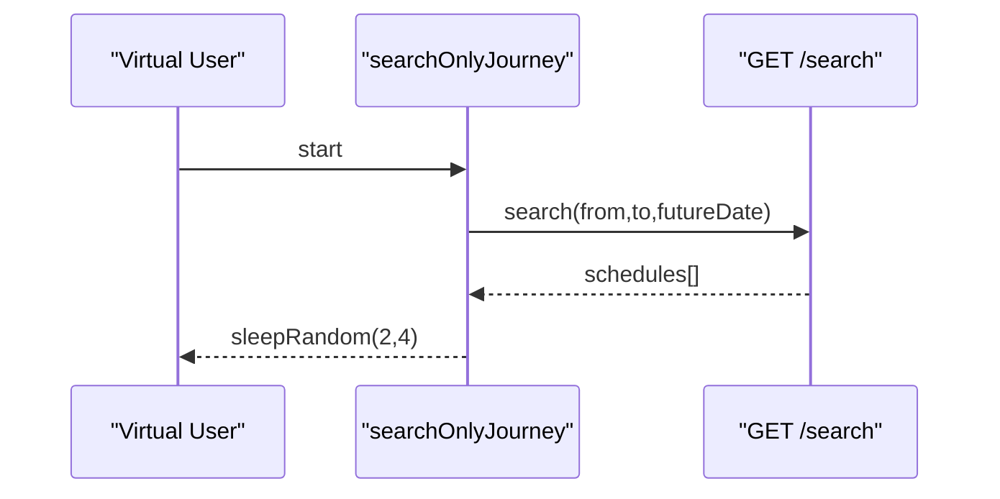
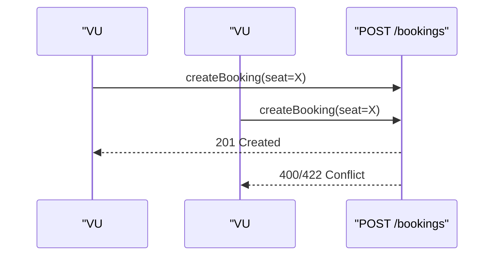
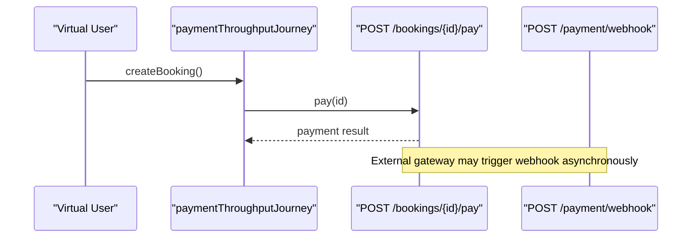
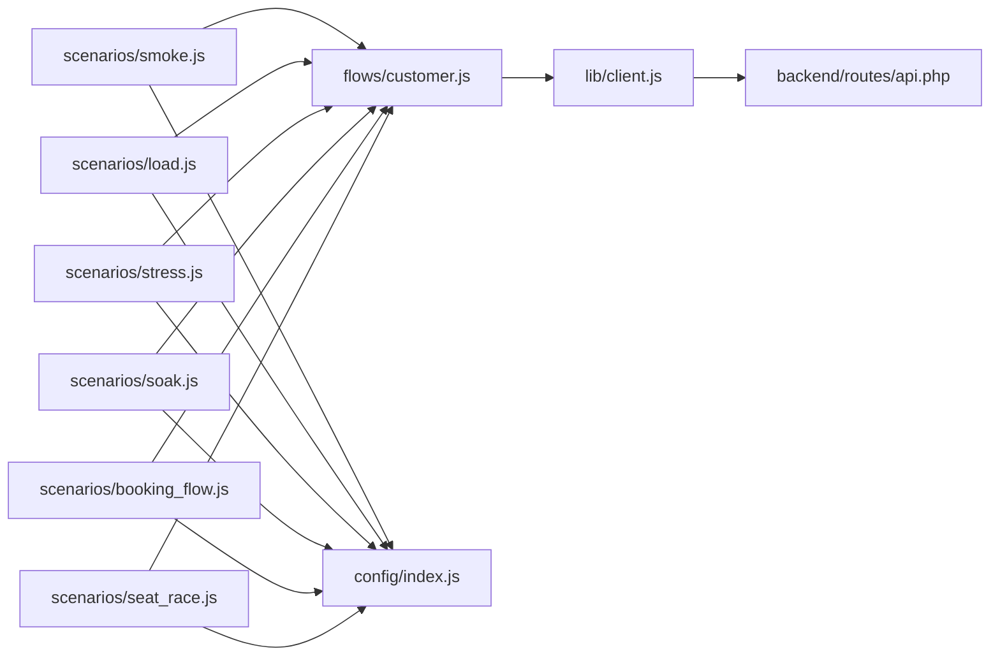

# Performance Testing

<cite>
**Referenced Files in This Document**
- [k6/README.md](file://k6/README.md)
- [k6/config/index.js](file://k6/config/index.js)
- [k6/lib/client.js](file://k6/lib/client.js)
- [k6/flows/customer.js](file://k6/flows/customer.js)
- [k6/scenarios/smoke.js](file://k6/scenarios/smoke.js)
- [k6/scenarios/load.js](file://k6/scenarios/load.js)
- [k6/scenarios/stress.js](file://k6/scenarios/stress.js)
- [k6/scenarios/soak.js](file://k6/scenarios/soak.js)
- [k6/scenarios/booking_flow.js](file://k6/scenarios/booking_flow.js)
- [k6/scenarios/seat_race.js](file://k6/scenarios/seat_race.js)
- [backend/routes/api.php](file://backend/routes/api.php)
</cite>

## Table of Contents
1. [Introduction](#introduction)
2. [Project Structure](#project-structure)
3. [Core Components](#core-components)
4. [Architecture Overview](#architecture-overview)
5. [Detailed Component Analysis](#detailed-component-analysis)
6. [Dependency Analysis](#dependency-analysis)
7. [Performance Considerations](#performance-considerations)
8. [Troubleshooting Guide](#troubleshooting-guide)
9. [Conclusion](#conclusion)
10. [Appendices](#appendices)

## Introduction
This document explains how to perform performance testing for the SonyaBus application using k6. It covers smoke testing, load testing, stress testing, and soak testing, with concrete examples for booking search performance, seat selection concurrency, and payment processing throughput. It also documents the k6 script structure, scenario configuration, metrics collection, baseline establishment, bottleneck identification, optimization recommendations, and continuous performance monitoring in CI/CD pipelines.

## Project Structure
The k6 test suite is organized into layers:
- Scenarios define virtual user profiles, ramp-up patterns, durations, and pass/fail thresholds.
- Flows implement reusable customer journeys such as browsing, searching, registering, booking, and canceling.
- Library modules provide HTTP helpers and API clients.
- Configuration centralizes base URLs, credentials, promo codes, and shared thresholds.

**Diagram sources**
- [k6/README.md:5-25](file://k6/README.md#L5-L25)
- [k6/scenarios/smoke.js:1-14](file://k6/scenarios/smoke.js#L1-L14)
- [k6/flows/customer.js:1-20](file://k6/flows/customer.js#L1-L20)
- [k6/lib/client.js:1-13](file://k6/lib/client.js#L1-L13)
- [k6/config/index.js:1-22](file://k6/config/index.js#L1-L22)
- [backend/routes/api.php:1-77](file://backend/routes/api.php#L1-L77)

**Section sources**
- [k6/README.md:5-36](file://k6/README.md#L5-L36)

## Core Components
- Scenario runners configure VUs, stages, duration, iterations, and thresholds. They call flow functions to execute realistic user journeys.
- Flow functions encapsulate end-to-end paths like browse-home, search-routes, register-and-book, and seat-race scenarios.
- The unified API client wraps customer REST endpoints and admin session endpoints.
- Shared configuration provides base URL resolution, default credentials, promo codes, and threshold presets.

Key responsibilities:
- Scenarios: orchestrate load profile and assertions.
- Flows: model business processes and data dependencies.
- Client: abstract HTTP calls and headers.
- Config: environment-driven settings and SLOs.

**Section sources**
- [k6/scenarios/load.js:1-18](file://k6/scenarios/load.js#L1-L18)
- [k6/flows/customer.js:18-41](file://k6/flows/customer.js#L18-L41)
- [k6/lib/client.js:8-41](file://k6/lib/client.js#L8-L41)
- [k6/config/index.js:19-42](file://k6/config/index.js#L19-L42)

## Architecture Overview
The performance tests exercise public and authenticated APIs exposed by the backend. Customer flows use Sanctum tokens; admin flows use session cookies. The routes include rate-limited authentication endpoints and protected booking endpoints.

**Diagram sources**
- [k6/flows/customer.js:100-125](file://k6/flows/customer.js#L100-L125)
- [k6/lib/client.js:15-27](file://k6/lib/client.js#L15-L27)
- [backend/routes/api.php:26-75](file://backend/routes/api.php#L26-L75)

## Detailed Component Analysis

### Smoke Testing (Critical Path Validation)
Smoke testing validates the full booking path with a single virtual user and strict thresholds. It ensures that core endpoints are reachable, data is present, registration works, a booking can be created, and cancellation succeeds.

- Scenario: one VU, one iteration, strict thresholds.
- Flow: minimal critical path including stations, promotions, route search, registration, booking creation, listing bookings, and cancellation.

**Diagram sources**
- [k6/scenarios/smoke.js:1-14](file://k6/scenarios/smoke.js#L1-L14)
- [k6/flows/customer.js:127-166](file://k6/flows/customer.js#L127-L166)
- [backend/routes/api.php:26-75](file://backend/routes/api.php#L26-L75)

**Section sources**
- [k6/scenarios/smoke.js:1-14](file://k6/scenarios/smoke.js#L1-L14)
- [k6/flows/customer.js:127-166](file://k6/flows/customer.js#L127-L166)

### Load Testing (Capacity Planning)
Load testing simulates realistic customer traffic with staged ramp-ups and branching behavior. It exercises browsing, searching, optional registration, and booking.

- Scenario: staged VUs up to 100, normal thresholds.
- Flow: browse home, search routes, probabilistic registration and booking.

**Diagram sources**
- [k6/scenarios/load.js:1-18](file://k6/scenarios/load.js#L1-L18)
- [k6/flows/customer.js:100-125](file://k6/flows/customer.js#L100-L125)

**Section sources**
- [k6/scenarios/load.js:1-18](file://k6/scenarios/load.js#L1-L18)
- [k6/flows/customer.js:100-125](file://k6/flows/customer.js#L100-L125)

### Stress Testing (Breaking Points)
Stress testing ramps to higher concurrency to identify breaking points and degradation patterns. It uses stricter thresholds and focuses on the booking lifecycle.

- Scenario: staged VUs up to 200, stress thresholds.
- Flow: full booking lifecycle repeated under pressure.

**Diagram sources**
- [k6/scenarios/stress.js:1-19](file://k6/scenarios/stress.js#L1-L19)
- [k6/flows/customer.js:115-125](file://k6/flows/customer.js#L115-L125)

**Section sources**
- [k6/scenarios/stress.js:1-19](file://k6/scenarios/stress.js#L1-L19)
- [k6/flows/customer.js:115-125](file://k6/flows/customer.js#L115-L125)

### Soak Testing (Memory Leaks and Stability)
Soak testing runs steady moderate load over time to detect memory leaks, connection pool exhaustion, and slow resource growth.

- Scenario: steady VUs over extended duration, normal thresholds.
- Flow: repeated booking lifecycle to observe long-term stability.

**Diagram sources**
- [k6/scenarios/soak.js:1-17](file://k6/scenarios/soak.js#L1-L17)
- [k6/flows/customer.js:115-125](file://k6/flows/customer.js#L115-L125)

**Section sources**
- [k6/scenarios/soak.js:1-17](file://k6/scenarios/soak.js#L1-L17)
- [k6/flows/customer.js:115-125](file://k6/flows/customer.js#L115-L125)

### Booking Search Performance
Search performance is exercised through dedicated flows and scenarios. The search endpoint returns schedules based on origin, destination, and date.

- Flow: pick random stations, generate future date, call search, sleep between requests.
- Scenario example: search-only journey with randomized parameters.

**Diagram sources**
- [k6/flows/customer.js:184-194](file://k6/flows/customer.js#L184-L194)
- [backend/routes/api.php:26-32](file://backend/routes/api.php#L26-L32)

**Section sources**
- [k6/flows/customer.js:184-194](file://k6/flows/customer.js#L184-L194)
- [backend/routes/api.php:26-32](file://backend/routes/api.php#L26-L32)

### Seat Selection Concurrency
Seat race testing validates locking and conflict handling when multiple users attempt to book the same seat simultaneously.

- Scenario: fixed VUs and iterations, allows expected conflicts (400/422).
- Flow: register, find first available seat, attempt booking concurrently.

**Diagram sources**
- [k6/scenarios/seat_race.js:1-16](file://k6/scenarios/seat_race.js#L1-L16)
- [k6/flows/customer.js:214-244](file://k6/flows/customer.js#L214-L244)
- [backend/routes/api.php:63-75](file://backend/routes/api.php#L63-L75)

**Section sources**
- [k6/scenarios/seat_race.js:1-16](file://k6/scenarios/seat_race.js#L1-L16)
- [k6/flows/customer.js:214-244](file://k6/flows/customer.js#L214-L244)

### Payment Processing Throughput
Payment-related endpoints exist for webhooks and booking payments. While current k6 flows focus on booking creation, you can extend flows to exercise payment endpoints for throughput analysis.

- Endpoints: webhook and booking pay.
- Recommended extension: add a flow that creates a booking and then calls the payment endpoint, measuring success rates and latency.

**Diagram sources**
- [backend/routes/api.php:54-75](file://backend/routes/api.php#L54-L75)

**Section sources**
- [backend/routes/api.php:54-75](file://backend/routes/api.php#L54-L75)

## Dependency Analysis
The k6 test suite depends on:
- Scenario files importing config and flows.
- Flows depending on the unified API client.
- The API client delegating to customer and admin API modules.
- Backend routes exposing the endpoints exercised by the flows.

**Diagram sources**
- [k6/scenarios/smoke.js:1-14](file://k6/scenarios/smoke.js#L1-L14)
- [k6/scenarios/load.js:1-18](file://k6/scenarios/load.js#L1-L18)
- [k6/scenarios/stress.js:1-19](file://k6/scenarios/stress.js#L1-L19)
- [k6/scenarios/soak.js:1-17](file://k6/scenarios/soak.js#L1-L17)
- [k6/scenarios/booking_flow.js:1-17](file://k6/scenarios/booking_flow.js#L1-L17)
- [k6/scenarios/seat_race.js:1-16](file://k6/scenarios/seat_race.js#L1-L16)
- [k6/flows/customer.js:1-20](file://k6/flows/customer.js#L1-L20)
- [k6/lib/client.js:1-13](file://k6/lib/client.js#L1-L13)
- [k6/config/index.js:1-22](file://k6/config/index.js#L1-L22)
- [backend/routes/api.php:1-77](file://backend/routes/api.php#L1-L77)

**Section sources**
- [k6/README.md:28-36](file://k6/README.md#L28-L36)

## Performance Considerations
- Baseline establishment:
  - Run smoke tests to validate environment readiness.
  - Run load tests at typical peak VUs to establish p50/p95 latencies and error rates.
  - Record results across multiple runs to compute stable baselines.
- Bottleneck identification:
  - Inspect p95 latency spikes during ramp-up phases.
  - Correlate error rate increases with specific endpoints (e.g., /auth/register, /bookings).
  - Monitor database query times, cache hit ratios, and queue backlogs if applicable.
- Optimization recommendations:
  - Add indexes for frequent search filters (origin, destination, date).
  - Cache station and promotion lists where appropriate.
  - Rate-limit sensitive endpoints to protect against abuse while allowing legitimate bursts.
  - Optimize booking transactions to reduce lock contention and deadlocks.
- Continuous monitoring:
  - Integrate k6 runs into CI/CD with thresholds gating merges.
  - Track regression in p95 latency and error rate compared to baseline.
  - Alert on threshold violations and produce trend reports.

[No sources needed since this section provides general guidance]

## Troubleshooting Guide
Common issues and resolutions:
- Authentication failures:
  - Ensure BASE_URL points to the correct environment.
  - Verify rate limits on auth endpoints; adjust test pacing or thresholds accordingly.
- No data returned:
  - Confirm seed data exists for stations, routes, and schedules.
  - Validate that smoke tests fail fast when required data is missing.
- Unexpected conflicts:
  - For seat race tests, allow expected 400/422 responses via thresholds.
  - Investigate backend locking logic if conflicts exceed expectations.
- Threshold regressions:
  - Review recent changes to controllers or services impacting latency.
  - Adjust thresholds only after confirming performance impact is justified.

**Section sources**
- [k6/config/index.js:24-42](file://k6/config/index.js#L24-L42)
- [k6/scenarios/seat_race.js:1-16](file://k6/scenarios/seat_race.js#L1-L16)
- [backend/routes/api.php:41-46](file://backend/routes/api.php#L41-L46)

## Conclusion
The k6 suite provides a structured approach to validating SonyaBus performance across smoke, load, stress, and soak scenarios. By leveraging flows for realistic journeys, scenarios for load profiles, and thresholds for automated quality gates, teams can establish baselines, detect bottlenecks, and prevent regressions. Extending flows to cover payment throughput and integrating these tests into CI/CD ensures sustained reliability under production-like conditions.

[No sources needed since this section summarizes without analyzing specific files]

## Appendices

### Scenario Reference
- smoke.js: Full booking path validation with strict thresholds.
- load.js: Realistic customer traffic with staged ramp-up.
- stress.js: High-concurrency booking lifecycle to find breaking points.
- soak.js: Steady moderate load over time for stability checks.
- booking_flow.js: Authenticated booking lifecycle with re-exported runner.
- seat_race.js: Concurrent booking of the same seat to validate locking.

**Section sources**
- [k6/README.md:67-85](file://k6/README.md#L67-L85)

### Metrics Collection and Thresholds
- Key metrics:
  - http_req_failed: failure rate.
  - http_req_duration: latency percentiles (p95).
- Threshold presets:
  - strict: very low failure rate and latency.
  - normal: balanced thresholds for typical loads.
  - relaxed: lenient thresholds for exploratory runs.
  - stress: tolerant thresholds for high-load scenarios.

**Section sources**
- [k6/config/index.js:24-42](file://k6/config/index.js#L24-L42)

### CI/CD Integration Tips
- Run smoke tests on every commit.
- Run load and stress tests on feature branches before merge.
- Persist k6 JSON reports and compare against previous baselines.
- Fail pipelines when thresholds are violated.

[No sources needed since this section provides general guidance]