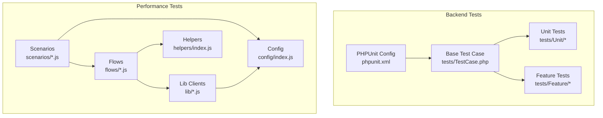
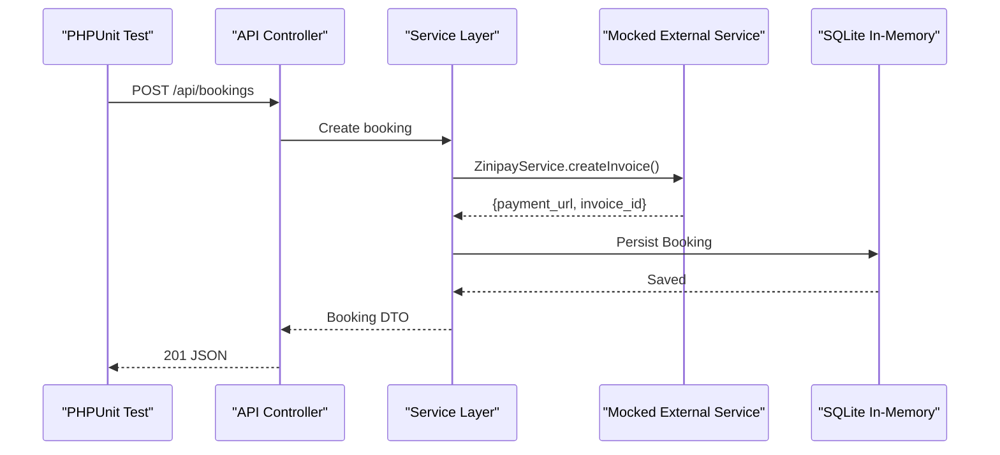
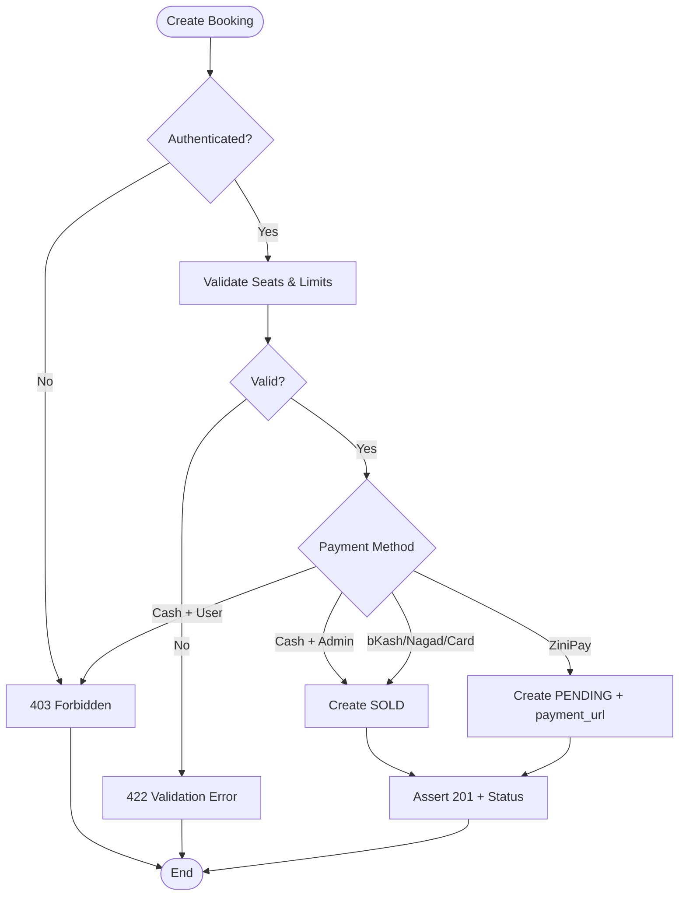
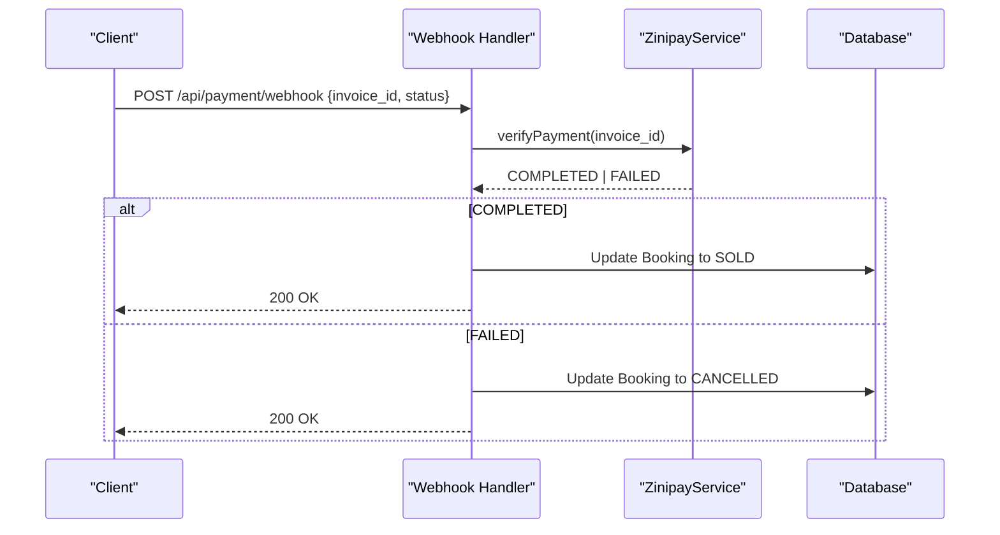
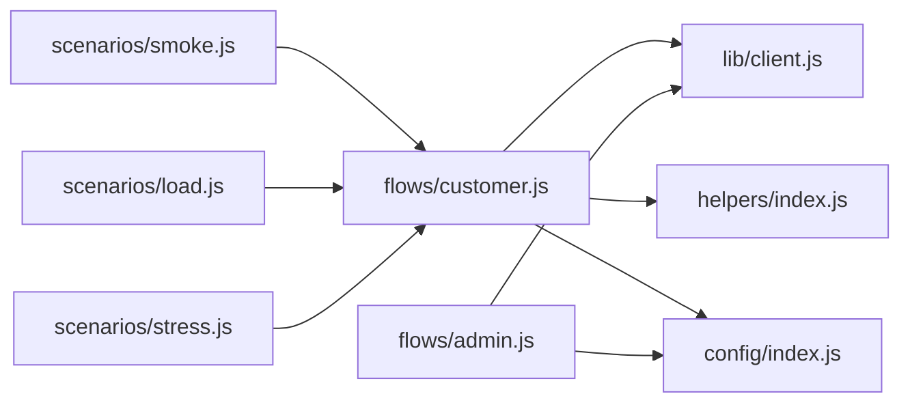
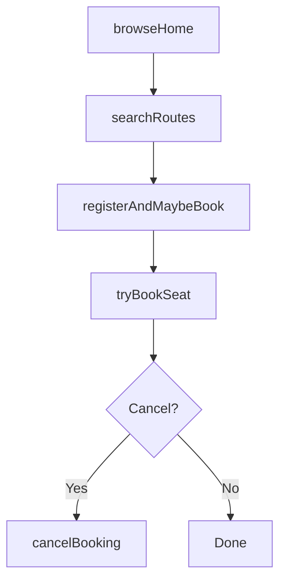
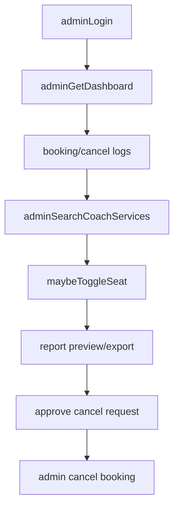
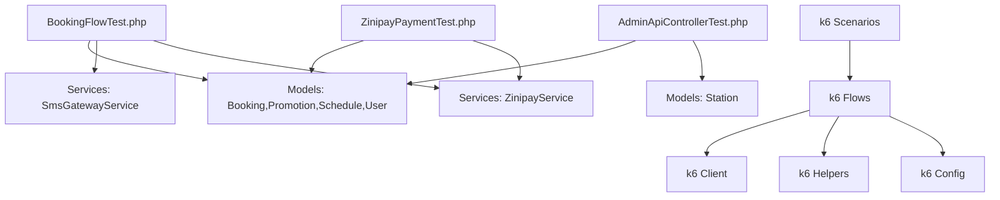

# Testing Strategy

<cite>
**Referenced Files in This Document**
- [phpunit.xml](file://backend/phpunit.xml)
- [TestCase.php](file://backend/tests/TestCase.php)
- [ExampleTest.php (Unit)](file://backend/tests/Unit/ExampleTest.php)
- [ExampleTest.php (Feature)](file://backend/tests/Feature/ExampleTest.php)
- [BookingFlowTest.php](file://backend/tests/Feature/BookingFlowTest.php)
- [ZinipayPaymentTest.php](file://backend/tests/Feature/ZinipayPaymentTest.php)
- [AdminApiControllerTest.php](file://backend/tests/Feature/AdminApiControllerTest.php)
- [README.md (k6)](file://k6/README.md)
- [index.js (k6 config)](file://k6/config/index.js)
- [client.js (k6 client)](file://k6/lib/client.js)
- [customer.js (k6 flows)](file://k6/flows/customer.js)
- [admin.js (k6 flows)](file://k6/flows/admin.js)
- [smoke.js (k6 scenario)](file://k6/scenarios/smoke.js)
- [load.js (k6 scenario)](file://k6/scenarios/load.js)
- [stress.js (k6 scenario)](file://k6/scenarios/stress.js)
</cite>

## Table of Contents
1. [Introduction](#introduction)
2. [Project Structure](#project-structure)
3. [Core Components](#core-components)
4. [Architecture Overview](#architecture-overview)
5. [Detailed Component Analysis](#detailed-component-analysis)
6. [Dependency Analysis](#dependency-analysis)
7. [Performance Considerations](#performance-considerations)
8. [Troubleshooting Guide](#troubleshooting-guide)
9. [Conclusion](#conclusion)

## Introduction
This document defines the testing strategy for SonyaBus quality assurance across unit, feature, API, and performance testing. It explains how PHPUnit tests validate backend logic and user workflows, how K6 scenarios model load, stress, and smoke tests, and how test data, mocking, and CI pipelines should be structured to ensure reliability and speed.

## Project Structure
The testing surface is split into two main areas:
- Backend unit and feature tests using PHPUnit under backend/tests
- Performance tests using k6 under k6 with a layered structure: scenarios (entry points), flows (user journeys), lib (HTTP/API clients), helpers (test data utilities), and config (shared settings)

**Diagram sources**
- [phpunit.xml:7-19](file://backend/phpunit.xml#L7-L19)
- [TestCase.php:7-10](file://backend/tests/TestCase.php#L7-L10)
- [README.md (k6):5-36](file://k6/README.md#L5-L36)
- [index.js (k6 config):1-43](file://k6/config/index.js#L1-L43)

**Section sources**
- [phpunit.xml:7-19](file://backend/phpunit.xml#L7-L19)
- [README.md (k6):5-36](file://k6/README.md#L5-L36)

## Core Components
- PHPUnit configuration defines Unit and Feature test suites, source inclusion, and testing environment variables such as SQLite in-memory database, array cache/session/mail drivers, and disabled telemetry services.
- Base TestCase extends Laravel’s base test case; it can be extended by all tests.
- Example tests demonstrate minimal unit and feature assertions.
- Feature tests cover booking flows, payment callbacks/webhooks, and admin API permissions.
- k6 configuration centralizes base URL, credentials, promo codes, thresholds, and helper functions.
- k6 client unifies customer REST and admin session APIs.
- k6 flows implement reusable customer and admin journeys.
- k6 scenarios define VUs, stages, and thresholds for smoke, load, and stress tests.

**Section sources**
- [phpunit.xml:7-35](file://backend/phpunit.xml#L7-L35)
- [TestCase.php:7-10](file://backend/tests/TestCase.php#L7-L10)
- [ExampleTest.php (Unit):7-16](file://backend/tests/Unit/ExampleTest.php#L7-L16)
- [ExampleTest.php (Feature):8-19](file://backend/tests/Feature/ExampleTest.php#L8-L19)
- [index.js (k6 config):1-43](file://k6/config/index.js#L1-L43)
- [client.js (k6 client):8-41](file://k6/lib/client.js#L8-L41)
- [customer.js (k6 flows):18-166](file://k6/flows/customer.js#L18-L166)
- [admin.js (k6 flows):15-96](file://k6/flows/admin.js#L15-L96)

## Architecture Overview
The testing architecture integrates HTTP-driven feature tests with service-level mocks and uses k6 to simulate realistic user traffic against the same endpoints.

**Diagram sources**
- [BookingFlowTest.php:127-152](file://backend/tests/Feature/BookingFlowTest.php#L127-L152)
- [ZinipayPaymentTest.php:21-42](file://backend/tests/Feature/ZinipayPaymentTest.php#L21-L42)

## Detailed Component Analysis

### PHPUnit Configuration and Environment
- Defines Unit and Feature test directories.
- Includes app directory for code coverage.
- Sets testing-specific environment values:
  - Database: SQLite in-memory
  - Cache/Session/Mail: array/null drivers
  - Queue: sync
  - Telemetry features disabled

These choices optimize test isolation and execution speed.

**Section sources**
- [phpunit.xml:7-35](file://backend/phpunit.xml#L7-L35)

### Base Test Case
- Extends Laravel’s base test case.
- Provides a common base for all tests to inherit shared behavior if needed.

**Section sources**
- [TestCase.php:7-10](file://backend/tests/TestCase.php#L7-L10)

### Unit Testing Strategy
- Use plain PHPUnit for pure logic validation where no HTTP or framework bootstrapping is required.
- Keep unit tests fast and deterministic.
- Prefer testing business rules directly on services or domain classes when applicable.

**Section sources**
- [ExampleTest.php (Unit):7-16](file://backend/tests/Unit/ExampleTest.php#L7-L16)

### Feature Testing Strategy
- End-to-end HTTP requests through Laravel’s test client.
- Use RefreshDatabase trait to isolate state per test.
- Seed baseline data via seeders before running tests that depend on initial records.
- Mock external integrations (e.g., SMS gateway, payment provider) to avoid real network calls.

Key examples:
- Booking creation across multiple payment methods and status transitions
- Promo code application and fare calculation
- Seat availability and hold/release semantics
- Admin-only cash bookings and SMS notifications
- Payment callback and webhook handling for ZiniPay

**Diagram sources**
- [BookingFlowTest.php:70-186](file://backend/tests/Feature/BookingFlowTest.php#L70-L186)

**Section sources**
- [BookingFlowTest.php:30-64](file://backend/tests/Feature/BookingFlowTest.php#L30-L64)
- [BookingFlowTest.php:70-186](file://backend/tests/Feature/BookingFlowTest.php#L70-L186)
- [BookingFlowTest.php:188-314](file://backend/tests/Feature/BookingFlowTest.php#L188-L314)
- [BookingFlowTest.php:316-516](file://backend/tests/Feature/BookingFlowTest.php#L316-L516)
- [BookingFlowTest.php:518-597](file://backend/tests/Feature/BookingFlowTest.php#L518-L597)

### API Endpoint Testing
- Public REST endpoints are tested via JSON requests and response assertions.
- Admin endpoints require authentication and permission checks.
- Tests assert both HTTP status codes and JSON structures.

Examples:
- Booking creation and cancellation endpoints
- My bookings listing endpoint
- Admin AJAX endpoints protected by role and menu permissions

**Section sources**
- [BookingFlowTest.php:70-186](file://backend/tests/Feature/BookingFlowTest.php#L70-L186)
- [BookingFlowTest.php:555-597](file://backend/tests/Feature/BookingFlowTest.php#L555-L597)
- [AdminApiControllerTest.php:76-159](file://backend/tests/Feature/AdminApiControllerTest.php#L76-L159)

### Payment Integration Testing (ZiniPay)
- Verifies public booking lookup, callback redirects, and webhook processing.
- Uses mock for ZinipayService to control verification outcomes.
- Ensures correct booking status transitions (PENDING → SOLD/CANCELLED).

**Diagram sources**
- [ZinipayPaymentTest.php:78-112](file://backend/tests/Feature/ZinipayPaymentTest.php#L78-L112)
- [ZinipayPaymentTest.php:223-256](file://backend/tests/Feature/ZinipayPaymentTest.php#L223-L256)

**Section sources**
- [ZinipayPaymentTest.php:21-42](file://backend/tests/Feature/ZinipayPaymentTest.php#L21-L42)
- [ZinipayPaymentTest.php:44-76](file://backend/tests/Feature/ZinipayPaymentTest.php#L44-L76)
- [ZinipayPaymentTest.php:78-112](file://backend/tests/Feature/ZinipayPaymentTest.php#L78-L112)
- [ZinipayPaymentTest.php:114-137](file://backend/tests/Feature/ZinipayPaymentTest.php#L114-L137)
- [ZinipayPaymentTest.php:191-256](file://backend/tests/Feature/ZinipayPaymentTest.php#L191-L256)
- [ZinipayPaymentTest.php:258-302](file://backend/tests/Feature/ZinipayPaymentTest.php#L258-L302)

### Admin Permission Testing
- Validates guest and customer access denials.
- Enforces menu-based permissions for admin AJAX endpoints.
- Confirms approval flow for cancel requests.

**Section sources**
- [AdminApiControllerTest.php:76-159](file://backend/tests/Feature/AdminApiControllerTest.php#L76-L159)

### Performance Testing with K6
K6 tests are organized into:
- Scenarios: entry points defining VUs, duration, stages, and thresholds
- Flows: reusable user journeys (customer and admin)
- Lib: HTTP and API clients for customer REST and admin session APIs
- Helpers: random data, dates, route pickers
- Config: base URL, credentials, promo codes, thresholds

**Diagram sources**
- [smoke.js (k6 scenario):1-14](file://k6/scenarios/smoke.js#L1-L14)
- [load.js (k6 scenario):1-18](file://k6/scenarios/load.js#L1-L18)
- [stress.js (k6 scenario):1-19](file://k6/scenarios/stress.js#L1-L19)
- [customer.js (k6 flows):18-166](file://k6/flows/customer.js#L18-L166)
- [admin.js (k6 flows):15-96](file://k6/flows/admin.js#L15-L96)
- [client.js (k6 client):8-41](file://k6/lib/client.js#L8-L41)
- [index.js (k6 config):1-43](file://k6/config/index.js#L1-L43)

#### Smoke Testing
- Single virtual user executes a full booking path to quickly validate critical functionality.
- Uses strict thresholds for low failure rate and latency.

**Section sources**
- [smoke.js (k6 scenario):1-14](file://k6/scenarios/smoke.js#L1-L14)
- [customer.js (k6 flows):127-166](file://k6/flows/customer.js#L127-L166)
- [index.js (k6 config):24-42](file://k6/config/index.js#L24-L42)

#### Load Testing
- Ramps up to 100 VUs with realistic branching between browsing, searching, registering, and booking.
- Uses normal thresholds for acceptable error rates and p95 latency.

**Section sources**
- [load.js (k6 scenario):1-18](file://k6/scenarios/load.js#L1-L18)
- [customer.js (k6 flows):100-125](file://k6/flows/customer.js#L100-L125)
- [index.js (k6 config):24-42](file://k6/config/index.js#L24-L42)

#### Stress Testing
- Ramps to 200 VUs to identify breaking points.
- Uses stress thresholds allowing higher error rates and latency during overload.

**Section sources**
- [stress.js (k6 scenario):1-19](file://k6/scenarios/stress.js#L1-L19)
- [customer.js (k6 flows):115-125](file://k6/flows/customer.js#L115-L125)
- [index.js (k6 config):24-42](file://k6/config/index.js#L24-L42)

#### Customer Journey Flow

**Diagram sources**
- [customer.js (k6 flows):18-98](file://k6/flows/customer.js#L18-L98)

**Section sources**
- [customer.js (k6 flows):18-98](file://k6/flows/customer.js#L18-L98)

#### Admin Journey Flow

**Diagram sources**
- [admin.js (k6 flows):15-96](file://k6/flows/admin.js#L15-L96)

**Section sources**
- [admin.js (k6 flows):15-96](file://k6/flows/admin.js#L15-L96)

## Dependency Analysis
- Feature tests depend on:
  - Models (Booking, Promotion, Schedule, User, Station)
  - Services (SmsGatewayService, ZinipayService)
  - Laravel testing traits (RefreshDatabase)
  - Facade Http for optional stubbing
- k6 tests depend on:
  - Shared config (baseUrl, thresholds, credentials)
  - Unified ApiClient combining customer and admin APIs
  - Reusable flows for customer and admin journeys
  - Helpers for generating test data and scheduling

**Diagram sources**
- [BookingFlowTest.php:5-14](file://backend/tests/Feature/BookingFlowTest.php#L5-L14)
- [ZinipayPaymentTest.php:5-9](file://backend/tests/Feature/ZinipayPaymentTest.php#L5-L9)
- [AdminApiControllerTest.php:5-10](file://backend/tests/Feature/AdminApiControllerTest.php#L5-L10)
- [client.js (k6 client):8-41](file://k6/lib/client.js#L8-L41)
- [customer.js (k6 flows):1-16](file://k6/flows/customer.js#L1-L16)
- [admin.js (k6 flows):1-13](file://k6/flows/admin.js#L1-L13)
- [index.js (k6 config):1-43](file://k6/config/index.js#L1-L43)

**Section sources**
- [BookingFlowTest.php:5-14](file://backend/tests/Feature/BookingFlowTest.php#L5-L14)
- [ZinipayPaymentTest.php:5-9](file://backend/tests/Feature/ZinipayPaymentTest.php#L5-L9)
- [AdminApiControllerTest.php:5-10](file://backend/tests/Feature/AdminApiControllerTest.php#L5-L10)
- [client.js (k6 client):8-41](file://k6/lib/client.js#L8-L41)
- [customer.js (k6 flows):1-16](file://k6/flows/customer.js#L1-L16)
- [admin.js (k6 flows):1-13](file://k6/flows/admin.js#L1-L13)
- [index.js (k6 config):1-43](file://k6/config/index.js#L1-L43)

## Performance Considerations
- Use SQLite in-memory database for fast, isolated test runs.
- Disable broadcasting, queue workers, and telemetry services in tests to reduce overhead.
- Employ array cache/session drivers to avoid I/O.
- For k6:
  - Tune thresholds based on environment expectations (strict, normal, relaxed, stress).
  - Use stages to ramp users gradually and observe system behavior under load.
  - Isolate smoke tests for quick feedback and heavier scenarios for scheduled runs.

[No sources needed since this section provides general guidance]

## Troubleshooting Guide
Common issues and resolutions:
- Database not seeded: Ensure setUp seeds baseline data before tests requiring initial records.
- External service calls: Mock SMS and payment services to prevent flaky tests.
- Session/CSRF in admin flows: Use k6 admin flows which handle CSRF and session cookies correctly.
- Threshold failures in k6: Adjust thresholds in config to match environment capacity or investigate slow endpoints.

**Section sources**
- [BookingFlowTest.php:38-64](file://backend/tests/Feature/BookingFlowTest.php#L38-L64)
- [ZinipayPaymentTest.php:15-19](file://backend/tests/Feature/ZinipayPaymentTest.php#L15-L19)
- [admin.js (k6 flows):15-26](file://k6/flows/admin.js#L15-L26)
- [index.js (k6 config):24-42](file://k6/config/index.js#L24-L42)

## Conclusion
SonyaBus employs a comprehensive testing strategy:
- PHPUnit for unit and feature tests covering core business logic, API endpoints, and admin permissions
- K6 for performance testing with smoke, load, and stress scenarios
- Robust test data management via seeders and helpers
- Effective mocking of external services to ensure deterministic tests
- Clear separation of concerns between scenarios, flows, clients, and configuration

Adhering to these practices ensures reliable, maintainable, and high-quality software delivery.