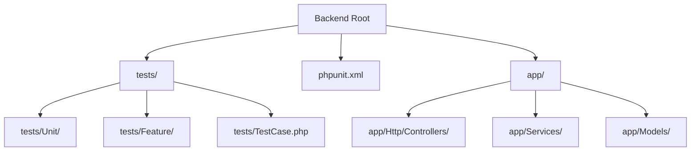
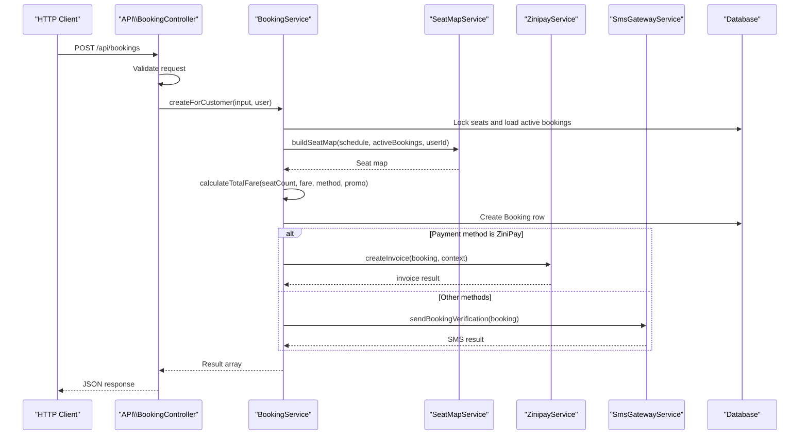
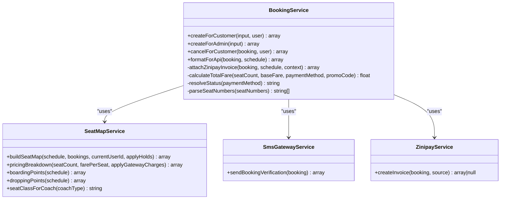
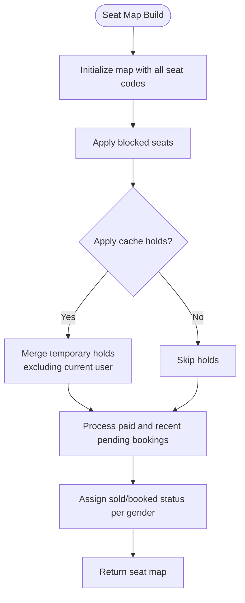
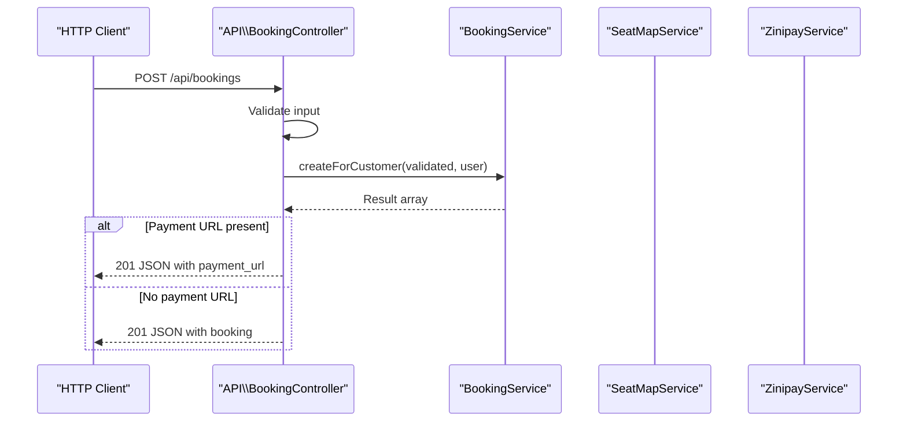
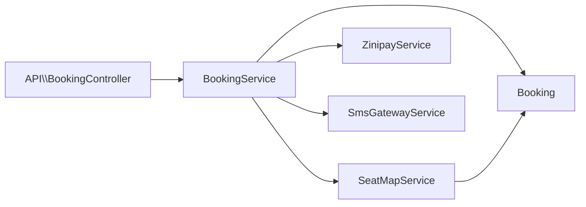

# Unit Testing

<cite>
**Referenced Files in This Document**
- [phpunit.xml](file://backend/phpunit.xml)
- [TestCase.php](file://backend/tests/TestCase.php)
- [ExampleTest.php](file://backend/tests/Unit/ExampleTest.php)
- [BookingController.php](file://backend/app/Http/Controllers/API/BookingController.php)
- [BookingService.php](file://backend/app/Services/BookingService.php)
- [SeatMapService.php](file://backend/app/Services/SeatMapService.php)
- [SmsGatewayService.php](file://backend/app/Services/SmsGatewayService.php)
- [ZinipayService.php](file://backend/app/Services/ZinipayService.php)
- [Booking.php](file://backend/app/Models/Booking.php)
</cite>

## Table of Contents
1. [Introduction](#introduction)
2. [Project Structure](#project-structure)
3. [Core Components](#core-components)
4. [Architecture Overview](#architecture-overview)
5. [Detailed Component Analysis](#detailed-component-analysis)
6. [Dependency Analysis](#dependency-analysis)
7. [Performance Considerations](#performance-considerations)
8. [Troubleshooting Guide](#troubleshooting-guide)
9. [Conclusion](#conclusion)

## Introduction
This document explains how to write and run unit tests for the SonyaBus backend. It focuses on PHPUnit configuration, test organization, model testing, service-layer testing, controller unit tests, mocking strategies for external dependencies such as payment gateways and SMS providers, test data setup, database transactions in tests, assertion patterns, code coverage requirements, naming conventions, and debugging techniques for failing tests.

The core testing targets are:
- Model behavior for `Booking`.
- Business logic in `BookingService` and `SeatMapService`.
- HTTP contract validation and response shape in `BookingController`.
- External integrations through `ZinipayService` and `SmsGatewayService`, which should be isolated with mocks or fakes during unit tests.

## Project Structure
The backend uses a standard Laravel test layout under `backend/tests`:
- `tests/Unit` contains unit tests that focus on classes without full HTTP stack execution.
- `tests/Feature` contains integration-style tests that exercise routes, middleware, and application bootstrapping.
- `tests/TestCase.php` is the base test class extending Laravel’s base test case.
- `phpunit.xml` defines test suites, source directories, and environment variables used by tests.

**Diagram sources**
- [phpunit.xml:7-19](file://backend/phpunit.xml#L7-L19)
- [TestCase.php:5-10](file://backend/tests/TestCase.php#L5-L10)

**Section sources**
- [phpunit.xml:1-37](file://backend/phpunit.xml#L1-L37)
- [TestCase.php:1-11](file://backend/tests/TestCase.php#L1-L11)

## Core Components
The most important components for unit testing are:
- `BookingController`: Validates requests and delegates business logic to services.
- `BookingService`: Encapsulates booking creation, cancellation, pricing, status resolution, and external calls to payment and SMS services.
- `SeatMapService`: Computes seat availability, seat codes, pricing breakdowns, boarding/dropping points, and seat holds.
- `ZinipayService`: Creates payment invoices and verifies payments via an external gateway.
- `SmsGatewayService`: Sends booking confirmation messages via configured SMS providers.
- `Booking`: Eloquent model representing a ticket with fillable fields, casts, relationships, and a PNR accessor.

These components form a layered architecture where controllers validate input, services implement business rules, and models represent persistent data.

**Section sources**
- [BookingController.php:10-17](file://backend/app/Http/Controllers/API/BookingController.php#L10-L17)
- [BookingService.php:14-21](file://backend/app/Services/BookingService.php#L14-L21)
- [SeatMapService.php:9-33](file://backend/app/Services/SeatMapService.php#L9-L33)
- [ZinipayService.php:9-18](file://backend/app/Services/ZinipayService.php#L9-L18)
- [SmsGatewayService.php:11-48](file://backend/app/Services/SmsGatewayService.php#L11-L48)
- [Booking.php:8-47](file://backend/app/Models/Booking.php#L8-L47)

## Architecture Overview
The booking flow demonstrates how unit tests should isolate layers:

**Diagram sources**
- [BookingController.php:19-40](file://backend/app/Http/Controllers/API/BookingController.php#L19-L40)
- [BookingService.php:28-131](file://backend/app/Services/BookingService.php#L28-L131)
- [SeatMapService.php:194-244](file://backend/app/Services/SeatMapService.php#L194-L244)
- [ZinipayService.php:27-97](file://backend/app/Services/ZinipayService.php#L27-L97)
- [SmsGatewayService.php:16-48](file://backend/app/Services/SmsGatewayService.php#L16-L48)

## Detailed Component Analysis

### PHPUnit Configuration and Test Structure
Key configuration aspects:
- Two test suites: `Unit` and `Feature`.
- Source directory for coverage includes `app`.
- Environment variables configure SQLite in-memory database, array cache, sync queue, and disabled telemetry features.

Recommended practices:
- Place pure logic tests in `tests/Unit`.
- Use `tests/Feature` for route-level tests that require full application boot.
- Extend `Tests\TestCase` for feature tests; for pure unit tests, you may extend PHPUnit’s base test case directly when avoiding framework boot is intentional.

Coverage configuration:
- The `<source>` block includes `app`, so running PHPUnit will collect coverage for application classes.
- Add coverage thresholds in CI if needed, but do not hardcode them here unless required by your team policy.

**Section sources**
- [phpunit.xml:7-19](file://backend/phpunit.xml#L7-L19)
- [phpunit.xml:20-35](file://backend/phpunit.xml#L20-L35)

### Model Testing: Booking
When testing `Booking`:
- Verify fillable attributes match expected persistence fields.
- Assert cast behavior for numeric or decimal fields like `total_fare`.
- Validate relationship definitions (`schedule`, `user`).
- Assert computed attributes such as `pnr`.

Typical assertions:
- Attribute presence and types.
- Relationship existence.
- Accessor output format.

Data setup:
- Use factories where available.
- For custom scenarios, instantiate `Booking` with minimal required attributes and assert behavior.

**Section sources**
- [Booking.php:12-31](file://backend/app/Models/Booking.php#L12-L31)
- [Booking.php:33-47](file://backend/app/Models/Booking.php#L33-L47)

### Service Layer Testing: BookingService
`BookingService` coordinates seat locking, pricing, booking creation, payment invoice creation, and SMS notifications. Unit tests should:
- Mock `SeatMapService`, `SmsGatewayService`, and `ZinipayService`.
- Provide a fake authenticated `User`.
- Provide a valid `Schedule` and related entities.
- Assert returned arrays contain correct status codes and body shapes.

Important behaviors to cover:
- Customer booking path with seat validation.
- Admin booking path without seat locking.
- Cancellation state transitions.
- Pricing calculation including promotions.
- Status resolution based on payment method.
- Error handling returning structured error responses.

Mocking strategy:
- Use dependency injection to inject mock instances into `BookingService`.
- Configure mock expectations for `buildSeatMap`, `pricingBreakdown`, `sendBookingVerification`, and `createInvoice`.
- Assert that side effects (e.g., SMS sent, invoice created) occur only under expected conditions.

**Diagram sources**
- [BookingService.php:14-333](file://backend/app/Services/BookingService.php#L14-L333)
- [SeatMapService.php:49-365](file://backend/app/Services/SeatMapService.php#L49-L365)
- [SmsGatewayService.php:16-48](file://backend/app/Services/SmsGatewayService.php#L16-L48)
- [ZinipayService.php:27-97](file://backend/app/Services/ZinipayService.php#L27-L97)

**Section sources**
- [BookingService.php:28-131](file://backend/app/Services/BookingService.php#L28-L131)
- [BookingService.php:138-193](file://backend/app/Services/BookingService.php#L138-L193)
- [BookingService.php:200-240](file://backend/app/Services/BookingService.php#L200-L240)
- [BookingService.php:304-333](file://backend/app/Services/BookingService.php#L304-L333)

### Service Layer Testing: SeatMapService
`SeatMapService` handles seat generation, availability mapping, pricing breakdown, boarding/dropping points, and seat hold/release operations. Unit tests should:
- Generate all seat codes for default layouts and bus-specific layouts.
- Build seat maps from schedules and bookings.
- Validate seat selection rules.
- Compute pricing breakdowns with and without gateway charges.
- Handle blocked seats and temporary holds.

Key test cases:
- `allSeatCodes()` returns expected default grid.
- `allSeatCodesForBus()` respects bus layout and total seats.
- `buildSeatMap()` marks seats correctly based on paid/recent pending bookings and holds.
- `pricingBreakdown()` computes totals accurately.
- `holdSeat()` and `releaseSeat()` interact with cache-based holds.

**Diagram sources**
- [SeatMapService.php:194-244](file://backend/app/Services/SeatMapService.php#L194-L244)
- [SeatMapService.php:502-582](file://backend/app/Services/SeatMapService.php#L502-L582)

**Section sources**
- [SeatMapService.php:49-189](file://backend/app/Services/SeatMapService.php#L49-L189)
- [SeatMapService.php:194-244](file://backend/app/Services/SeatMapService.php#L194-L244)
- [SeatMapService.php:343-365](file://backend/app/Services/SeatMapService.php#L343-L365)
- [SeatMapService.php:502-582](file://backend/app/Services/SeatMapService.php#L502-L582)

### Controller Unit Tests: API BookingController
`BookingController` validates incoming requests and delegates to services. Unit tests should:
- Validate request payloads using Laravel’s validator rules.
- Assert HTTP status codes and JSON response bodies.
- Mock `BookingService`, `SeatMapService`, and `ZinipayService` to avoid real side effects.
- Cover success paths, authorization failures, invalid inputs, and external service errors.

Representative test scenarios:
- Successful booking creation returns 201 or redirects to payment URL depending on payment method.
- Unauthorized cancellation returns 403.
- Missing or invalid fields return validation errors.
- Seat hold/release endpoints return appropriate results.

**Diagram sources**
- [BookingController.php:19-40](file://backend/app/Http/Controllers/API/BookingController.php#L19-L40)
- [BookingService.php:28-131](file://backend/app/Services/BookingService.php#L28-L131)

**Section sources**
- [BookingController.php:19-40](file://backend/app/Http/Controllers/API/BookingController.php#L19-L40)
- [BookingController.php:62-73](file://backend/app/Http/Controllers/API/BookingController.php#L62-L73)
- [BookingController.php:82-116](file://backend/app/Http/Controllers/API/BookingController.php#L82-L116)
- [BookingController.php:118-148](file://backend/app/Http/Controllers/API/BookingController.php#L118-L148)

### Mocking Strategies for External Dependencies
External dependencies include:
- Payment gateway via `ZinipayService`.
- SMS provider via `SmsGatewayService`.
- Database and cache interactions inside services.

Recommended approaches:
- Inject mock implementations of `ZinipayService` and `SmsGatewayService` into `BookingService`.
- Use Laravel’s `Mockery` or PHPUnit mocks to define expectations for `createInvoice` and `sendBookingVerification`.
- For SMS normalization and message building, test `SmsGatewayService` in isolation by providing controlled `SmsConfig` and `Booking` objects.
- For ZiniPay invoice creation, mock HTTP client responses or replace the service entirely in tests.

Examples of mocked behaviors:
- `ZinipayService::createInvoice` returns a successful invoice with `payment_url`.
- `ZinipayService::createInvoice` returns null to simulate failure.
- `SmsGatewayService::sendBookingVerification` returns success or failure with descriptive messages.
- Cache-based seat holds are verified by asserting cache keys and values.

**Section sources**
- [ZinipayService.php:27-97](file://backend/app/Services/ZinipayService.php#L27-L97)
- [SmsGatewayService.php:16-48](file://backend/app/Services/SmsGatewayService.php#L16-L48)
- [SmsGatewayService.php:75-134](file://backend/app/Services/SmsGatewayService.php#L75-L134)

### Test Data Setup and Database Transactions
Because `phpunit.xml` configures SQLite in-memory database and array cache, tests can safely use database transactions:
- Use Laravel’s `DatabaseTransactions` trait in feature tests to wrap each test in a transaction.
- For unit tests that need database access, prefer factories and seeders to create minimal data.
- Avoid relying on global state; reset caches between tests when testing seat holds.

Recommended patterns:
- Use `DatabaseMigrations` trait when schema changes must be applied before tests.
- Use `DatabaseTransactions` trait to ensure rollback after each test.
- Seed only necessary records for the scenario being tested.

**Section sources**
- [phpunit.xml:20-35](file://backend/phpunit.xml#L20-L35)

### Assertion Patterns
Common assertion patterns:
- Assert HTTP status codes and JSON structure in controller tests.
- Assert service return arrays contain expected keys and values.
- Assert model attributes, casts, and relationships.
- Assert external service calls occurred with expected parameters.
- Assert cache entries exist or were updated for seat holds.

Examples:
- `assertArrayHasKey('status', $result)`
- `assertEquals(201, $response->status())`
- `assertTrue($service->isSeatSelectable('available'))`
- `assertDatabaseHas('bookings', [...])`

**Section sources**
- [BookingController.php:19-40](file://backend/app/Http/Controllers/API/BookingController.php#L19-L40)
- [SeatMapService.php:433-447](file://backend/app/Services/SeatMapService.php#L433-L447)

### Code Coverage Requirements
- The `<source>` block includes `app`, enabling coverage collection for application code.
- Run PHPUnit with coverage enabled to generate reports.
- Set minimum coverage thresholds in CI pipelines if required by your team policy.
- Focus coverage on critical paths: booking creation, cancellation, pricing, seat availability, and external service interactions.

**Section sources**
- [phpunit.xml:15-19](file://backend/phpunit.xml#L15-L19)

### Test Naming Conventions
Follow these conventions:
- Use descriptive method names that express intent, e.g., `test_create_for_customer_returns_201_when_seats_available`.
- Group related tests in dedicated test classes per component, e.g., `BookingServiceTest`, `SeatMapServiceTest`, `BookingControllerTest`.
- Keep tests small and focused on one behavior per method.

**Section sources**
- [ExampleTest.php:7-15](file://backend/tests/Unit/ExampleTest.php#L7-L15)

### Debugging Techniques for Failing Unit Tests
Useful techniques:
- Print intermediate results using `dump()` or `var_dump()` in tests to inspect service outputs.
- Enable logging to inspect warnings and errors from SMS and payment services.
- Isolate failing tests by running them individually.
- Use `expectException()` to verify error conditions.
- Mock external services to eliminate network variability.
- Inspect database state with `assertDatabaseHas` or `assertDatabaseMissing`.

**Section sources**
- [SmsGatewayService.php:25-31](file://backend/app/Services/SmsGatewayService.php#L25-L31)
- [ZinipayService.php:29-32](file://backend/app/Services/ZinipayService.php#L29-L32)

## Dependency Analysis
The following diagram shows key dependencies among core components relevant to testing:

**Diagram sources**
- [BookingController.php:10-17](file://backend/app/Http/Controllers/API/BookingController.php#L10-L17)
- [BookingService.php:14-21](file://backend/app/Services/BookingService.php#L14-L21)
- [SeatMapService.php:9-33](file://backend/app/Services/SeatMapService.php#L9-L33)
- [ZinipayService.php:9-18](file://backend/app/Services/ZinipayService.php#L9-L18)
- [SmsGatewayService.php:11-48](file://backend/app/Services/SmsGatewayService.php#L11-L48)
- [Booking.php:8-47](file://backend/app/Models/Booking.php#L8-L47)

**Section sources**
- [BookingController.php:10-17](file://backend/app/Http/Controllers/API/BookingController.php#L10-L17)
- [BookingService.php:14-21](file://backend/app/Services/BookingService.php#L14-L21)

## Performance Considerations
- Prefer unit tests over feature tests for performance-sensitive logic like seat mapping and pricing.
- Mock external HTTP calls to avoid network latency in tests.
- Use in-memory SQLite for fast database-backed tests.
- Keep test datasets minimal to reduce setup time.
- Avoid loading unnecessary relationships in service tests; provide preloaded entities where needed.

[No sources needed since this section provides general guidance]

## Troubleshooting Guide
Common issues and resolutions:
- **SMS gateway not configured**: Tests should assert fallback behavior when configuration is missing.
- **Invalid phone numbers**: Validate normalization logic and assert error messages.
- **Payment invoice creation fails**: Mock `ZinipayService` to return null and assert controller/service error handling.
- **Seat availability conflicts**: Use cache mocks to simulate concurrent holds and verify lock semantics.
- **Database state leakage**: Ensure transactions or rollbacks are used to isolate tests.

**Section sources**
- [SmsGatewayService.php:16-48](file://backend/app/Services/SmsGatewayService.php#L16-L48)
- [ZinipayService.php:27-97](file://backend/app/Services/ZinipayService.php#L27-L97)

## Conclusion
Effective unit testing for SonyaBus requires isolating controllers, services, and models while mocking external dependencies. PHPUnit configuration supports SQLite in-memory databases and array caching, making tests fast and deterministic. Focus on covering booking workflows, seat availability logic, pricing calculations, and external integrations. Follow consistent naming conventions, use clear assertion patterns, and leverage mocking strategies to ensure reliable and maintainable tests.

[No sources needed since this section summarizes without analyzing specific files]