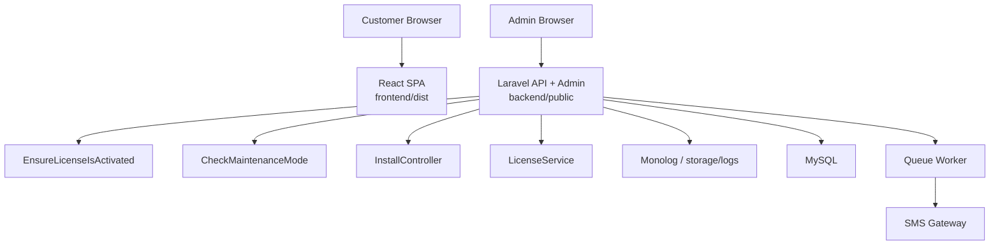
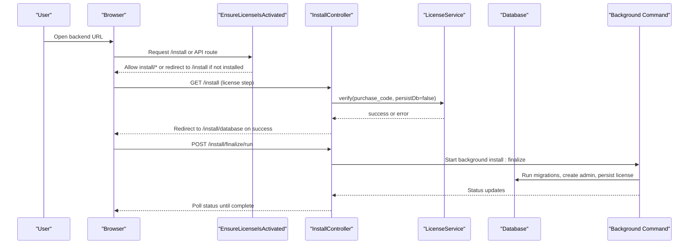
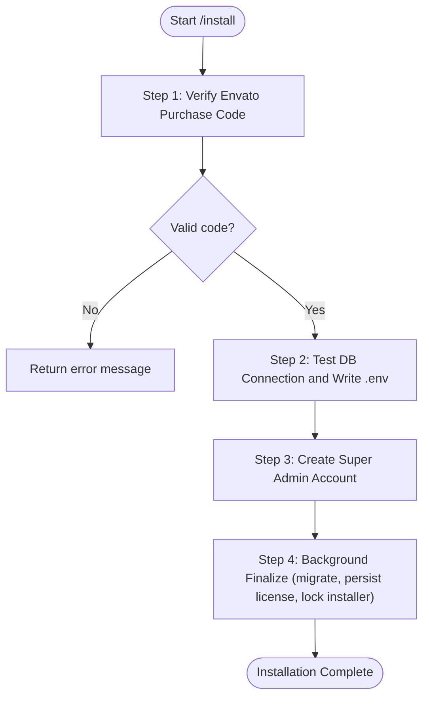
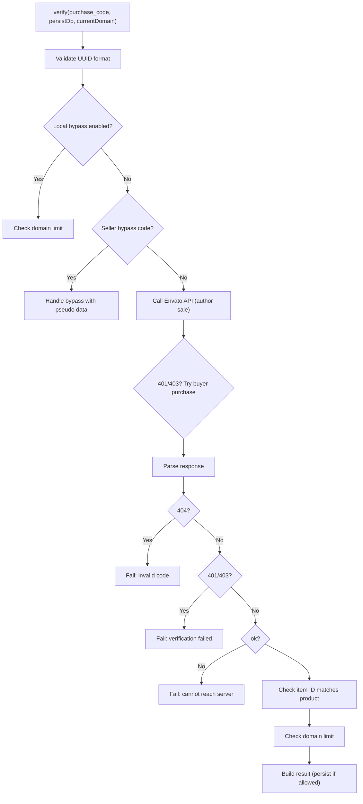
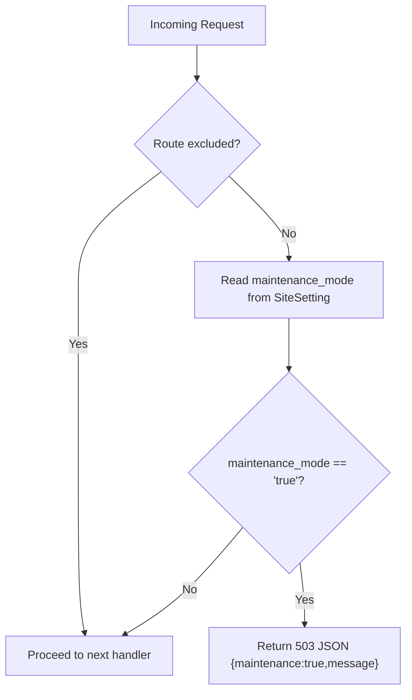
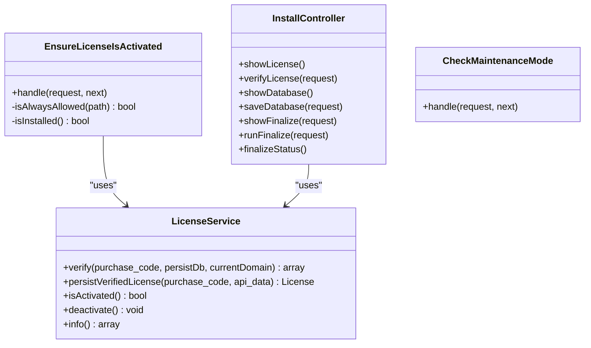

# Troubleshooting & Support

<cite>
**Referenced Files in This Document**
- [README.md](file://README.md)
- [documentation/index.html](file://documentation/index.html)
- [backend/config/logging.php](file://backend/config/logging.php)
- [backend/app/Http/Middleware/CheckMaintenanceMode.php](file://backend/app/Http/Middleware/CheckMaintenanceMode.php)
- [backend/app/Http/Middleware/EnsureLicenseIsActivated.php](file://backend/app/Http/Middleware/EnsureLicenseIsActivated.php)
- [backend/app/Services/LicenseService.php](file://backend/app/Services/LicenseService.php)
- [backend/app/Http/Controllers/Install/InstallController.php](file://backend/app/Http/Controllers/Install/InstallController.php)
- [CPANEL_DEPLOYMENT_GUIDE.md](file://CPANEL_DEPLOYMENT_GUIDE.md)
- [SMS_IMPLEMENTATION_SUMMARY.md](file://SMS_IMPLEMENTATION_SUMMARY.md)
</cite>

## Table of Contents
1. [Introduction](#introduction)
2. [Project Structure](#project-structure)
3. [Core Components](#core-components)
4. [Architecture Overview](#architecture-overview)
5. [Detailed Component Analysis](#detailed-component-analysis)
6. [Dependency Analysis](#dependency-analysis)
7. [Performance Considerations](#performance-considerations)
8. [Troubleshooting Guide](#troubleshooting-guide)
9. [Log Analysis and Error Diagnosis](#log-analysis-and-error-diagnosis)
10. [Performance Profiling Methods](#performance-profiling-methods)
11. [FAQ](#faq)
12. [Community Support Resources](#community-support-resources)
13. [Professional Support Channels](#professional-support-channels)
14. [Debugging Tools and Development Workflow Tips](#debugging-tools-and-development-workflow-tips)
15. [Migration Troubleshooting](#migration-troubleshooting)
16. [Contact Information and Escalation Procedures](#contact-information-and-escalation-procedures)
17. [Conclusion](#conclusion)

## Introduction
This document provides comprehensive troubleshooting and support guidance for SonyaBus. It covers common installation issues, configuration problems, runtime errors, log analysis techniques, error diagnosis procedures, performance profiling methods, frequently asked questions, community and professional support channels, debugging tools, development workflow tips, migration troubleshooting, and contact information with escalation procedures.

SonyaBus is a full-stack bus ticket booking system with:
- A Laravel 12 backend API and admin dashboard
- A React 19 customer-facing SPA
- Envato license verification during installation
- ZiniPay payment integration
- SMS notifications via configured gateways
- Queue-based background processing for SMS and scheduled tasks

## Project Structure
The project is organized into backend (Laravel), frontend (React), documentation, and operational guides. The most relevant areas for troubleshooting are:
- Backend middleware for license gating and maintenance mode
- Installation controller and license service
- Logging configuration
- Documentation troubleshooting sections
- Deployment and SMS setup guides

**Diagram sources**
- [backend/app/Http/Middleware/EnsureLicenseIsActivated.php](file://backend/app/Http/Middleware/EnsureLicenseIsActivated.php)
- [backend/app/Http/Middleware/CheckMaintenanceMode.php](file://backend/app/Http/Middleware/CheckMaintenanceMode.php)
- [backend/app/Http/Controllers/Install/InstallController.php](file://backend/app/Http/Controllers/Install/InstallController.php)
- [backend/app/Services/LicenseService.php](file://backend/app/Services/LicenseService.php)
- [backend/config/logging.php](file://backend/config/logging.php)

**Section sources**
- [README.md](file://README.md)
- [documentation/index.html](file://documentation/index.html)

## Core Components
Key components that affect installation, configuration, and runtime behavior:
- EnsureLicenseIsActivated middleware: enforces installation completion and license activation; allows public read endpoints and specific install/payment routes.
- CheckMaintenanceMode middleware: returns 503 JSON when maintenance mode is enabled, except for site-settings endpoints.
- InstallController: orchestrates the 4-step installation wizard (license, database, admin account, finalize).
- LicenseService: verifies Envato purchase codes, handles local bypass and seller bypass, persists license state, and caches activation status.
- Logging configuration: defines default channel, daily rotation, Slack, Papertrail, stderr, syslog, and emergency logging.

**Section sources**
- [backend/app/Http/Middleware/EnsureLicenseIsActivated.php](file://backend/app/Http/Middleware/EnsureLicenseIsActivated.php)
- [backend/app/Http/Middleware/CheckMaintenanceMode.php](file://backend/app/Http/Middleware/CheckMaintenanceMode.php)
- [backend/app/Http/Controllers/Install/InstallController.php](file://backend/app/Http/Controllers/Install/InstallController.php)
- [backend/app/Services/LicenseService.php](file://backend/app/Services/LicenseService.php)
- [backend/config/logging.php](file://backend/config/logging.php)

## Architecture Overview
The request flow includes middleware gates, controller logic, service calls, and background jobs. The installation process uses a background command to run migrations, persist license data, create the super-admin account, and lock the installer.

**Diagram sources**
- [backend/app/Http/Middleware/EnsureLicenseIsActivated.php](file://backend/app/Http/Middleware/EnsureLicenseIsActivated.php)
- [backend/app/Http/Controllers/Install/InstallController.php](file://backend/app/Http/Controllers/Install/InstallController.php)
- [backend/app/Services/LicenseService.php](file://backend/app/Services/LicenseService.php)

## Detailed Component Analysis

### Installation Wizard Flow
The installation wizard has four steps:
1. License verification
2. Database connection test and .env write
3. Admin account creation
4. Finalize: background migrations, license persistence, cache clear, and installer lock

**Diagram sources**
- [backend/app/Http/Controllers/Install/InstallController.php](file://backend/app/Http/Controllers/Install/InstallController.php)

**Section sources**
- [backend/app/Http/Controllers/Install/InstallController.php](file://backend/app/Http/Controllers/Install/InstallController.php)

### License Verification Logic
LicenseService implements multiple rules:
- UUID format validation
- Local dev bypass when ENVATO_SKIP_VERIFY=true and APP_ENV=local
- Seller bypass code path
- Real Envato API verification with fallback endpoint
- Product ID match check
- Domain limit enforcement (max 5 domains per purchase code)
- Cache activation status and persist to .env and database

**Diagram sources**
- [backend/app/Services/LicenseService.php](file://backend/app/Services/LicenseService.php)

**Section sources**
- [backend/app/Services/LicenseService.php](file://backend/app/Services/LicenseService.php)

### Maintenance Mode Behavior
CheckMaintenanceMode returns a 503 JSON response when maintenance mode is enabled, excluding site-settings endpoints so the frontend can still fetch maintenance status and message.

**Diagram sources**
- [backend/app/Http/Middleware/CheckMaintenanceMode.php](file://backend/app/Http/Middleware/CheckMaintenanceMode.php)

**Section sources**
- [backend/app/Http/Middleware/CheckMaintenanceMode.php](file://backend/app/Http/Middleware/CheckMaintenanceMode.php)

## Dependency Analysis
Component relationships and coupling:
- EnsureLicenseIsActivated depends on LicenseService to determine activation state.
- InstallController depends on LicenseService for license verification and EnvFileWriter for .env writes.
- CheckMaintenanceMode reads SiteSetting values to control access.
- Logging configuration centralizes channels and levels used across the application.

**Diagram sources**
- [backend/app/Http/Middleware/EnsureLicenseIsActivated.php](file://backend/app/Http/Middleware/EnsureLicenseIsActivated.php)
- [backend/app/Services/LicenseService.php](file://backend/app/Services/LicenseService.php)
- [backend/app/Http/Controllers/Install/InstallController.php](file://backend/app/Http/Controllers/Install/InstallController.php)
- [backend/app/Http/Middleware/CheckMaintenanceMode.php](file://backend/app/Http/Middleware/CheckMaintenanceMode.php)

**Section sources**
- [backend/app/Http/Middleware/EnsureLicenseIsActivated.php](file://backend/app/Http/Middleware/EnsureLicenseIsActivated.php)
- [backend/app/Services/LicenseService.php](file://backend/app/Services/LicenseService.php)
- [backend/app/Http/Controllers/Install/InstallController.php](file://backend/app/Http/Controllers/Install/InstallController.php)
- [backend/app/Http/Middleware/CheckMaintenanceMode.php](file://backend/app/Http/Middleware/CheckMaintenanceMode.php)

## Performance Considerations
- Use queue workers for SMS and scheduled tasks to avoid blocking requests.
- Keep APP_DEBUG=false in production to reduce overhead and prevent sensitive data exposure.
- Clear config, cache, and views after deployment to ensure optimal routing and view rendering.
- Monitor queue worker logs and adjust retry/sleep parameters based on workload.
- Use Supervisor or similar process managers to keep queue workers alive and auto-restart them.

[No sources needed since this section provides general guidance]

## Troubleshooting Guide

### Common Installation Issues
- 500 Internal Server Error on all pages:
  - Cause: Storage or cache directory not writable; missing APP_KEY.
  - Fix: Set permissions on storage and bootstrap/cache; generate APP_KEY.
- Blank white React app:
  - Cause: VITE_API_BASE_URL incorrect or backend unreachable.
  - Fix: Verify frontend .env and browser Network tab for first API call.
- CORS errors in browser console:
  - Cause: Frontend domain not allowed in CORS config.
  - Fix: Add frontend domain to allowed_origins and clear config cache.
- Payment callback lands on error page:
  - Cause: APP_URL or APP_FRONTEND_URL mismatch; ZiniPay callback URLs mismatched.
  - Fix: Align .env URLs and ZiniPay dashboard callbacks.
- SMS not sending:
  - Cause: Queue worker not running; incorrect SMS gateway settings.
  - Fix: Start queue worker; verify SMS settings and use "Send Test SMS".
- Password reset email not arriving:
  - Cause: SMTP credentials incorrect or email provider filtering.
  - Fix: Verify SMTP settings in .env or Admin → Integrations → Mail; check spam folder.
- Admin dashboard shows blank tabs:
  - Cause: Stale Blade views or cached assets.
  - Fix: Clear views and hard-refresh browser.
- Seat map shows all seats unavailable:
  - Cause: Schedule date is in the past.
  - Fix: Use future schedule dates.
- License wizard errors:
  - ENVATO_ITEM_ID not configured: set it in .env and clear config cache.
  - Invalid or expired personal token: regenerate token at Envato build site.
  - Purchase code for different product: use SonyaBus purchase code.

**Section sources**
- [documentation/index.html](file://documentation/index.html)

### cPanel-Specific Issues
- Opening site shows Object not found or index:
  - Fix: Set subdomain Document Root to public_html/api/public.
- composer: command not found:
  - Fix: Install dependencies locally and upload vendor/, or use hosting Composer Manager.
- PHP version requires 8.2:
  - Fix: Select PHP 8.2+ in MultiPHP Manager.
- .env file not visible:
  - Fix: Enable "Show Hidden Files" in File Manager.
- Database connection error in wizard:
  - Fix: Assign user to database with ALL PRIVILEGES; use localhost for DB_HOST.
- storage/logs permission error:
  - Fix: Change permissions to 775 recursively.
- React app shows 404 on route refresh:
  - Fix: Ensure public_html/app/.htaccess exists and contains correct rewrite rules.
- SSL/HTTPS mixed content warning:
  - Fix: Ensure both APP_URL and APP_FRONTEND_URL use https; install Let's Encrypt certificate.
- Cron job not working:
  - Fix: Find correct PHP path using which php and update cron command.

**Section sources**
- [documentation/index.html](file://documentation/index.html)

### Local (Laragon/XAMPP) Issues
- Port conflict when running php artisan serve:
  - Fix: Use a different port and update VITE_API_BASE_URL accordingly.
- SQLSTATE: Connection refused:
  - Fix: Start MySQL in Laragon or XAMPP Control Panel.
- CORS error from frontend:
  - Fix: Add http://localhost:5173 to allowed_origins and clear config cache.
- key:generate not working on Windows:
  - Fix: Copy .env.example to .env before generating key.
- node-gyp error during npm install:
  - Fix: Install Windows Build Tools or use Node.js LTS.
- 403 Forbidden on Laragon Virtual Host:
  - Fix: Ensure Document root points to backend/public and restart Apache.
- License not verifying locally:
  - Fix: Ensure internet connection; for testing set APP_LICENSED=true and run migrations manually.
- SMS not sending without queue worker:
  - Fix: Run queue:work locally or set QUEUE_CONNECTION=sync for synchronous testing.

**Section sources**
- [documentation/index.html](file://documentation/index.html)

## Log Analysis and Error Diagnosis
To diagnose issues effectively:
- Tail the Laravel log file:
  - Linux/macOS: tail -f storage/logs/laravel.log
  - Windows PowerShell: Get-Content storage\logs\laravel.log -Wait -Tail 50
  - cPanel: View storage/logs/laravel.log in File Manager
- Configure logging channels:
  - Default channel defined in logging configuration
  - Daily rotation, Slack alerts, Papertrail, stderr, syslog, and emergency logging available
- Inspect queue worker logs:
  - Supervisor stdout_logfile path provided in documentation
- Filter SMS-related logs:
  - grep -i "sms" storage/logs/laravel.log | tail -20

**Section sources**
- [documentation/index.html](file://documentation/index.html)
- [backend/config/logging.php](file://backend/config/logging.php)
- [SMS_IMPLEMENTATION_SUMMARY.md](file://SMS_IMPLEMENTATION_SUMMARY.md)

## Performance Profiling Methods
Recommended approaches:
- Use Laravel Telescope for request profiling, query inspection, and exception tracking in development.
- Enable query logging temporarily to identify slow queries:
  - DB::enableQueryLog() and dump/inspect logged queries
- Profile queue workers:
  - Monitor worker logs and adjust --tries and --sleep parameters
- Use k6 scenarios included in the repository for load and stress testing:
  - Scenarios include smoke, soak, spike, stress, combined flows, and seat race tests
- Optimize database indexes and queries following the database optimization guides in the repository

[No sources needed since this section provides general guidance]

## FAQ

### Why am I redirected to /install repeatedly?
- Cause: Application is not installed or license not activated.
- Fix: Complete the installation wizard; ensure APP_INSTALLED and APP_LICENSED flags are set correctly.

### Why does the license verification fail?
- Causes:
  - Missing ENVATO_ITEM_ID
  - Invalid or expired Envato personal token
  - Purchase code belongs to another product
  - Exceeded domain limit (max 5 domains)
- Fixes:
  - Set ENVATO_ITEM_ID in .env and clear config cache
  - Regenerate Envato personal token
  - Use SonyaBus purchase code
  - Remove unused domain activations or purchase additional licenses

### Why is maintenance mode returning 503?
- Cause: maintenance_mode setting is true in SiteSetting.
- Fix: Disable maintenance mode in Admin panel or update SiteSetting value.

### Why are SMS messages not sent?
- Causes:
  - Queue worker not running
  - Incorrect SMS gateway configuration
  - Invalid phone number format
- Fixes:
  - Start queue worker or configure Supervisor
  - Verify SMS settings in Admin → Integrations → SMS
  - Validate phone numbers and use "Send Test SMS"

### Why do password reset emails not arrive?
- Causes:
  - Incorrect SMTP credentials
  - Email provider filtering
- Fixes:
  - Verify SMTP settings in .env or Admin → Integrations → Mail
  - Check spam folder and test email delivery

**Section sources**
- [backend/app/Http/Middleware/EnsureLicenseIsActivated.php](file://backend/app/Http/Middleware/EnsureLicenseIsActivated.php)
- [backend/app/Services/LicenseService.php](file://backend/app/Services/LicenseService.php)
- [backend/app/Http/Middleware/CheckMaintenanceMode.php](file://backend/app/Http/Middleware/CheckMaintenanceMode.php)
- [documentation/index.html](file://documentation/index.html)
- [SMS_IMPLEMENTATION_SUMMARY.md](file://SMS_IMPLEMENTATION_SUMMARY.md)

## Community Support Resources
- Documentation: Open documentation/index.html for installation, configuration, and troubleshooting sections.
- CodeCanyon comments tab: Primary channel for installation help and documented feature support.
- Repository guides:
  - CPANEL_DEPLOYMENT_GUIDE.md for shared hosting specifics
  - SMS_GATEWAY_SETUP.md and SMS_IMPLEMENTATION_SUMMARY.md for SMS troubleshooting
  - Database optimization guides for performance tuning

**Section sources**
- [README.md](file://README.md)
- [documentation/index.html](file://documentation/index.html)
- [CPANEL_DEPLOYMENT_GUIDE.md](file://CPANEL_DEPLOYMENT_GUIDE.md)
- [SMS_IMPLEMENTATION_SUMMARY.md](file://SMS_IMPLEMENTATION_SUMMARY.md)

## Professional Support Channels
- CodeCanyon purchase page comments: Submit detailed issue reports including environment details, steps to reproduce, and relevant log excerpts.
- Email support: your-support-email@example.com
- Response time: 24–48 hours on business days
- Scope: Installation issues and documented features; customization, hosting setup, and third-party accounts are buyer responsibilities

**Section sources**
- [README.md](file://README.md)
- [documentation/index.html](file://documentation/index.html)

## Debugging Tools and Development Workflow Tips
- Enable APP_DEBUG=true only in local development; never in production.
- Use Laravel Tinker for quick service checks and data inspection.
- Clear caches after configuration changes:
  - php artisan config:clear
  - php artisan cache:clear
  - php artisan view:clear
- Use queue workers for SMS and scheduled tasks:
  - php artisan queue:work
  - Supervisor configuration recommended for production
- Frontend development:
  - npm run dev for hot module replacement
  - npm run build for production assets
- Environment variables:
  - Backend: APP_URL, APP_FRONTEND_URL, DB_*, ENVATO_ITEM_ID, MAIL_*
  - Frontend: VITE_API_BASE_URL, VITE_ZINIPAY_API_KEY

**Section sources**
- [documentation/index.html](file://documentation/index.html)
- [README.md](file://README.md)

## Migration Troubleshooting
Common migration issues and resolutions:
- Migrations table missing:
  - The installer runs migrate:install before applying migrations.
- Tables already exist:
  - Installer skips migrations gracefully if tables exist.
- SQL import failures:
  - Installer ignores "already exist" and "Duplicate" errors during SQL import.
- Permission errors during migration:
  - Ensure storage and bootstrap/cache directories are writable.
- Database connection errors:
  - Verify DB credentials and host; on cPanel, DB_HOST is usually localhost.

**Section sources**
- [backend/app/Http/Controllers/Install/InstallController.php](file://backend/app/Http/Controllers/Install/InstallController.php)
- [documentation/index.html](file://documentation/index.html)

## Contact Information and Escalation Procedures
- Initial contact:
  - CodeCanyon comments tab with detailed reproduction steps and logs
  - Email: your-support-email@example.com
- Required information:
  - Environment details (PHP version, MySQL version, web server)
  - Steps to reproduce
  - Relevant log excerpts from storage/logs/laravel.log
  - Screenshots of error pages or admin panels
- Escalation:
  - If no response within 48 hours on business days, follow up via CodeCanyon comments
  - For critical production outages, include severity and impact in initial report

**Section sources**
- [README.md](file://README.md)
- [documentation/index.html](file://documentation/index.html)

## Conclusion
Use this guide to systematically diagnose and resolve installation, configuration, and runtime issues in SonyaBus. Prioritize checking logs, validating environment variables, ensuring proper permissions, and confirming queue workers and scheduled tasks are running. For complex or persistent issues, engage professional support with detailed context and logs.

[No sources needed since this section summarizes without analyzing specific files]